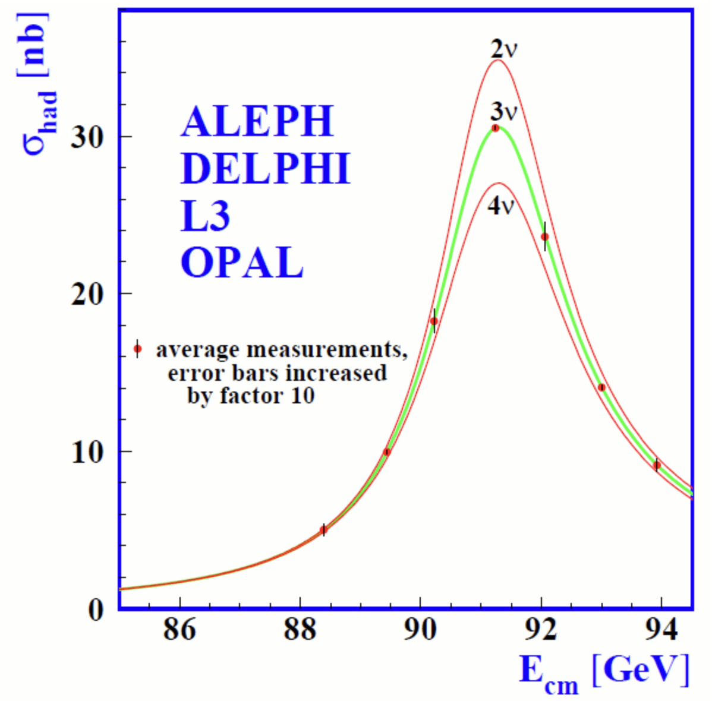

# Before We Begin

## Basic Courses

This lecture requires the basic ideas from three branches of physics:

- special relativity;
- quantum mechanics;
- classical field theory.

The materials of the corresponding courses are available at [teach-in.ru](https://teach-in.ru/).

## Natural Units

We set

$$
\hbar=c=1.
$$

:::: {.columns}

::: {.column width="58%"}

Then

$$
[E]=[m]=[L]^{-1}=[t]^{-1},
$$

$$
E^2=\mathbf p^2+m^2,
\qquad
E=\omega,
\qquad
ƛ=\frac{1}{p}
\qquad
t\sim\frac{1}{E}.
$$

:::

::: {.column width="42%"}

Useful conversions:

$$
\hbar c=197.327~\mathrm{MeV\,fm},
$$

$$
1~\mathrm{GeV}^{-1}=0.197~\mathrm{fm},
$$

$$
1~\mathrm{fm}=5.07~\mathrm{GeV}^{-1},
$$

$$
1~\mathrm{s}=1.52\cdot10^{24}~\mathrm{GeV}^{-1}.
$$

:::

::::

# 1. Matter

## What Is Ordinary Matter Made Of?



# 2. Interactions

## How Do Particles Interact? {#interaction-gallery}



## Force Carriers

The fundamental interactions are described by the exchange of field quanta —
**bosons**.

| Interaction | Carrier | Spin |
|---|---:|---:|
| electromagnetic | photon $\gamma$ | $1$ |
| weak | $W^\pm$, $Z$ | $1$ |
| strong | gluons $g$ | $1$ |

Gravity is not included in the Standard Model of particle physics.

# 3. Classification of Particles

## Fermions and Bosons



# 4. The Standard Model

## Particles and the Three Pillars of the Model



## Particles and Fields

The fundamental objects are **quantum fields**:

- lepton and quark fields are fermionic;
- the fields of the force carriers and the Higgs field are bosonic.

A particle is a quantum of excitation of the corresponding field.

$$
\text{real particle:}\quad E^2=\mathbf p^2+m^2.
$$

The internal lines of the diagrams describe virtual states, for which in general

$$
E^2\ne\mathbf p^2+m^2.
$$

## A Field as a System of Oscillators

::: {.nh-statement size="xxl" weight="bold"}

A field can be represented as an infinite system of coupled quantum
oscillators — one at each point of space.

:::

## A Particle as an Excitation of a Field

::: {.nh-statement size="xxl" weight="bold"}

A particle is a localized excitation of a field, capable of carrying energy,
momentum, and quantum numbers.

:::

## Analogy: Coupled Oscillators



# 5. What We Know About Neutrinos

## Electric Charge

Theoretically, in the minimal Standard Model

$$
q_\nu=0.
$$

But experiment must check whether the neutrino has a very small charge.

:::: {.columns}

::: {.column width="50%"}

Scattering on electrons:

$$
\frac{d\sigma}{dT}\propto\frac{q_\nu^2}{T^2}
\quad\Longrightarrow\quad
|q_\nu|\lesssim10^{-12}e.
$$

:::

::: {.column width="50%"}

Electric neutrality of matter:

$$
n\to p+e^-+\bar\nu_e
$$

gives constraints down to

$$
|q_\nu|\lesssim10^{-21}e.
$$

:::

::::

## Spin

:::: {.columns}

::: {.column width="45%"}

The neutrino is a fermion with spin

$$
s=\frac12.
$$

The projection of the spin onto a chosen axis takes two values:

$$
S_z=\pm\frac{\hbar}{2}.
$$

We will discuss the helicity and polarization of the neutrino in Lecture 03.

:::

::: {.column width="55%"}



:::

::::

## Flavors

:::: {.columns}

::: {.column width="58%"}

Flavor is a quantum number that distinguishes three types of neutrinos:

- $\nu_e$ — electron neutrino, 1956;
- $\nu_\mu$ — muon neutrino, 1962;
- $\nu_\tau$ — tau neutrino, 2000.

In the weak charged current, the neutrino flavor is tied to the charged lepton:

$$
\nu_e+n\to p+e^-,
\qquad
\nu_\mu+n\not\to p+e^-.
$$

The measurement of the $Z$-boson width implies that there are three light **active** neutrinos.

:::

::: {.column width="42%"}

{.slide-media .media-height-md fig-alt="The Z-boson width allows three light active neutrinos"}


:::

::::

## Mass States

Flavor states do not have a definite mass:

$$
|\nu_\alpha\rangle
=
\sum_{i=1}^{3}U_{\alpha i}^*|\nu_i\rangle,
\qquad
\alpha=e,\mu,\tau.
$$

- $\nu_e,\nu_\mu,\nu_\tau$ are produced and detected in the weak interaction;
- $\nu_1,\nu_2,\nu_3$ propagate with definite masses
  $m_1,m_2,m_3$;
- antineutrinos form the corresponding conjugate states.

It is precisely the mismatch between the flavor and mass bases that leads to oscillations.

## Neutrino Interactions



- Neutrinos take part in the weak and gravitational interactions.
- At accessible
energies, the gravitational interaction of an individual neutrino is negligibly small.

## Cross Section and Interaction Length

The probability of traveling a distance $x$ without interacting is

$$
P_0(x)=e^{-x/\lambda}.
$$

The mean interaction length:

$$
\lambda=\frac{1}{n\sigma},
$$

where $\sigma$ is the cross section and $n$ is the concentration of targets. For atoms

$$
n_{\rm atom}=\frac{\rho N_A}{A},
\qquad
n_e=Z\frac{\rho N_A}{A}.
$$

$\rho$ is the density of the medium, $A$ is the molar mass, and $Z$ is the number of electrons in the atom.

## Example: Solar Neutrino

For $E_\nu\sim1~\mathrm{MeV}$ let us estimate the scattering on electrons in the Sun:

$$
\sigma(\nu_e e\to\nu_e e)\sim10^{-44}~\mathrm{cm}^2,
$$

$$
n_e\sim
\rho N_A\frac{Z}{A}
\sim7\cdot10^{23}~\mathrm{cm}^{-3}.
$$

Hence

$$
\lambda_\nu
\sim\frac{1}{n_e\sigma}
\sim10^{20}~\mathrm{cm}
\sim10^9R_\odot.
$$

The Sun is practically transparent to neutrinos with energies of order MeV.

## Example: Neutrino with an Energy of 1 PeV

For passage through the Earth:

$$
\sigma(\nu N)\sim10^{-33}~\mathrm{cm}^2,
$$

$$
n_N\sim\rho N_A
\sim
5.5~\frac{\mathrm{g}}{\mathrm{cm}^3},
6.02\cdot10^{23}~\mathrm{g}^{-1}
\sim3.3\cdot10^{24}~\mathrm{cm}^{-3}.
$$

$$
\lambda_\nu
\sim\frac{1}{n_N\sigma}
\sim3\cdot10^8~\mathrm{cm}
\sim3000~\mathrm{km}.
$$

At energies of order PeV, the Earth is already opaque to a significant fraction of neutrinos.

## Spatial Parity

The parity transformation reflects space:

$$
P:\quad \mathbf r\to-\mathbf r.
$$

The weak interaction does not conserve parity: it singles out left-handed chiral
fermions,

$$
J_L^\mu
=
\bar\psi\gamma^\mu\frac{1-\gamma^5}{2}\psi.
$$

This is reflected directly in the gauge group

$$
SU(2)_L\times U(1)_Y.
$$

The experimental discovery of parity violation is the topic of Lecture 02.

## Neutrinos in the Weak Interaction

In the weak charged current, the three neutrinos form pairs with charged leptons:

$$
\begin{pmatrix}\nu_e\\e\end{pmatrix}_L,
\qquad
\begin{pmatrix}\nu_\mu\\\mu\end{pmatrix}_L,
\qquad
\begin{pmatrix}\nu_\tau\\\tau\end{pmatrix}_L.
$$

If neutrinos were considered massless, these three flavor states could be
treated independently.

But oscillations show that:

$$
\Delta m_{ij}^2\ne0.
$$

## The Standard Model with Neutrino Masses



## Mixing of Lepton Generations

The charged weak current contains the Pontecorvo–Maki–Nakagawa–Sakata matrix:

$$
\mathcal L_{\rm CC}
=
-\frac{g}{\sqrt2}
\sum_{\alpha,i}
\bar\ell_{\alpha L}\gamma^\mu
U_{\alpha i}\nu_{iL}W^-_\mu
+\mathrm{h.c.}
$$

$$
U_{\rm PMNS}
=
\begin{pmatrix}
U_{e1}&U_{e2}&U_{e3}\\
U_{\mu1}&U_{\mu2}&U_{\mu3}\\
U_{\tau1}&U_{\tau2}&U_{\tau3}
\end{pmatrix},
\qquad
U^\dagger U=1.
$$

The non-diagonal nature of $U_{\rm PMNS}$ means that the flavor changes as the neutrino
propagates.

# Neutrino Oscillations

## Two Flavors and Two Mass States

In the simplest model

$$
\begin{pmatrix}
|\nu_e\rangle\\
|\nu_\mu\rangle
\end{pmatrix}
=
\begin{pmatrix}
\cos\theta&-\sin\theta\\
\sin\theta&\cos\theta
\end{pmatrix}
\begin{pmatrix}
|\nu_1\rangle\\
|\nu_2\rangle
\end{pmatrix}.
$$

Each mass state acquires its own phase as it propagates:

$$
|\nu_i(L)\rangle
=
e^{-i\phi_i(L)}|\nu_i(0)\rangle.
$$

The observed oscillation is the result of interference of these phases.

## Probabilities in Vacuum

For two flavors

$$
P(\nu_e\to\nu_e)
=
1-\sin^2 2\theta\,
\sin^2\!\left(\frac{\Delta m^2L}{4E}\right),
$$

$$
P(\nu_e\to\nu_\mu)
=
\sin^2 2\theta\,
\sin^2\!\left(\frac{\Delta m^2L}{4E}\right).
$$

Practical form of the phase:

$$
\frac{\Delta m^2L}{4E}
=
1.267\,
\frac{\Delta m^2[\mathrm{eV}^2]L[\mathrm{km}]}{E[\mathrm{GeV}]}.
$$

## The Neutrino as a Quantum Chameleon



## Experimental Evidence

Oscillations have manifested themselves in independent classes of experiments:

- the deficit of solar electron neutrinos;
- the anomaly in the ratio of atmospheric $\nu_\mu/\nu_e$;
- the disappearance of reactor antineutrinos;
- the disappearance and appearance of flavors in accelerator beams;
- the dependence of the probabilities on the ratio $L/E$.

A joint description of all these data requires nonzero

$$
\Delta m_{ij}^2.
$$

## The Solar Neutrino Flux — Without a Model of the Sun {#solar-neutrino-flux .solar-flux-slide}

:::: {.solar-flux-layout}

::: {.solar-flux-card .solar-flux-source}
[**1. Two neutrinos per cycle**]{.solar-flux-step-title}

However the individual reactions proceed, their overall result is:

$$
4p\to{}^4\mathrm{He}+2e^++2\nu_e,
\qquad n_\nu=2.
$$

The energy release is known from the mass difference

$$
Q\simeq26.7~\mathrm{MeV}.
$$
:::

::: {.solar-flux-card .solar-flux-observation}
[**2. The energy flux is measured at the Earth**]{.solar-flux-step-title}

The solar constant is the luminosity divided by the area of a sphere:

$$
F_\odot\equiv\frac{L_\odot}{4\pi d^2}
=1.361~\mathrm{kW\,m^{-2}}.
$$
:::

::: {.solar-flux-card .solar-flux-calculation}
[**3. We count the number of cycles — and of neutrinos**]{.solar-flux-step-title}

First, let us convert the "price" of one cycle into joules:

$$
Q=26.7\times10^6\times1.602\times10^{-19}
=4.28\times10^{-12}~\mathrm{J}.
$$

The number of completed cycles per second per unit area:

$$
\frac{\dot N_{\rm cycle}}{4\pi d^2}
=\frac{F_\odot}{Q}
=\frac{1.361\times10^3}{4.28\times10^{-12}}
=3.18\times10^{14}~\mathrm{m^{-2}\,s^{-1}}.
$$

Each cycle yields two neutrinos:

$$
\Phi_\nu=\frac{2F_\odot}{Q}
=6.36\times10^{14}~\mathrm{m^{-2}\,s^{-1}}
=6.36\times10^{10}~\mathrm{cm^{-2}\,s^{-1}}
\approx\boxed{6.5\times10^{10}~\mathrm{cm^{-2}\,s^{-1}}}.
$$
:::

::::

::: {.nh-box tone="warning" size="md"}
**This is the strength of the estimate:** one needs neither the temperature and density of the solar core, nor the reaction cross sections, nor the branching fractions of the chain. All that is needed is the measured $F_\odot$, the law of energy conservation, and the fact that two neutrinos are produced per ${}^4\mathrm{He}$ nucleus.
:::

::: {.nh-text tone="muted" size="sm"}
The accuracy of the estimate is a few percent: a small part of $Q$ is carried away by the neutrinos themselves. The historical deficit was observed in the flux of $\nu_e$: part of it turned into $\nu_\mu$ and $\nu_\tau$ along the way.
:::

## Solar Neutrino Experiments



::: {.solar-flux-card}

The results of solar neutrino experiments showed that the flux of electron neutrinos at the Earth is approximately three times smaller than expected. This was the first convincing evidence of neutrino oscillations.

:::

## Atmospheric neutrinos {#atmospheric-neutrino-ratio}

:::: {.columns}

::: {.column width="45%"}

Cosmic rays produce pions in the atmosphere:

$$
p+A\to\text{hadrons}\supset\pi^\pm,
$$

$$
\pi^+\to\mu^++\nu_\mu,
\qquad
\mu^+\to e^++\nu_e+\bar\nu_\mu.
$$

Without oscillations, at low energies one expects approximately

$$
\frac{\nu_\mu+\bar\nu_\mu}{\nu_e+\bar\nu_e}\simeq2.
$$

The experiment showed that the ratio depends on the distance traveled and on the energy.

:::

::: {.column width="55%"}



:::

::::

# 6. What we do not yet know

# Is CP symmetry violated?

## What CP violation means

Charge conjugation replaces a particle with its antiparticle:

$$
C:\quad \text{particle}\to\text{antiparticle}.
$$

Parity reflects the coordinates:

$$
P:\quad\mathbf r\to-\mathbf r.
$$

CP violation in oscillations would mean

$$
P(\nu_\alpha\to\nu_\beta)
\ne
P(\bar\nu_\alpha\to\bar\nu_\beta).
$$

For example,

$$
P(\nu_\mu\to\nu_e)
\ne
P(\bar\nu_\mu\to\bar\nu_e).
$$

## CP phase in the mixing matrix

::: {.pmns-factorization}

$$
U_{\rm PMNS}
=
\underbrace{
\begin{pmatrix}
1&0&0\\0&c_{23}&s_{23}\\0&-s_{23}&c_{23}
\end{pmatrix}}_{\text{atmospheric mixing}}
\underbrace{
\begin{pmatrix}
c_{13}&0&s_{13}e^{-i\delta_{\rm CP}}\\
0&1&0\\
-s_{13}e^{i\delta_{\rm CP}}&0&c_{13}
\end{pmatrix}}_{\text{reactor mixing and }\delta_{\rm CP}}
\underbrace{
\begin{pmatrix}
c_{12}&s_{12}&0\\-s_{12}&c_{12}&0\\0&0&1
\end{pmatrix}}_{\text{solar mixing}}.
$$

:::

Here

$$
s_{ij}=\sin\theta_{ij},
\qquad
c_{ij}=\cos\theta_{ij}.
$$

The phase $\delta_{\rm CP}$ is responsible for CP-odd effects in oscillations.

## Mass ordering

From solar data it is known that

$$
m_2>m_1,
\qquad
\Delta m_{21}^2>0.
$$

But the sign of the atmospheric mass-squared difference still has to be determined:

:::: {.columns}

::: {.column width="50%"}

**Normal ordering**

$$
m_1<m_2<m_3.
$$

:::

::: {.column width="50%"}

**Inverted ordering**

$$
m_3<m_1<m_2.
$$

:::

::::



## Dirac or Majorana?

| | Dirac fermion | Majorana fermion |
|---|---|---|
| Particle and antiparticle | different | identical |
| Example | $e^-\ne e^+$ | neutrino — possibly |
| Lepton number is conserved | yes | not necessarily |

For an electrically neutral neutrino, both options are possible:

$$
\nu\ne\bar\nu
\quad\text{or}\quad
\nu=\bar\nu.
$$

Observation of neutrinoless double beta decay

$$
(A,Z)\to(A,Z+2)+2e^-
$$

would be evidence for the Majorana nature of the neutrino mass.

# Absolute mass scale

## Mass of the lightest neutrino

Oscillations measure the mass-squared differences:

$$
\Delta m_{ij}^2=m_i^2-m_j^2.
$$

They do not determine the overall shift of the mass spectrum.

```{=html}
<div class="absolute-mass-question">
  <div class="question-mark">?</div>
  <div>
    <p><strong>We do not yet know the mass of the lightest neutrino.</strong></p>
    <p class="muted">The absolute scale requires kinematic measurements,
    cosmological observations, or processes that violate lepton number.</p>
  </div>
</div>
```

# Neutrinos as a tool

## What can be studied with neutrinos

:::: {.instrument-grid}

::: {.instrument-card}
**New physics**<br>
rare interactions and unknown particles
:::

::: {.instrument-card}
**The structure of the proton**<br>
elastic, inelastic, and deep inelastic scattering
:::

::: {.instrument-card}
**The Sun and stars**<br>
reactions in regions inaccessible to photons
:::

::: {.instrument-card}
**Supernovae and the extreme Universe**<br>
neutrino telescopes
:::

::: {.instrument-card}
**Nuclear reactors**<br>
remote monitoring
:::

::: {.instrument-card}
**The Earth and the Universe**<br>
tomography, geoneutrinos, and cosmology
:::

::::

# 7. Course map

## Neutrino theory

:::: {.roadmap-grid}

::: {.roadmap-card}
Parity, spin, and polarization
:::

::: {.roadmap-card}
Direct determination of the mass
:::

::: {.roadmap-card}
Oscillations in vacuum and in matter
:::

::: {.roadmap-card}
Neutrinos in the Standard Model
:::

::: {.roadmap-card}
Electromagnetic properties and sterile neutrinos
:::

::: {.roadmap-card}
Majorana mass, mixing, and new physics
:::

::::

## Sources, interactions, and detectors

:::: {.roadmap-grid}

::: {.roadmap-card}
Interactions and detection methods
:::

::: {.roadmap-card}
Solar, atmospheric, accelerator, reactor, and geoneutrinos
:::

::: {.roadmap-card}
Relic and ultra-high-energy neutrinos and supernovae
:::

::: {.roadmap-card}
Global data analysis
:::

::: {.roadmap-card}
Neutrino tomography of the Earth
:::

::: {.roadmap-card}
Monitoring of nuclear reactors
:::

::::
