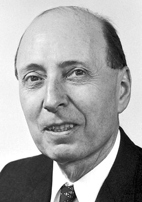
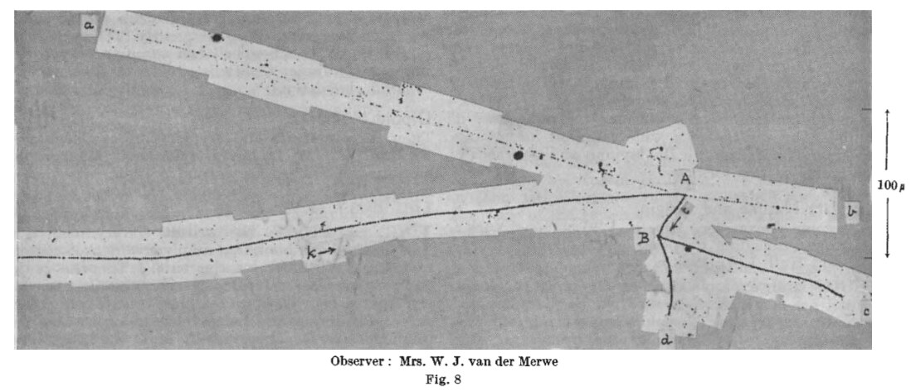
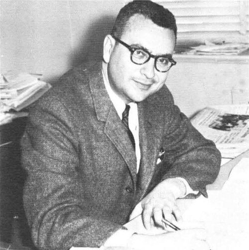
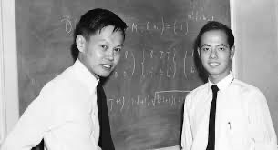
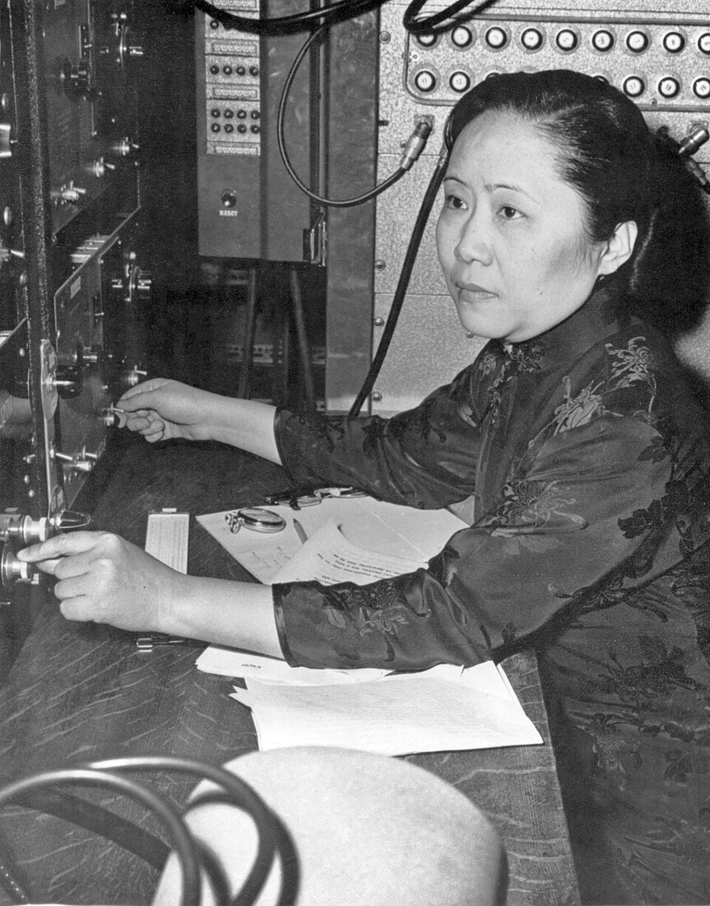
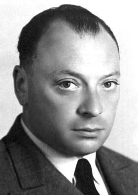
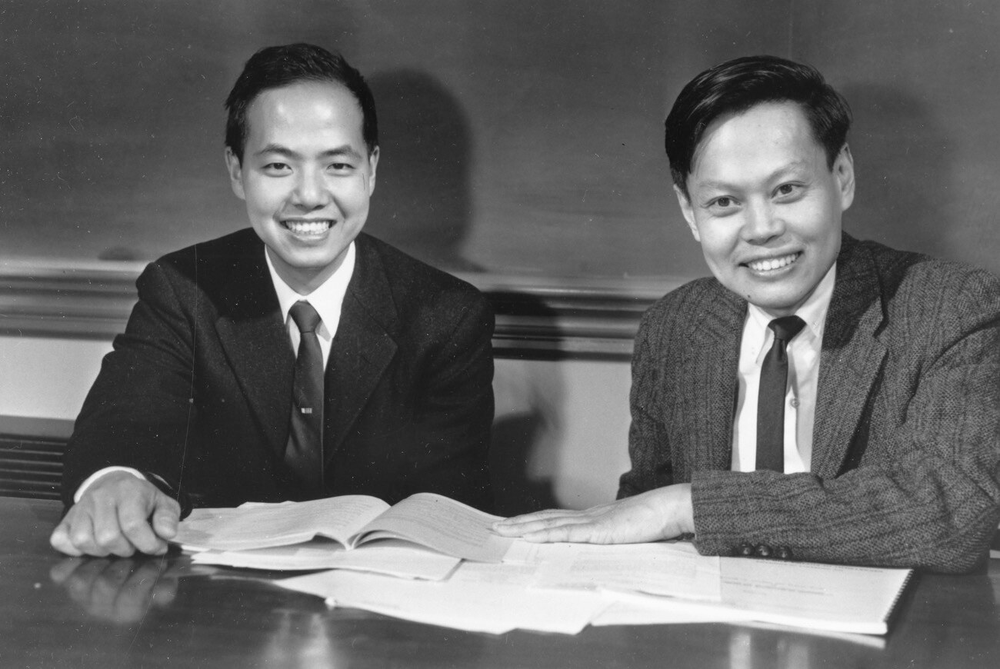

# 1. Parity as a Symmetry

## Space Reflection {#parity-transform}



## Polar and Axial Vectors

Under space reflection

$$
P:\qquad \mathbf r\to-\mathbf r,
\qquad
\mathbf p\to-\mathbf p.
$$

But angular momentum and spin are **axial** vectors:

$$
\mathbf L=\mathbf r\times\mathbf p\to\mathbf L,
\qquad
\mathbf S\to\mathbf S.
$$

Therefore the scalar product

$$
\mathbf S\cdot\mathbf p
\xrightarrow{P}
-\mathbf S\cdot\mathbf p
$$

is odd under $P$. This observation will be the key to the Wu experiment.

## Parity of a Quantum State

If the Hamiltonian is invariant under reflection,

$$
[H,P]=0,
$$

the states can be chosen to be eigenstates of the parity operator:

$$
P\psi(\mathbf r)=\psi(-\mathbf r)=\eta_P\psi(\mathbf r),
\qquad
\eta_P=\pm1.
$$

:::: {.columns}

::: {.column width="50%"}

**Even state**

$$
\psi(-\mathbf r)=+\psi(\mathbf r).
$$

:::

::: {.column width="50%"}

**Odd state**

$$
\psi(-\mathbf r)=-\psi(\mathbf r).
$$

:::

::::

## Why Parity Conservation Was Expected

:::: {.columns}

::: {.column width="67%"}

- In atomic spectroscopy the Laporte rule holds: electric dipole
  transitions change parity.
- In 1927 Wigner linked the $\mathbf r\to-\mathbf r$ symmetry with the quantum
  number of parity.
- Electromagnetic and strong processes confirmed the conservation of $P$.

::: {.nh-box tone="accent" size="md"}

By the mid-1950s, parity conservation was perceived almost as a self-evident
law of nature.

:::

:::

::: {.column width="33%"}

{.portrait .media-height-md fig-alt="Eugene Wigner"}

Eugene Wigner

:::

::::

# 2. The $\tau$–$\theta$ Puzzle

## One Mass — Two Decays

In the early 1950s a positively charged particle with a mass of about
$494~\mathrm{MeV}$ and two decay channels was observed:

:::: {.columns}

::: {.column width="50%"}

$$
\theta^+\to\pi^++\pi^0.
$$

:::

::: {.column width="50%"}

$$
\tau^+\to\pi^++\pi^++\pi^-.
$$

:::

::::

The masses and lifetimes of $\theta^+$ and $\tau^+$ coincided — everything pointed to one
and the same particle, the modern $K^+$.

{.slide-media style="--media-max-height: 520px; --media-margin-top: 0.9rem;" fig-alt="Photograph of a strange particle decay event in a bubble chamber"}

## The Parity Contradiction

The pion has negative intrinsic parity:

$$
\eta_\pi=-1.
$$

For decays in the $S$-wave:

:::: {.columns}

::: {.column width="50%"}

$$
\theta^+\to2\pi,
\qquad
\eta_f=(-1)^2=+1.
$$

:::

::: {.column width="50%"}

$$
\tau^+\to3\pi,
\qquad
\eta_f=(-1)^3=-1.
$$

:::

::::

One particle cannot have both $\eta_P=+1$ and $\eta_P=-1$ if
parity is conserved.

::: {.nh-box tone="warning" size="md" weight="bold"}

Either these are two nearly indistinguishable particles, or the weak interaction violates
spatial parity.

:::

# 3. From a Puzzle to a Testable Hypothesis

## An Idea Considered Almost Unthinkable {.history-story-slide}

:::: {.history-story-grid}

::: {.history-story-person .history-story-gellmann}

{.history-story-photo fig-alt="Murray Gell-Mann"}

**Murray Gell-Mann**

Unable to "prove" the conservation of $P$, he realized early on: this is not a geometric
necessity, but a property of a specific theory.

:::

::: {.history-story-person .history-story-feynman}

{.history-story-photo fig-alt="Richard Feynman"}

**Richard Feynman**

Discussed the hypothesis with Gell-Mann and brought the question to the Rochester Conference.

:::

::: {.history-story-moment .history-story-feshbach}

[**A Week Spent on an Impossible Proof**]{.history-story-title}

Professor Herman Feshbach suggested that students prove parity conservation
by a change of coordinates. Gell-Mann spent about a week and discovered that no such
proof exists — a coordinate transformation by itself does not dictate the laws
of nature.

:::

::: {.history-story-moment .history-story-rochester}

[**1955 → Rochester, 1956**]{.history-story-title}

Gell-Mann and Feynman discussed the violation of $P$, but did not connect it with the
$\tau$–$\theta$ puzzle. At the conference Feynman passed on the idea of his roommate
Marty Block; Yang replied that he and Lee had already considered it — without result.

:::

::: {.history-story-moment .history-story-moscow}

[**Moscow, May 1956: the hall responds with hostility**]{.history-story-title}

Gell-Mann named the violation of $P$ as a possible solution of the $\tau$–$\theta$ puzzle.
From the crowded hall came objections: "This is a violation of Lorentz invariance!" and
"Do the laws depend on rotations?"

**Gell-Mann's answer:** the conservation of $P$ is an empirical fact; there is no fundamental
reason for it.

:::

::::

::: {.nh-box tone="warning" size="md"}

**The main barrier was not mathematical.** Space reflection was mistakenly
perceived as a simple change of coordinates — and therefore as a mandatory symmetry
of any law of nature.

:::

## Lee and Yang: Testing the Weak Interaction

In the summer of 1956, Tsung-Dao Lee and Chen-Ning Yang systematically studied the existing
experiments and noticed:

::: {.nh-box tone="accent" size="lg"}

parity conservation had been well tested for electromagnetic and strong
processes, but not for weak ones.

:::

They proposed specific tests in $\beta$ decay, pion decays, and
muon decays. To test $\beta$ decay, Lee turned to Chien-Shiung Wu.

{.slide-media .lee-yang-1956 fig-alt="Tsung-Dao Lee and Chen-Ning Yang"}

# 4. The Wu Experiment

## Chien-Shiung Wu

:::: {.columns}

::: {.column width="58%"}

Chien-Shiung Wu was one of the leading specialists in $\beta$ decay.

At the end of 1956 her group, together with specialists from the National Bureau of
Standards, carried out an experiment with polarized ${}^{60}\mathrm{Co}$ nuclei.

The experiment was to answer a simple question:

::: {.nh-box tone="danger" size="lg" weight="bold"}

do electrons emerge equally often along and against the nuclear spin?

:::

:::

::: {.column width="42%"}

{.portrait .wu-portrait fig-alt="Chien-Shiung Wu at the experimental apparatus"}

:::

::::

## The Idea of the Experiment



## Why ${}^{60}\mathrm{Co}$

The main $\beta^-$ decay:

$$
{}^{60}_{27}\mathrm{Co}(5^+)
\to
{}^{60}_{28}\mathrm{Ni}^{*}(4^+)+e^-+\bar\nu_e.
$$

After it, the nickel nucleus emits two $\gamma$ quanta:

$$
{}^{60}\mathrm{Ni}^{*}(4^+)
\to
{}^{60}\mathrm{Ni}^{*}(2^+)+\gamma
\to
{}^{60}\mathrm{Ni}(0^+)+2\gamma.
$$

- the angular distribution of the electrons tests parity;
- the anisotropy of the $\gamma$ radiation independently shows the degree of polarization
  of the nuclei.

## Why Millikelvins Are Needed

A magnetic moment in a field has energy

$$
E=-\boldsymbol\mu\cdot\mathbf B,
\qquad
\frac{n_\uparrow}{n_\downarrow}
=
\exp\!\left(\frac{2\mu B}{k_BT}\right).
$$

:::: {.columns}

::: {.column width="50%"}

$$
\mu_B=\frac{e\hbar}{2m_e}
=5.79\cdot10^{-5}\ \mathrm{eV/T},
$$

$$
\frac{\mu_B B}{k_BT}\simeq0.67
\quad (B=1~\mathrm{T},\ T=1~\mathrm K).
$$

Electron spins are comparatively easy to polarize.

:::

::: {.column width="50%"}

$$
\mu_N=\frac{e\hbar}{2m_p}
=3.15\cdot10^{-8}\ \mathrm{eV/T},
$$

$$
\frac{\mu_N B}{k_BT}\simeq3.7\cdot10^{-4}
\quad (B=1~\mathrm{T},\ T=1~\mathrm K).
$$

For nuclei, a temperature of order $10^{-2}~\mathrm K$ is required.

:::

::::

## Adiabatic Demagnetization



## Experimental Setup



## Expected Angular Distribution

For the electrons of $\beta$ decay

$$
W(\theta)
=
1+A\,\mathcal P\,\frac{v}{c}\,f_{\rm bs}\cos\theta,
$$

where

$$
\mathcal P=\frac{\langle I_z\rangle}{I}
$$

is the nuclear polarization, $f_{\rm bs}$ is the backscattering correction, and $A$ is the
asymmetry coefficient.

If parity is conserved, the directions $\mathbf I$ and $-\mathbf I$ are physically
equivalent, and therefore

$$
A=0.
$$

## What Reflection Does

The angle is set by the correlation

$$
\cos\theta
=
\frac{\mathbf I\cdot\mathbf p_e}{I\,p_e}.
$$

Under space reflection

$$
\mathbf I\to\mathbf I,
\qquad
\mathbf p_e\to-\mathbf p_e,
\qquad
\cos\theta\to-\cos\theta.
$$

Consequently,

$$
W(\theta)\xrightarrow{P}W(\pi-\theta).
$$

A nonzero term proportional to $\cos\theta$ means that the mirror process
has a different probability.

## Result {#wu-result}



## The World and Its Mirror Image



::: {.nh-box tone="danger" size="md" align="center" weight="bold"}

The weak interaction distinguishes these two worlds: spatial parity
is violated.

:::

# 5. Verification and Physical Meaning

## "The Experiment Must Be Repeated"

:::: {.columns}

::: {.column width="32%"}

{.portrait .media-height-md fig-alt="Wolfgang Pauli"}

Wolfgang Pauli

:::

::: {.column width="68%"}

The result was so unexpected that many theorists were at first skeptical
of it.

Pauli insisted: the experiment must be repeated and checked by an independent method.

That is exactly what happened almost immediately.

:::

::::

## Independent Check with Muons

In the decay

$$
\pi^+\to\mu^++\nu_\mu
$$

muons are produced polarized. Their polarization can be measured from the asymmetry of
positrons in the subsequent decay

$$
\mu^+\to e^++\nu_e+\bar\nu_\mu.
$$

Leon Lederman, Richard Garwin, and Marcel Weinrich prepared the experiment in less than a
week and in early 1957 confirmed the violation of parity.

::: {.nh-box tone="accent" size="md"}

Two different weak processes gave the same answer.

:::

## What Remained of Parity

| Interaction | Spatial parity |
|---|---:|
| strong | conserved |
| electromagnetic | conserved |
| weak | maximally violated |

In the modern theory the charged weak current contains the left-handed projector:

$$
J_L^\mu
=
\bar\psi\gamma^\mu\frac{1-\gamma^5}{2}\psi.
$$

The index $L$ in the gauge group

$$
SU(2)_L\times U(1)_Y
$$

is a reminder: the weak interaction fundamentally distinguishes left from right.

## How to Explain to Aliens Which Way Is Left?



::: {.nh-box tone="accent" size="sm"}

**A common reference:** polarize ${}^{60}\mathrm{Co}$ nuclei and call "left" the
direction in which more electrons are emitted.

:::

## The 1957 Nobel Prize

:::: {.columns}

::: {.column width="56%"}

{.slide-media style="--media-max-height: 510px;" fig-alt="Tsung-Dao Lee and Chen-Ning Yang"}

:::

::: {.column width="44%"}

Tsung-Dao Lee and Chen-Ning Yang received the Nobel Prize in Physics
"for their penetrating investigation of the so-called parity laws, which has led to important
discoveries regarding the elementary particles."

The discovery came a year after their theoretical work.

::: {.nh-box tone="success" size="md" weight="bold"}

Mirror symmetry is not a universal law of nature.

:::

:::

::::

<!-- exercises:begin (generated by scripts/sync_exercise_slides.py) -->

## Problems for this lecture {#lecture-exercises}

::: {.nh-text size="md"}
:::: {.columns}
::: {.column width="50%"}

- **2.1.** The $\tau$–$\theta$ puzzle
- **2.2.** What does the Wu experiment measure directly?
- **2.3.** Can nuclei be polarized with an ordinary magnet?
- **2.4.** Adiabatic demagnetization
- **2.5.** How can we explain to aliens which side is left?

:::
::: {.column width="50%"}

- **2.6.** Why is it easy to polarize electrons but hard to polarize nuclei?
- **2.7.** Why did the Laporte rule make people confident in parity conservation?
- **2.8.** Why do ${}^{60}\mathrm{Co}$ electrons fly opposite to the nuclear spin?
- **2.9.** The $\pi\to\mu\to e$ chain: two parity violations at once
- **2.10.** What does "maximal" parity violation mean?

:::
::::
:::

::: {.nh-box tone="question"}
[All problems for lecture 02 →](../exercises/02_parity_violation_exercises.qmd) and problems for the seminar · [All course problems](../exercises/index.qmd)
:::

<!-- exercises:end -->
