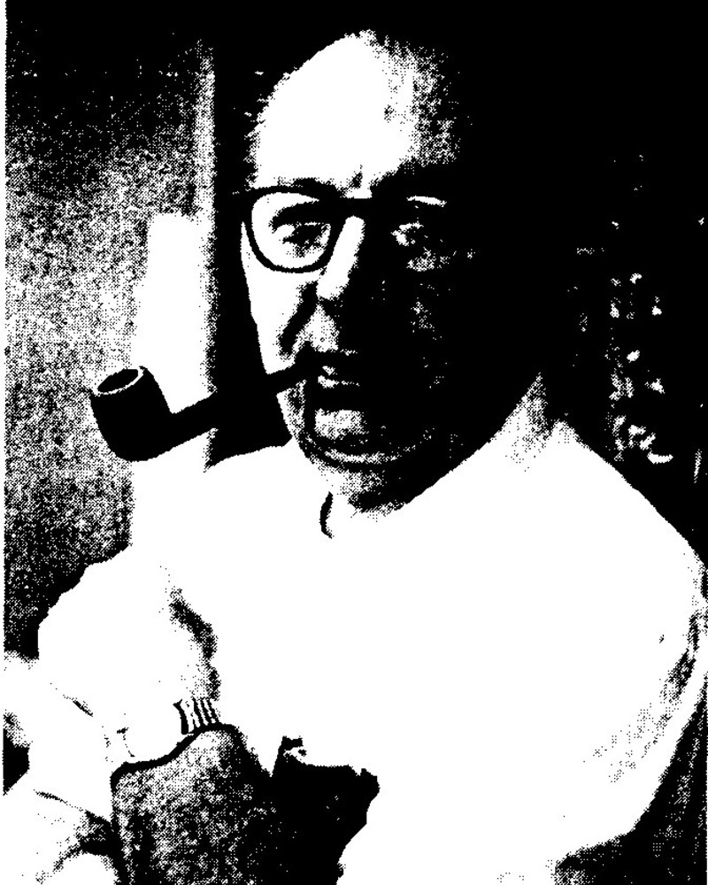
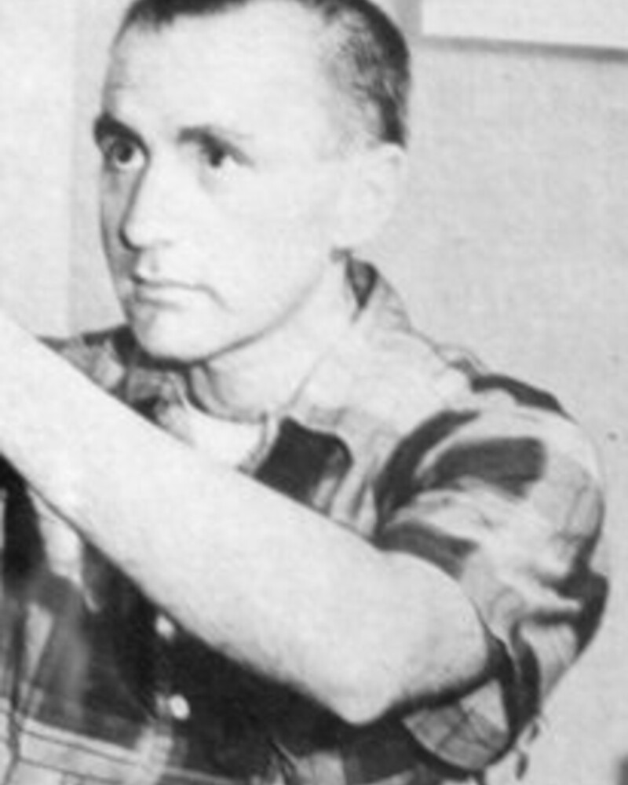
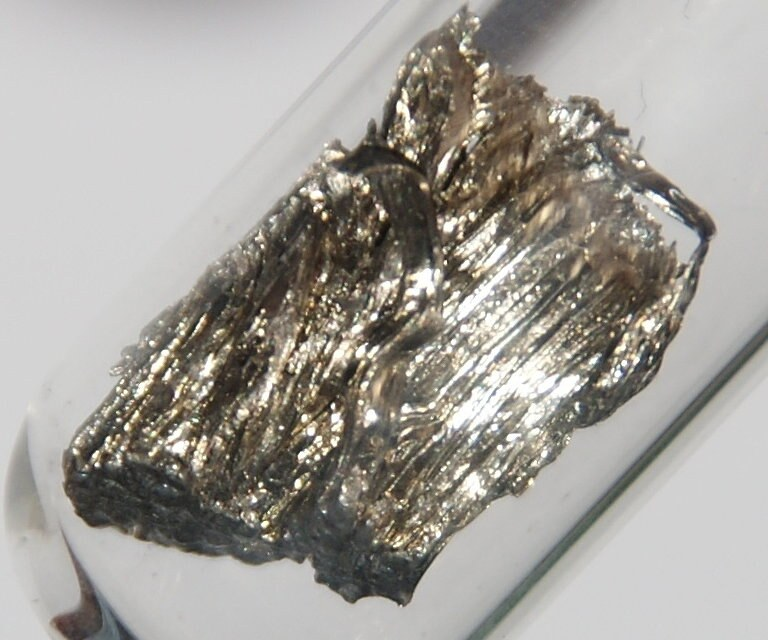
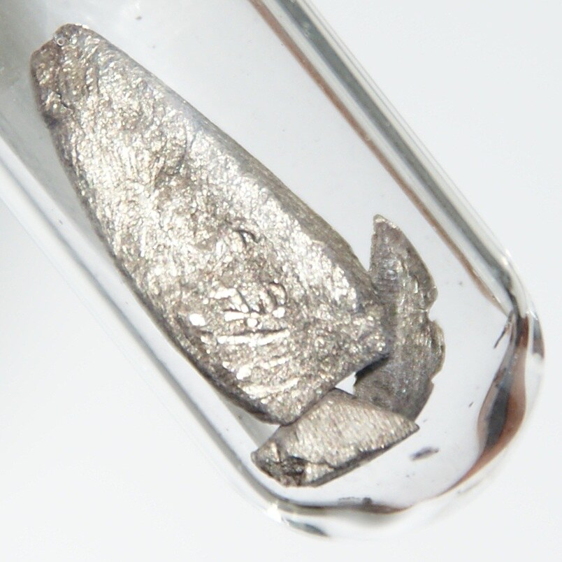

# 1. What Is Helicity

## Projection of the Spin onto the Direction of Motion

For a particle with spin $1/2$ the helicity operator is

$$
\hat{\mathbf S}=\frac{\boldsymbol\sigma}{2},
\qquad
\hat h
=
2\hat{\mathbf S}\cdot\hat{\mathbf p}
=
\boldsymbol\sigma\cdot\hat{\mathbf p},
\qquad
\hat{\mathbf p}=\frac{\mathbf p}{|\mathbf p|}.
$$

:::: {.helicity-pair}

::: {.helicity-card .helicity-card-right}

ν

spin

momentum

**Right-handed helicity state**

$$h=+1$$

:::

::: {.helicity-card .helicity-card-left}

ν

spin

momentum

**Left-handed helicity state**

$$h=-1$$

:::

::::
Helicity answers the question:

::: {.nh-box tone="warning" size="lg" weight="bold"}

are the spin and the momentum directed the same way or opposite ways?

$$
\begin{aligned}
\mathbf S\uparrow\uparrow\mathbf p
&\quad\Longrightarrow\quad h=+1,\\[0.5em]
\mathbf S\uparrow\downarrow\mathbf p
&\quad\Longrightarrow\quad h=-1.
\end{aligned}
$$

:::

## Can Helicity Be Changed? {#frame-change}



## A Massless Particle Cannot Be Overtaken

:::: {.panel-tabset .nh-story-tabs .helicity-story-tabs}

### Massive particle

A massive particle has a rest frame. An observer can first catch up with the particle and then move faster than it.

In the new reference frame the sign of the momentum changes, while the direction of the spin remains the same:

$$
\mathbf p\to-\mathbf p,
\qquad
\mathbf S\to\mathbf S.
$$

Consequently,

$$
h=\boldsymbol\sigma\cdot\hat{\mathbf p}
\quad\longrightarrow\quad -h.
$$

### Massless particle

A massless particle moves with speed $v=1$ in all inertial frames. An inertial observer cannot overtake it and see a momentum directed backward.

Therefore an admissible Lorentz transformation cannot perform

$$
\mathbf p\to-\mathbf p
$$

without changing the physical state itself.

### Conclusion

::: {.helicity-tab-summary}

For $m>0$ the sign of the helicity depends on the reference frame.

For $m=0$ the direction of the momentum cannot be reversed by a transition to another inertial frame, so

$$
\boxed{\text{the helicity of a massless particle is Lorentz-invariant}.}
$$

:::

::::

## Neutrinos Are Almost Massless

:::: {.panel-tabset .nh-story-tabs .helicity-story-tabs}

### Relativistic limit

Neutrinos have mass, but in most experiments their energy is much greater than their rest energy:

$$
E_\nu\gg m_\nu,
\qquad
\beta_\nu\equiv v_\nu\simeq1.
$$

The difference between helicity and chirality is determined by the small ratio

$$
\frac{m_\nu}{E_\nu}\ll1.
$$

### Suppression

A left-handed weak vertex almost always produces a neutrino with $h=-1$. The probability of the opposite helicity is

$$
P_{\rm wrong}
=\frac{1-\beta_\nu}{2}
\simeq
\left(\frac{m_\nu}{2E_\nu}\right)^2.
$$

The amplitude is suppressed as $m_\nu/E_\nu$, and the probability as the square of this ratio.

### Numerical estimate

Take

$$
m_\nu=0.1~\mathrm{eV},
\qquad
E_\nu=1~\mathrm{MeV}=10^6~\mathrm{eV}.
$$

Then

$$
\frac{m_\nu}{2E_\nu}
=\frac{0.1}{2\cdot10^6}
=5\cdot10^{-8},
$$

$$
\boxed{
P_{\rm wrong}\simeq
(5\cdot10^{-8})^2
=2.5\cdot10^{-15}}.
$$

::: {.helicity-tab-summary}

In practice the observed helicity coincides with the chirality selected by the weak interaction.

:::

::::

## Helicity and Chirality Are Not the Same Thing

:::: {.panel-tabset .nh-story-tabs .chirality-tabs}

### Two concepts

::::: {.comparison-grid .chirality-overview}

:::: {.comparison-card}

Helicity

The projection of the spin onto the momentum:

$$
h=\boldsymbol\sigma\cdot\hat{\mathbf p}.
$$

For a massive particle it depends on the reference frame.

::::

:::: {.comparison-card}

Chirality

The projection of the field onto the eigenstates of $\gamma^5$:

$$
P_{L,R}=\frac{1\mp\gamma^5}{2}.
$$

It determines how the field enters the weak interaction.

::::

:::::

::: {.chirality-tab-takeaway}

For $m=0$ chirality and helicity coincide. For $m>0$ they are different characteristics — below one can see how large their difference is.

:::

### Spinor

::: {.chirality-tab-lead}

We work in the **Dirac basis**.

:::

::::: {.chirality-tab-grid .chirality-spinor-grid}

:::: {.chirality-tab-panel}

The two-component spinor $\xi_h$ is an eigenvector of helicity:

$$
(\boldsymbol\sigma\!\cdot\!\hat{\mathbf p})\xi_h=h\xi_h,
\qquad h=\pm1.
$$

::::

:::: {.chirality-tab-panel}

The positive-frequency solution of the Dirac equation:

$$
u_h(\mathbf p)=
\begin{pmatrix}
a\,\xi_h\\[3pt]
h b\,\xi_h
\end{pmatrix},
$$

$$
a=\sqrt{E+m},\qquad
b=\sqrt{E-m},\qquad
ab=p.
$$

::::

:::::

::: {.chirality-tab-takeaway}

The sign $h$ appears only in the lower component: this is exactly why the left and right projectors will act differently on the two helicity states.

:::

### Matrices

::: {.chirality-tab-lead}

In the Dirac basis chirality does not coincide with the "upper" or "lower" half of the four-component spinor.

:::

::::: {.chirality-tab-grid}

:::: {.chirality-tab-panel}

$$
\gamma_D^0=
\begin{pmatrix}I&0\\0&-I\end{pmatrix},
\qquad
\gamma_D^5=
\begin{pmatrix}0&I\\I&0\end{pmatrix},
$$

$$
I\equiv I_{2\times2}.
$$

::::

:::: {.chirality-tab-panel}

$$
P_{L,R}=\frac{1\mp\gamma_D^5}{2}
=\frac12
\begin{pmatrix}
I&\mp I\\
\mp I&I
\end{pmatrix}.
$$

$$
P_L+P_R=1,
\qquad
P_LP_R=0.
$$

::::

:::::

::: {.chirality-tab-takeaway}

$P_L$ and $P_R$ select the eigenstates of $\gamma^5$ with eigenvalues $-1$ and $+1$.

:::

### Projectors

::: {.chirality-tab-lead}

Now let us act with the projectors on the state with **definite helicity** $h$.

:::

::::: {.chirality-tab-grid}

:::: {.chirality-tab-panel}

$$
P_Lu_h=\frac{a-hb}{2}
\begin{pmatrix}\xi_h\\-\xi_h\end{pmatrix},
$$

$$
P_Ru_h=\frac{a+hb}{2}
\begin{pmatrix}\xi_h\\ \xi_h\end{pmatrix}.
$$

::::

:::: {.chirality-tab-panel}

Since

$$
u_h^\dagger u_h=a^2+b^2=2E,
$$

the fraction of the $X$-chiral component is

$$
f_X(h)\equiv
\frac{\|P_Xu_h\|^2}{\|u_h\|^2},
\qquad X=L,R.
$$

::::

:::::

::: {.chirality-tab-takeaway}

It remains to compute the norms of the two projections and divide them by the norm of the original spinor.

:::

### Calculation

::: {.chirality-tab-lead}

We set $\xi_h^\dagger\xi_h=1$ and use
$u_h^\dagger u_h=a^2+b^2=2E$.

:::

::::: {.chirality-tab-grid .chirality-computation-grid}

:::: {.chirality-tab-panel}

**1. Norms of the projections**

$$
\begin{aligned}
\|P_Lu_h\|^2
&=\frac{(a-hb)^2}{4}
\left(\|\xi_h\|^2+\|-\xi_h\|^2\right)\\
&=\frac{(a-hb)^2}{2},\\[5pt]
\|P_Ru_h\|^2
&=\frac{(a+hb)^2}{2}.
\end{aligned}
$$

::::

:::: {.chirality-tab-panel}

**2. Expanding the square**

$$
\begin{aligned}
(a\mp hb)^2
&=a^2+b^2\mp2hab\\
&=2E\mp2hp\\
&=2E(1\mp h\beta),
\end{aligned}
$$

$$
ab=p,
\qquad
\beta=\frac{p}{E}.
$$

::::

:::::

**3. Dividing by the norm of the original spinor**

$$
\boxed{
f_{L,R}(h)=\frac{(a\mp hb)^2}{4E}
=\frac{1\mp h\beta}{2}},
\qquad \beta=\frac{p}{E}.
$$

::: {.chirality-tab-takeaway}

The upper sign corresponds to $L$, the lower to $R$.

:::

### Probabilities

::: {.chirality-prob-explain}

::::: {.chirality-prob-row}

:::: {.chirality-prob-card}

What does $f_X(h)$ mean?

$f_X(h)$ is the fraction of the norm of the spinor with fixed helicity $h$ that is selected by the chiral projector $P_X$.

In a weak vertex of type $X$ the amplitude contains $P_Xu_h$, so the rate of production or detection of the state $h$ is proportional to $f_X(h)$.

::::

:::: {.chirality-prob-card}

Why is this a probability?

For fixed chirality

$$
f_X(-1)+f_X(+1)=1.
$$

Consequently, after normalization over the two possible helicities

$$
\boxed{P(h\mid X)=f_X(h)}.
$$

::::

:::::

::: {.chirality-neutrino-result}

**A neutrino from a left-handed weak vertex:**

$$
P(h=-1\mid L)=\frac{1+\beta}{2},
\qquad
P(h=+1\mid L)=\frac{1-\beta}{2}
\simeq\frac{m^2}{4E^2}.
$$

For $E\gg m$ almost all neutrinos have $h=-1$, and the admixture of the "wrong" helicity is suppressed as $m^2/E^2$.

:::

:::

::::

## How to Determine the Direction of the Neutrino Spin?

This is not simple:

- the electric charge is zero;
- the magnetic moment is extremely small;
- the interaction probability is small;

::: {.nh-box tone="warning" size="lg" weight="bold"}

We need a process in which the neutrino helicity leaves a measurable trace in other processes.

:::

# 2. The Masterful Goldhaber–Sunyar–Grodzins Experiment

## Goldhaber — Sunyar — Grodzins

In 1958 Maurice Goldhaber, Andrew Sunyar and Lee Grodzins proposed measuring the neutrino helicity through a sequence of two quantum transitions.

:::: {.experiment-team}

::: {.team-card}

{.team-photo fig-alt="Maurice Goldhaber"}

**Maurice Goldhaber**

:::

::: {.team-card}

{.team-photo fig-alt="Andrew Sunyar in 1970"}

**Andrew Sunyar**

:::

::: {.team-card}

{.team-photo fig-alt="Lee Grodzins while working on the measurement of the neutrino helicity in 1957"}

**Lee Grodzins**

:::

::::

Photos: lecture archive · Brookhaven Bulletin · MIT News / New York Daily News

::: {.nh-box tone="accent" size="md"}

The idea: to make the nucleus and the photon "remember" in turn the projection of the neutrino spin.

:::

## The First Transition: Electron Capture

:::: {.panel-tabset .nh-story-tabs .helicity-story-tabs}

### Reaction

Consider electron capture

$$
A(0)+e^-\longrightarrow B^*(1)+\nu_e.
$$

The initial nucleus has spin $0$, and the daughter nucleus is produced in an excited state with spin $1$.

::: {.helicity-tab-summary}

In the final state the projection of angular momentum is shared between the nucleus $B^*$ and the neutrino.

:::

### Spins

::::: {.helicity-quantum-grid}

:::: {.helicity-quantum-card}

**Initial nucleus**

$$J_A=0$$

::::

:::: {.helicity-quantum-card}

**Electron in the \(K\) shell**

$$J_e=\frac12$$

::::

:::: {.helicity-quantum-card}

**Excited nucleus**

$$J_{B^*}=1$$

::::

:::: {.helicity-quantum-card}

**Neutrino**

$$S_\nu=\frac12$$

::::

:::::

### Conservation of angular momentum

Since the initial nucleus carries no angular momentum,

$$
\mathbf J_{e}
=
\mathbf J_{B^*}+\mathbf S_\nu.
$$

After choosing the axis along the neutrino momentum, this vector equality turns into a relation between projections:

$$
m_e=m_{B^*}+m_\nu.
$$

::: {.helicity-tab-summary}

By measuring the spin projection $B^*$, one can reconstruct the projection of the neutrino spin.

:::

::::

## Who Remembers the Neutrino Spin {#spin-tagging}



## Addition of Spin Projections {.spin-projection-slide}

Let us direct the $z$ axis along the neutrino momentum and use
$m_e=m_{B^*}+m_\nu$:

| $m_e$ | $m_{B^*}$ | $m_\nu$ | $h_\nu$ |
|---:|---:|---:|:---|
| $+\tfrac12$ | $0$ | $+\tfrac12$ | $+1$ |
| $+\tfrac12$ | $+1$ | $-\tfrac12$ | $-1$ |
| $-\tfrac12$ | $0$ | $-\tfrac12$ | $-1$ |
| $-\tfrac12$ | $-1$ | $+\tfrac12$ | $+1$ |

::: {.nh-box tone="success" size="md"}

In the green rows the measurement $m_{B^*}$ uniquely fixes $h_\nu$; for
$m_{B^*}=0$ two possibilities remain.

:::

::: {.nh-box tone="accent" size="xl" align="center" weight="bold"}

One must measure the projection of the nuclear spin in order to reconstruct the projection of the neutrino spin.

:::

## The Second Transition: The Photon Preserves the Spin Label



## How to Measure the Circular Polarization of a Photon {#photon-analyzer}



## The Problem: Photon Polarization Is Not Yet Helicity



# 3. Resonance as a Kinematic Filter

## Solution: resonant absorption

A resonance can serve as a kinematic filter: the absorber will register
only photons of the required energy. First, let us check whether the emission
and absorption energies coincide for nuclei at rest.

:::: {.panel-tabset .nh-story-tabs .helicity-story-tabs}

### Questions
1. The nucleus $B^*$ emits a photon in the transition $B^*\to B+\gamma$.
The energy difference between the levels is $\Delta E$.
2. Can a free nucleus at rest absorb a photon emitted by an identical nucleus?
$$
B+\gamma\to B^*.
$$
3. What is the photon energy in these two processes?

### Emission

When a photon is emitted, the nucleus receives a recoil momentum. Therefore part of the transition energy
$\Delta E$ is converted into the kinetic energy of the nucleus:

$$
E_\gamma^{\rm em}
\simeq
\Delta E-\frac{(\Delta E)^2}{2M}.
$$

The energy of the emitted photon turns out to be **lower** than the energy of the nuclear transition.

### Absorption

In absorption, the photon must not only excite the nucleus but also impart a recoil
momentum to it. Therefore the required energy is

$$
E_\gamma^{\rm abs}
\simeq
\Delta E+\frac{(\Delta E)^2}{2M}.
$$

It turns out to be **higher** than the transition energy.

### Mismatch

The difference between the emission and absorption energies is

$$
E_\gamma^{\rm abs}-E_\gamma^{\rm em}
\simeq\frac{(\Delta E)^2}{M}.
$$

Consequently,

$$
E_\gamma^{\rm em}<E_\gamma^{\rm abs}.
$$

::: {.helicity-tab-summary}

A free nucleus at rest cannot resonantly absorb a photon emitted by an identical
nucleus: the recoil energy gets in the way.

:::

::::

## The filter selects the geometry

:::: {.panel-tabset .nh-story-tabs .helicity-story-tabs .resonance-geometry-tabs}

### Electron capture

Consider the selected capture branch of an atom at rest:

$$
A+e^-\longrightarrow B^*+\nu_e.
$$

Let $Q$ denote the energy remaining after subtracting the rest energies and
the internal energy of the selected level $B^*$. Neglecting the momentum of the bound
electron and the neutrino mass, we obtain

$$
\begin{aligned}
\mathbf p_{B^*}&=-\mathbf p_\nu, & p_\nu&\simeq E_\nu,\\
Q&=E_\nu+\frac{p_{B^*}^2}{2M}
 =E_\nu+\frac{E_\nu^2}{2M}.
\end{aligned}
$$

Hence the neutrino energy and the nuclear recoil energy are

$$
\boxed{\begin{aligned}
E_\nu&=\frac{2Q}{1+\sqrt{1+2Q/M}}
      \simeq Q-\frac{Q^2}{2M},\\[2pt]
E_R&\equiv Q-E_\nu
    =\frac{p_\nu^2}{2M}
    \simeq\frac{Q^2}{2M}.
\end{aligned}}
$$

### Photon emission

The ground and excited states of the same nucleus $B$ differ by the internal
energy $\Delta E$; $M$ is the nuclear mass in the recoil term. In the rest frame $B^*$

$$
B^*\longrightarrow B+\gamma,
\qquad
E_{\rm int}(B^*)-E_{\rm int}(B)=\Delta E,
$$

$$
\begin{aligned}
\mathbf 0=\mathbf p_B+\mathbf p_\gamma,
\qquad p_B=p_\gamma=E_\gamma,\\
M+\Delta E
=\sqrt{M^2+p_B^2}+E_\gamma.
\end{aligned}
$$

Solving this equation for $E_\gamma$, we obtain

$$
\boxed{\begin{aligned}
E_\gamma^{\rm em}
&=\frac{\Delta E\,(2M+\Delta E)}{2(M+\Delta E)},\\[3pt]
E_\gamma^{\rm em}
&\simeq \Delta E-\frac{(\Delta E)^2}{2M},
\qquad \Delta E\ll M.
\end{aligned}}
$$

### Doppler shift

After electron capture the nucleus $B^*$ is moving. Therefore, in the rest frame of the absorber,

$$
E_\gamma\simeq E_\gamma^{\rm em}
\left(1+\mathbf v_{B^*}\!\cdot\!\hat{\mathbf p}_\gamma\right)
=E_\gamma^{\rm em}
\left(1+v_{B^*}\cos\theta\right),
$$

where $v_{B^*}=|\mathbf v_{B^*}|$ and $\theta$ is the angle between the source velocity
and the photon momentum. Therefore for $\theta=0$ the energy is increased, and for
$\theta=\pi$ it is decreased.

### Resonant selection

An absorber at rest requires the energy

$$
E_\gamma^{\rm abs}
=\Delta E+\frac{(\Delta E)^2}{2M}.
$$

Its velocity is already fixed by the neutrino energy:

$$
v_{B^*}\simeq\frac{E_\nu}{M}.
$$

Substituting the Doppler shift and requiring the energies to coincide:

$$
\left(\Delta E-\frac{(\Delta E)^2}{2M}\right)
\left(1+\frac{E_\nu}{M}\cos\theta_{\rm res}\right)
\simeq
\Delta E+\frac{(\Delta E)^2}{2M}.
$$

::: {.small}

To first order in $1/M$:

$$
\frac{\Delta E\,E_\nu}{M}\cos\theta_{\rm res}
\simeq\frac{(\Delta E)^2}{M},
\qquad
\boxed{\cos\theta_{\rm res}\simeq\frac{\Delta E}{E_\nu}}.
$$

For $E_\nu\simeq\Delta E$ we obtain $\theta_{\rm res}\simeq0$, that is,

$$
\mathbf p_\gamma\parallel\mathbf p_{B^*}
\quad\Longrightarrow\quad
\mathbf p_\gamma\uparrow\downarrow\mathbf p_\nu.
$$

:::

### Velocity and angle

For the main branch of the experiment $E_\nu\simeq\Delta E\simeq0.96\ \mathrm{MeV}$ and
$M\simeq1.42\times10^5\ \mathrm{MeV}$.

::::: {.columns}

:::: {.column width="50%"}

**The neutrino momentum determines the recoil**

$$
\begin{aligned}
v_{B^*}&\simeq\frac{E_\nu}{M}
          \simeq6.7\times10^{-6},\\
E_R&\equiv\frac{p_\nu^2}{2M}
     \simeq\frac{E_\nu^2}{2M}
     \simeq3.2\ \mathrm{eV}.
\end{aligned}
$$

In SI units $v_{B^*}\simeq2.0\ \mathrm{km/s}$.

::::

:::: {.column width="50%"}

**The resonance selects the angle**

$$
\boxed{\cos\theta_{\rm res}\simeq
\frac{\Delta E}{E_\nu}\simeq1},
\qquad \theta_{\rm res}\simeq0.
$$

The photon travels along the recoil direction $B^*$; the line width and thermal motion leave a
narrow cone of directions.

::::

:::::

::: {.helicity-tab-summary}

The velocity is not tuned: the absorber itself selects the suitable angle between
$\mathbf p_{B^*}$ and $\mathbf p_\gamma$.

:::

::::

## The Doppler shift repairs the resonance {#resonance-filter}



## Why the nucleus has time to emit

:::: {.panel-tabset .nh-story-tabs .helicity-story-tabs}

### Thermalization or emission?

::::: {.columns .thermalization-tab}

:::: {.column width="41%"}

At $T=300\ \mathrm K$ the mean thermal energy of the nucleus and the directed recoil
energy after electron capture are

$$
\langle K\rangle_{\rm th}=\frac32k_BT\simeq0.039\ \mathrm{eV},
\qquad
E_R\simeq3.2\ \mathrm{eV}
\simeq80\langle K\rangle_{\rm th}.
$$

The nucleus $B^*$ moves through the crystal. Collisions with lattice atoms change
its momentum and may reorient its spin. What matters for the experiment is which happens
first:

$$
\tau_\gamma
\quad\text{or}\quad
\tau_{\rm slow}.
$$

$\tau_\gamma$ is the photon emission time, $\tau_{\rm slow}$ is the time for losing the
initial direction. Complete thermalization is not required.

::::

:::: {.column width="59%"}



::: {.helicity-tab-summary .thermalization-summary}

$E_R\gg\langle K\rangle_{\rm th}$: the nucleus will inevitably be slowed down.
Will $B^*$ manage to emit a photon sooner?

:::

::::

:::::

### Comparison of times

::::: {.columns .time-compare-tab}

:::: {.column width="53%"}

**Estimate of the time for appreciable slowing down**

After electron capture, the kinematics gives
$v_{B^*}\simeq2.0\times10^3\ \mathrm{m/s}$. For the estimate we assume that the
direction of the momentum changes appreciably after a path of the order of one
interatomic spacing: $\ell_{\rm slow}\sim0.3\text{—}0.4\ \mathrm{nm}$.

$$
\tau_{\rm slow}
\sim\frac{\ell_{\rm slow}}{v_{B^*}}
\sim\frac{0.3\text{—}0.4\ \mathrm{nm}}
{2.0\times10^3\ \mathrm{m/s}}
\simeq0.15\text{—}0.20\ \mathrm{ps}.
$$

::: {.nh-box tone="info" size="sm"}

This is an order-of-magnitude estimate: one interatomic spacing is taken as the path of appreciable
loss of direction, with no microscopic model of the slowing down.

:::

::::

:::: {.column width="47%"}

**Decay of the excited level**

For the level ${}^{152}\mathrm{Sm}^{*}$

$$
\tau_\gamma=(3\pm1)\times10^{-14}\ \mathrm{s}
\simeq0.03\ \mathrm{ps}.
$$

This is roughly seven times shorter than the time for appreciable slowing down:
$\tau_{\rm slow}/\tau_\gamma\sim7$.

For exponential decay, the probability of emitting a photon **before** appreciable
slowing down is

$$
P_{\rm emit}
=1-\exp\!\left(-\frac{\tau_{\rm slow}}{\tau_\gamma}\right)
\simeq1-e^{-7}\simeq0.999.
$$

::::

:::::

::: {.helicity-tab-summary}

Almost all excited nuclei emit a photon before appreciable loss of the direction
of the recoil. The resonance preserves information about the kinematics of electron capture.

:::

### Nuclear scheme

The experiment uses a chain of two transitions:

$$
{}^{152m}\mathrm{Eu}(0^-)+e^-
\longrightarrow
{}^{152}\mathrm{Sm}^{*}(1^-)+\nu_e,
$$

$$
{}^{152}\mathrm{Sm}^{*}(1^-)
\longrightarrow
{}^{152}\mathrm{Sm}(0^+)+\gamma.
$$

The first transition creates a moving excited nucleus with spin $1$ and
fixes the direction of the recoil. The second transition occurs within
$\tau_\gamma\simeq0.03\ \mathrm{ps}$: the photon carries away the spin label, and its
Doppler shift still depends on the direction of motion of the nucleus.

::: {.nh-box tone="success" size="lg" align="center" weight="bold"}

The short lifetime of the level turns the spectroscopic resonance into a
kinematic direction filter.

:::

### Source and absorber

:::: {.material-pair}

::: {.material-card}

{fig-alt="Europium metal"}

**${}^{152m}\mathrm{Eu}$** — electron-capture source

:::

::: {.material-arrow}

$$
\Longrightarrow
$$

:::

::: {.material-card}

{fig-alt="Samarium metal"}

**${}^{152}\mathrm{Sm}$** — resonant absorber

:::

::::

For resonant absorption the same transition in
${}^{152}\mathrm{Sm}$ is used: the source produces photons, and the samarium at rest serves as a
narrow energy filter.

::::

## Let us assemble the setup {#experiment-chain}

<!-- experiment-chain-revision: 2026-08-16-6 -->


## What is actually compared

:::: {.panel-tabset .nh-story-tabs .helicity-story-tabs}

### Two counts

The geometry of the setup remains unchanged. Only the direction of the
magnetic field in the iron analyzer changes.

Let $N_+$ and $N_-$ denote the numbers of transmitted resonant photons for the two
field directions:

$$
N_+\equiv N(B),
\qquad
N_-\equiv N(-B).
$$

An equal measurement time allows these numbers to be compared directly.

### Asymmetry

The difference of the counts is normalized to their sum:

$$
\mathcal A
=
\frac{N_+-N_-}{N_++N_-}.
$$

The sum suppresses the dependence on the overall source intensity, while the difference
isolates the effect that changes sign together with the magnetic field.

### From sign to helicity

The magnitude of the effect depends on

- the polarization of the electrons in the iron;
- the analyzing power of the iron;
- the fraction of resonant photons in the total count.

After these corrections the sign of $\mathcal A$ determines the sign of the circular polarization of the
photon, and the geometry selected by the resonance gives

$$
\operatorname{sign}\mathcal A
\longrightarrow h_\gamma
\longrightarrow h_\nu.
$$

::: {.helicity-tab-summary}

The experiment does not catch the neutrino: it reads the chain of correlations left by the
neutrino in the nucleus and the photon.

:::

::::

# 4. Result and physical meaning

## The neutrino turned out to be left-handed

:::: {.columns}

::: {.column width="64%"}

Goldhaber, Grodzins, and Sunyar obtained

$$
\boxed{h(\nu_e)=-1\pm0.3}.
$$

The sign unambiguously indicated: electron neutrinos are produced left-handed.

::: {.nh-box tone="success" size="md" weight="bold"}

The result agrees with the maximal parity violation in the
weak interaction.

:::

:::

::: {.column width="36%"}

{.goldhaber-portrait fig-alt="Maurice Goldhaber"}

Maurice Goldhaber

:::

::::

## From helicity to chirality

- The Goldhaber experiment directly measures helicity: $h(\nu_e)\simeq-1$.
- For a massive particle, helicity depends on the reference frame, while chirality
  remains a Lorentz-invariant characteristic.
- Since $E_\nu\gg m_\nu$, the state with $h=-1$ is almost entirely
  left-chiral; the fraction of the right-chiral component is of order $m_\nu^2/(4E_\nu^2)$.
- In the Standard Model it is precisely the left-chiral fermions that form the doublets
  of the group
$$
SU(2)_L\times U(1)_Y
$$

:::: {.weak-handedness}

::: {.weak-card .weak-neutrino}

**neutrino**

$$h\simeq-1$$

left-handed

:::

::: {.weak-card .weak-antineutrino}

**antineutrino**

$$h\simeq+1$$

right-handed

:::

::::

It is precisely this asymmetry that links the Goldhaber experiment with the parity violation in the
Wu experiment.

# Current status

## Muon neutrinos

The helicity $\nu_\mu$ is determined as follows:

- Muon capture produces a polarized nucleus ${}^{12}\mathrm{B}$:
$$
\mu^-+{}^{12}\mathrm{C}_{g.s.}
\to\nu_\mu+{}^{12}\mathrm{B}_\mathrm{g.s.}
$$
Its polarization is determined from the subsequent $\beta$ decay:
$$
{}^{12}\mathrm{B}_{g.s.}
\to{}^{12}\mathrm{C}_{g.s.}+e^-+\bar\nu_e,
\qquad h(\nu_\mu)\approx-1.06\pm0.11.
$$
The spins of carbon and boron in the ground state are $0$ and $1$, respectively.

- An independent limit is obtained from the decay chain
$$
\pi^+\to\mu^++\nu_\mu,
\qquad
\mu^+\to e^++\nu_e+\bar\nu_\mu.
$$
The polarization of $\mu^+$ is determined from the positron distribution in its decay:

$$
|h(\nu_\mu)|>0.9959
\qquad\text{at the confidence level }90\%.
$$

## Tau neutrinos

For $\nu_\tau$, correlations in $\tau$-lepton decays are used. The measurements
are consistent with

$$
h(\nu_\tau)=-1.
$$

CLEO:

$$
h(\nu_\tau)
=
-0.995\pm0.010\pm0.003.
$$

::: {.nh-box tone="success" size="lg" align="center" weight="bold"}

For all three flavors $h(\nu_\ell)\simeq-1$, $\ell=e,\mu,\tau$ —
the charged weak current has a universal left-chiral structure.

:::
