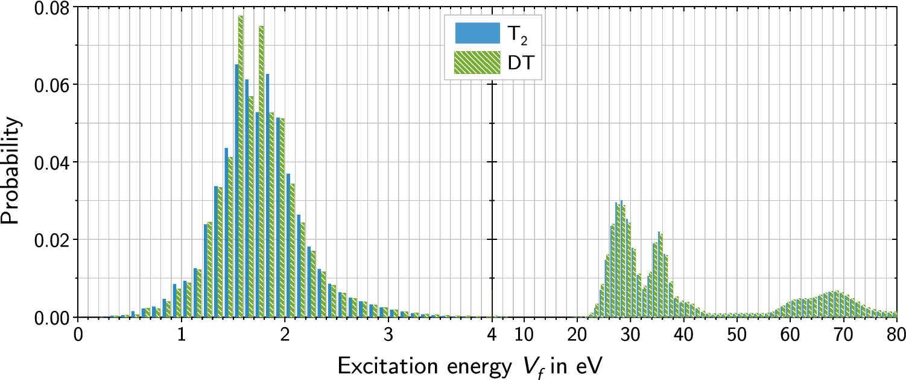
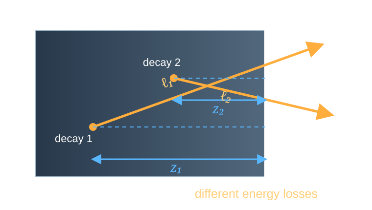

# Neutrinos Have Mass
## Neutrinos Have Nonzero Mass
- Neutrino oscillations are reliably observed. Therefore
$$
\Delta m^2_{ij}\ne 0.
$$
- The neutrino mass is nonzero, and also $m_i\ne m_j$.
- How can we measure the masses themselves, rather than the differences of squared masses?

## Method for Measuring the Neutrino Mass in $\beta$ Decays
- The idea of measuring the shape of the $\beta$ spectrum to determine the neutrino mass was proposed by Perrin (1933) and Fermi (1934)
- The first experiments using this method were performed by Curran, Angus, and Cockcroft (1948) and by Hanna and Pontecorvo (1949)

## The Essence of the Method {#beta-endpoint-spectrum}

For a single neutrino mass state:

$$
\frac{d\Gamma}{dE}
\propto
\underbrace{F(Z,E)}_{\substack{\text{Coulomb}\\\text{correction}}}\,
\underbrace{\sqrt{E^2+2m_eE}}_{p_e}\,
\underbrace{(E+m_e)}_{E_e}\,
\underbrace{(E_0-E)}_{E_\nu}\,
\underbrace{\sqrt{(E_0-E)^2-m_\nu^2}}_{p_\nu}\,
\Theta(E_0-E-m_\nu),
$$

where $E$ is the kinetic energy of the electron, and $E_0$ is the maximum possible electron energy subject to $m_\nu=0$.

::: {.l04-spectrum-narrow}



:::

## The Fermi Function $F(Z,E;A)$ {#fermi-function}

:::: {.panel-tabset .nh-story-tabs .fermi-function-tabs}

### Final State

For free particles it is convenient to compute the spectrum with plane waves. For the neutrino
this is a good approximation, but the charged lepton is born inside the Coulomb
field of the daughter nucleus. Therefore a plane electron wave is not a state
of the final Hamiltonian:

$$
\left[
\boldsymbol\alpha\cdot\mathbf p+\beta m_e+V_C(r)
\right]\psi^{(-)}_{E_e\mathbf p}(\mathbf r)
=E_e\psi^{(-)}_{E_e\mathbf p}(\mathbf r),
\qquad
V_C(r)\simeq-\frac{Z_d\alpha}{r}.
$$

For an allowed transition, $p_eR\ll1$ and $p_\nu R\ll1$, the weak vertex
probes the electron wave in the region of the nucleus:

$$
\mathcal M_{fi}\simeq
\psi_{E_e\mathbf p}^{(-)*}(R)\,\mathcal M_{\mathrm{nucl}},
\qquad
\boxed{
F(Z_d,E_e;A)=
\frac{|\psi_C^{(-)}(R)|^2}{|\psi_{\mathrm{pw}}(R)|^2}
}.
$$

That is, the simple result is not discarded but multiplied by the calculable ratio
of wave densities in the region of the weak vertex:

$$
\boxed{
\frac{d\Gamma_C}{dE_e}
=F(Z_d,E_e;A)\frac{d\Gamma_{\mathrm{pw}}}{dE_e}
}.
$$

$F$ is not a phenomenological "energy loss after the decay": it corrects the
**matrix element**, not the neutrino phase space.

### Coulomb Focusing

Let us reverse the picture in time: a slow electron with a given asymptotic
momentum falls onto a positive nucleus. The attraction increases the density of its
wave at the nucleus. Therefore for $\beta^-$ decay

$$
\eta=\frac{Z_d\alpha}{\beta_e},
\qquad
\boxed{
F_{\mathrm{NR}}(Z_d,E_e)
=\frac{2\pi\eta}{1-e^{-2\pi\eta}}>1
},
\qquad
\beta_e=\frac{p_e}{E_e}.
$$

For $\beta_e\ll1$ we have $F_{\mathrm{NR}}\simeq2\pi Z_d\alpha/\beta_e$:
this is the Sommerfeld Coulomb enhancement. For $\beta^+$ the sign of the potential changes,
the wave is defocused, and $F<1$.

### Spectra of $\beta^-$ and $\beta^+$

For an allowed transition and $m_\nu=0$:

$$
\frac{d\Gamma_\mp}{dK}\propto
F(\pm Z_d,E_e;A)\,p_eE_e(E_0-K)^2,
\qquad E_e=K+m_e.
$$



### Relativistic Form

For a point nucleus, the solution of the Dirac equation gives

$$
\boxed{
F_0(Z_d,E_e;R)=
\frac{2(1+\gamma)}{\Gamma(2\gamma+1)^2}
(2p_eR)^{2(\gamma-1)}
e^{\pi\eta}|\Gamma(\gamma+i\eta)|^2
},
$$

$$
\gamma=\sqrt{1-(Z_d\alpha)^2},
\qquad
\eta=\frac{Z_d\alpha E_e}{p_e},
\qquad
R\simeq r_0A^{1/3}.
$$

Therefore the short notation $F(Z,A)$ hides the energy dependence:
in fact $F=F(Z_d,E_e;R(A))$. An exact calculation uses the finite
nuclear charge distribution, screening, and radiative corrections.

### Causality

The term "final-state correction" is sometimes illustrated as follows: the electron
first flies out with one energy, then slows down and arrives at infinity
with a smaller one. Such a sequential picture is misleading: there was no
free electron "before the correction".

The Coulomb final state is immediately specified by the asymptotic energy $E_e$.
Exactly and in the quasiclassical limit, respectively:

$$
H_C\psi_{E_e}=E_e\psi_{E_e},
\qquad
E_e=\sqrt{\boldsymbol\pi^2(r)+m_e^2}+V_C(r)=\mathrm{const},
\qquad V_C(\infty)=0.
$$

For $\beta^-$ we have $V_C<0$: near the nucleus the local kinetic energy is
larger and decreases with distance, but the total $E_e$ remains the same. For $\beta^+$
the sign of the effect is opposite.

In the $S$ matrix, this same asymptotic $E_e$ enters the energy conservation law:

$$
\int dt\,e^{i(E_f+E_e+E_\nu-E_i)t}
=2\pi\delta(E_i-E_f-E_e-E_\nu).
$$

Therefore $F(Z_d,E_e)$ changes the amplitude and the probabilities of different energy partitions,
but redistributes nothing "after the decay". For tritium, $F$ enters the slowly varying
factor $C(E)$ and does not shift the boundary $E_{\max}=E_0-m_\nu$.

::: {.takeaway}
$F$ corrects the final state, not the energy of already emitted particles.
:::

::::

::: {.absolute bottom=30 left=50 width=1150 style="font-size: 0.46em;"}
[Hayen et al., *Rev. Mod. Phys.* **90**, 015008 (2018)](https://doi.org/10.1103/RevModPhys.90.015008) ·
[Hill, Plestid, *Phys. Rev. Lett.* **133**, 021803 (2024)](https://doi.org/10.1103/PhysRevLett.133.021803)
:::

## Experimental Requirements {#endpoint-resolution}

One needs high statistics near the endpoint of the spectrum and a small, well-known $\sigma_E$.

$$
\begin{aligned}
\frac{d\Gamma_{\mathrm{rec}}}{dE_{\mathrm{rec}}}
&=
\int_0^{E_0-m_\nu}
R(E_{\mathrm{rec}}\mid E;\sigma_E)\,
\frac{d\Gamma}{dE}\,dE,
\\
R(E_{\mathrm{rec}}\mid E;\sigma_E)
&=
\frac{1}{\sqrt{2\pi}\sigma_E}
\exp\left[
-\frac{(E_{\mathrm{rec}}-E)^2}{2\sigma_E^2}
\right].
\end{aligned}
$$



# What Does the $\beta$ Spectrum Measure?

## Mass, Flavor, and the Final State

:::: {.panel-tabset .nh-story-tabs}

### States

The weak interaction produces an electron antineutrino:

$$
|\bar\nu_e\rangle=\sum_i V_{ei}|\bar\nu_i\rangle.
$$

$|\bar\nu_i\rangle$ is a state with definite mass $m_i$;
$V_{ei}$ is an element of the mixing matrix. In each mass channel

$$
E_{\nu,i}^2=p_{\nu,i}^2+m_i^2.
$$

A kinematic experiment is sensitive to the masses $m_i$, even though the particle
is produced as an electron antineutrino.

### Why a Sum?

Final states with different masses are orthogonal:

$$
\langle\bar\nu_j|\bar\nu_i\rangle=\delta_{ij}.
$$

The neutrino is not detected. After summing over the unobserved final
state, the interference terms vanish:

$$
\sum_i\left|V_{ei}\mathcal M_i\right|^2
=\sum_i|V_{ei}|^2|\mathcal M_i|^2.
$$

Therefore in the $\beta$ spectrum it is the **probabilities**, not the amplitudes, that add.

### Spectrum

Let us denote

$$
E_\nu=E_0-E,
\qquad
C(E)\propto F(Z,E)p_e(E+m_e).
$$

Then

$$
\boxed{
\frac{d\Gamma}{dE}
=C(E)\sum_i|V_{ei}|^2
E_\nu\sqrt{E_\nu^2-m_i^2}\,
\Theta(E_\nu-m_i)
}.
$$

Each mass state ends at $E_{\max,i}=E_0-m_i$.

### Resolution

If the energy resolution is better than the mass splitting, the spectrum contains
several kinks:

$$
\sigma_E\lesssim |m_i-m_j|.
$$

For three light neutrinos $|m_i-m_j|\lesssim5\cdot10^{-2}~\mathrm{eV}$,
which is much smaller than the resolution of present-day tritium experiments.

The individual thresholds merge into a single effective endpoint of the spectrum.

::::

## Resolved Mass Thresholds {#resolved-mass-spectrum}

In this teaching example the masses are artificially increased to keV so that the thresholds are visible.



## Effective Mass $m_\beta$

If the thresholds are not resolved and $E_\nu\gg m_i$, then

$$
\begin{aligned}
\sum_i|V_{ei}|^2\sqrt{E_\nu^2-m_i^2}
&\simeq E_\nu\sum_i|V_{ei}|^2
\left(1-\frac{m_i^2}{2E_\nu^2}\right)
\\
&=E_\nu\left[
1-\frac{1}{2E_\nu^2}\sum_i|V_{ei}|^2m_i^2
\right].
\end{aligned}
$$

Comparing this with

$$
\sqrt{E_\nu^2-m_\beta^2}
\simeq E_\nu\left(1-\frac{m_\beta^2}{2E_\nu^2}\right),
$$

we obtain

$$
\boxed{m_\beta^2=\sum_i|V_{ei}|^2m_i^2}.
$$

## The Kurie Plot {#kurie-plot}

For an allowed transition, let us remove the slowly varying factors:

$$
K(E)\equiv
\left[
\frac{d\Gamma/dE}{F(Z,E)p_e(E+m_e)}
\right]^{1/2}.
$$

For $m_\beta=0$ we obtain a straight line $K(E)=E_0-E$; a nonzero mass
bends it and shifts the endpoint.



::: {.marginnote .absolute top=50 left=1290 width=265 style="--note-font-size: 0.62em;"}
Kurie, not Curie
The plot was proposed by Franz Newell Devereux Kurie
(*Franz N. D. Kurie*).

Curie is Marie.
:::

## Excited Final States

:::: {.columns}

::: {.column width="60%"}

After the decay the molecule may end up in a state $j$ with excitation
energy $V_j$ and probability $W_j$:

$$
E_{\nu,j}=E_0-E-V_j,
\qquad
\sum_jW_j=1.
$$

Then

$$
\frac{d\Gamma}{dE}
=C(E)\sum_jW_j\sum_i|V_{ei}|^2
E_{\nu,j}\sqrt{E_{\nu,j}^2-m_i^2}\,
\Theta(E_{\nu,j}-m_i).
$$

For unresolved mass thresholds

$$
\frac{d\Gamma}{dE}
\simeq C(E)\sum_jW_j
E_{\nu,j}\sqrt{E_{\nu,j}^2-m_\beta^2}\,
\Theta(E_{\nu,j}-m_\beta).
$$

:::

::: {.column width="40%"}

{fig-alt="Distributions of final molecular states after beta decay of T2 and DT" width="100%"}

<small>[M. Kleesiek et al., *EPJ C* **79**, 204 (2019), Fig. 3](https://doi.org/10.1140/epjc/s10052-019-6686-7), CC BY 4.0.</small>

:::

::::

# Tritium

## Why Tritium?

:::: {.panel-tabset .nh-story-tabs}

### Decay

$$
{}^3\mathrm H
\to{}^3\mathrm{He}^{+}+e^-+\bar\nu_e,
\qquad
E_0\simeq18.6~\mathrm{keV}.
$$

- small $E_0$: the relative fraction of events near the endpoint is large;
- superallowed transition: the nuclear matrix element hardly changes the shape;
- $T_{1/2}=12.32$ years: high specific activity and a stable source;
- light system: recoil and molecular states can be computed accurately.

### The Price of Statistics

Near the endpoint of the allowed spectrum at $m_\beta=0$

$$
\frac{d\Gamma}{dE}\propto(E_0-E)^2.
$$

Therefore the fraction of decays in the last interval $\Delta E$ is estimated as

$$
f(\Delta E)
\simeq
\frac{\int_{E_0-\Delta E}^{E_0}(E_0-E)^2dE}
{\int_0^{E_0}(E_0-E)^2dE}
=\left(\frac{\Delta E}{E_0}\right)^3.
$$

For $\Delta E=1~\mathrm{eV}$ this is only

$$
f\sim1.6\cdot10^{-13}.
$$

### Atom or Molecule?

KATRIN uses molecular tritium:

$$
\mathrm T_2\to{}^3\mathrm{HeT}^{+}+e^-+\bar\nu_e.
$$

The molecule is convenient to store and to pump continuously, but the daughter ion receives
rotational, vibrational, or electronic excitation.

The unmeasured energy $V_j$ is subtracted from the neutrino energy:

$$
E_{\nu,j}=E_0-E-V_j.
$$

Therefore the distribution of final states enters the spectrum model directly.

::::

# From 30 eV to KATRIN

## What Did the Experiments of the 1980s Change?

:::: {.panel-tabset .nh-story-tabs}

### ITEP

The experiment of V. A. Lyubimov's group used

- a solid source — a thin film of tritiated valine;
- the Tretyakov magnetic spectrometer with high luminosity;
- a measurement of the shape of the last few hundred electronvolts of the $\beta$ spectrum.

In 1980 the group reported

$$
m_{\bar\nu_e}\simeq30~\mathrm{eV}.
$$

The deficit of electrons near the end of the spectrum was interpreted as a kinematic effect
of the neutrino mass.

### Film

:::: {.columns}

::: {.column width="48%"}

{fig-alt="Electrons are produced at different depths of the solid film and travel different paths in it" width="100%"}

:::

::: {.column width="52%"}

An electron is born at depth $z$ and leaves at an angle $\theta$ to the normal.
Its path in the material is equal to

$$
\ell=\frac{z}{\cos\theta},
\qquad
E_{\mathrm{det}}=E-\Delta E(\ell).
$$

Therefore the observed spectrum contains a convolution with the loss distribution $L$:

$$
S_{\mathrm{obs}}(E)
=\int L(\Delta E)S_\beta(E+\Delta E)\,d\Delta E.
$$

Non-uniformity of thickness, roughness, and the composition of the film change $L(\Delta E)$.
An error in this function distorts the end of the spectrum and can mimic a mass.

:::

::::

### Checks

The result was checked in Los Alamos, Zurich, Mainz, and Troitsk.
A mass of about $30~\mathrm{eV}$ was not confirmed.

The main lesson: energy resolution alone is not enough. The end of the spectrum
is distorted by effects that resemble a mass:

$$
\text{energy losses}
+\text{final states}
+\text{response function}.
$$

The source and the spectrometer must be calibrated and modeled together.

### Two Technologies

The next generation combined

$$
\boxed{\text{windowless gas source }\mathrm T_2}
\qquad+\qquad
\boxed{\text{MAC-E filter}}.
$$

A gaseous source eliminates the substrate. The MAC-E filter combines a large solid
angle with sub-eV energy resolution.

This combination was developed in Mainz and Troitsk and scaled up in KATRIN.

::::

::: {.absolute bottom=30 left=50 width=1150 style="font-size: 0.42em;"}
[V. A. Lyubimov et al., *Phys. Lett. B* **94**, 266 (1980)](https://doi.org/10.1016/0370-2693(80)90873-4) ·
[G. Drexlin, C. Weinheimer, KATRIN review (2026)](https://arxiv.org/abs/2601.00248)
:::
