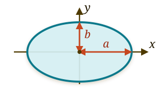

# Task of the $\beta$ spectrometer

## Integral energy measurement {.l05-tight}

- The neutrino mass changes the shape of the $\beta$ spectrum near its endpoint. There are few events there, and the electrons from an unpolarized source are emitted isotropically:

$$
\frac{dN}{d\Omega}=\mathrm{const}.
$$

- A small detector looking in only one direction would lose almost all of the
statistics.

- Therefore the setup must accept electrons from a large solid angle.

- The energy can be measured integrally. Let us place a retarding electrostatic potential $U$ in front of the detector:

$$
E<e|U|\ \Longrightarrow\ \text{electron is reflected},
\qquad
E>e|U|\ \Longrightarrow\ \text{electron passes through}.
$$

When $U$ is scanned, the detector measures the number of electrons above the threshold:

$$
\boxed{
R(U)\propto
\int_{e|U|}^{E_0}\frac{d\Gamma}{dE}\,dE
}.
$$

::: {.takeaway}
Task of the instrument: to collect as many $\beta$ electrons as possible and compare their energy with a controllable electrostatic threshold.
:::

## Longitudinal and transverse motion {.l05-tight}

- The one-dimensional condition $E>e|U|$ assumes that the electron moves along the spectrometer axis. In reality its momentum makes an angle $\alpha$ with the axis:

$$
\mathbf p=\mathbf p_\parallel+\mathbf p_\perp,
\qquad
E=E_\parallel+E_\perp,
\qquad
\tan\alpha=\frac{p_\perp}{p_\parallel}.
$$

- For the potential $U(z)$ the transverse momentum is conserved. The longitudinal energy is spent on climbing against the potential, so

$$
\boxed{E_\parallel>e|U|},
\qquad
E_\parallel=E\cos^2\alpha
\quad\text{(in the nonrelativistic regime)}.
$$

- For the same $E$, electrons with different $\alpha$ pass different thresholds.

- Keeping only small angles is not an option: the source is isotropic, and the statistics would vanish.

- What is required is a magnetic system that

  1. collects a large solid angle and guides the electrons to the filter;
  2. conserves $E$;
  3. converts $E_\perp$ into $E_\parallel$ before the filter.

# Where we are heading



  MAC-E: electrons above the threshold pass, electrons below the threshold are reflected.

# Uniform magnetic field

## Motion in a uniform constant magnetic field {#uniform-b-motion}

:::::: {.panel-tabset .nh-story-tabs .l05-tight}

### The main point

A uniform magnetic field does not change the energy of a particle: it splits the motion
into uniform motion along the field and cyclotron rotation transverse to the field.

:::: {.columns}

::: {.column width="49%"}

**Conserved**

$$
\boxed{p_\parallel=\mathrm{const}},
\qquad
\boxed{p_\perp=\mathrm{const}},
\qquad
\boxed{E=\mathrm{const}}.
$$

**Helical trajectory**

$$
\boxed{(x-X)^2+(y-Y)^2=\rho_L^2},
$$

$$
\boxed{z(t)=z_0+v_\parallel t}.
$$

:::

::: {.column width="49%"}

**Over one revolution**

$$
\boxed{\omega_c=\frac{|q|B}{m}},
\qquad
\boxed{T_c=\frac{2\pi m}{|q|B}}.
$$

$$
\boxed{\rho_L=\frac{p_\perp}{|q|B}},
\qquad
\boxed{h=\frac{2\pi p_\parallel}{|q|B}}.
$$

**Orbital magnetic moment**

$$
\boxed{
\mu=\frac{E_\perp}{B}
=\frac{mv_\perp^2}{2B}
=\mathrm{const}
}.
$$

:::

::::

**Relativistic case:**
$\omega_c=|q|B/(\gamma m)$, $T_c=2\pi\gamma m/(|q|B)$; the formulas for
$\rho_L$ and $h$ in terms of momentum do not change.

### Equation

Consider a nonrelativistic particle of charge $q$ and mass $m$:

$$
\mathbf B=B\mathbf e_z,
\qquad
\mathbf E=0.
$$

The Lorentz force gives

$$
m\dot{\mathbf v}
=q\,\mathbf v\times\mathbf B
=qB(v_y,-v_x,0),
$$

$$
\dot v_x=\Omega v_y,
\qquad
\dot v_y=-\Omega v_x,
\qquad
\dot v_z=0.
$$

$$
\boxed{\Omega=\frac{qB}{m}},
\qquad
\boxed{\omega_c=|\Omega|=\frac{|q|B}{m}}.
$$

$\Omega$ is the signed, and $\omega_c$ the positive, cyclotron frequency.

### Integrals

The magnetic field does no work:

$$
m\mathbf v\cdot\dot{\mathbf v}
=
q\mathbf v\cdot(\mathbf v\times\mathbf B)
=0.
$$

Consequently,

$$
\frac{d}{dt}\frac{mv^2}{2}=0,
\qquad
v^2=v_\parallel^2+v_\perp^2=\mathrm{const}.
$$

Moreover,

$$
v_\parallel=v_z=\mathrm{const},
\qquad
v_\perp^2=v_x^2+v_y^2=\mathrm{const}.
$$

The field changes the direction of $\mathbf v_\perp$, but not its magnitude.

### Velocity

$$
\ddot v_x=-\Omega^2v_x,
\qquad
\ddot v_y=-\Omega^2v_y.
$$

Therefore

$$
\boxed{
\begin{aligned}
v_x(t)
&=
v_{x0}\cos\Omega t
+
v_{y0}\sin\Omega t,
\\
v_y(t)
&=
v_{y0}\cos\Omega t
-
v_{x0}\sin\Omega t.
\end{aligned}}
$$

$$
v_x^2(t)+v_y^2(t)
=
v_{x0}^2+v_{y0}^2
=v_\perp^2.
$$

The tip of the vector $\mathbf v_\perp$ moves along a circle in velocity space.

### Trajectory

Integrating the velocity, we obtain

$$
\begin{aligned}
x(t)
&=
x_0+\frac{v_{x0}}{\Omega}\sin\Omega t
+\frac{v_{y0}}{\Omega}(1-\cos\Omega t),
\\
y(t)
&=
y_0+\frac{v_{y0}}{\Omega}\sin\Omega t
-\frac{v_{x0}}{\Omega}(1-\cos\Omega t),
\\
z(t)
&=
z_0+v_\parallel t.
\end{aligned}
$$

- In the plane perpendicular to $\mathbf B$ the particle moves along a circle.

- Along the field the motion is uniform.

$$
\boxed{\Omega=\frac{qB}{m}},
\qquad
\boxed{\omega_c=|\Omega|=\frac{|q|B}{m}}.
$$

### Radius

Let us introduce the coordinates of the center of the circle:

$$
\boxed{
X=x+\frac{v_y}{\Omega},
\qquad
Y=y-\frac{v_x}{\Omega}
}.
$$

Using $\dot v_x=\Omega v_y$ and $\dot v_y=-\Omega v_x$, we obtain

$$
\dot X=\dot Y=0.
$$

Thus $(X,Y)$ is a fixed **guiding center**, and the distance to it is

$$
\begin{aligned}
\rho_L^2
&=(x-X)^2+(y-Y)^2\\
&=\frac{v_x^2+v_y^2}{\Omega^2}.
\end{aligned}
$$

Hence

$$
\boxed{
\rho_L
=\frac{v_\perp}{\omega_c}
=\frac{mv_\perp}{|q|B}
=\frac{p_\perp}{|q|B}
}.
$$

### Period

Over one revolution the phase changes by $2\pi$. Therefore

$$
\omega_cT_c=2\pi
\quad\Longrightarrow\quad
\boxed{T_c=\frac{2\pi m}{|q|B}}.
$$

During the same time the guiding center advances along the field by the distance

$$
\boxed{
h=v_\parallel T_c
=\frac{2\pi p_\parallel}{|q|B}
}.
$$

The geometry of the helix directly determines the pitch angle:

$$
\boxed{
\frac{h}{2\pi\rho_L}
=\frac{p_\parallel}{p_\perp}
=\cot\alpha
}.
$$

For an electron with $K=18.6~\mathrm{keV}$ in a field $B=3.6~\mathrm{T}$,
taking $\gamma=1.036$ into account, we obtain

$$
T_c\simeq10.3~\mathrm{ps},
\qquad
\rho_{L,\max}\simeq0.129~\mathrm{mm}.
$$

### Moment

A cyclotron orbit is equivalent to a current loop. The magnitude of the current and the area
of the loop are

$$
|I|=\frac{|q|}{T_c}=\frac{|q|\omega_c}{2\pi},
\qquad
S=\pi\rho_L^2.
$$

Therefore

$$
\begin{aligned}
\mu=|I|S
&=\frac{|q|\omega_c\rho_L^2}{2}\\
&=\frac{mv_\perp^2}{2B}
=\frac{E_\perp}{B}.
\end{aligned}
$$

The direction of the moment is opposite to the field:

$$
\boxed{
\boldsymbol{\mu}_{\mathrm{orb}}=-\mu\,\mathbf b
},
\qquad
\mathbf b=\frac{\mathbf B}{B}.
$$

In a uniform field $E_\perp$ and $B$ are constant, hence

$$
\boxed{\mu=\frac{E_\perp}{B}=\mathrm{const}}.
$$

### Animation



  Three electrons are shown at the same moment of time. Their speeds are equal
  in magnitude, but $v_z=v\cos\alpha$: a smaller angle gives a larger advance
  along the field in the same time.

::::::

# Phase portrait

## Three languages

::::: {.panel-tabset .nh-story-tabs .l05-tight}

### Newton

- On the previous slides we used the Newtonian formalism to find the electron trajectory in 3D explicitly:
$$
\mathbf r(t)=(x(t),y(t),z(t))
$$
- Some properties of a physical system are easier to see on the **phase trajectory**

$$
(Q(t),P(t))
$$

- For example, for a harmonic oscillator with energy
$$
H = \frac{p^2}{2m} + \frac{m\omega^2q^2}{2}=E
$$
a particular solution is:
$$
q(t) = A\cos{\omega t}
$$
- In the variables $q$ and $p = m\dot{q}$ this is an **ellipse**

### Ellipse



- The same particle oscillates in ordinary space and traverses a closed curve in the phase plane.

- Obviously, the area of the ellipse does not change with time. Does it have a physical meaning?

- We will sort this out now!

### Lagrange

- The Lagrangian depends on the generalized coordinate $q$ and the velocity $\dot{q}$
$$
L(q,\dot{q},t)
$$
- Equation of motion:
$$
\frac{d}{dt}\frac{\partial L}{\partial \dot{q}}-\frac{\partial L}{\partial q} = 0.
$$
- This is a second-order equation

### Hamilton

- Let us define the canonical momentum:
$$
p\equiv\frac{\partial L}{\partial\dot q}
$$
- Hamiltonian

$$
H(q,p,t)\equiv p\dot q-L.
$$

- Hamilton's equations:

$$
\dot q=\frac{\partial H}{\partial p},
\qquad
\dot p=-\frac{\partial H}{\partial q}.
$$

- These are two first-order equations

:::::

# Hamiltonian formalism

## Phase trajectory

:::: {.panel-tabset .nh-story-tabs .l05-tight}

### Constant energy

If $H$ does not depend explicitly on time, then

$$
\begin{aligned}
\frac{dH}{dt}
&=\frac{\partial H}{\partial q}\dot q
+\frac{\partial H}{\partial p}\dot p\\
&=-\dot p\dot q+\dot q\dot p=0.
\end{aligned}
$$

Consequently, the phase point moves along a line of constant energy:

$$
\boxed{H(q,p)=E}.
$$

- The **phase point** $(q,p)$ specifies the state of the system.
- The **phase trajectory** is a single line $H=E$.
- The **phase portrait** is a family of trajectories for different initial conditions.

### Oscillator

::: {.l05-main style="font-size: 0.95em;"}

For a harmonic oscillator

$$
H(q,p)=\frac{p^2}{2m}+\frac{m\omega^2q^2}{2}=E.
$$

- The phase trajectories are nested ellipses:

$$
\frac{q^2}{q_{\max}^2}+\frac{p^2}{p_{\max}^2}=1,
$$

$$
q_{\max}=\sqrt{\frac{2E}{m\omega^2}},
\qquad
p_{\max}=\sqrt{2mE}.
$$

- Area of the ellipse:
$$
S=\pi q_{\max}p_{\max}=\frac{2\pi E}{\omega}.
$$
- Changing $E$ selects a different ellipse. Changing the parameters $m$ or $\omega$
rearranges the whole phase portrait.

:::

::: {.marginnote .note-right .absolute top=225 left=1255 width=300 style="--note-font-size: 0.62em; --note-math-font-size: 1em; --note-padding: 0.7rem 0.8rem;"}
Area of the ellipse

$$
S=\pi ab
$$
:::

### $J$ (action)

- So what is the physical meaning of the area of the ellipse in the phase plane?

- Let us define this area via the **action** $J$:

$$
\boxed{
J(E)=\frac{1}{2\pi}\oint p\,dq
}.
$$

- The dimension of $J$ is that of action, i.e. energy times time.

- The action $J$ is an integral of motion if the Hamiltonian does not depend explicitly on time:

$$
\boxed{
\dot E=0,
\qquad
J=J(E)
\quad\Longrightarrow\quad
\dot J=\frac{dJ}{dE}\dot E=0
}.
$$

### $J$ and $(\omega, T)$

::: {.l05-main}

- A beautiful formula relates the action $J$ to the period $T$ and the frequency $\omega = \frac{2\pi}{T}$:
$$
\boxed{\frac{dJ}{dE}=\frac{T}{2\pi} = \frac{1}{\omega}}.
$$

- Proof:
$$
\begin{aligned}
\frac{dJ}{dE}
&=\frac{1}{2\pi}\oint
\left(\frac{\partial p}{\partial E}\right)_q dq
=\frac{1}{2\pi}\oint\frac{dq}{\dot q}\\
&=\frac{1}{2\pi}\int_0^Tdt
=\frac{T}{2\pi}=\frac{1}{\omega}.
\end{aligned}
$$

::: {.marginnote .note-right .absolute top=225 left=1255 width=300 style="--note-font-size: 0.62em; --note-math-font-size: 1em; --note-padding: 0.7rem 0.8rem;"}
Four lines

$$
\begin{aligned}
H\bigl(q,p\bigr)& =E.\\
\frac{\partial H}{\partial p}
\left(\frac{\partial p}{\partial E}\right)_q&=1.\\
\partial H/\partial p&=\dot q,\\
({\partial p}/{\partial E})_q&=1/\dot q.
\end{aligned}
$$

:::

- Example: harmonic oscillator
$$
J=\frac{1}{2\pi}\pi q_{\max}p_{\max}=\frac{E}{\omega}, \qquad\frac{dJ}{dE} = \frac{1}{\omega}.
$$

:::

### $J$ and integrals of motion

- $J$ is an integral of motion.

- For one degree of freedom, $J$ is not an integral of motion independent of $E$.

- For $N>1$ $J_i$ are integrals of motion independent of $E$.

::::

## Canonical variables

::::: {.panel-tabset .nh-story-tabs .l05-tight}

### Change of variables

- The same motion can be described by different variables.

- The simplest example is stretching one axis and compressing the other:

$$
Q=aq,
\qquad
P=\frac{p}{a}.
$$

Then

$$
P\,dQ=p\,dq,
$$

so the area of the phase orbit does not change.

### Canonical variables

- A transformation $(q,p)\to(Q,P)$ is called **canonical** if the Hamilton equations have the same form in the new variables:
$$
\dot Q=\frac{\partial H}{\partial P},\qquad
\dot P=-\frac{\partial H}{\partial Q}.
$$

- A canonical transformation can stretch and deform the phase plane, but it preserves the oriented area:
$$
dq\,dp=dQ\,dP.
$$

- Strictly, this is written through the symplectic form:

$$
dq\wedge dp=dQ\wedge dP,
$$

- Then,

$$
\oint p\,dq = \oint P\,dQ.
$$

:::::

## Cyclotron orbit in the variables $(\theta,J)$

:::: {.panel-tabset .nh-story-tabs .l05-tight}

### $(Q,P)$

::: {.marginnote .note-right .absolute top=470 left=1255 width=300 style="--note-font-size: 0.62em; --note-math-font-size: 1em; --note-padding: 0.7rem 0.8rem;"}
Hamilton's equations

$$
\dot Q=\frac{\partial H}{\partial P},
\qquad
\dot P=-\frac{\partial H}{\partial Q}.
$$
:::

::: {.l05-main}

- Let us separate the motion relative to the guiding center. For
$\Omega=qB/m$ and $\omega_c=|\Omega|$ we introduce

$$
Q\equiv x-X=-\frac{v_y}{\Omega},
\qquad
P\equiv m\dot Q=mv_x.
$$

- Then the cyclotron equations take the form

$$
\dot Q=\frac{P}{m},
\qquad
\dot P=-m\omega_c^2Q.
$$

- These are the Hamilton equations for the oscillator

$$
\boxed{
H_\perp(Q,P)
=\frac{P^2}{2m}+\frac{m\omega_c^2Q^2}{2}
=E_\perp
}.
$$

Thus $(Q,P)$ is a canonical pair for one periodic degree
of freedom.

:::

### $J$

- Let us apply the already introduced definition of the action to the ellipse $H_\perp(Q,P)=E_\perp$:

$$
\boxed{
J\equiv\frac{1}{2\pi}\oint P\,dQ
=\frac{E_\perp}{\omega_c}
}.
$$

- Therefore $J$:

$$
\boxed{
J(Q,P)
=\frac{H_\perp(Q,P)}{\omega_c}
=\frac{P^2}{2m\omega_c}+\frac{m\omega_cQ^2}{2}
}.
$$

- $J$ determines **which ellipse** is chosen. But where is the particle on it?

### $\theta$

- We specify the position on the chosen ellipse by the angle

$$
\boxed{
\theta(Q,P)
=\operatorname{atan2}\!\left(m\omega_cQ,\,P\right)
}.
$$

$\operatorname{atan2}(y,x)$ is the ordinary polar angle of the point $(x,y)$ with the
correct choice of quadrant. Here it is the angle of the point $(P,m\omega_cQ)$.

- Together, the definitions $J(Q,P)$ and $\theta(Q,P)$ give the inverse change of variables

$$
Q=\sqrt{\frac{2J}{m\omega_c}}\sin\theta,
\qquad
P=\sqrt{2m\omega_cJ}\cos\theta.
$$

$J$ specifies the ellipse, and $\theta$ the position of the phase point on it. At the center
$J=0$ the angle is undefined, since the orbit itself degenerates into a point.

### Poisson bracket

- For functions of the phase variables the Poisson bracket is defined as

$$
\boxed{
\{f,g\}_{Q,P}
\equiv
\frac{\partial f}{\partial Q}\frac{\partial g}{\partial P}
-\frac{\partial f}{\partial P}\frac{\partial g}{\partial Q}
}.
$$

- Substituting the found $\theta(Q,P)$ and $J(Q,P)$, we obtain

$$
\begin{gathered}
D\equiv P^2+(m\omega_cQ)^2,\\
\frac{\partial\theta}{\partial Q}=\frac{m\omega_cP}{D},
\qquad
\frac{\partial\theta}{\partial P}=-\frac{m\omega_cQ}{D},\\
\frac{\partial J}{\partial P}=\frac{P}{m\omega_c},
\qquad
\frac{\partial J}{\partial Q}=m\omega_cQ.
\end{gathered}
$$

$$
\boxed{
\{\theta,J\}_{Q,P}
=\frac{P^2+(m\omega_cQ)^2}
       {P^2+(m\omega_cQ)^2}
=1
}.
$$

For one pair, $\{\theta,J\}=1$ is the condition of canonicity
($\{\theta,\theta\}=\{J,J\}=0$ holds automatically). Therefore $\theta$ is the
coordinate, $J$ is the conjugate momentum, and the Hamilton equations keep their form.

### Equations of motion

- In the variables $(\theta,J)$ the Hamiltonian does not depend on the angle:

$$
\boxed{H_\perp=\omega_cJ},
\qquad
\frac{\partial H_\perp}{\partial\theta}=0.
$$

- Since $(\theta,J)$ is a canonical pair,

$$
\dot\theta=\frac{\partial H_\perp}{\partial J},
\qquad
\dot J=-\frac{\partial H_\perp}{\partial\theta}.
$$

- From this directly

$$
\boxed{\dot\theta=\omega_c},
\qquad
\boxed{\dot J=0}.
$$

$J$ remains constant, and the phase point goes around the chosen
orbit uniformly: $\theta(t)=\theta_0+\omega_ct$.

### From $(\mathbf r,\mathbf p)$ to $(J,\theta)$

::: {style="font-size: 0.94em;"}

- The full state of a particle in three-dimensional space is given by six numbers
$(\mathbf r,\mathbf p)$:

$$
\boxed{
(\mathbf r,\mathbf p)
\ \longleftrightarrow\
\underbrace{(X,Y)}_{\substack{\text{guiding}\\\text{center}}}
\oplus
\underbrace{(z,p_\parallel)}_{\substack{\text{motion}\\\text{along the field}}}
\oplus
\underbrace{(Q,P)}_{\substack{\text{cyclotron}\\\text{motion}}}
}.
$$

- In a uniform field

$$
\dot X=\dot Y=\dot p_\parallel=0,
\qquad
\dot z=\frac{p_\parallel}{m}.
$$

- What remains are $z,Q,P$: the coordinate $z$ grows
uniformly, while the point $(Q,P)$ moves along a closed orbit.

- For cyclotron
motion we replace one canonical pair by another:

$$
\boxed{(Q,P)\ \longleftrightarrow\ (\theta,J)},
\qquad
\boxed{\{\theta,J\}=1}.
$$

- $J$ selects the orbit. The coordinate $\theta$ conjugate to it specifies the position of the particle on this orbit.

:::

### Portrait



::::

## The many faces of the action $J$

::::: {.panel-tabset .nh-story-tabs .l05-tight}

### Cyclotron orbit

::: {.marginnote .note-right .absolute top=225 left=1255 width=300 style="--note-font-size: 0.62em; --note-math-font-size: 1em; --note-padding: 0.7rem 0.8rem;"}
Recall

$$
\omega_c=\frac{|q|B}{m}
$$
:::

::: {.marginnote .note-right .absolute top=560 left=1255 width=300 style="--note-font-size: 0.62em; --note-math-font-size: 1em; --note-padding: 0.7rem 0.8rem;"}
Recall

$$
\rho_L=\frac{p_\perp}{|q|B}
$$
:::

::: {.l05-main style="font-size: 0.94em;"}

- For cyclotron motion the action is:

$$
\boxed{
J
=\frac{1}{2\pi}\oint P\,dQ
=\frac{E_\perp}{\omega_c}
=\frac{p_\perp^2}{2|q|B}
}.
$$

- For a circular cyclotron orbit the action $J$ is related:
  - to the orbital angular momentum $L_{\mathrm{orb}}\equiv|\mathbf L_{\mathrm{orb}}|=\rho_Lp_\perp$:
  $$
  J=\frac{L_{\mathrm{orb}}}{2}.
  $$
  - to the orbital magnetic moment $\mu=\frac{|q|L_{\mathrm{orb}}}{2m}$:
  $$
  J = \frac{m}{|q|}\mu.
  $$
  - to the magnetic flux $\Phi=\pi\rho_L^2B$ through the area of the orbit:
  $$
  J=\frac{|q|}{2\pi}\Phi
  $$

:::

### Planar rotator

:::: {.columns style="font-size: 0.92em;"}

::: {.column width="57%"}

- A bead of mass $m$ is fixed at the end of a massless rigid rod of length $R$.

- The point $O$ is fixed; the rod rotates without friction in a horizontal
plane.

- This is a **planar rotator**.

- The radius is fixed, so one coordinate remains — the angle $\varphi$:

$$
I=mR^2,
\qquad
\mathcal L=\frac{I\dot\varphi^2}{2},
\qquad
p_\varphi=\frac{\partial\mathcal L}{\partial\dot\varphi}
=I\dot\varphi=L_z.
$$

- The angle $\varphi$ does not enter $\mathcal L$, so it is cyclic and $p_\varphi$ is conserved.

- The Hamiltonian has the form

$$
H=\frac{p_\varphi^2}{2I},
\qquad
\dot p_\varphi=0.
$$

:::

::: {.column width="42%"}



:::

::::

### Action of the rotator

- Consider rotation in a chosen direction, for example
$p_\varphi>0$. On this branch $p_\varphi$ is constant, and in one revolution
$\varphi$ increases by $2\pi$:

$$
\begin{aligned}
J
&=\frac{1}{2\pi}\oint p_\varphi\,d\varphi \\
&=\frac{1}{2\pi}
  \int_{\varphi_0}^{\varphi_0+2\pi}p_\varphi\,d\varphi
=p_\varphi=L_z.
\end{aligned}
$$

- In general the action is chosen to be positive:

$$
\boxed{J=|p_\varphi|=|L_z|}.
$$

### The angle $\theta$

- For the branch $p_\varphi>0$ the conjugate angle is the coordinate
$\theta=\varphi$ itself. Indeed,

$$
\{\theta,J\}=\{\varphi,p_\varphi\}=1,
\qquad
H(J)=\frac{J^2}{2I}.
$$

- The Hamilton equations give uniform rotation:

$$
\boxed{
\dot\theta=\frac{\partial H}{\partial J}=\frac{J}{I}=\omega,
\qquad
\dot J=-\frac{\partial H}{\partial\theta}=0
}.
$$

- $J$ indicates **which rotation** is chosen: its angular momentum and energy;
- $\theta$ indicates **where the bead is** within the revolution.

For the rotator the action coincided with the magnitude of the angular momentum. This is a special
result; the definition $J=(2\pi)^{-1}\oint p\,dq$ remains the general one.

### Pendulum

:::: {.columns}

::: {.column width="51%"}

For the pendulum the spatial motion goes back and forth, but in the phase
plane $(\varphi,p_\varphi)$ an oscillation corresponds to a closed curve.

For each oscillatory regime we obtain its own orbit:

$$
H(\varphi,p_\varphi)=E,
\qquad
J(E)=\frac{1}{2\pi}\oint p_\varphi\,d\varphi.
$$

The pendulum orbit is no longer an ellipse, yet its phase area still provides
a label of the periodic motion. The definition $J$ works for any closed
phase trajectory.

:::

::: {.column width="47%"}



:::

::::

:::::

## Summary {.l05-tight}

:::: {.columns style="font-size: 0.94em;"}

::: {.column width="49%"}

**The spectrometer measures the longitudinal energy**

$$
\boxed{E_\parallel>e|U|}.
$$

The magnetic system must collect a large solid angle, guide the electrons
to the filter, and before it convert $E_\perp$ into $E_\parallel$ at
$E=\mathrm{const}$.

**Uniform magnetic field**

$$
\begin{gathered}
E=\mathrm{const},
\qquad
p_\parallel=\mathrm{const},
\qquad
p_\perp=\mathrm{const},\\[0.4em]
\rho_L=\frac{p_\perp}{|q|B},
\qquad
\omega_c=\frac{|q|B}{m}.
\end{gathered}
$$

$$
\tan\alpha=\frac{p_\perp}{p_\parallel}=\mathrm{const}
$$

The trajectory is helical, the guiding center is stationary. The field guides the electron
but does not collimate the beam.

:::

::: {.column width="49%"}

**One periodic degree of freedom**

$$
J=\frac{1}{2\pi}\oint p\,dq
\qquad
\frac{dJ}{dE}=\frac{1}{\omega}
$$

$2\pi J$ is the area inside the closed phase orbit.

**Cyclotron motion**

$$
J=\frac{E_\perp}{\omega_c}
=\frac{p_\perp^2}{2|q|B}
=\frac{m}{|q|}\mu
$$

$$
(Q,P)\longleftrightarrow(\theta,J),
\qquad
\{\theta,J\}=1
$$

$$
H_\perp=\omega_cJ,
\qquad
\dot J=0,
\qquad
\dot\theta=\omega_c
$$

$J$ specifies the cyclotron orbit; $\theta$ is the position of the particle on it.

:::

::::

::: {.takeaway style="text-align: center; font-size: 1.08em; margin-top: 0.25rem; padding: 0.42rem 0.8rem; border: 2px solid #58b8ee; border-radius: 14px; background: rgba(55, 145, 205, 0.12);"}
$J$ will become the central quantity in the method of
**adiabatic collimation**.
:::

<!-- exercises:begin (generated by scripts/sync_exercise_slides.py) -->

## Exercises for this lecture {#lecture-exercises}

::: {.nh-text size="md"}
:::: {.columns}
::: {.column width="50%"}

- **5.1.** Time of flight along a helical trajectory
- **5.2.** Electrostatic threshold and angular acceptance
- **5.3.** Guiding center and the sign of the charge
- **5.4.** From the phase ellipse to the variables $(\theta,J)$
- **5.5.** Four physical meanings of the action

:::
::: {.column width="50%"}

- **5.6.** Relativistic transverse energy
- **5.7.** Period from area: a box and a bouncing ball
- **5.8.** Which changes of variables are canonical?
- **5.9.** The pendulum: from oscillation to rotation

:::
::::
:::

::: {.nh-box tone="question"}
[All exercises for lecture 05 →](../exercises/05_electron_to_detector_exercises.qmd) and exercises for the seminar · [All course exercises](../exercises/index.qmd)
:::

<!-- exercises:end -->
