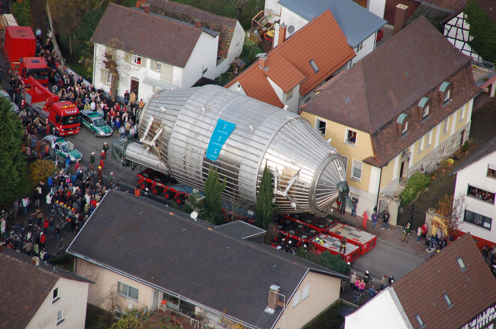
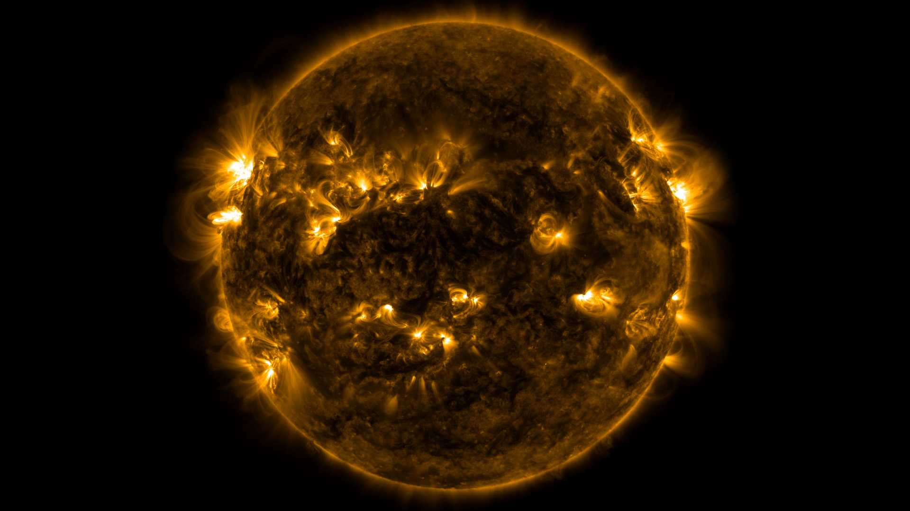
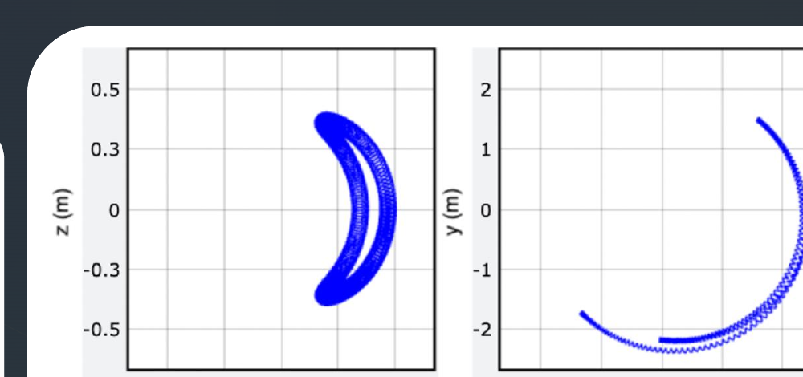
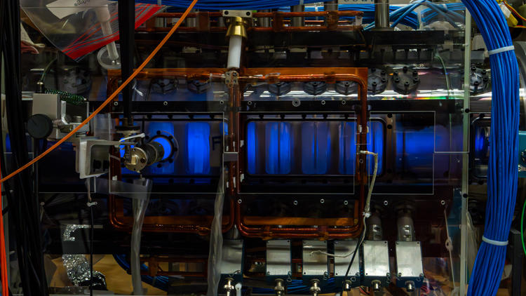

# MAC-E filter

## How to make the threshold almost independent of the angle? {#mac-e-filter}

:::: {.panel-tabset .nh-story-tabs .l06-tight}

### The problem
::: {.marginnote .note-right .absolute top=275 left=1245 width=315 style="--note-font-size: 0.62em; --note-math-font-size: 1em;"}
<span class="note-title">Notation</span>

- $\mathrm{src}$ — the source region (from the English *source*),

- $\mathrm A$ — the analyzing plane.

- $U$ — the retarding voltage; $e>0$ — the magnitude of the electron charge.

:::

::: {.l06-main style="font-size: 0.92em;"}

- The neutrino mass changes the shape of the $\beta$ spectrum.
- The electrostatic barrier is sensitive to the longitudinal energy of the electron.

- In the analyzing plane

$$
\boxed{
E_{\parallel,\mathrm A}
\simeq E-e|U|-E_{\perp,\mathrm A}
}.
$$

- Electrons of the same energy are born at different angles and have different
$E_\perp$.

- We need to achieve

$$
\boxed{E_{\perp,\mathrm A}\ll E}
$$

- This condition must hold for a large solid angle, and not only for
  electrons moving along the axis.

:::

### $B=\text{const}$

- In a uniform field

$$
p_\parallel=\mathrm{const},
\qquad
p_\perp=\mathrm{const},
\qquad
\alpha=\mathrm{const}.
$$

- The field guides the guiding center to the detector, but does not collimate the beam.

- For the fast cyclotron motion we introduced the action

$$
\boxed{
J=\frac{1}{2\pi}\oint P\,dQ
=\frac{E_\perp}{\omega_c}
=\frac{p_\perp^2}{2|q|B}
}.
$$

- In a constant uniform field $J$ is conserved exactly.

- Is $J$ conserved in a nonuniform field?
  - Approximately — if the field changes little during one cyclotron revolution.

### Nonuniform $\ne$ nonstationary

- The MAC-E magnetic configuration is stationary:

$$
\boxed{\frac{\partial B(\mathbf r)}{\partial t}=0}.
$$

- But the electron moves through a nonuniform field, so along its path

$$
\boxed{
B(t)\equiv B(\mathbf R(t)),
\qquad
\dot B=\dot{\mathbf R}\cdot\nabla B\ne0
}.
$$

The field is not rearranged in time: the electron itself enters regions with
different $B$.

::: {.nh-box tone="warning" size="sm"}
If $\partial B/\partial t\ne0$, a solenoidal (rotational) electric field would arise,
and the kinetic energy of the electron could change. That is a different regime.
:::

### Conserved quantities

- By $E$ we denote the **kinetic energy of the electron**.

- In a purely magnetic region the Lorentz force does no work:

$$
\boxed{
\frac{dE}{dt}
=q\mathbf v\cdot(\mathbf v\times\mathbf B)=0
},
\qquad
p^2=\mathrm{const}.
$$

- But in a nonuniform field $p_\parallel$ and $p_\perp$ are no longer required to be conserved separately.

### Idea

- Let the electron move from a region of strong stationary field to a region of
weak field.

- **If** $J=\mathrm{const}$, **then**

$$
\boxed{p_\perp^2=2|q|BJ}.
$$

- This is exactly the desired collimation:

$$
B\downarrow
\quad\Longrightarrow\quad
p_\perp\downarrow,
\qquad
p_\parallel^2=p^2-p_\perp^2\uparrow.
$$

- It remains to prove the assumption:

$$
\boxed{J=\mathrm{const}}.
$$

### MAC-E

$$
\boxed{
\text{MAC-E}
=
\text{Magnetic Adiabatic Collimation}
+
\text{Electrostatic filter}
}.
$$

- **MAC** preserves a large solid angle and makes $p_\perp$ small.

- **E** discards electrons below the chosen energy threshold.

- First we prove the conservation of $J$, then we construct the motion of the guiding center
  and obtain the characteristics of the filter.

### Animation



::::

::: {.absolute bottom=30 left=50 width=1150 style="font-size: 0.42em;"}
[Kruit, Read, 1983](https://doi.org/10.1088/0022-3735/16/4/016) ·
[Lobashev, Spivak, 1985](https://doi.org/10.1016/0168-9002(85)90640-0) ·
[KATRIN Design Report, §5](https://www.katrin.kit.edu/publikationen/DesignReport2004-12Jan2005.pdf)
:::

## Algorithm

::: incremental

- Electrons of the same energy $E$ are emitted at different angles with different values of $E_{\perp}$.

- A strong magnetic field guides the beam from the source to the spectrometer;

- The magnetic part of the MAC-E filter makes the transverse energy $E_{\perp,\mathrm A}$ small while preserving a large solid
  angle.

- The electrostatic barrier lets an electron through if a positive longitudinal energy remains
  in the analyzing plane:
$$
E_{\parallel,\mathrm A}
\simeq E-e|U|-E_{\perp,\mathrm A}>0.
$$

- This works if, for the fast cyclotron motion, the action is conserved, at least approximately:
$$
J=\frac{E_\perp}{\omega_c}\simeq\mathrm{const}.
$$

- In a smoothly decreasing stationary field this gives
$$
B\downarrow\Rightarrow E_\perp\downarrow,\quad E_\parallel\uparrow.
$$

- This is the MAC-E collimation.

:::

# Adiabatic motion in a nonuniform field

## An electron in a nonuniform magnetic field: what is conserved?

:::: {.panel-tabset .nh-story-tabs .l06-tight}

### Setup

- We consider an electron with charge $q=-e$ in a stationary nonuniform field
  $\mathbf B(\mathbf r)$.

- In a uniform field the action of the cyclotron orbit is

$$
J=\frac{1}{2\pi}\oint P\,dQ
=\frac{E_\perp}{\omega_c},
\qquad
H_\perp=\omega_cJ,
\qquad
\dot J=0.
$$

- In a nonuniform field the frequency changes along the electron's path:

$$
B(t)\equiv B(\mathbf R(t)),
\qquad
\omega_c(t)=\frac{|q|B(t)}{m}.
$$

- $\mathbf R(t)$ — the position of the guiding center.

- Let us check whether the action is conserved:

$$
\boxed{
J\stackrel{?}{\simeq}\mathrm{const}
}.
$$

### Conditions

::: {style="width: 75%; font-size: 0.92em;"}

:::: {.columns}

::: {.column width="48%"}

- Two sizes of a single turn:

$$
\rho_L=\frac{p_\perp}{|q|B},
\qquad
h=v_\parallel T_c.
$$

:::

::: {.column width="48%"}

- Scales of the field variation

$$
L_\perp\equiv\frac{B}{|\nabla_\perp B|},
\qquad
L_\parallel\equiv\frac{B}{|\partial B/\partial s|}.
$$

:::

::::

- We require that during one revolution the field change little across the orbit and along the distance
traveled:

$$
\boxed{
\frac{\rho_L}{L_\perp}\ll1,
\qquad
\frac{h}{L_\parallel}\ll1
}.
$$

- The second condition can be written in terms of the characteristic time of the field variation:

$$
\tau_B\equiv\frac{B}{|\dot B|},
\qquad
T_c=\frac{2\pi}{\omega_c},
\qquad
\boxed{T_c\ll\tau_B}.
$$
:::

::: {.marginnote .note-right .absolute top=265 left=1245 width=315 style="--note-font-size: 0.62em; --note-math-font-size: 1em;"}
<span class="note-title">Coordinate along the field</span>

$s$ — the arc length along the field line:

$$
\frac{d\mathbf R}{ds}=\mathbf b,
\qquad
\mathbf b\equiv\frac{\mathbf B}{B},
$$

$$
\frac{\partial B}{\partial s}
=\mathbf b\cdot\nabla B.
$$

$s$ is a continuous coordinate, and $h=v_\parallel T_c$ is the path of the electron
along the field during one revolution.

During one revolution the field is almost constant, but over many revolutions it may change
appreciably.
:::

### Oscillator

- On a single revolution we "freeze" $B$ and $\omega_c$. The transverse motion remains
fast:
$$
\dot\theta\simeq\omega_c.
$$

- The frequency changes slowly from revolution to revolution:
$$
\boxed{
\frac{|\dot\omega_c|}{\omega_c^2}
=\frac{|\dot B|}{\omega_c B}
=\frac{1}{2\pi}\frac{T_c}{\tau_B}
\ll1
}.
$$

- The transverse motion is an oscillator with a parameter that varies slowly along the path:
$$
H_\perp(Q,P;s(t))\equiv E_\perp
=\frac{P^2}{2m}+\frac{m\omega_c^2(s(t))Q^2}{2}.
$$

- The dependence on $t$ here is composite: $\omega_c(s(t))$. The laboratory field does not
depend on time. For coupled fast and slow dynamics
$$
\boxed{
H(s,p_\parallel,Q,P)
=\frac{p_\parallel^2}{2m}+H_\perp(Q,P;s),
\qquad
\frac{\partial H}{\partial t}=0
}.
$$


### Energy

::: {.l06-main}

- According to Hamilton's equations for the transverse pair

$$
\begin{aligned}
\dot E_\perp=\frac{dH_\perp}{dt}
&=
\frac{\partial H_\perp}{\partial Q}\dot Q
+\frac{\partial H_\perp}{\partial P}\dot P
+\frac{\partial H_\perp}{\partial s}\dot s
\\
&=-\dot P\dot Q+\dot Q\dot P
+\frac{\partial H_\perp}{\partial s}\dot s
=\frac{\partial H_\perp}{\partial s}\dot s.
\end{aligned}
$$

- For fixed $Q$ and $P$

$$
\boxed{
\dot E_\perp
=\frac{\partial}{\partial s}
\left(\frac{m\omega_c^2(s)Q^2}{2}\right)\dot s
=m\omega_c\dot\omega_c Q^2.
}
$$

:::

::: {.marginnote .note-right .absolute top=730 left=60 width=330 style="--note-font-size: 0.62em; --note-math-font-size: 1em;"}
<span class="note-title">Chain rule</span>

$$
\dot{\omega}_c = \frac{d\omega_c}{dt}=\frac{d\omega_c}{ds}\dot{s}
$$
:::

::: {.marginnote .note-right .absolute top=240 left=1245 width=315 style="--note-font-size: 0.62em; --note-math-font-size: 1em;"}
<span class="note-title">Motion along the field</span>

$$
s\parallel\mathbf B,
\qquad
p_\parallel=m\dot s,
$$

$$
H
=\frac{p_\parallel^2}{2m}+H_\perp.
$$

Since the full $H$ does not depend explicitly on time,

$$
\dot E_\parallel=-\dot E_\perp.
$$

The transverse and longitudinal energies are exchanged, while their sum is conserved.

<span class="note-title">Hamilton's equations</span>

$$
\begin{aligned}
\dot Q&=\frac{\partial H_\perp}{\partial P},\\[1mm]
\dot P&=-\frac{\partial H_\perp}{\partial Q}.
\end{aligned}
$$

:::


### Average

::: {.l06-main}

- Over one revolution $E_\perp$ and $\omega_c$ barely change, so

$$
Q(t)=Q_0\cos(\omega_ct+\varphi),
\qquad
E_\perp=\frac{m\omega_c^2Q_0^2}{2}.
$$

- Hence

$$
\left\langle Q^2\right\rangle
=Q_0^2\left\langle\cos^2(\omega_ct+\varphi)\right\rangle
=\frac{Q_0^2}{2}
=\frac{E_\perp}{m\omega_c^2}.
$$

- Averaging $\dot E_\perp=m\omega_c\dot\omega_c Q^2$, we find

$$
\left\langle\dot E_\perp\right\rangle
=m\omega_c\dot\omega_c\left\langle Q^2\right\rangle
=\frac{E_\perp\dot\omega_c}{\omega_c}.
$$

:::

::: {.marginnote .note-right .absolute top=260 left=1260 width=300 style="--note-font-size: 0.62em; --note-math-font-size: 1em;"}
<span class="note-title">Average over a period</span>

$$
\langle f\rangle
=\frac{1}{T_c}
\int_t^{t+T_c}f(t')\,dt',
$$

$$
\left\langle\cos^2\right\rangle=\frac12.
$$

:::

### Invariant J

::: {.marginnote .note-right .absolute top=260 left=1260 width=300 style="--note-font-size: 0.62em; --note-math-font-size: 1em;"}
<span class="note-title">On the previous tab</span>

$$
\left\langle\dot E_\perp\right\rangle
=\frac{E_\perp\dot\omega_c}{\omega_c}.
$$


:::


::: {.l06-main}

- Apply the quotient rule for derivatives:

$$
\begin{aligned}
\left\langle
\frac{d}{dt}\frac{E_\perp}{\omega_c}
\right\rangle
&=
\frac{\left\langle\dot E_\perp\right\rangle}{\omega_c}
-\frac{E_\perp\dot\omega_c}{\omega_c^2}
\\[1mm]
&=
\frac{E_\perp\dot\omega_c}{\omega_c^2}
-\frac{E_\perp\dot\omega_c}{\omega_c^2}
=0.
\end{aligned}
$$

- Consequently,

$$
\boxed{
\langle\dot J\rangle=\langle\frac{d}{dt}\frac{E_\perp}{\omega_c}\rangle=0}.
$$

- The phase-space ellipse slowly changes its shape, but preserves its area $2\pi J$.

:::

::: {.marginnote .note-right .absolute top=560 left=1260 width=300 style="--note-font-size: 0.60em; --note-math-font-size: 0.95em;"}
<span class="note-title">Phase-space meaning</span>

$$
\begin{aligned}
Q_{\max}&=\sqrt{\frac{2J}{m\omega_c}},\\
P_{\max}&=\sqrt{2m\omega_cJ},
\end{aligned}
$$

$$
\pi Q_{\max}P_{\max}=2\pi J.
$$

:::

### Moment $\mu$

- Since $\omega_c=|q|B/m$, the conservation of $J$ gives

$$
\boxed{
\mu
\equiv\frac{|q|}{m}J
=\frac{E_\perp}{B}
=\frac{p_\perp^2}{2mB}
\simeq\mathrm{const}
}.
$$

- In a uniform field $E_\perp$ and $B$ are constant separately. When moving through a slowly varying magnetic field they change, but their ratio remains almost
constant.

- Thus the previously introduced magnitude of the orbital magnetic moment
becomes the first adiabatic invariant.

- Collisions and abrupt changes of the field violate this approximation.

::::

## Summary


- In the adiabatic regime the action is conserved with good accuracy.


- Although $E_\perp$ changes
$$
\langle\dot E_\perp\rangle
=E_\perp\frac{\dot\omega_c}{\omega_c}, \qquad (T_c\ll\tau_B).
$$


- In the adiabatic approximation $E_\perp$ follows the change of the field:

$$
\boxed{J\simeq\mathrm{const}},
\qquad
\boxed{\mu=E_\perp/B\simeq\mathrm{const}}.
$$

- This is the golden key to MAC-E collimation: as $B$ decreases, $E_\perp$ decreases, while the longitudinal energy $E_\parallel=E-E_\perp$ grows.

## Guiding Center in an Effective Potential

:::: {.panel-tabset .nh-story-tabs .l06-tight}

### Reduction

- Let us continue the expansion from the previous lecture: the coordinate $z$ is replaced by the arc length $s$, and $(X,Y)$ label the magnetic tube:

$$
(\mathbf r,\mathbf p)
\longleftrightarrow
\underbrace{(X,Y)}_{\text{magnetic tube}}
\oplus
\underbrace{(s,p_\parallel)}_{\text{motion along the field}}
\oplus
\underbrace{(\theta,J)}_{\text{fast rotation}}.
$$

- Average over the fast phase $\theta$; its conjugate momentum $J$ is conserved adiabatically:

$$
\theta\ \text{averaged},
\qquad
J\simeq\mathrm{const}.
$$

- For the remaining pair $(s,p_\parallel)$ we obtain

$$
\boxed{
\mathcal H_{\mathrm{gc}}(s,p_\parallel;J)
=\frac{p_\parallel^2}{2m}+\omega_c(s)J
=\frac{p_\parallel^2}{2m}+\mu B(s)
},
$$

where $\mu=|q|J/m$.

- The energy of the fast rotation has become an effective potential $\mu B(s)$.

::: {.marginnote .note-right .absolute top=600 left=1265 width=300 style="--note-font-size: 0.60em; --note-math-font-size: 0.95em;"}
<span class="note-title">Note!</span>

- This is the nonrelativistic form.

- The correction for an electron at the end of the tritium spectrum will be restored when computing the resolution.
:::

### Energy

- In a static magnetic field the total kinetic energy is conserved:

$$
E=E_\parallel+E_\perp=\mathrm{const}.
$$

- From the guiding-center Hamiltonian

$$
\boxed{
E_\perp(s)=\omega_c(s)J=\mu B(s),
\qquad
E_\parallel(s)=E-\mu B(s)
}.
$$

- Therefore

$$
\begin{array}{lll}
B\downarrow: & E_\perp\downarrow, & E_\parallel\uparrow,\\[2mm]
B\uparrow:   & E_\perp\uparrow,   & E_\parallel\downarrow.
\end{array}
$$

- The Lorentz force does no work: the magnitude of the velocity is constant. What changes is the decomposition of the motion into components relative to the local field direction.

### Collimation

- Let $\alpha$ be the angle between $\mathbf p$ and the local field. From the conservation of $J$ it follows that

$$
\frac{p_\perp^2}{B}\simeq\mathrm{const},
\qquad
p_\perp=p\sin\alpha.
$$

- Relative to the initial point $s_0$:

$$
\boxed{
p_\perp(s)=p_{\perp,0}\sqrt{\frac{B(s)}{B_0}}
},
\qquad
\boxed{
\sin^2\alpha(s)=\sin^2\alpha_0\frac{B(s)}{B_0}
}.
$$

- Consequently, the beam is collimated:

$$
B\downarrow
\quad\Longrightarrow\quad
p_\perp\downarrow,
\quad
\alpha\downarrow.
$$

- In this case

$$
\rho_L=\frac{p_\perp}{|q|B}\propto B^{-1/2}:
$$

::: {.marginnote .note-right .absolute top=600 left=1265 width=300 style="--note-font-size: 0.60em; --note-math-font-size: 0.95em;"}
<span class="note-title">Note!</span>

The transverse momentum decreases, although the radius of an individual orbit grows.
:::


### Force

- Now the usefulness of the Hamiltonian form is directly visible:

$$
\begin{aligned}
\dot p_\parallel
&=-\frac{\partial\mathcal H_{\mathrm{gc}}}{\partial s}\\
&=-J\frac{d\omega_c}{ds}
=-\mu\frac{dB}{ds}.
\end{aligned}
$$

$$
\boxed{
F_\parallel=-\mu\frac{dB}{ds}
}.
$$

- This is the **magnetic mirror force**:
  - It is always directed toward the weaker field: when moving into a region of increasing $B$, the particle is decelerated along the field line.

### Mirror

::: {.marginnote .note-right .absolute top=300 left=1265 width=300 style="--note-font-size: 0.60em; --note-math-font-size: 0.95em;"}
<span class="note-title">Recall:</span>

$$
\sin^2\alpha(s)=\sin^2\alpha_0\frac{B(s)}{B_0}
$$
:::


- Let an electron start at $B_0$ with energy $E$ at an angle $\alpha_0$:

$$
\mu
=\frac{E\sin^2\alpha_{0}}{B_{0}}.
$$

- Then

$$
E_\parallel(s)
=E\left[
1-\frac{B(s)}{B_{0}}\sin^2\alpha_{0}
\right].
$$

- At the point where $E_\parallel=0$, the guiding center stops and moves back:

$$
\boxed{
B_{\mathrm{mirror}}
=\frac{B_{0}}{\sin^2\alpha_{0}}
}.
$$

### Acceptance

- Let $B_{\max}$ be the maximum field along the whole path of the electron. The particle passes through the magnetic system if

$$
B_{\max}<B_{\mathrm{mirror}}
\quad\Longleftrightarrow\quad
\sin^2\alpha_{0}
<\frac{B_{0}}{B_{\max}}.
$$

- The maximum accepted angle is

$$
\boxed{
\alpha_{\mathrm{acc}}
=\arcsin\sqrt{\frac{B_{0}}{B_{\max}}}
}.
$$

- For KATRIN

$$
B_{\mathrm{src}}=3.6~\mathrm{T},
\qquad
B_{\max}=6.0~\mathrm{T}
\quad\Longrightarrow\quad
\alpha_{\mathrm{acc}}\simeq50.8^\circ.
$$

- Electrons with larger angles are reflected by the magnetic mirror.

::::

# KATRIN: Magnetic Adiabatic Collimation with Electrostatic Filter

## MAC-E Filter: From Fields to the Threshold {#magnetic-collimation}

:::: {.panel-tabset .nh-story-tabs .l06-tight}

### Layout

:::: {.columns}

::: {.column width="53%"}

Three field values serve three different functions:

$$
\begin{array}{ccl}
B_{\mathrm{src}}=3.6~\mathrm{T}
&:& \text{field at the source},\\[1mm]
B_{\mathrm A}=0.30~\mathrm{mT}
&:& \text{minimum in the analyzing plane},\\[1mm]
B_{\max}=6.0~\mathrm{T}
&:& \text{maximum on the electron's path}.
\end{array}
$$

:::

::: {.column width="43%"}

- $B_{\mathrm A}\ll B_{\mathrm{src}}$ makes $p_{\perp,\mathrm A}$ small.
- $B_{\max}$ sets the magnetic mirror and the angular acceptance.
- The maximum of the retarding potential coincides with the minimum of $B$.

$$
\boxed{\text{first MAC}\quad\longrightarrow\quad\text{then E}}
$$

:::

::::

### MAC

From the conservation of $J$ between the source and the analyzing plane,

$$
\boxed{
\frac{p_{\perp,\mathrm A}}{p_{\perp,\mathrm{src}}}
=\sqrt{\frac{B_{\mathrm A}}{B_{\mathrm{src}}}}
\simeq9.1\cdot10^{-3}
}.
$$

The transverse momentum decreases by approximately a factor of $110$. With conservation of the total energy, the transverse energy that is freed becomes longitudinal.

For example,

$$
\alpha_{\mathrm{src}}=50^\circ
\quad\longrightarrow\quad
\alpha_{\mathrm A}\simeq0.40^\circ.
$$

This is **Magnetic Adiabatic Collimation**: the field does not reduce the electron's energy, but rotates its momentum almost along the axis of the spectrometer.

### E-filter

:::: {.columns}

::: {.column width="55%"}

After the potential is switched on, the kinetic energy $E$ is no longer constant. For stationary $\mathbf E$ and $\mathbf B$, the following is conserved:

$$
\boxed{
\mathcal E
=\frac{p_\parallel^2}{2m}+\mu B(s)+q\Phi(s)
=\mathrm{const}
}.
$$

Here $\Phi(s)$ is the electrostatic potential, and $\mathcal E$ is the sum of the kinetic and potential energies.

- $p_\parallel^2/(2m)$ is the energy of passage along the axis;
- $\mu B$ is the magnetic collimation and mirror;
- $q\Phi$ is the retarding barrier.

The electric field is directed predominantly along $\mathbf B$ and almost does not disturb the cyclotron action.

:::

::: {.column width="41%"}

In the analyzing plane

$$
\boxed{
E_{\parallel,\mathrm A}
\simeq E-e|U|-E_{\perp,\mathrm A}
}.
$$

$$
\begin{array}{ccl}
E_{\parallel,\mathrm A}>0 &:& \text{electron passes},\\[1mm]
E_{\parallel,\mathrm A}=0 &:& \text{transmission threshold},\\[1mm]
E_{\parallel,\mathrm A}<0 &:& \text{electron is reflected}.
\end{array}
$$

::: {.takeaway style="font-size: 0.72em; margin-top: 0.35rem; padding: 0.35rem 0.55rem;"}
MAC makes $E_{\perp,\mathrm A}$ small; the E-filter compares almost the entire energy $E$ with the threshold $e|U|$.
:::

:::

::::

### Animation



<p class="media-caption">
  In the KATRIN magnetic field, upon entering the main spectrometer $p_\perp$ decreases, and after the analyzing plane it grows again. The electric field is switched off here in order to show only the MAC.
</p>


### Resolution

:::: {.columns style="font-size: 0.95em; line-height: 1.15;"}

::: {.column width="47%"}

**1. Magnetic mirror acceptance**

- In the source $p_{\perp,\mathrm{src}}=p\sin\alpha_{\mathrm{src}}$.

- Condition for passing through the region of maximum field:

$$
\sin^2\alpha_{\mathrm{src}}
=
\frac{p_{\perp,\mathrm{src}}^2}{p^2}
\leq\frac{B_{\mathrm{src}}}{B_{\max}}.
$$

:::

::: {.column width="49%"}

**2. Adiabatic collimation**

- From the conservation of the adiabatic invariant

$$
\frac{p_\perp^2}{B}\simeq\mathrm{const}
\quad\Longrightarrow\quad
\frac{p_{\perp,\mathrm A}^2}{p_{\perp,\mathrm{src}}^2}
=\frac{B_{\mathrm A}}{B_{\mathrm{src}}}.
$$

- To obtain the fraction of transverse momentum in the analyzing plane, we insert the intermediate momentum in the source:

$$
\boxed{
\frac{p_{\perp,\mathrm A}^2}{p^2}
=
\underbrace{\frac{p_{\perp,\mathrm A}^2}
{p_{\perp,\mathrm{src}}^2}}_{B_{\mathrm A}/B_{\mathrm{src}}}
\frac{p_{\perp,\mathrm{src}}^2}{p^2}
\leq
\frac{B_{\mathrm A}}{B_{\mathrm{src}}}
\frac{B_{\mathrm{src}}}{B_{\max}}
=\frac{B_{\mathrm A}}{B_{\max}}.
}
$$

:::

::::

### Threshold

::: {.l06-main}

:::: {.columns style="font-size: 0.96em; line-height: 1.15;"}

::: {.column width="50%"}

**3. What sets the width of the threshold?**

- The barrier tests $E_{\parallel,\mathrm A}$:

$$
\begin{aligned}
E_{\parallel,\mathrm A}
&\simeq E-e|U|-E_{\perp,\mathrm A},\\
0\leq E_{\perp,\mathrm A}
&\leq E_{\perp,\mathrm A}^{\max}\equiv\Delta E.
\end{aligned}
$$

- At the threshold the electron is almost stopped ($\gamma_{\mathrm A}\simeq1$):

$$
E_{\perp,\mathrm A}^{\max}
\simeq\frac{(p_{\perp,\mathrm A}^{\max})^{2}}{2m_e}
=\frac{p^2}{2m_e}\frac{B_{\mathrm A}}{B_{\max}}.
$$

:::

::: {.column width="46%"}

$$
\frac{p^2}{2m_e}
=E\left(1+\frac{E}{2m_e}\right)
=E\frac{\gamma+1}{2}.
$$

Hence, for $E=18.6~\mathrm{keV}$, $\gamma=1.036$ and $B_{\mathrm A}/B_{\max}=5.0\cdot10^{-5}$:

$$
\boxed{
\Delta E
=E\frac{B_{\mathrm A}}{B_{\max}}\frac{\gamma+1}{2}
\simeq0.95~\mathrm{eV}.
}
$$

:::

::::

:::

::: {.marginnote .note-right .absolute top=250 left=1260 width=300 style="--note-font-size: 0.56em; --note-math-font-size: 0.90em;"}
<span class="note-title">$E$ is the kinetic energy of the electron</span>

$$
\begin{aligned}
E   &= \sqrt{p^2+m_e^2}-m_e\\
p^2 &=(E+m_e)^2 - m_e^2\\
    &= E^2+2Em_e,\\
\frac{p^2}{2m_e} &= E(1+\frac{E}{2m_e})
\end{aligned}
$$
$$
\begin{aligned}
\gamma &=\frac{\sqrt{p^2+m_e^2}}{m_e}\\
       &=\frac{E+m_e}{m_e}= 1+\frac{E}{m_e}.
\end{aligned}
$$
:::

### Size of the spectrometer

:::: {.columns}

::: {.column width="51%"}

The resolution requires

$$
\frac{\Delta E}{E}\sim\frac{B_{\mathrm A}}{B_{\max}}
\sim5\cdot10^{-5}.
$$

With conservation of the flux of the accepted magnetic tube,

$$
\boxed{\Phi_{\mathrm{tube}}=B\mathcal A\simeq\mathrm{const}},
\qquad
\boxed{
d(B)=2\sqrt{\frac{\Phi_{\mathrm{tube}}}{\pi B}}
\propto B^{-1/2}
}.
$$

$\mathcal A$ is the cross-sectional area of the magnetic tube.

$$
\boxed{
\Phi_{\mathrm{tube}}=191~\mathrm{T\,cm^2}
\quad\Longrightarrow\quad
d_{\mathrm A}\simeq9.0~\mathrm{m}
}.
$$

**The price of high resolution:** a small $B_{\mathrm A}$ inevitably widens the entire magnetic tube, and not only a single Larmor orbit.

:::

::: {.column width="45%"}



<p class="media-caption" style="font-size:0.48em; line-height:1.25;">
  The KATRIN main vessel: length $23.3$ m, inner diameter $9.8$ m, mass about $200$ t. Transport through Eggenstein-Leopoldshafen, 25 November 2006. Photo: Markus Breig, KIT-Archiv 28010/I 7185; <a href="https://www.100objekte.kit.edu/en/object/085/">source: KIT</a>.
</p>

:::

::::

::::

::: {.absolute bottom=30 left=50 width=1150 style="font-size: 0.42em;"}
[The KATRIN magnetic system](https://arxiv.org/abs/1806.08312) ·
[KATRIN: response function and filter width](https://doi.org/10.1140/epjc/s10052-019-6686-7) ·
[The MAC-E principle and the main spectrometer](https://www.katrin.kit.edu/deutsch/893.php)
:::

# Examples of Magnetic Mirrors

## The Van Allen Belts: Earth's Magnetic Trap

:::: {.panel-tabset .nh-story-tabs .l06-tight}

### Discovery

- **31 January 1958:** the first American satellite, Explorer 1, is placed in
  orbit carrying a Geiger–Müller counter built by James Van Allen's group.

- At high altitudes the counter at times showed an almost zero count rate. The
  cause turned out to be unexpected: the flux was so large that the instrument
  was saturated.

- Data from the next satellite, Explorer 3, confirmed a region of intense
  radiation trapped by the Earth's magnetic field.

- The instrument "failure" turned out to be one of the first major discoveries
  of the space age.

- The discovery was confirmed by data from the Soviet Sputnik 3.

- The signal of the radiation belts had also been recorded by the earlier
  Sputnik 2, but at the time it was not linked to a new region of near-Earth
  space.

### What Is It?

::: {style="font-size: 0.82em; line-height: 1.15;"}

- The radiation belts are toroidal regions where the magnetic field traps
  energetic protons and electrons. The particle distribution usually shows two
  maxima: the inner and outer belts.

:::: {.columns}

::: {.column width="48%"}

#### Inner Belt

$$
\boxed{h\sim10^3\text{–}1.2\cdot10^4~\mathrm{km}}
$$

- Begins roughly a thousand kilometers above the surface.

- The most stable; rich in energetic protons.

- The main source of high-energy protons is the decay of atmospheric neutrons
  produced by cosmic rays: the CRAND mechanism.


:::

::: {.column width="48%"}

#### Outer Belt

$$
\boxed{h\sim1.3\cdot10^4\text{–}6\cdot10^4~\mathrm{km}}
$$

- Consists mainly of electrons supplied from the outer magnetosphere.

- During magnetic storms the electrons are transported and accelerated; the
  belt can expand, contract, and almost vanish.


:::

::::

#### The Region Between the Belts

- Plasmaspheric hiss is electromagnetic oscillations of the plasma that gradually change the direction of motion of electrons. Some of the electrons escape along magnetic field lines into the atmosphere. As a result, a region of reduced electron density forms between the inner and outer radiation belts.

::: {.nh-box tone="info" size="sm"}
The magnetic mirror explains the trapping of an individual particle, but it
does not create two belts. The two maxima arise from different sources,
transport, and losses; between them, waves precipitate electrons into the
atmosphere especially efficiently.
:::

:::

### Energies

- In the inner belt, protons with energies of roughly
  $0.1\text{–}400~\mathrm{MeV}$ dominate; electrons of order
  $10^2~\mathrm{keV}$ are also present.

- In the outer belt, electrons of roughly
  $0.1\text{–}10~\mathrm{MeV}$ predominate.

- An electron with kinetic energy $1~\mathrm{MeV}$ is already relativistic:

$$
\gamma=1+\frac{E}{m_ec^2}\simeq2.96,
\qquad
v\simeq0.94c.
$$

- These particles damage electronics and solar panels, create background in
  detectors, and determine the radiation load on spacecraft.

::: {.nh-box tone="info" size="sm"}
The ranges are approximate: a belt is a broad, variable spectrum, not a beam of
particles of a single energy.
:::

### Animation

:::: {.columns}

::: {.column width="66%"}

<video autoplay loop muted controls playsinline preload="metadata"
       poster="../../ru/slides/assets/06_mac_e_spectrometer/nasa_radiation_belts_particles.jpg"
       src="../../ru/slides/assets/06_mac_e_spectrometer/nasa_radiation_belts_plasmapause_particles.mov"
       style="display:block; width:100%; max-height:500px; margin:0 auto 0.2rem; object-fit:contain;">
</video>

<p class="media-caption" style="font-size:0.46em; line-height:1.22;">
  Yellow particles are electrons, blue ones are positive ions; the
  blue-green surface is the plasmapause. NASA/GSFC Scientific Visualization
  Studio.
</p>

:::

::: {.column width="30%"}

::: {style="font-size: 0.92em;"}

- The particle gyrates around the field line.

- It bounces between the northern and southern mirror points.

- It slowly drifts around the Earth.

- Together these motions fill the toroidal radiation belts.

::: {.nh-box tone="warning" size="sm"}
The spiral is artificially enlarged: on the scale of the whole magnetosphere
the individual turns would not be visible.
:::


:::

:::

::::


### Interactive

```{=html}
<link rel="stylesheet" href="../../ru/slides/assets/06_mac_e_spectrometer/loss_cone_interactive.css">
```



```{=html}
<script src="../../ru/slides/assets/06_mac_e_spectrometer/loss_cone_interactive.js"></script>
```

### Loss Cone

::: {.l06-main style="width: 75%; font-size: 0.92em;"}

- Consider a dipole field line. $R_\oplus$ is the Earth's radius, and
  $r_{\mathrm{eq}}$ and $h_{\mathrm{eq}}$ are the distance from the center and the altitude above
  the surface at the equator:

$$
L=\frac{r_{\mathrm{eq}}}{R_\oplus},
\qquad
h_{\mathrm{eq}}=(L-1)R_\oplus.
$$

- A particle crosses the equator at an angle $\alpha_{\mathrm{eq}}$ to $\mathbf B$.
  From the conservation of $\mu$ it follows that

$$
B_{\mathrm m}
=\frac{B_{\mathrm{eq}}(L)}{\sin^2\alpha_{\mathrm{eq}}}.
$$

- On the same line, the field at the nominal boundary of the atmosphere is
  $B_{\mathrm{atm}}(L)$.

$$
\boxed{
\sin^2\alpha_{\mathrm{loss}}(L)
=\frac{B_{\mathrm{eq}}(L)}{B_{\mathrm{atm}}(L)}
}.
$$

::: {.marginnote .note-right .absolute top=190 left=1235 width=335 style="--note-font-size: 0.56em; --note-math-font-size: 0.95em;"}
<span class="note-title">Loss cone:</span>

- For $\alpha_{\mathrm{eq}}<\alpha_{\mathrm{loss}}(L)$ the particle reaches the atmosphere before
  the mirror point.


- For a fixed speed, all directions lie on a sphere in velocity space.

- Directions with the same angle $\alpha_{\mathrm{loss}}$ form a circle
  around the $\mathbf B$ axis.

- Smaller angles fill a **cone**. For the two directions along the field there
  are two opposite cones.

- Waves and collisions scatter particles in angle. Once inside the cone, a
  particle precipitates into the atmosphere.

:::


::: {.nh-box tone="info" size="sm"}
The field at the equator enters the formula because the initial angle and the
magnetic moment of the particle are specified there. Two points on **the same**
line $L$ are being compared.
:::

:::


::::

## More Examples of Magnetic Mirrors

:::: {.panel-tabset .nh-story-tabs}

### The Solar Corona

:::: {.columns style="font-size: 0.90em; line-height: 1.18;"}

::: {.column width="45%"}

- The glowing arcs of the solar corona are hot plasma outlining closed magnetic
  loops.

- The field strengthens at the footpoints of the loop. Particles with a
  sufficiently large transverse velocity are reflected and repeatedly travel
  between the mirror points.

- Particles from the loss cone reach the chromosphere. Their bremsstrahlung is
  observed as bright X-ray sources at the footpoints of the flare loop.

- Mirror confinement affects the duration of solar flares and the distribution
  of energy between the corona and the lower layers of the atmosphere.

:::

::: {.column width="51%"}



<p class="media-caption" style="font-size:0.46em; line-height:1.22;">
  Hot plasma outlines magnetic loops in the solar corona.
  NASA/SDO and NASA/GSFC.
</p>

:::

::::

### Tokamak

:::: {.columns style="font-size: 0.88em; line-height: 1.18;"}

::: {.column width="43%"}

- The main plasma confinement in a tokamak is provided by a toroidal magnetic
  configuration.

- The toroidal field is nonuniform:

$$
B(R)\propto\frac{1}{R}.
$$

- On the outer side of the torus the field is weaker, on the inner side
  stronger. Particles with small
  $v_\parallel/v_\perp$ are reflected before reaching the region of maximum field.

- Together with slow drift, this gives a **banana orbit** in the poloidal
  cross-section. Such particles significantly affect neoclassical plasma
  transport.

:::

::: {.column width="53%"}

<div style="display:flex; gap:0.5rem; align-items:center; justify-content:center;">
  
  
</div>

<p class="media-caption" style="font-size:0.46em; line-height:1.22;">
  Toroidal geometry and the trajectory of a mirror-trapped particle.
  PPPL educational materials.
</p>

:::

::::

### Mirror Trap

:::: {.columns style="font-size: 0.90em; line-height: 1.18;"}

::: {.column width="43%"}

- In an open mirror trap the field is weak in the central chamber and
  strengthens at the two ends.

- Particles outside the loss cone are reflected from the magnetic plugs and
  repeatedly pass through the central plasma.

- Particles from the loss cone escape through the ends. Reducing these losses
  is one of the main tasks for mirror fusion devices.

- Such devices are used in research on controlled fusion, plasma heating, and
  the interaction of plasma flows with materials.

:::

::: {.column width="53%"}



<p class="media-caption" style="font-size:0.46em; line-height:1.22;">
  The PFRC experimental device uses magnetic mirrors at its ends.
  PPPL, 2024.
</p>

:::

::::

### Fermi Acceleration

:::: {.columns style="font-size: 0.84em; line-height: 1.16;"}

::: {.column width="52%"}

<video autoplay loop muted controls playsinline preload="metadata"
       poster="../../ru/slides/assets/06_mac_e_spectrometer/nasa_fermi_shock_acceleration_poster.jpg"
       src="../../ru/slides/assets/06_mac_e_spectrometer/nasa_fermi_shock_acceleration.mp4"
       style="display:block; width:100%; max-height:420px; margin:0 auto 0.2rem; object-fit:contain;">
</video>

<p class="media-caption" style="font-size:0.46em; line-height:1.22;">
  A particle repeatedly crosses the shock front of a supernova remnant and
  gains energy. NASA/GSFC.
</p>
- This is how the acceleration of cosmic rays in supernova remnants is
  explained.

:::

::: {.column width="44%"}

- In a well-conducting plasma the magnetic field is approximately frozen into
  the matter. A moving magnetized cloud carries a magnetic inhomogeneity along
  with it.

- In the cloud frame the scattering of the particle is almost elastic. In the
  laboratory frame, a moving magnetic scatterer and the associated electric
  field can change the particle's energy.

- In Fermi's 1949 model, random clouds give an average gain that is second order
  in $u/c$, where $u$ is the characteristic velocity of the scatterer.
  Repeated crossings of a shock front give a faster, first-order gain.

$$
\boxed{
\begin{array}{ll}
\text{stationary structure:}&\Delta E=0,\\
\text{moving structure:}&\Delta E\ne0
\end{array}
}
$$


:::

::::


::::

::: {.absolute bottom=32 left=50 width=1160 style="font-size: 0.36em;"}
[NASA/SDO: solar magnetic loops](https://svs.gsfc.nasa.gov/11755/) ·
[NASA/NTRS: confinement in coronal loops](https://ntrs.nasa.gov/citations/19930072101) ·
[PPPL: particle motion in a tokamak](https://suli.pppl.gov/2026/course/SULI_SingleParticleMotion_06-02-26.pdf) ·
[PPPL: PFRC](https://www.pppl.gov/Princeton-Field-Reversed-Configuration) ·
[NASA/SVS: acceleration at a shock front](https://svs.gsfc.nasa.gov/11209/) ·
[Fermi, 1949](https://doi.org/10.1103/PhysRev.75.1169) ·
[KATRIN Design Report, §5](https://www.katrin.kit.edu/publikationen/DesignReport2004-12Jan2005.pdf)
:::


## Summary

:::: {.columns}

::: {.column width="49%"}

**Fast and slow motion**

$$
T_c\ll\tau_B
\quad\Longrightarrow\quad
\boxed{J\simeq\mathrm{const}}.
$$

After averaging over the fast phase $\theta$

$$
\boxed{
\mathcal H_{\mathrm{gc}}
=\frac{p_\parallel^2}{2m}+\omega_c(s)J
=\frac{p_\parallel^2}{2m}+\mu B(s)
}.
$$

$$
B\downarrow\Rightarrow\text{collimation},
\qquad
B\uparrow\Rightarrow\text{magnetic mirror}.
$$

:::

::: {.column width="49%"}

**Ideal MAC-E filter**

$$
\sin^2\alpha_{\mathrm{acc}}
=\frac{B_{\mathrm{src}}}{B_{\max}},
$$

$$
\Delta E
=E\frac{B_{\mathrm A}}{B_{\max}}\frac{\gamma+1}{2},
$$

$$
E_{\parallel,\mathrm A}
\simeq E-e|U|-E_{\perp,\mathrm A}.
$$

$B_{\mathrm A}\ll B_{\max}$ gives high resolution, but broadens the magnetic
tube and requires a huge spectrometer.

:::

::::

::: {.takeaway style="text-align: center; font-size: 1.02em; margin-top: 0.25rem; padding: 0.42rem 0.8rem; border: 2px solid #58b8ee; border-radius: 14px; background: rgba(55, 145, 205, 0.12);"}
We have obtained the transmission of **a single electron**. In the next lecture, angles,
scattering, and source properties will turn the ideal threshold into the response function
of the real KATRIN experiment.
:::

<!-- exercises:begin (generated by scripts/sync_exercise_slides.py) -->

## Problems for this lecture {#lecture-exercises}

::: {.nh-text size="md"}
:::: {.columns}
::: {.column width="50%"}

- **6.1.** MAC-E spectrometer numbers
- **6.2.** Two adiabaticity conditions
- **6.3.** Loss cone in a dipole field
- **6.4.** Stationary mirror and Fermi acceleration
- **6.5.** Slow or fast: a numerical test of the invariant

:::
::: {.column width="50%"}

- **6.6.** Magnetic bottle: oscillations between mirrors
- **6.7.** Transmission function of an ideal MAC-E filter
- **6.8.** Why the main spectrometer is the size of a house
- **6.9.** Where is the electron's fate decided?
- **6.10.** Whom does the Earth's magnetic field confine?

:::
::::
:::

::: {.nh-box tone="question"}
[All problems for lecture 06 →](../exercises/06_mac_e_spectrometer_exercises.qmd) · [All course problems](../exercises/index.qmd)
:::

<!-- exercises:end -->
