## From electron energy to neutrino mass

::: {style="width:74%;"}

- In lecture 04 we obtained the shape of the electron production spectrum.
- In lectures 05–06 we analyzed how the magnetic field collects the electrons and
  how the electrostatic barrier selects them by energy.
- Now we need to predict the number of counts of a real instrument:

$$
\boxed{
\text{production spectrum}
\ \longrightarrow\
\text{losses and transmission}
\ \longrightarrow\
\text{count rate}
}.
$$

- If an electron has lost energy in the source, this will change the measured spectrum.
  If the voltage has shifted, the threshold will change. If the background has grown, the number of
  counts will change.
- Each of these quantities can be checked by a separate measurement.

::: {.nh-box tone="question" size="md"}
How can one distinguish a change of the spectrum due to the neutrino mass from a change of the instrument itself?
:::

:::

::: {.marginnote .absolute top=180 left=1240 width=310 style="--note-font-size:0.62em;"}
Recall

- $E$ is the kinetic energy of the electron.
- $E_0$ is the endpoint of the spectrum for zero neutrino mass.
- $e>0$ is the absolute value of the electron charge.
- $e|U|$ is the retarding energy.
- We use $\hbar=c=1$.

:::

## From the decay to a registered electron {#katrin-beamline}

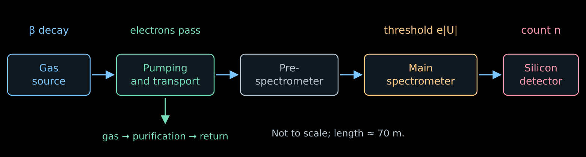{width="100%" fig-alt="The source produces electrons, pumping removes the gas, the spectrometer sets the threshold, the detector counts the transmitted electrons"}

- **Source:** many decays in a gas of known composition.
- **Transport:** the electrons follow the magnetic field; the neutral gas is pumped out.
- **Main spectrometer:** each electron either passes or is reflected.
- **Detector:** during the time $t$ the number of events $n$ accumulates; the count rate
  is equal to $R=n/t$.

::: {.nh-text tone="muted" size="sm"}
Scheme: the main components of [KATRIN](https://arxiv.org/abs/2103.04755).
:::

## Windowless source: the gas must flow {#katrin-source}

::::: {.panel-tabset .nh-story-tabs}

### Source

:::: {.columns}

::: {.column width="53%"}

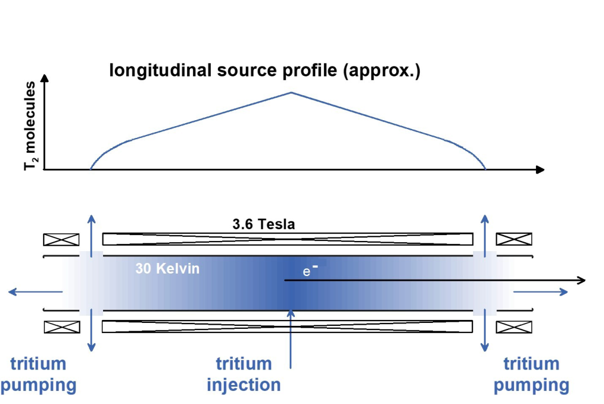{.slide-image-center .nostretch width="100%" fig-alt="Tritium is injected at the center of the ten-meter source and pumped out at both ends"}

::: {.nh-text tone="muted" size="sm"}
Scheme of the source: [Drexlin, Weinheimer, fig. 6](https://arxiv.org/abs/2601.00248).
WGTS is the windowless gaseous tritium source.
:::

:::

::: {.column width="44%"}

- Tritium is injected into the middle of a tube of length $10$ m.
- Pumps at both ends continuously remove the gas. The density is maximal at the center
  and drops toward the exits.
- The gas is purified and returned to the source: a stationary flow is maintained.
- The electron does not pass through a film or a window. But other gas molecules remain
  on its path.

:::

::::

### Density and temperature

- The number of molecules per unit transverse area defines the **column density**:

$$
\rho d\equiv\int_0^d n(z)\,dz
\simeq4\cdot10^{17}\ \mathrm{cm}^{-2}.
$$

- $n(z)$ is the concentration of molecules; $\rho d$ is the accepted notation for the integral.
- The larger $\rho d$, the more decays, but the more often the electron scatters.
  Therefore an instability of the density changes both the intensity and the shape of the spectrum.
- The injection pressure and the temperature $T_{\mathrm{gas}}$ are stabilized:
  they determine the distribution of the gas. The thermal motion of the molecules also
  produces Doppler broadening of the spectrum.

::: {.nh-box tone="accent" size="sm"}
It is important to know not only the number of decayed nuclei, but also the amount of gas
that the electron will meet after being born.
:::

### Gas composition

- The gas contains $\mathrm T_2$, $\mathrm{DT}$, $\mathrm{HT}$ and molecules
  without tritium. $\mathrm T_2$ has two radioactive nuclei, $\mathrm{DT}$ has one.
- Different molecules give different distributions of the final excitations of the daughter
  ion. This changes the production spectrum, as we saw in lecture 04.
- The composition is continuously measured by **Raman spectroscopy**:
  upon scattering, a laser photon gives the molecule energy of rotation or vibration,

$$
E_{\gamma,\mathrm{in}}-E_{\gamma,\mathrm{out}}
=\Delta E_{\mathrm{mol}}.
$$

- The positions of the lines distinguish the molecules, and their intensities, after calibration, give
  the concentrations of the components.

::: {.nh-text tone="muted" size="sm"}
[Measurement of the isotopic composition by Raman spectroscopy](https://doi.org/10.3390/s20174827).
:::

:::::

## Let the electrons through, stop the tritium

::::: {.panel-tabset .nh-story-tabs}

### Curved tube

- The electron is charged. In a smoothly curved magnetic field its guiding
  center follows the field line.
- The neutral molecule $\mathrm T_2$ is not held by this field. Between
  collisions it flies almost in a straight line.
- The bends of the tube eliminate the direct flight of molecules to the spectrometer. The molecules
  collide with the walls and get more opportunities to end up in a pump.
- Meanwhile the electron beam passes along the magnetic flux tube.

::: {.nh-box tone="success" size="md"}
The difference in electric charge makes it possible to separate the electrons from the gas
without a material window.
:::

### Two pumping stages

- **Differential pumping:** several pumps in series reduce
  the pressure. The fast blades of a turbomolecular pump transfer to the molecules
  momentum in the pumping direction.
- **Cryogenic pumping:** the residual gas lands on walls colder than $5$ K,
  covered with a porous layer of frozen argon.
- On the cold surface the molecules are adsorbed and return to the gas
  very slowly. The large surface of the argon layer increases
  the capacity of the trap.
- The whole system reduces the flow of tritium to the spectrometers by more than
  $14$ orders of magnitude.

::: {.nh-text tone="muted" size="sm"}
DPS and CPS in the technical diagrams are the sections of differential and cryogenic
pumping. [KATRIN setup, sections on pumping](https://arxiv.org/abs/2103.04755).
:::

### Why this matters for the spectrum

- A decay inside the source occurs before the retarding barrier.
  The energy of the electron is checked by the filter.
- If tritium decays already inside the main spectrometer, the electron may
  be born on the other side of the barrier.
- Such an electron can reach the detector even though its initial energy
  did not satisfy the selection for source electrons.
- These counts form the background. In the region of the endpoint of the spectrum even a small
  addition is comparable to the useful signal.

:::::

## Why is the gas on the electron's path dangerous?

::::: {.panel-tabset .nh-story-tabs}

### Pro and con

- **Pro.** In the solid source of the 1980s the electron was born inside the film and
  lost energy in the same film. The thickness, roughness and composition of the film entered into the
  result — and the unconfirmed $30$ eV is an example of this (lecture 04).
- **Con.** The windowless source removed the substrate, but the gas remained on the path:
  between the point of birth and the filter there lies a column of molecules.
- For an individual electron neither the place of birth, nor the number of
  collisions, nor the lost energy is known:

$$
\boxed{E_{\text{at the filter}}=E-\varepsilon},
\qquad
\varepsilon=\varepsilon_1+\ldots+\varepsilon_n.
$$

- The barrier compares with the threshold precisely $E-\varepsilon$, while the neutrino mass is
  recorded in the distribution $E$.

### What this threatens for the mass

- The energy loss moves the electron down along the measured spectrum. Near the endpoint of the spectrum
  this looks like a lack of counts.
- But a lack of counts near the endpoint can also be explained by the neutrino mass. An error in the
  losses will flow into $m_\beta^2$.
- Inelastic losses begin at about $11$ eV, while the mass is determined from
  the last $40$ eV of the spectrum: the losses fall right into the working window.
- An estimate from the last section of the lecture: an unaccounted broadening of the response $\sigma_E$
  shifts the result by

$$
\Delta m_\beta^2\simeq-2\sigma_E^2.
$$

- A broadening of only $0.2$ eV gives $-0.08$ eV$^2$ — this is already of the order of the entire
  statistical error of the first five campaigns.

::: {.nh-box tone="warning" size="sm"}
In the KATRIN uncertainty table the optical depth ($0.052$ eV$^2$) and the
energy-loss distribution ($0.034$ eV$^2$) are the two largest contributions after
the statistical one. This slide explains where they come from.
:::

### What to do

- Two things are needed: the distribution of losses in a single collision $g_1$ and
  the probabilities of the number of collisions $P_n$.
- They cannot be extracted from the β spectrum itself: it contains the same mixture of unknowns. A separate
  beam with a known energy is needed — a **photoelectron gun**.
- Measurement plan:

$$
\begin{array}{ll}
\text{we scan } e|U| &\text{— we see how much energy the beam has lost},\\[2mm]
\text{we vary } \rho d &\text{— we change the weights of single and multiple collisions},\\[2mm]
\text{we remove the gas} &\text{— we obtain the intrinsic resolution of the instrument}.
\end{array}
$$

::: {.nh-box tone="accent" size="sm"}
The gun says nothing about the neutrino mass. It measures properties of the gas, which
then enter into the calculation of the β spectrum.
:::

:::::

## How many collisions will an electron experience?

::::: {.panel-tabset .nh-story-tabs}

### Path in the gas

- Let an electron be born at the point $z$ and move toward the exit $z=d$ at an angle
  $\alpha$ to the axis of the almost uniform field. For the axial displacement $dz'$ it travels
  the path $dz'/\cos\alpha$. The mean number of inelastic collisions is equal to

$$
\boxed{
\tau(z,\alpha)=
\frac{\sigma_{\mathrm{inel}}}{\cos\alpha}
\int_z^d n(z')\,dz'
}.
$$

- This quantity is called the **optical depth**: the path expressed in mean free
  path lengths $\lambda=1/(n\sigma_{\mathrm{inel}})$. In lecture 01 the ratio $x/\lambda$ in the law $P_0=e^{-x/\lambda}$ had
  the same meaning.
- For the whole column of gas

$$
\boxed{
\tau_{\mathrm{col}}=(\rho d)\,\sigma_{\mathrm{inel}}
\simeq(4\cdot10^{17})(3.4\cdot10^{-18})\simeq1.36
}.
$$

- The gun beam goes along the axis through the whole column, therefore
  $\tau_{\mathrm{gun}}=\tau_{\mathrm{col}}$.

::: {.nh-text tone="muted" size="sm"}
The angle and the cross section are assumed constant along the path. This is an approximation for estimating the
probabilities; the change of direction in collisions is taken into account in a more complete
model.
:::

### Probabilities

- The collisions are independent, therefore their number is Poisson distributed:

$$
\boxed{
P_n(z,\alpha)=e^{-\tau}\frac{\tau^n}{n!}
},
\qquad
\tau=\tau(z,\alpha).
$$

- For the gun beam $\tau=\tau_{\mathrm{col}}\simeq1.36$:

$$
P_0\simeq0.26,
\qquad
P_1\simeq0.35,
\qquad
P_2\simeq0.24,
\qquad
P_3\simeq0.11.
$$

- At least one collision is experienced by three quarters of the beam, two or more by
  almost forty percent.

::: {.nh-box tone="accent" size="sm"}
A single average correction for the lost energy will not do here: both the
full distribution of losses and the weights of all multiplicities are needed.
:::

### Gun and β decay

:::: {.columns}

::: {.column width="54%"}

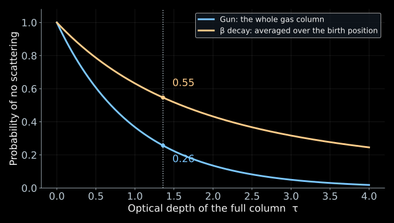{width="100%" fig-alt="The probability of escaping without scattering is higher for electrons produced in the gas than for a beam passing through the whole column"}

::: {.nh-box tone="warning" size="sm"}
The numbers refer to different objects: $0.26$ to the gun beam, $0.55$ to the
β electrons of the same gas. The gun measures the **gas**; to go over to the β spectrum
one must average over the places of birth and the angles.
:::

::: {.nh-text tone="muted" size="sm"}
The probability of production is proportional to the concentration, therefore $u$ is uniform for
any shape of the profile $n(z)$.
:::

:::

::: {.column width="43%"}

- The gun passes through the **whole** column, therefore the fraction of those that have not lost energy is equal to

$$
P_0^{\mathrm{gun}}=e^{-\tau_{\mathrm{col}}}\simeq0.26.
$$

- The β electron is born **inside** the gas. For $\alpha=0$ and constant composition
  the thickness remaining to the exit $u$ is uniform on $[0,\tau_{\mathrm{col}}]$:

$$
\boxed{
\langle P_0\rangle_\beta
=\frac{1}{\tau_{\mathrm{col}}}\int_0^{\tau_{\mathrm{col}}}e^{-u}\,du
=\frac{1-e^{-\tau_{\mathrm{col}}}}{\tau_{\mathrm{col}}}
\simeq0.55
}.
$$

- Averaging over angles reduces this number: oblique trajectories are longer.

:::

::::

:::::

## Electron gun: what do we measure? {#electron-gun}

::::: {.panel-tabset .nh-story-tabs}

### The task

**Determine the energy-loss distribution in a single inelastic collision
with a tritium molecule.**

$g_1(\varepsilon)\,d\varepsilon$ is the probability of a loss in the interval
$[\varepsilon,\varepsilon+d\varepsilon]$ in such a collision.

$$
\int_0^\infty g_1(\varepsilon)\,d\varepsilon=1.
$$

- $g_1$ is the simplest object in this problem: a property of a single molecule, not
  of the apparatus. This function depends neither on the gas density, nor on the
  electron's birth position, nor on the angle.
- Everything else is built from it: the losses in $n$ collisions are convolutions
  $g_1$, and the weights of the multiplicities are Poisson $P_n(\tau)$.

::: {.nh-box tone="accent" size="sm"}
Knowing $g_1$ and $\tau$, we know the loss distribution for any gas density and
any path length in it.
:::

### Sum of losses

For two independent collisions the losses add up:
$\varepsilon=\varepsilon_1+\varepsilon_2$.

$$
\boxed{
g_2(\varepsilon)=
\int_0^\varepsilon
 g_1(x)\,g_1(\varepsilon-x)\,dx
\equiv (g_1*g_1)(\varepsilon).
}
$$

The integral over all partitions of the total loss is a **convolution**.

For exactly $n$ collisions:

$$
g_n=\underbrace{g_1*\cdots*g_1}_{n\ \text{times}}.
$$

::: {.nh-text tone="muted" size="sm"}
Convolution of distributions and the Poisson law are discussed in my course
on statistical analysis.
:::

### Example

:::: {.columns}

::: {.column width="52%"}

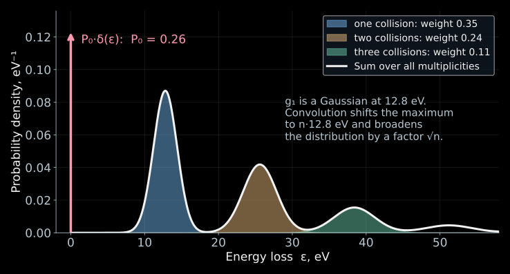{width="100%" fig-alt="Toy model: a Gaussian energy-loss function and its convolutions with Poisson weights give the full energy-loss distribution"}

::: {.nh-text tone="muted" size="sm"}
This is a teaching model, not a measured $g_1$: the real function also has an
ionization tail, which is visible in Fig. 11 at the end of this section.
:::

:::

::: {.column width="45%"}

- Toy model: $g_1$ is a Gaussian centered at $12.8$ eV with width $1.6$ eV.
- The contribution of exactly $n$ collisions is $P_ng_n$: the maximum moves to
  $n\cdot12.8$ eV, the width grows as $\sqrt n$, and the weight falls off according to the Poisson law.
- The full loss distribution of the beam:

$$
\boxed{
G(\varepsilon)=P_0\,\delta(\varepsilon)
+\sum_{n\ge1}P_n\,g_n(\varepsilon)
}.
$$

- The red arrow is the contribution of $P_0\delta(\varepsilon)$: electrons without losses.

:::

::::

:::::

## How are energy losses measured? {#electron-gun-measurement}

::::: {.panel-tabset .nh-story-tabs}

### Charging the gun!

:::: {.columns}

::: {.column width="51%"}

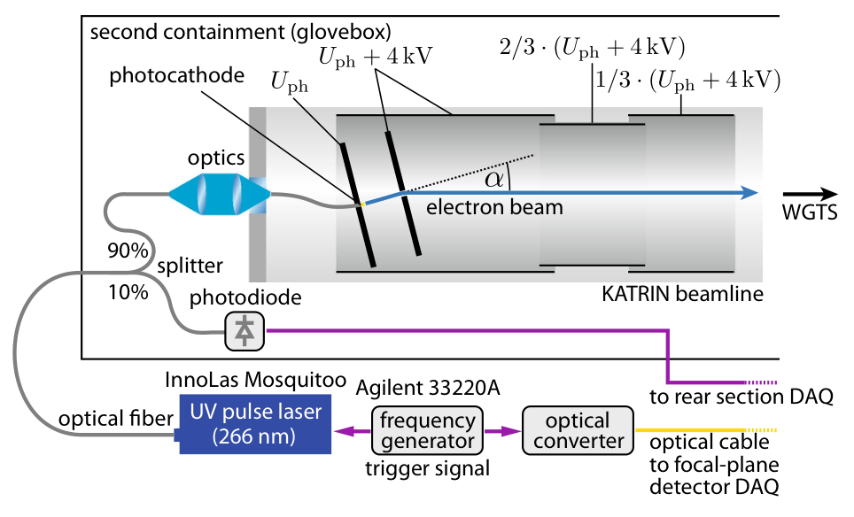{.slide-image-center .nostretch width="100%" fig-alt="Photoelectron gun: ultraviolet light illuminates the photocathode, electrodes accelerate the electrons toward the gas source"}

::: {.nh-text tone="muted" size="sm"}
[KATRIN, Fig. 2](https://doi.org/10.1140/epjc/s10052-021-09325-z).
The light is chosen close to the photoelectric threshold in order to reduce the initial
energy spread.
:::

::: {.nh-text tone="muted" size="sm"}
Recall: $\tau_{\mathrm{col}}=(\rho d)\sigma_{\mathrm{inel}}\simeq1.36$ is
the optical depth of the entire column, $P_n=e^{-\tau}\tau^n/n!$ is the probability of exactly
$n$ collisions, $g_n$ is the distribution of the energy loss after them.
:::

:::

::: {.column width="46%"}

Ultraviolet light liberates electrons from the photocathode, and the electric field sets
the energy $E_{\mathrm{gun}}\simeq18.6$ keV. The beam passes through the entire gas column
almost along the axis.

What matters is neither the energy nor the barrier separately, but their difference:

$$
\boxed{E_s=E_{\mathrm{gun}}-e|U|}.
$$

$E_s$ is the **surplus energy** (hence the subscript $s$).
With a sharp filter, an electron passes if

$$
E_{\mathrm{gun}}-\varepsilon>e|U|
\quad\Longleftrightarrow\quad
\boxed{\varepsilon<E_s}.
$$

**In other words, $E_s$ is the largest loss that the filter lets through.**
By scanning $E_s$, we scan the threshold in losses.

:::

::::

### Density scan

:::: {.columns}

::: {.column width="46%"}

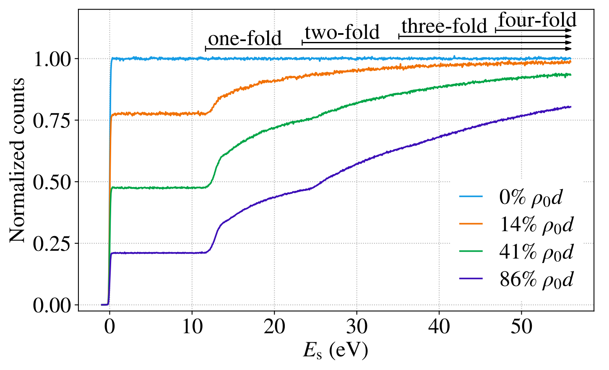{.slide-image-center .nostretch width="100%" fig-alt="Measured normalized count rate as a function of surplus energy at zero and three nonzero gas densities"}

::: {.nh-text tone="muted" size="sm"}
[KATRIN, Fig. 3](https://doi.org/10.1140/epjc/s10052-021-09325-z) shows the measured
curves. The background and changes in the gun intensity are taken into account in the analysis.
:::

:::

::: {.column width="51%"}

- The horizontal axis is $E_s$, the largest transmitted loss. The vertical axis is the
  normalized count $r_{\mathrm{gun}}$: the ratio to the count without gas at
  large $E_s$.
- **No gas** (light blue): a step at $E_s=0$. Its width is the intrinsic
  resolution of the gun and the filter; this is the function $\mathcal T_{\mathrm{gun}}(E_s)$.

:::

::::

### Plateau and rise

:::: {.columns}

::: {.column width="46%"}

{.slide-image-center .nostretch width="100%" fig-alt="Measured normalized count rate as a function of surplus energy at zero and three nonzero gas densities"}

::: {.nh-text tone="muted" size="sm"}
[KATRIN, Fig. 3](https://doi.org/10.1140/epjc/s10052-021-09325-z) shows the measured
curves. The background and changes in the gun intensity are taken into account in the analysis.
:::

:::

::: {.column width="51%"}

- **Plateau:** only electrons without losses have passed. As long as $E_s$ has not grown
  to the smallest possible loss ($\simeq11$ eV), there is nothing to add:

$$
r_{\mathrm{gun}}^{\text{plateau}}\simeq P_0=e^{-\tau}.
$$

- **Rise:** at $E_s\simeq12$ eV the singly scattered electrons pass, at
  $\simeq25$ the doubly scattered ones, at $\simeq37$ the triply scattered ones.

:::

::::

### What this means

:::: {.columns}

::: {.column width="46%"}

{.slide-image-center .nostretch width="100%" fig-alt="Measured normalized count rate as a function of surplus energy at zero and three nonzero gas densities"}

::: {.nh-text tone="muted" size="sm"}
[KATRIN, Fig. 3](https://doi.org/10.1140/epjc/s10052-021-09325-z) shows the measured
curves. The background and changes in the gun intensity are taken into account in the analysis.
:::

:::

::: {.column width="51%"}

- The plateau tells us **how many** electrons lost nothing: the heights
  $0.78$, $0.48$, $0.21$ at $14$, $41$, $86\,\%$ of $\rho_0d$ give
  $\tau=-\ln P_0\simeq0.25$, $0.73$, $1.56$.
- The **rise** tells us **how** the others lose
  energy: its shape follows the integral of $g_1$.
- The denser the gas, the lower the plateau and the more pronounced the multiple collisions.
- The shape of $g_1$ does not change in the process — this is what the separation of parameters rests on.
  $\mathcal T_{\mathrm{gun}}$ refers to the nearly axial beam of the gun.
- The **transmission** for isotropic β electrons will be constructed before we assemble the response function.

:::

::::

:::::

## Reconstructing the loss function {#electron-gun-fit}

::::: {.panel-tabset .nh-story-tabs}

### Response model

::: {.nh-text tone="muted" size="sm"}
Recall the notation of the previous two slides: $P_n$ is the probability of $n$
collisions, $g_n$ is the distribution of the total energy loss after them,
$\mathcal T_{\mathrm{gun}}(E_s)$ is the measured transmission of the gun without gas.
:::

A loss $\varepsilon$ shifts the argument of the transmission:
$\mathcal T_{\mathrm{gun}}(E_s-\varepsilon)$.
We average over the losses after $n$ collisions:

$$
(\mathcal T_{\mathrm{gun}}*g_n)(E_s)
=
\int_0^\infty
 g_n(\varepsilon)\,
 \mathcal T_{\mathrm{gun}}(E_s-\varepsilon)\,d\varepsilon.
$$

We sum the contributions with the probabilities $P_n$:

$$
\boxed{
\begin{aligned}
r_{\mathrm{gun}}(E_s)
&=P_0\,\mathcal T_{\mathrm{gun}}(E_s)
 +P_1(\mathcal T_{\mathrm{gun}}*g_1)(E_s)\\
&\quad+P_2(\mathcal T_{\mathrm{gun}}*g_2)(E_s)+\ldots
\end{aligned}
}
$$

::: {.nh-text tone="muted" size="sm"}
$r_{\mathrm{gun}}$ is the normalized gun signal; the background is taken into account separately.
[KATRIN, equations (6)–(9)](https://doi.org/10.1140/epjc/s10052-021-09325-z).
:::

### Parameter fit

:::: {.columns}

::: {.column width="57%"}

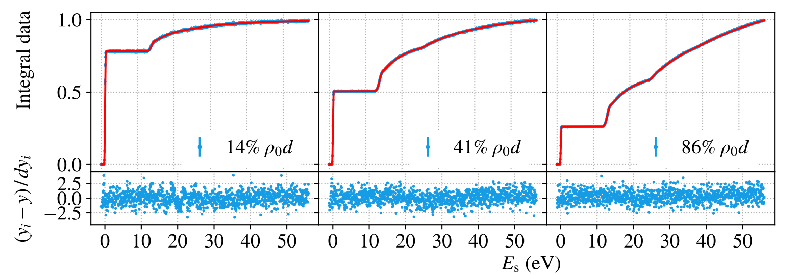{.slide-image-center .nostretch width="100%" fig-alt="Three integral data sets at different gas densities are described by a common model; normalized residuals are shown below each plot"}

::: {.nh-text tone="muted" size="sm"}
[KATRIN, Fig. 10, top row](https://doi.org/10.1140/epjc/s10052-021-09325-z) shows
the same measurements as in Fig. 3, but now together with the model. Fig. 3 shows the curves
themselves: all densities on one panel, normalized to the count without gas. Fig. 10
shows the result of the joint fit: data, model, and residuals, with each
panel normalized to its own last bin — so the plateau height here is no longer
equal to $P_0$. The joint fit also includes the differential time-of-flight
data.
:::

::: {.nh-box tone="accent" size="sm"}
Why different densities separate the parameters: $\tau$ shifts the height of the plateau and
the weights of the steps, while $g_1$ sets their shape. By varying $\rho d$, we mix these
contributions in different ways — and "how many collisions" is separated from "how a single collision
loses energy".
:::

:::

::: {.column width="40%"}

- **Common to all data sets:** the shape of $g_1$. Below the ionization threshold it is taken as a sum
  of three Gaussians, above it as a calculated ionization tail.
- **Specific to each data set:** the optical depth $\tau$, the normalization, and the background.
- The parameters are fitted to all densities simultaneously: one and the same $g_1$ must
  describe both the plateau height and the shape of all the steps.
- The lower panels show the normalized residuals $(y_i-y)/dy_i$. A scatter around zero without
  visible structure means that the fit succeeded.

:::

::::

### Result

:::: {.columns}

::: {.column width="58%"}

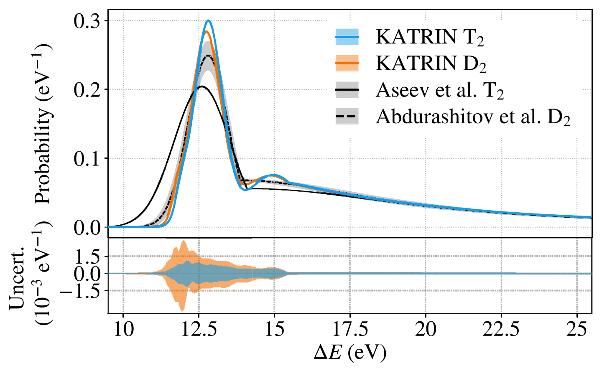{.slide-image-center .nostretch width="100%" fig-alt="Reconstructed energy-loss distribution for a single collision: the KATRIN T2 curve and a comparison with deuterium and previous measurements"}

:::

::: {.column width="39%"}

- The light-blue curve is the $g_1$ found for tritium.

- The peak near $12.8$ eV corresponds to electronic excitations of the molecule.
The tail above $15.5$ eV is ionization.

- Next we use $g_n$ in the calculation of the response of the β source,
taking into account the birth positions and angles of the electrons.

:::

::::

::: {.nh-text tone="muted" size="sm"}
[KATRIN, Fig. 11](https://doi.org/10.1140/epjc/s10052-021-09325-z).
The horizontal axis shows $\Delta E=\varepsilon$; the vertical axis shows the
probability density, eV$^{-1}$.
:::

:::::

## How to measure 18,600 volts to hundredths of a volt?

::::: {.panel-tabset .nh-story-tabs}

### What each instrument does

- A negative voltage $U\simeq-18.6$ kV is applied to the vessel of the main spectrometer.
  A commercial source sets the main level, but its stability of order $10^{-4}$ means
  fluctuations of about $1$ V.
- A parallel post-regulator based on a vacuum triode picks a small
  correcting current and suppresses fast voltage fluctuations.
- The alternating component is measured by a **ripple probe**: it sees noise
  in the range up to about $1$ MHz.
- The DC component is measured slowly, but precisely:

$$
U_{\rm vessel}
\xrightarrow{\ \text{divider }M\simeq1972\ }
u\simeq-9.4~\text{V}
\xrightarrow{\ \text{voltmeter}\ }
U_{\rm vessel}=Mu.
$$

- The requirement $3\cdot 10^{-6}$ at $18.6$ kV means
  $|\delta U|\lesssim56$ mV. For an electron this is a threshold shift of
  $|\delta E|=e|\delta U|\lesssim56$ meV.

### Voltage divider

:::: {.columns}

::: {.column width="53%"}

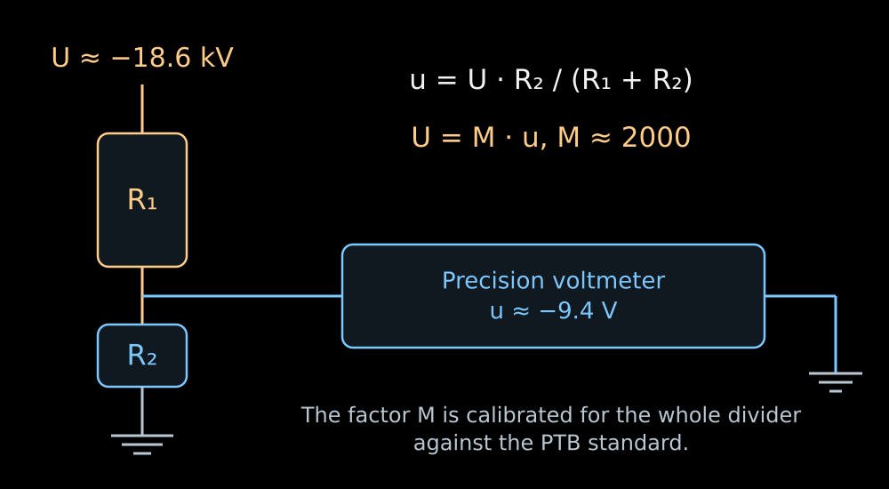{width="100%" fig-alt="The high voltage is divided by a resistor chain down to a few volts and measured with a precision voltmeter"}

- The calculation uses the scale factor of the entire instrument, measured relative to
  the PTB reference divider:

$$
M(-18.6~\text{kV})=1972.4801\pm0.0040
\qquad (\text{expanded uncertainty},~k=2).
$$

:::

::: {.column width="44%"}

- In the K35 divider the high-voltage arm is a chain of one hundred resistors of
  $1.84$ MΩ each. Each of them carries about $186$ V and $19$ mW.
- The low-voltage arm has a resistance of about $93$ kΩ. The division ratio
  of the whole chain is

$$
M\equiv\frac{U}{u}
=\frac{R_{\rm HV}+R_{\rm LV}}{R_{\rm LV}},
\qquad \boxed{U=Mu}.
$$

- At $|U|=18.6$ kV the voltmeter reads $|u|\simeq9.43$ **V**.
  Such a signal is convenient to measure on the most accurate range of the voltmeter.

:::

::::

:::::

## How is the divider accuracy maintained? {#katrin-divider-stability}

::::: {.panel-tabset .nh-story-tabs}

### Resistors and the environment

:::: {.columns}

::: {.column width="49%"}

**Resistors and heating**

- One hundred resistors were selected out of two hundred after measuring the
  temperature coefficient and burning in under voltage.
- Resistors with opposite temperature drifts are placed next to each other.
  For the assembled arm, the changes partially compensate.
- After switch-on, the divider is allowed to warm up for at least five minutes.
  The residual shift during warm-up is about $10^{-6}$.

:::

::: {.column width="49%"}

**Environment, leakage, and time**

- The resistors are kept in dry nitrogen at $25.0\pm0.15\,{}^\circ$C.
  Electrodes equalize the field; Teflon insulators reduce leakage currents.
- The temperature coefficient of the assembled K35 is about
  $-0.081 \cdot 10^{-6}$/K, much smaller than the coefficient of an individual resistor.
- The measured long-term drift of K35 is about $6\cdot 10^{-7}$ per month;
  therefore the coefficient $M$ is periodically recalibrated.

:::

::::

### Checking the scale

- At the divider output, the requirement $3\cdot 10^{-6}$ corresponds to roughly
  $28$ μV out of $9.43$ V. The voltmeter is checked against a $10$-volt
  standard tied to the Josephson effect.
- Four years later, a calibration using two $^{83\mathrm m}$Kr lines gave
  $M=1972.449(10)$: the difference from the PTB measurement was $(-2\pm5) \cdot 10^{-6}$.
  This is an independent check of the entire electrical scale with electrons of
  known energy.

::: {.nh-text tone="muted" size="sm"}
[KATRIN high-voltage system](https://doi.org/10.1088/1748-0221/13/04/P04020) ·
[K35 divider](https://arxiv.org/abs/0908.1523) ·
[calibration with $^{83\mathrm m}$Kr](https://arxiv.org/abs/1802.05227).
:::

:::::

## Krypton provides lines of known energy {#krypton-calibration}

::::: {.panel-tabset .nh-story-tabs}

### Internal conversion

:::: {.columns}

::: {.column width="51%"}

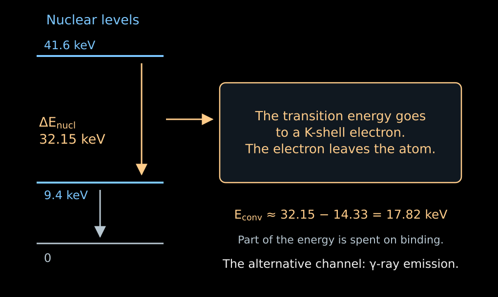{width="100%" fig-alt="In the krypton nuclear transition, an energy of 32.15 keV is transferred to a bound electron; subtracting the binding energy gives a line at about 17.82 keV"}

:::

::: {.column width="46%"}

- An excited nucleus can transfer its energy directly to one of the electrons
  of the atomic shell. This is **internal conversion**.
- The electron leaves the atom; part of the transition energy is spent on its binding.
- For the shell $a$:

$$
\boxed{
E_{\mathrm{conv},a}
=\Delta E_{\mathrm{nucl}}
-E_{\mathrm{bind},a}
-E_{\mathrm{recoil}}
}.
$$

- There is no neutrino here carrying away a variable fraction of the energy.
  A fixed transition and a shell give a spectral line.

:::

::::

### Why ⁸³ᵐKr

- The index $\mathrm m$ denotes a metastable, long-lived excited state of the
  nucleus.
- In $^{83\mathrm m}\mathrm{Kr}$, a transition with an energy of about $32.15$ keV gives a
  conversion line of the $K$ shell at about $17.82$ keV — close to the end
  of the tritium spectrum.
- $K$ is the electron shell closest to the nucleus; the line designation $K$-32
  indicates the shell and the energy of the nuclear transition.
- The line has a natural width, about $2.7$ eV for $K$-32.
  With a large number of electrons, the position of its center can be determined
  much more precisely than the width.
- For other tasks, narrower lines of other shells are used.

::: {.nh-text tone="muted" size="sm"}
[$^{83}\mathrm{Rb}/{}^{83\mathrm m}\mathrm{Kr}$ conversion sources](https://arxiv.org/abs/1212.5016).
:::

### What the measured line shows

- We scan the retarding voltage across the line.
  The integral count rate changes from full transmission to zero.
- The **position of the edge** checks the energy scale.
- The **shape of the edge** depends on the natural width of the line, the spread
  of initial potentials, and the transmission of the spectrometer.
- Knowing the intrinsic shape of the line, one can determine additional shifts
  and broadenings of the apparatus.
- Lines of different shells allow the scale to be checked at several points.
  When the difference of their energies is used, the energy of the common
  nuclear transition cancels.

::: {.nh-text tone="muted" size="sm"}
[Calibration using the difference of conversion lines](https://arxiv.org/abs/1802.05227).
:::

:::::

## Monitor spectrometer: checking the scale

:::: {.columns}

::: {.column width="44%"}

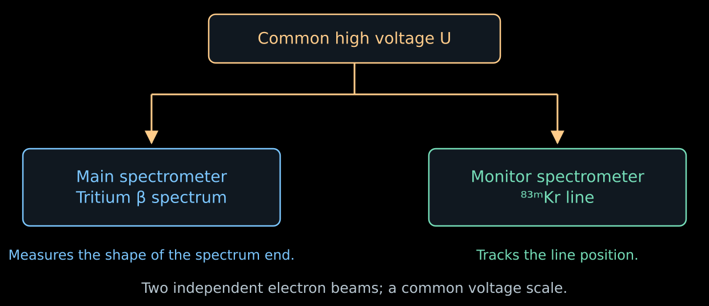{width="100%" fig-alt="The main and monitor spectrometers are connected to the same high voltage but measure different electron sources"}

::: {.nh-text tone="muted" size="sm"}
[Monitor spectrometer and stability of the conversion source](https://arxiv.org/abs/1212.5016).
:::

:::

::: {.column width="53%"}

- A small separate MAC-E spectrometer measures the conversion line of a
  stable $^{83}\mathrm{Rb}/{}^{83\mathrm m}\mathrm{Kr}$ source.
- It is connected to the same high voltage as the main spectrometer.
  The $K$-32 line lies about $0.8$ keV below the endpoint of the tritium spectrum;
  a separate voltage on the source shifts it to the required working region.
- If the line has shifted while the source is stable, the energy scale has changed.
  This can be compared with the readings of the voltage divider.
- The monitor checks the stability of the scale over time. The gaseous source and
  local inhomogeneities of the main spectrometer require their own calibrations.

:::

::::

## The electron also has an initial potential

::::: {.panel-tabset .nh-story-tabs}

### Plasma in the source

- β electrons ionize the gas. Slow electrons and
  positive ions appear in the source — a weakly ionized plasma.
- The charge distribution creates an electric potential
  $\Phi_{\mathrm{src}}(z)$.
- Suppose an electron is born with kinetic energy $E$ at the point $z$.
  Its charge is $-e$, so the potential energy is $-e\Phi$.
  On passing to a region with $\Phi=0$, energy conservation gives

$$
E-e\Phi_{\mathrm{src}}(z)=E_{\mathrm{at}\ \Phi=0}.
$$

- Two electrons with the same initial $E$ but from different points of the source
  can arrive at the filter with different energies.

::: {.nh-box tone="warning" size="sm"}
A stable spectrometer voltage does not yet guarantee the same
energy threshold for all electron birth locations.
:::

### Measurement inside the gas

- A small admixture of gaseous $^{83\mathrm m}\mathrm{Kr}$ is added to the tritium.
- Conversion electrons are born inside the same plasma.
  Their initial line is known, while the measured one contains the influence of the gas potential.
- The mean potential shifts the line. The spatial spread of potentials
  broadens it.
- These effects are estimated from the krypton lines; when transferring the calibration to
  the β spectrum, the gas distribution and electron losses are taken into account.
- The temperature $80$ K is chosen, in particular, so that krypton remains in the gas phase
  rather than being deposited on the walls.

::: {.nh-text tone="muted" size="sm"}
[Co-circulation of tritium and krypton and diagnostics of the source potential](https://arxiv.org/abs/2103.04755);
[application in the first five campaigns](https://arxiv.org/abs/2406.13516).
:::

:::::

## What does the silicon detector register?

::::: {.panel-tabset .nh-story-tabs}

### From electron to pulse

- An electron that has passed the filter is accelerated again by an electric field.
  An additional voltage at the detector raises its energy by a further
  few keV.
- In silicon, the electron spends its energy on exciting the material and creating
  electron–hole pairs.
- The diode field collects the charge. The electronics registers the pulse and its amplitude.
- The amplitude makes it possible to select events in an energy window and to suppress
  part of the background.

::: {.nh-box tone="accent" size="md"}
The energy threshold, to a precision of the order of an eV, is set by the spectrometer.
The detector, with a resolution of the order of a keV, counts the transmitted electrons.
:::

### Why 148 segments

- The detector is divided into $148$ sensitive pixels.
- The magnetic system maps different parts of the source and of the analyzing
  region onto different pixels of the detector.
- The electric potential and the magnetic field differ slightly across the cross section.
  This means that the transmission thresholds differ as well.
- The hit position makes it possible to apply the corresponding response function
  and to exclude shadowed or unstable regions.
- The spectra of the individual regions are described jointly: the neutrino mass is the same for all of them.

::: {.nh-text tone="muted" size="sm"}
[Design of the segmented detector](https://arxiv.org/abs/1404.2925).
:::

### An electron born after the barrier

- A slow electron can appear inside the spectrometer,
  for example by ionization of the residual gas.
- If it was born at $\Phi\simeq-|U|$ with an energy of $\varepsilon\ll1$ keV,
  then at the grounded exit

$$
\boxed{E_{\mathrm{out}}\simeq\varepsilon+e|U|}.
$$

- Near the endpoint of the spectrum, this is almost the same $18.6$ keV as for a useful electron.
- The detector cannot distinguish them by amplitude alone.
  The very production of such electrons has to be reduced.

:::::

## The background changes the design of the experiment

::::: {.panel-tabset .nh-story-tabs}

### Trapped electrons

- In Lecture 06, the magnetic mirror held particles in a trap.
  In the spectrometer, it can trap an electron of radioactive origin.
- The electron repeatedly passes through the residual gas and produces secondary
  electrons by ionization. A single primary decay can give a series of counts.
- Therefore the background count can have a larger variance than an independent
  Poisson flux.
- Radon from the materials is held back by cold traps in the pumping ports.
  Electrons from the walls are suppressed by the magnetic configuration and by a more negative
  potential of the wire electrodes.

### Pre-spectrometer

- The pre-spectrometer was originally intended to reflect in advance electrons
  with energies far below the endpoint of the β spectrum.
- But a confinement region arose between the two electrostatic barriers:
  along the axis the electric fields prevented escape, and transversely the magnetic field did.
  This is a Penning trap.
- The accumulation of charged particles led to a background growing with time.
- For later campaigns, the retarding voltage of the pre-spectrometer was
  reduced to the order of $100$ V. The main spectrometer continued to set
  the precise energy threshold.

::: {.nh-box tone="warning" size="sm"}
An additional filter is useful as long as it does not itself become a source of counts.
:::

### Background volume

:::: {.columns}

::: {.column width="55%"}

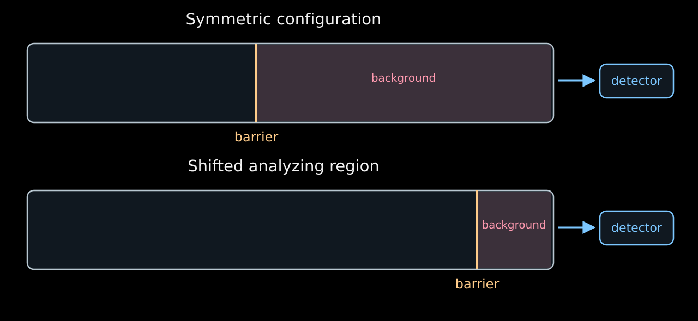{width="100%" fig-alt="Shifting the analyzing barrier toward the detector reduces the volume from which slow background electrons can reach the detector"}

:::

::: {.column width="42%"}

- Part of the background is born from neutral excited atoms
  entering the volume from the walls.
- A weakly bound electron can be freed even by the thermal
  radiation of the walls.
- If the barrier is shifted toward the exit and the magnetic flux tube is compressed, the
  volume available to the background after the barrier decreases.
- This configuration reduced the background by about a factor of two.
  The inhomogeneous fields in it are calibrated with krypton.

:::

::::

::: {.nh-text tone="muted" size="sm"}
The available volume is shown schematically; the geometry of the field lines is omitted.
[KATRIN shifted analyzing region](https://arxiv.org/abs/2408.07022).
:::

### Resolution and background

- The teaching example of Lecture 06 used a symmetric configuration:

$$
B_{\mathrm{src}}=3.6~\mathrm{T},\quad
B_{\mathrm A}=0.30~\mathrm{mT},\quad
B_{\max}=6.0~\mathrm{T}
\quad\Rightarrow\quad \Delta E\simeq0.95~\mathrm{eV}.
$$

- For the characteristic fields of the shifted configuration

$$
B_{\mathrm{src}}\simeq2.5~\mathrm{T},\quad
B_{\mathrm A}\simeq0.6~\mathrm{mT},\quad
B_{\max}\simeq4.2~\mathrm{T}
\quad\Rightarrow\quad \Delta E\simeq2.7~\mathrm{eV}.
$$

- For larger $B_{\mathrm A}$, the magnetic flux tube is narrower and the transmission edge is wider.
- The loss of resolution is weighed against the gain from the lower background.
  The parameters are chosen according to the final uncertainty of $m_\beta^2$.
- In the real shifted region, $B_{\mathrm A}$ and the potential depend on
  position; a single number here gives only a characteristic scale.

::: {.nh-text tone="muted" size="sm"}
[Background reduction and choice of configuration](https://doi.org/10.1140/epjc/s10052-022-10220-4).
:::

:::::

## One voltage setting — one count rate {#katrin-integral-spectrum}

::::: {.panel-tabset .nh-story-tabs}

### Observable

- $S_\beta(E;m_\beta^2,E_0)$ — the production spectrum, including the final
  molecular states.
- $f(E,U)$ — the probability that an electron produced with energy $E$,
  after losses in the source and averaging over angles, passes the filter at voltage $U$.
- For one detector pixel and stable conditions:

$$
\boxed{
R(U)=A\int_0^{E_0}
S_\beta(E;m_\beta^2,E_0)\,f(E,U)\,dE+b
}.
$$

- $A$ includes the amount of tritium, the geometric acceptance, and the efficiency;
  $b$ is the background count rate.
- By varying $U$, one measures several integrals of the same spectrum.

### Interactive



- The shaded part of the spectrum gives the transmitted electrons.
  Changing the threshold changes its area — and the count rate.

::: {.nh-text tone="muted" size="sm"}
Teaching model: no molecular states and no scattering; the transmission edge
is approximated by a linear transition of width $0.95$ eV.
[Open the applet](../../ru/applets/katrin-integral-spectrum.qmd) (in Russian) ·
[Source code](https://github.com/NeutrinoHit/neutrinophysics/blob/main/introduction/ru/slides/assets/04_direct_neutrino_mass/_katrin_integral_spectrum.qmd).
:::

:::::

## Where is the mass in the integral spectrum? {#katrin-mass-shape}

::::: {.panel-tabset .nh-story-tabs}

### The integral can be taken

- To see the dependence on the mass, we temporarily keep a single final state,
  an ideal sharp filter, and a constant slowly varying factor $C$.
- Introduce $x=E_0-E$ and $w=E_0-e|U|$. The quantity $w$ is the width of the energy
  window between the threshold and the endpoint of the spectrum. For $w>m_\beta$:

$$
R(w)-b
=AC\int_{m_\beta}^{w}x\sqrt{x^2-m_\beta^2}\,dx
=\boxed{\frac{AC}{3}(w^2-m_\beta^2)^{3/2}}.
$$

- For $w\gg m_\beta$ the expansion gives

$$
\boxed{
R(w)\simeq AC\left(\frac{w^3}{3}-\frac{m_\beta^2w}{2}\right)+b
}.
$$

- The massless signal grows as $w^3$; the mass adds a deficit
  proportional to $m_\beta^2w$.

### Four different shapes

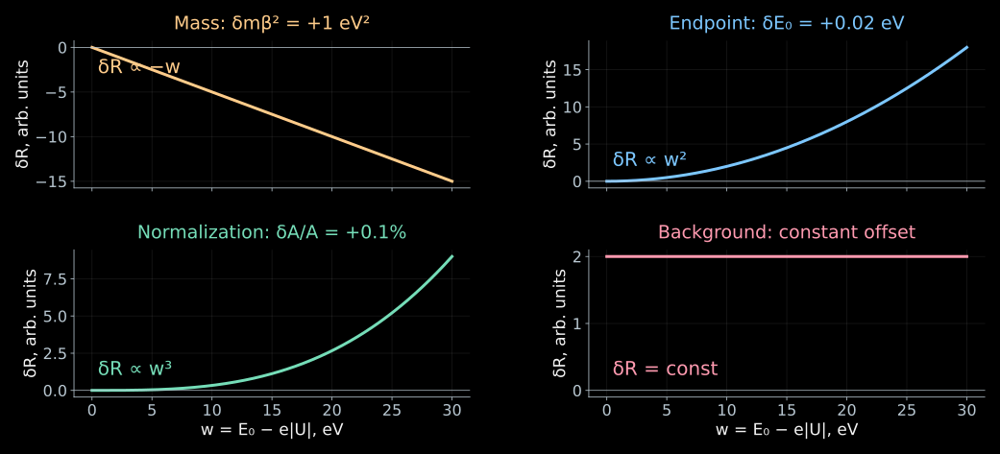{height="610" fig-alt="Small changes in the mass, the endpoint, the normalization and the background produce different dependences of the count rate on the distance from the endpoint"}

::: {.nh-text tone="muted" size="sm"}
Linearized model of the previous tab. The changes in the count rate are shown
with all other parameters held fixed; the vertical axis scales are different.
:::

### Why a single point is not enough

- At a single point, a deficit of counts can be explained by the mass, by a lower activity,
  or by a shift of the energy threshold.
- At several points these explanations give different dependences:

$$
\frac{\partial R}{\partial m_\beta^2}\simeq-\frac{AC}{2}w,\quad
\frac{\partial R}{\partial E_0}\simeq ACw^2,\quad
\frac{\partial R}{\partial A}\simeq\frac{C}{3}w^3,\quad
\frac{\partial R}{\partial b}=1.
$$

- When differentiating with respect to $E_0$, the voltage $U$ is fixed:
  $w=E_0-e|U|$ changes.
- The shape of the scan makes it possible to separate the four parameters, although their
  estimates remain correlated.

:::::

## How should the measurement time be distributed?

::::: {.panel-tabset .nh-story-tabs}

### Close to the endpoint

- In the simple model, the relative change of the signal due to the mass is

$$
\frac{R(m_\beta^2)-R(0)}{R(0)-b}
\simeq-\frac{3m_\beta^2}{2w^2}.
$$

- The closer the threshold is to the endpoint, the larger the relative effect.
- But the signal itself falls as $w^3$.
  At $w\to0$ the detector sees mostly background.
- Therefore it is not advantageous to measure only right at the endpoint.
  Part of the time is needed for points below the endpoint, and part for points above it, where the background is measured.

### The count and its uncertainty

- At threshold $U_k$ we measure for a time $t_k$ and record $n_k$ events.
  In the model of independent counts

$$
\lambda_k=t_kR(U_k),
\qquad
n_k\sim\operatorname{Poisson}(\lambda_k).
$$

- Therefore

$$
\sigma_R\simeq\sqrt{\frac{R}{t}},
\qquad
\frac{\sigma_R}{R}\simeq\frac{1}{\sqrt{Rt}}.
$$

- To reduce the statistical error by a factor of two, four times more
  time is required.
- If the background contains bursts of events from a single trapped particle, independence
  is violated; this addition to the variance is accounted for separately.

### The KATRIN scan

- One cycle contains several tens of voltages and takes about three hours.
- Points above the endpoint give the background; points below the endpoint help to separate
  the mass, $E_0$, and the normalization.
- In the analysis of the first five campaigns, the mass was determined from the region of the last
  $40$ eV below the endpoint and from the background points above it.
- The time at each point is chosen according to the sensitivity to the parameters.
  The order of the voltages is varied in order to check the influence of slow drifts.
- The detector pixels and campaigns have their own response and normalization
  parameters, but a common neutrino mass.

:::::

## How do calibrations enter the determination of the mass?

::::: {.panel-tabset .nh-story-tabs}

### Comparing the model and the data

- For independent Poisson counts the following function is convenient:

$$
D=2\sum_k\left[
\lambda_k-n_k+n_k\ln\frac{n_k}{\lambda_k}
\right].
$$

- This is $-2\ln L$ with a constant subtracted that does not depend on the model.
  For $n_k=0$ the logarithmic term is taken to be zero.
- One fits $m_\beta^2$, $E_0$, $A$, $b$, and the response parameters so that the
  model describes all the points.
- The more events there are, the smaller the shape deviations that become distinguishable.

### A separate measurement is an additional constraint

- Suppose the electron gun has given an optical depth
  $\tau_{\mathrm{cal}}\pm\sigma_\tau$.
- In the spectral analysis $\tau$ need not be fixed exactly,
  but a deviation from the calibration worsens the agreement:

$$
\boxed{
-2\ln L_{\mathrm{comb}}
=D_\beta+
\frac{(\tau-\tau_{\mathrm{cal}})^2}{\sigma_\tau^2}
+\ldots
}.
$$

- The quadratic term is the logarithm of a Gaussian model of the calibration measurement.
- In this way the uncertainty of the gas density is turned into an uncertainty of the
  mass. Fields, potentials, and energy losses are treated similarly.
- For correlated calibrations their covariance matrix is used.

::: {.nh-text tone="muted" size="sm"}
This is a simple form of a joint analysis. [KATRIN analysis methods](https://doi.org/10.1103/PhysRevD.104.012005).
:::

:::::

## Why can the minimum turn out to be at $m_\beta^2<0$?

::::: {.panel-tabset .nh-story-tabs}

### Fluctuation near zero

- In the expansion of the spectrum, the parameter $m_\beta^2$ reduces the number of electrons near the endpoint.
- If the true mass is small, a random deficit of counts pulls the estimate
  $m_\beta^2$ upward, and a random excess pulls it downward.
- The spectral model is continued into the region of negative values of the parameter,
  so that the minimum can lie on both sides of zero.
- The physical mass remains non-negative.
  This boundary is taken into account when constructing the confidence interval.

::: {.nh-box tone="accent" size="md"}
The free estimate of the parameter $m_\beta^2$ from fluctuating data
may turn out to be negative. The physical mass squared remains non-negative.
:::

### Unaccounted broadening

- Suppose the measured $x=E_0-E$ contains a random shift
  $\delta$ with mean $0$ and variance $\sigma_E^2$.
- In the region where the cutoff of the spectrum at the boundary can be neglected,

$$
\left\langle(x+\delta)^2\right\rangle=x^2+\sigma_E^2.
$$

- The mass correction has the form

$$
x\sqrt{x^2-m_\beta^2}\simeq x^2-\frac{m_\beta^2}{2}.
$$

- Attributing the unaccounted excess to the mass correction, we obtain

$$
\boxed{\Delta m_\beta^2\simeq-2\sigma_E^2}.
$$

- For example, an extra broadening of $0.2$ eV gives a shift of order $-0.08$ eV$^2$.

### What to check

- The mean energy has shifted — we check the scale and $E_0$.
- The width has increased — we check the voltage fluctuations,
  the source potential, and the distribution of final states.
- The energy-loss tail has changed — we check the gas and the electron-gun calibration.
- The counts above the endpoint have changed — we check the background.
- A negative minimum by itself does not single out the cause.
  The cause is sought in independent measurements and in the agreement of different data sets.

:::::

## The KATRIN result {#katrin-result}

::::: {.panel-tabset .nh-story-tabs}

### Result

- The first five campaigns: $259$ days of data, about $36$ million counts
  in the analyzed region.
- The joint analysis gave

$$
\boxed{m_\beta^2=-0.14^{+0.13}_{-0.15}~\mathrm{eV}^2}.
$$

- The deviation from zero is not significant. Taking the physical boundary into account:

$$
\boxed{m_\beta<0.45~\mathrm{eV}\qquad(90\%\ \text{confidence level})}.
$$

- This is a constraint on $m_\beta^2=\sum_i|V_{ei}|^2m_i^2$,
  introduced in lecture 04, and not a separate measurement of each of the three masses.

::: {.nh-text tone="muted" size="sm"}
[KATRIN Collaboration, Science 388, 180–185 (2025)](https://arxiv.org/abs/2406.13516).
:::

### What limits the precision

| Contribution for the first five campaigns | $\sigma(m_\beta^2)$, eV$^2$ |
|---|---:|
| Statistics | 0.108 |
| Optical depth $(\rho d)\sigma_{\mathrm{inel}}$ | 0.052 |
| Energy-loss distribution | 0.034 |
| Background dependent on the step duration | 0.027 |
| Changes of the source potential | 0.022 |
| Non-Poissonian background fluctuations | 0.015 |

- Each physical effect from the lecture leaves a measurable contribution to the mass error.
- These are selected contributions from the analysis table; in the presence of correlations they cannot
  simply be added as independent errors.

::: {.nh-text tone="muted" size="sm"}
[KATRIN uncertainty table](https://arxiv.org/abs/2406.13516).
:::

### Resolution and mass precision

- The width of the filter characterizes the transmission of a single electron.
- The mass is determined from a small change in the shape of the distribution of many
  millions of electrons.
- Therefore the limit on the mass can be smaller than the width of the transmission edge,
  if this width and the other properties of the response are known sufficiently accurately.
- According to a review from early 2026, about $1000$ days of data have been collected;
  the expected sensitivity of the full data set is better than $0.30$ eV.
- Sensitivity is a forecast of the typical limit for a small true mass.
  It does not replace the result of the data analysis.

::: {.nh-text tone="muted" size="sm"}
[Overview of the KATRIN program, January 2026](https://arxiv.org/abs/2601.00248).
:::

:::::

## What can be measured next?

::::: {.panel-tabset .nh-story-tabs}

### A kink from a heavy state

- Suppose there exists an additional mass state with mass $m_4$
  and admixture $|V_{e4}|^2$.
- It creates one more contribution to the spectrum:

$$
S_\beta(E)
=(1-|V_{e4}|^2)S_{\mathrm{light}}(E)
+|V_{e4}|^2S_4(E).
$$

- The channel with the heavy neutrino ends at $E\simeq E_0-m_4$.
  A kink appears on the smooth spectrum.
- If $m_4$ is of order keV, one has to look far from the endpoint, where the flux
  of electrons is much larger.
- For this task, the multi-segment silicon detector
  TRISTAN, designed for a high count rate, is being developed.

### A more precise measurement of the light mass

- In the integral mode, neighboring energies are probed by sequential
  scanning of the voltage.
- For KATRIN++, the possibility of measuring the energies of the transmitted electrons
  simultaneously is being studied — with microcalorimeters or via time of flight.
- Atomic tritium would remove the rotational-vibrational broadening of the molecule.
  Atomic excitations and recoil still have to be taken into account.
- The goal of the program under discussion is a sensitivity of order $50$ meV.
  The source and the detection methods for it are still under development.

::: {.nh-text tone="muted" size="sm"}
[Prospects of TRISTAN and KATRIN++, section 6](https://arxiv.org/abs/2601.00248).
Other ways of direct determination of the neutrino mass are the topic of lecture 08.
:::

:::::

## What do we need to know to weigh the neutrino?

- **Production spectrum:** the kinematics of β decay and the final states of the molecule.
- **Losses along the way:** gas density, angles, and scattering; these are checked
  with the electron gun.
- **Energy scale:** the voltage divider, conversion lines,
  and the monitor spectrometer.
- **Production conditions:** the plasma potential inside the source; it is probed
  with a krypton admixture.
- **Number of extra counts:** the background and its dependences on time and fields.
- **Mass:** one common quantity that must describe the spectra
  at different voltages and under different measurement conditions.

::: {.nh-box tone="success" size="md"}
KATRIN extracts the neutrino mass from the shape of the spectrum, after checking how this shape
is changed by the source, the fields, and the detection of the electrons.
:::

## Literature and materials

::::: {.panel-tabset .nh-story-tabs}

### Setup and result

- [Design, construction and commissioning of KATRIN](https://arxiv.org/abs/2103.04755),
  *JINST* **16**, T08015 (2021).
- [Spectrum model and response function](https://doi.org/10.1140/epjc/s10052-019-6686-7),
  *EPJ C* **79**, 204 (2019).
- [Analysis methods for the first mass measurement](https://doi.org/10.1103/PhysRevD.104.012005),
  *Phys. Rev. D* **104**, 012005 (2021).
- [First five campaigns: limit $0.45$ eV](https://arxiv.org/abs/2406.13516),
  *Science* **388**, 180–185 (2025).
- [G. Drexlin, C. Weinheimer: review of the experiment and its development](https://arxiv.org/abs/2601.00248), 2026.

### Calibrations

- [Photoelectron gun with controllable angle](https://arxiv.org/abs/2603.15918), 2026.
- [Electron energy losses in tritium and deuterium](https://doi.org/10.1140/epjc/s10052-021-09325-z), 2021.
- [Isotopic composition of the gas: Raman spectroscopy](https://doi.org/10.3390/s20174827), 2020.
- [Calibration of voltage dividers using conversion lines](https://arxiv.org/abs/1802.05227), 2018.
- [Stable $^{83}\mathrm{Rb}/{}^{83\mathrm m}\mathrm{Kr}$ sources](https://arxiv.org/abs/1212.5016), 2013.
- [Fields in the shifted analyzing region](https://arxiv.org/abs/2408.07022), 2024.

### Detector and background

- [Segmented silicon detector](https://arxiv.org/abs/1404.2925),
  *NIM A* **778**, 40–60 (2015).
- [Background from radioactive impurities on the surface](https://arxiv.org/abs/2011.05107),
  *Astroparticle Physics* **138**, 102686 (2022).
- [Background reduction with a shifted analyzing region](https://doi.org/10.1140/epjc/s10052-022-10220-4),
  *EPJ C* **82**, 258 (2022).

### Applet and exercises

- [KATRIN integral spectrum](../../ru/applets/katrin-integral-spectrum.qmd) (in Russian):
  relation between the position of the threshold and the number of transmitted electrons.
- [Applet source code](https://github.com/NeutrinoHit/neutrinophysics/blob/main/introduction/ru/slides/assets/04_direct_neutrino_mass/_katrin_integral_spectrum.qmd).
- [Exercises for Lecture 07](../exercises/07_katrin_exercises.qmd):
  averaging of losses, integral spectrum and estimate of $m_\beta^2$.

:::::

<!-- exercises:begin (generated by scripts/sync_exercise_slides.py) -->

## Exercises for this lecture {#lecture-exercises}

::: {.nh-text size="md"}
:::: {.columns}
::: {.column width="50%"}

- **7.1.** Final states and scattering in the source
- **7.2.** What KATRIN measures
- **7.3.** Why a fit can give $m_\beta^2<0$
- **7.4.** From calibration to the spectrum
- **7.5.** What one needs to know about the source

:::
::: {.column width="50%"}

- **7.6.** The krypton line as an energy standard
- **7.7.** Where measuring pays off most
- **7.8.** Calibration in the likelihood function
- **7.9.** A kink from a heavy neutrino

:::
::::
:::

::: {.nh-box tone="question"}
[All exercises for lecture 07 →](../exercises/07_katrin_exercises.qmd) · [All course exercises](../exercises/index.qmd)
:::

<!-- exercises:end -->
