## Energy can be converted into frequency or heat

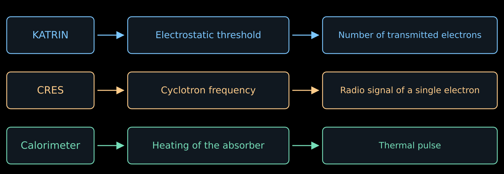{.nostretch width="64%" fig-alt="KATRIN compares the energy with a threshold, CRES measures the frequency, the calorimeter records the heating"}

- In lecture 07 we measured several integrals of the $\beta$ spectrum
  by varying the retarding voltage.
- Now we consider ways to measure the energy of each decay separately.
- There will be four ways:
  - hear the electron;
  - measure the heat;
  - reconstruct the missing momentum;
  - compare the arrival times.

## Method one: hear the electron {#cres-intro}

::: {style="width:78%;"}

- An electron in a magnetic field rotates and, like any accelerated charge, radiates.
- The frequency of this radio wave decreases as the energy grows. Catch the wave, measure
  the frequency — and we obtain the energy.

$$
\boxed{
\text{single decay}
\ \longrightarrow\
\text{radio signal}
\ \longrightarrow\
\text{frequency}
\ \longrightarrow\
\text{energy}
}
$$

- No threshold is needed here: the instrument listens to each electron individually.
- The method is called CRES, and it is being developed by the Project 8 experiment.

:::

## The cyclotron frequency depends on energy {#cres-energy}

::::: {.panel-tabset .nh-story-tabs}

### Relativistic correction

:::: {.columns}

::: {.column width="53%"}

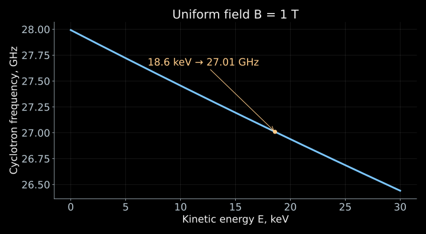{width="100%" fig-alt="In a known magnetic field the cyclotron frequency decreases as the electron kinetic energy increases"}

:::

::: {.column width="44%"}

- The energy does not appear in the nonrelativistic formula $\omega_c=eB/m_e$.
- In lecture 05 we obtained the relativistic refinement:

$$
f_c=\frac{\omega_c}{2\pi}
=\frac{eB}{2\pi\gamma m_e}
=\frac{f_0}{\gamma},
\qquad
\gamma=1+\frac{E}{m_ec^2}.
$$

- Here $f_0=eB/(2\pi m_e)$.
  A more energetic electron rotates more slowly.
- If the field is known, the frequency gives the energy:

$$
\boxed{E=m_ec^2\left(\frac{f_0}{f_c}-1\right)}.
$$

:::

::::

### How to hear an electron

- The electron moves with acceleration transverse to the magnetic field and emits
  an electromagnetic wave.
- The periodic rotation produces a signal at the cyclotron frequency.
  It can be received as long as the electron remains in the observed volume.
- For $B=1$ T and $E=18.6$ keV

$$
f_0\simeq27.99~\text{GHz},
\qquad
f_c\simeq27.01~\text{GHz}.
$$

- This approach is called **cyclotron radiation emission spectroscopy**,
  abbreviated CRES. It is being developed by the Project 8 experiment.

::: {.nh-text tone="muted" size="sm"}
In the electrodynamic formulas of this lecture $c$ is written explicitly,
and $E$ is the kinetic energy of the electron.
[Principle and implementation of CRES](https://arxiv.org/abs/2503.08807).
:::

:::::

## What arrives at the receiver input?

::::: {.panel-tabset .nh-story-tabs}

### Radiated power

- In the free-space approximation the radiated power is

$$
P_{\mathrm{rad}}
=\frac{e^4B^2}{6\pi\varepsilon_0m_e^2c}
\,\gamma^2\beta^2\sin^2\alpha.
$$

- $\beta=v/c$, and $\alpha$ is the angle between the velocity and the field.
  It is the transverse acceleration that radiates; for $\alpha=0$ there is no cyclotron radiation.
- For $E=18.6$ keV, $B=1$ T, $\alpha=90^\circ$:

$$
\boxed{P_{\mathrm{rad}}\simeq1.2\cdot10^{-15}~\text{W}}.
$$

- Only part of the power reaches the receiver.
  A waveguide or a resonator changes both the collection of the signal and the conditions of the emission itself.

::: {.nh-text tone="muted" size="sm"}
[Emission of an electron into the electromagnetic modes of the receiving system](https://arxiv.org/abs/1901.02844).
:::

### Is a femtowatt a lot?

:::: {.columns}

::: {.column width="58%"}

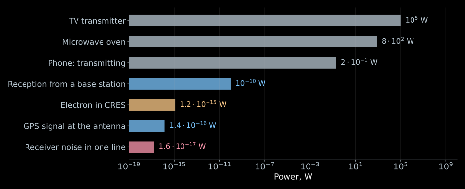{width="100%" fig-alt="Power scale: transmitters, received signals, the CRES signal and the receiver noise"}

:::

::: {.column width="39%"}

- A phone radiates $0.2$ W during transmission, a TV tower — hundreds of kilowatts.
- The antenna of the same phone receives about
  $10^{-10}$ W from the base station.
- The GPS signal at this antenna is $1.4\cdot10^{-16}$ W, and it is reliably
  received by every smartphone.
- Our femtowatt lies above the GPS signal.

:::

::::

::: {.nh-box tone="question" size="md"}
Comparing our femtowatt with transmitters is meaningless. What does it actually
compete with?
:::

### Why it can be heard

- There is only one rival — the thermal noise of the receiver itself. It gives a power
  $kT_{\mathrm{n}}$ per hertz of bandwidth.
- The bandwidth is set by the recording duration: the longer we listen to the electron,
  the narrower the line in the spectrum,

$$
\Delta f\simeq\frac{0.886}{T_{\mathrm{obs}}}.
$$

- For $T_{\mathrm{n}}=132$ K and a recording of length $100$ μs, the noise in one such line is

$$
\boxed{
P_{\mathrm{n}}=kT_{\mathrm{n}}\,\Delta f
\simeq1.6\cdot10^{-17}~\text{W}
}.
$$

- A femtowatt against this is a margin of almost a factor of one hundred. Part of the power is lost
  on the way to the amplifier, and the working signal-to-noise ratio comes out on the order of unity.

::: {.nh-box tone="success" size="md"}
Listen for a long time and in a narrow band.
:::

:::::

## How the receiving chain is built {#cres-receiver}

::::: {.panel-tabset .nh-story-tabs}

### The whole chain

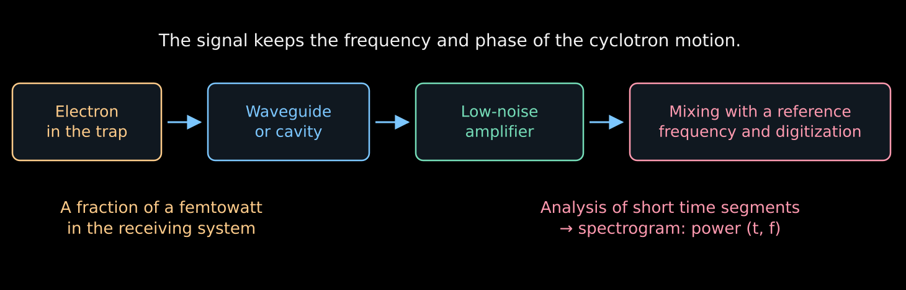{height="330" fig-alt="The electron's radiation excites a mode, is amplified, shifted to an intermediate frequency and digitized"}

- The electron gives up power to an electromagnetic mode, and the mode delivers it to the amplifier.
- The amplifier raises the level, the mixer lowers the frequency,
  and the ADC records the voltage as a function of time.
- Each step preserves the frequency — the very quantity for the sake of which everything is done.

### Waveguide and resonator

:::: {.columns}

::: {.column width="56%"}

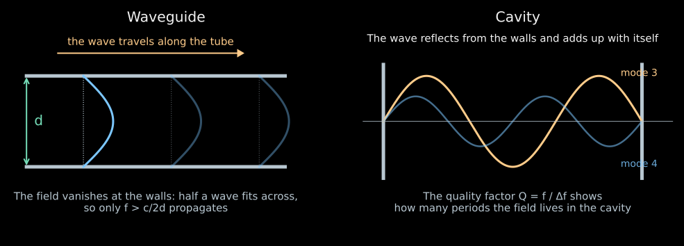{width="100%" fig-alt="In a waveguide a half-wave fits across the tube; in a cavity the wave adds up with itself"}

- A **resonator** is a closed cavity. The wave is reflected from the walls and adds up
  with itself at selected frequencies.
- The quality factor $Q=f/\Delta f$ counts how many periods the field lives in the cavity.
  For $Q=10^4$ at $26$ GHz the resonator bandwidth is $2.6$ MHz.

:::

::: {.column width="41%"}

- A **waveguide** is a metal tube. The field vanishes at the walls,
  so at least a half-wave must fit across the tube:

$$
f>f_{\mathrm{cr}}\simeq\frac{c}{2d}.
$$

- For $d=10$ mm this is $15$ GHz; an exact calculation for a circular tube gives $17.6$ GHz.
  A signal at $26$ GHz passes, while everything below the cutoff is attenuated.

:::

::::

### Amplifier

- The femtowatts must be raised to a level that will survive the cables and digitization.
  The gain in Project 8 is from $70$ to $82$ dB, that is, a factor of $10^7$–$10^8$
  in power.
- One has to pay for this: the amplifier adds its own noise.
  It is expressed by a temperature $T_{\mathrm{n}}$; the noise power is
  $kT_{\mathrm{n}}$ per hertz of bandwidth.
- For a chain of stages with gains $G_i$

$$
\boxed{
T_{\mathrm{sys}}=T_1+\frac{T_2}{G_1}+\frac{T_3}{G_1G_2}+\ldots
}
$$

- The noise of the first stage enters in full, while the others are divided by the gain
  of the preceding ones. Therefore the first amplifier is cooled, and everything else is tolerated.
- For Project 8, $T_{\mathrm{sys}}=132$ K.

### Mixer and digitization

- There is no way to record $26$ GHz directly. The mixer multiplies the signal
  by a reference oscillation of frequency $f_{\mathrm{ref}}$:

$$
\cos(2\pi f_ct)\cos(2\pi f_{\mathrm{ref}}t)
=\frac12\cos[2\pi(f_c-f_{\mathrm{ref}})t]
+\frac12\cos[2\pi(f_c+f_{\mathrm{ref}})t].
$$

- A filter keeps the difference. Mixing $26$ GHz with $24.5$ GHz, we obtain $1.5$ GHz;
  all frequency changes are preserved in this shift without distortion.
- The ADC records the voltage with a sampling rate above twice the bandwidth —
  otherwise different frequencies become indistinguishable.
- Fourier analysis of short pieces of the recording gives a spectrogram: the power
  as a function of time and frequency.

::: {.nh-text tone="muted" size="sm"}
[Receiver electronics of Project 8](https://arxiv.org/abs/2503.08807).
:::

:::::

## A single electron leaves a frequency track {#project8-cres}

::::: {.panel-tabset .nh-story-tabs}

### How to read a track

:::: {.columns}

::: {.column width="54%"}

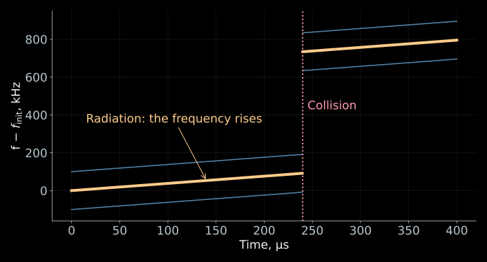{width="100%" fig-alt="The radiation smoothly raises the frequency, while a collision with energy loss creates a jump in the frequency track"}

::: {.nh-text tone="muted" size="sm"}
- A schematic track at a constant average field.
- The loss in a single collision is chosen to be $12.6$ eV;
- the sidebands are shown schematically.
:::

:::

::: {.column width="43%"}

- Time is along the horizontal axis, frequency along the vertical.
- The start of the first detected line gives an estimate of the initial energy of the electron.
- The smooth rise is due to the loss of energy to radiation:

$$
\dot E=-P_{\mathrm{rad}},
\qquad
\dot f_c=\frac{f_cP_{\mathrm{rad}}}{m_ec^2+E}>0.
$$

- A collision with a molecule can sharply decrease the energy:
  the frequency will jump up.
- Neighboring lines may belong to the same electron.

:::

::::

### Radiated energy

- In lectures 05–06 the Lorentz force did no work:
  $q\mathbf v\cdot(\mathbf v\times\mathbf B)=0$.
- But there we neglected radiation.
  Now it is the observable signal and carries away the electron's energy.
- The magnetic field does not supply this energy. The electron spends its own
  kinetic energy; in the exact equation of motion a radiation-reaction
  force appears.
- At a power of $1.2$ fW, over $100$ μs approximately the following is lost:

$$
P_{\mathrm{rad}}T_{\mathrm{obs}}
\simeq1.2\cdot10^{-19}~\text{J}
\simeq0.75~\text{eV}.
$$

- Therefore the initial energy is reconstructed from the start of the track,
  taking into account its subsequent evolution.

### Animation



- The electron is held in the trap; the radiation produces a rising track.
  A collision changes its frequency.

::: {.nh-text tone="muted" size="sm"}
A schematic animation; its notation $K$ corresponds to the kinetic energy
$E$ in the lecture.
:::

:::::

## A magnetic mirror prolongs the observation

::::: {.panel-tabset .nh-story-tabs}

### Weak trap

:::: {.columns}

::: {.column width="54%"}

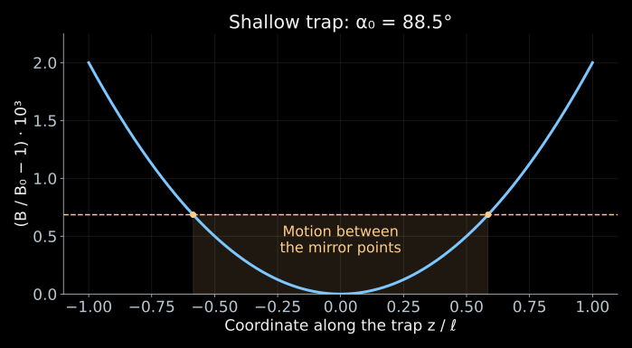{width="100%" fig-alt="A small increase of the field toward the edges keeps the electron at an angle close to 90 degrees"}

:::

::: {.column width="43%"}

- Without a trap the electron would quickly leave the sensitive region.
- Two magnetic mirrors reflect it back — the effect of lecture 06 is used.
- Between reflections the energy changes little over one longitudinal period,
  and the adiabatic invariant can be applied.
- If the field at the edges is only slightly larger than $B_0$, electrons
  with angles close to $90^\circ$ are trapped:

$$
\boxed{\sin^2\alpha_0>\frac{B_0}{B_{\max}}}.
$$

:::

::::

### Depth and reception

- Let $B_{\max}=B_0(1+\eta)$, where $\eta\ll1$ is the relative depth of the trap.
- The trapping condition takes the form

$$
|\cos\alpha_0|<
\sqrt{1-\frac{1}{1+\eta}}
\simeq\sqrt{\eta}.
$$

- For an isotropic source $\cos\alpha_0$ is uniform on $[-1,1]$.
  Therefore the geometric fraction of trapped electrons is approximately equal to
  $\sqrt{\eta}$.
- A deep trap accepts more angles, but the electron explores
  a larger range of fields.
- The frequency depends on both the energy and the field: the gain in statistics
  complicates the reconstruction of the energy.

### The field that the electron feels

- The trap field is constant in time. It is the electron that moves, and with it
  the field changes at the point where it currently is.
- In the parabolic approximation

$$
B(z)=B_0\left(1+\frac{z^2}{\ell^2}\right),
\qquad
z(t)=z_{\max}\cos(2\pi f_zt).
$$

- Substitution gives

$$
B(t)=B_0\left[
1+\frac{z_{\max}^2}{2\ell^2}
+\frac{z_{\max}^2}{2\ell^2}\cos(4\pi f_zt)
\right].
$$

- Over one longitudinal period the electron enters the region of strong field twice,
  so the rotation frequency oscillates at $2f_z$.
- The mean frequency is shifted as well. Substituting a single $B_0$ into the formula for $E$
  without a correction for the trajectory will give an error.

:::::

## Why does one electron give several lines? {#cres-sidebands-origin}

::::: {.panel-tabset .nh-story-tabs}

### What the receiver hears

:::: {.columns}

::: {.column width="50%"}

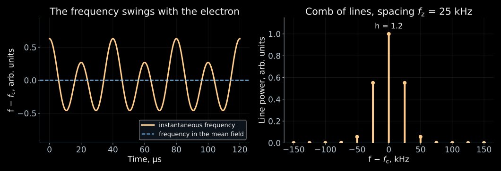{width="100%" fig-alt="The instantaneous frequency oscillates with the period of the longitudinal motion, and the spectrum splits into a comb of lines"}

::: {.nh-text tone="muted" size="sm"}
The total phase of the received signal is the sum of the rotation phase and the wave delay,
$\Phi_{\mathrm{rec}}(t)=\int_0^t2\pi f_c\,dt'+\Phi_{\mathrm{prop}}[z(t)]$:
the first term oscillates at $2f_z$, the second at $f_z$.
[CRES power spectrum and longitudinal motion](https://arxiv.org/abs/1901.02844).
:::

:::

::: {.column width="47%"}

- The electron oscillates between the mirrors with frequency $f_z$ and enters the strong field twice per period.
  The cyclotron frequency oscillates along with it.
- At the same time, the distance to the receiver changes: the wave arrives now slightly earlier,
  now slightly later.
- The receiver hears a sinusoid whose period slightly "breathes" with period $1/f_z$.
- This breathing of the phase splits one line into a comb:

$$
\boxed{f_n=f_c+nf_z}.
$$

- All these lines belong to a single electron.

:::

::::

### Modulation index

- First, let us keep a single modulation frequency:

$$
V(t)=V_0\cos\Phi(t),
\qquad
\Phi(t)=2\pi f_ct+h\sin(2\pi f_zt).
$$

- The instantaneous frequency is determined by the derivative of the phase:

$$
f_{\mathrm{inst}}=\frac{1}{2\pi}\frac{d\Phi}{dt}
=f_c+h f_z\cos(2\pi f_zt).
$$

- Therefore $h=\Delta f/f_z$ is the **dimensionless modulation index**,
  and $\Delta f$ is the amplitude of the frequency variation.
- For small $h$ the signal is almost harmonic.
  For large $h$ the sidebands carry a noticeable fraction of the power.

### Power of the lines

- The Jacobi–Anger identity gives

$$
e^{ih\sin\theta}=\sum_{n=-\infty}^{\infty}J_n(h)e^{in\theta}.
$$

- Consequently,

$$
e^{i\Phi(t)}
=\sum_{n=-\infty}^{\infty}J_n(h)e^{2\pi i(f_c+nf_z)t}.
$$

- $J_n$ is a Bessel function. The sideband has frequency
  $f_n=f_c+nf_z$ and relative power $J_n^2(h)$.
- For a long observation

$$
\sum_nJ_n^2(h)=1:
$$

  the power is redistributed among the lines and does not disappear anywhere.

### Why this matters

- The comb takes power away from the central line. The detection threshold
  has to be calculated for the line that we actually see.
- The spacing between the lines is equal to $f_z$. It depends on the angle and on
  how deep the electron goes into the trap — that is, it tells us about the trajectory.
- The trajectory determines the average field along the path, and without it the frequency cannot be converted
  into energy.
- At $h\approx2.4$ the function $J_0$ vanishes: the central line goes out,
  even though the electron has not gone anywhere.

:::::

## The record length sets the energy resolution {#cres-linewidth}

::::: {.panel-tabset .nh-story-tabs}

### Why we need the linewidth

- We obtain the energy from the frequency, so the frequency error immediately becomes
  an energy error:

$$
\delta E=(m_ec^2+E)\frac{\delta f_c}{f_c}.
$$

- A record of finite length cannot distinguish frequencies better than $1/T_{\mathrm{obs}}$:
  over a short time two close sinusoids do not have time to drift apart in phase.
- A track of length $100$ μs gives a line of width $8.9$ kHz. In energy this is

$$
\delta E\simeq529.6~\text{keV}\cdot
\frac{8.9~\text{kHz}}{27.0~\text{GHz}}\simeq0.17~\text{eV}.
$$

- This is why the electron is held in a trap: every extra microsecond of observation
  narrows the line and refines the energy.

### Where the width comes from

- Suppose a harmonic of frequency $f_n$ is observed only for
  $0<t<T_{\mathrm{obs}}$. Its Fourier amplitude is

$$
A_n(f)=
\int_0^{T_{\mathrm{obs}}}e^{2\pi i(f_n-f)t}\,dt
=T_{\mathrm{obs}}e^{i\pi(f_n-f)T_{\mathrm{obs}}}
\operatorname{sinc}\!\left[\pi(f_n-f)T_{\mathrm{obs}}\right].
$$

- Here $\operatorname{sinc}x=\sin x/x$.
  The power is proportional to $\operatorname{sinc}^2$.
- The width of such a peak at half maximum is:

$$
\boxed{\Delta f_{\mathrm{FWHM}}\simeq\frac{0.886}{T_{\mathrm{obs}}}}.
$$

- The coefficient refers to a rectangular time window.
  A different processing of the record changes the shape and width of the peak.

### Interactive {#cres-sidebands}



- Vary the index $h$. Find the regime where the central line is weaker than the sidebands.
- The spacing between the lines is set by $f_z$; their envelope depends on $h$.
- A decrease in the carrier power does not mean that the electron has disappeared.

::: {.nh-text tone="muted" size="sm"}
[Open the applet](../../ru/applets/cres-sidebands.qmd) (in Russian) ·
[Model source code](https://github.com/NeutrinoHit/neutrinophysics/blob/main/introduction/ru/slides/assets/04_direct_neutrino_mass/_cres_radiation_spectrum.qmd).
:::

:::::

## What accuracy do the frequency and the field require?

::::: {.panel-tabset .nh-story-tabs}

### Converting the frequency error

- At fixed $B$ we differentiate the relation between energy and frequency:

$$
\boxed{\delta E=-(m_ec^2+E)\frac{\delta f_c}{f_c}}.
$$

- Near the endpoint of the tritium spectrum in a field of $1$ T

$$
\delta E=0.10~\text{eV}
\quad\Longleftrightarrow\quad
|\delta f_c|\simeq5.1~\text{kHz}.
$$

- A line of this width is produced by a rectangular record lasting about $174$ μs.
- The center of the line is found more precisely than its width: the gain grows with the
  signal-to-noise ratio. The width sets the scale, and beyond that statistics takes over.

### The field is also measured

- If both the field and the frequency change,

$$
\boxed{
\delta E=(m_ec^2+E)
\left(\frac{\delta B}{B}-\frac{\delta f_c}{f_c}\right)
}.
$$

- For a contribution to the error of no more than $0.10$ eV at $E=18.6$ keV, a relative
  knowledge of the effective field of the order of

$$
\frac{|\delta B|}{B}\lesssim1.9\cdot10^{-7}.
$$

  is required.
- The unknown position of the electron in an inhomogeneous field becomes
  an uncertainty in its energy.
- For calibration, the krypton conversion lines, familiar from lecture 07, are used,
  and the track structure is compared with a model of the trap.

### Frequency drift {#cres-frequency-track}



- Vary the initial energy. A more energetic electron starts at a lower frequency.
- The power in this model is fixed. In a real instrument it also depends
  on the angle and on the coupling of the electron to the electromagnetic mode.

::: {.nh-text tone="muted" size="sm"}
[Open the applet](../../ru/applets/cres-frequency-track.qmd) (in Russian) ·
[Source code](https://github.com/NeutrinoHit/neutrinophysics/blob/main/introduction/ru/slides/assets/04_direct_neutrino_mass/_cres_frequency_track.qmd).
:::

:::::

## From individual tracks to the Project 8 spectrum

::::: {.panel-tabset .nh-story-tabs}

### The cell

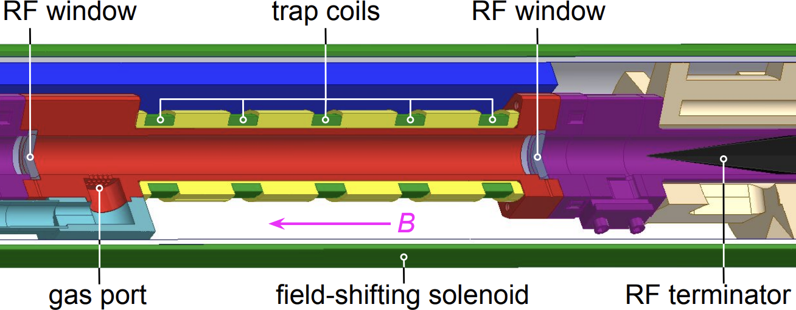{.slide-image-center .nostretch width="56%" fig-alt="Cross section of the cryogenic CRES cell: windows for the radio signal, trap coils, gas inlet, field-shifting solenoid, radio-wave absorber"}

- The electron is born in the decay right inside the waveguide and remains there,
  confined by the trap coils.
- The radio wave travels along the pipe to the amplifiers, and at the far end it is absorbed
  by a terminator, so that no echo returns.
- The gas is supplied through a separate inlet, and the field-shifting solenoid changes the operating
  field without retuning the magnet itself.

::: {.nh-text tone="muted" size="sm"}
[Project 8, Fig. 1](https://arxiv.org/abs/2212.05048).
:::

### Parameters

:::: {.columns}

::: {.column width="55%"}

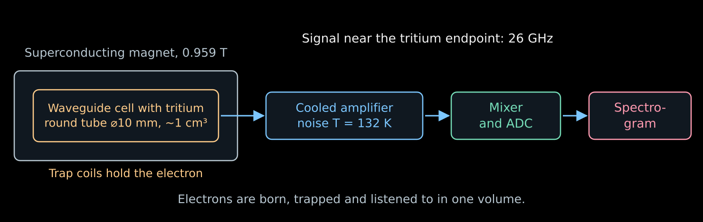{width="100%" fig-alt="A cell with tritium inside a magnet, a cooled amplifier, a mixer with an ADC and a spectrogram"}

:::

::: {.column width="42%"}

| Parameter | Value |
|---|---|
| Field | $0.959$ T |
| Frequency at the spectrum endpoint | $\simeq26$ GHz |
| Cell | circular waveguide $\varnothing\,10$ mm |
| Volume | of the order of cm³ |
| System noise | $132$ K |
| Gain | $70$–$82$ dB |
| Resolution on the Kr line | $1.66$ eV |

:::

::::

::: {.nh-text tone="muted" size="sm"}
Phase II parameters. [Overview of the method and the apparatus](https://arxiv.org/abs/2503.08807).
:::

### Spectrum of initial energies

- For each detected electron the start of the track is reconstructed.
- The initial frequencies are converted into energies and the spectrum is filled.
  It is then compared with the model of β decay and the detector response.
- Not every electron gives a visible track: the detection probability depends
  on the power, the duration, the angle, and the receiver bandwidth.
- If the first segment is too weak or too short, the electron may be noticed
  only after it has lost energy. This distorts the reconstructed spectrum.
- Calibrations and an efficiency model are needed here just as in KATRIN.

:::::

## Project 8: the first measurement and next steps

::::: {.panel-tabset .nh-story-tabs}

### The published measurement

:::: {.columns}

::: {.column width="45%"}

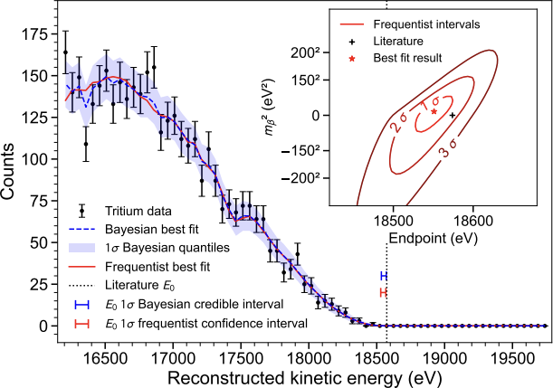{.slide-image-center .nostretch width="100%" fig-alt="The measured tritium spectrum near the endpoint with Bayesian and frequentist fits, with mass and endpoint contours in the inset"}

::: {.nh-text tone="muted" size="sm"}
Figure 5 and the result: [Project 8, Phys. Rev. Lett. 131, 102502 (2023)](https://arxiv.org/abs/2212.05048).
:::

:::

::: {.column width="52%"}

- In 2023 Project 8 published the first tritium spectrum
  measured via cyclotron radiation.
- The following limits were obtained

$$
m_\beta<155~\text{eV}\quad(90\%\ \text{Bayesian interval}),
$$

$$
m_\beta<152~\text{eV}\quad(90\%\ \text{frequentist interval}).
$$

- A resolution of $1.66\pm0.19$ eV FWHM was demonstrated on the line
  $^{83\mathrm m}\mathrm{Kr}$ at about $17.8$ keV
  in a specially chosen shallow trap.
- Good resolution for an individual electron does not yet give a strong limit
  on the mass: what matters is the number of tritium events and the whole response.

:::

::::

### This is still a demonstration

- The source volume is one cubic centimeter. KATRIN has a source ten meters
  long, hence the difference in the limits: $155$ eV versus $0.45$ eV.
- Phase II was solving its own task: to demonstrate the resolution. With a single electron
  $1.66$ eV was obtained in a volume the size of a thimble.
- Next, volume is needed. The weak signal is collected either with an antenna array, summing the
  signals with delays according to the electron position, or with a cavity with a selected
  mode.
- Phase III is a cavity on the scale of m³. Phase IV is atomic tritium with a goal of
  $40$ meV.
- CRES will begin to measure the physics of the neutrino mass at the following stages.

::: {.nh-text tone="muted" size="sm"}
[Project 8: CRES in cavities, 2026](https://arxiv.org/abs/2601.07848).
:::

### Atomic source

- In molecular tritium part of the energy remains in the rotation and vibrations of
  the daughter molecule. Frequency readout by itself does not eliminate this.
- Atomic tritium removes the molecular degrees of freedom,
  but retains atomic excitations and recoil.
- The atoms must be cooled, confined, and protected from recombination
  into molecules on the walls.
- The discussed goal of Project 8 is a sensitivity of the order of $40$ meV.
  This requires a large atomic source and a new readout.

::: {.nh-text tone="muted" size="sm"}
[Project 8: the goal and atomic tritium](https://nuclearscience.lbl.gov/research/research-programs/neutrinos/neutrinos-research/katrin-project-8/).
:::

:::::

## Method two: catch the heat {#calorimetry-intro}

::: {style="width:78%;"}

- In CRES the electron energy is determined from the frequency of its cyclotron radiation.
- In the calorimetric method the source is placed inside the absorber. With complete absorption, all the decay energy except that carried away by the neutrino remains in it. It is measured via the heating.
$$
\boxed{
\text{decay inside the absorber}
\ \longrightarrow\
\text{heating}
\ \longrightarrow\
\text{thermometer pulse}
}
$$

:::

## Calorimeter: the big picture {#calorimeter-overview}

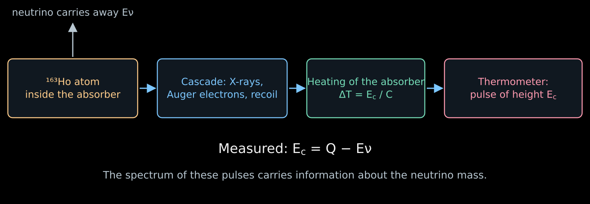{.nostretch width="66%" fig-alt="Electron capture in holmium, a cascade of shell rearrangements, heating of the absorber, thermometer pulse"}

:::: {.columns}

::: {.column width="47%"}

- The $^{163}\mathrm{Ho}$ atom sits inside the absorber and captures its own
  electron. The neutrino escapes, and everything else stays right here.
- The X-ray quanta and Auger electrons of the cascade are stopped in the material,
  and within microseconds all of this becomes heat.

:::

::: {.column width="49%"}

- The absorber heats up, the thermometer converts the temperature rise into a pulse,
  and the pulse height gives

$$
\boxed{E_c=Q-E_\nu}.
$$

- $Q$ is the total energy release of the decay, $E_c$ is the measured
  calorimetric energy.
- Next we will examine each link of this chain separately.

:::

::::

## Electron capture in holmium-163

::::: {.panel-tabset .nh-story-tabs}

### What gets captured?

:::: {.columns}

::: {.column width="45%"}

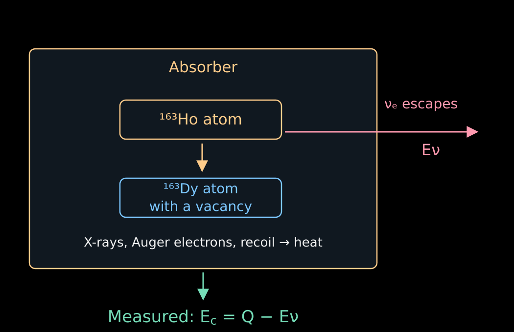{width="100%" fig-alt="Holmium decays inside the absorber: the neutrino escapes, while X-ray radiation and electrons heat the absorber"}

:::

::: {.column width="52%"}

- A proton of the nucleus captures one of the bound electrons of its atom:

$$
p+e^-_{\mathrm{b}}\to n+\nu_e.
$$

- The nuclear charge decreases by one. For the complete neutral atom

$$
{}^{163}\mathrm{Ho}_{\mathrm{at}}
\to{}^{163}\mathrm{Dy}_{\mathrm{at}}^*+\nu_e.
$$

- Here the asterisk denotes an excitation of the **electron shell**:
  after the capture a vacancy remains and the field of the nucleus has been rearranged.
- The mass difference of the neutral atoms sets $Q\simeq2.86$ keV.
  The bound electron is already included in the mass of the initial atom.

:::

::::

### Where does the vacancy energy go?

- An electron from an outer shell can fill the vacancy.
- The released energy is emitted as an X-ray quantum
  or transferred to another electron, which is ejected from the atom.
  The latter process produces an **Auger electron**.
- A cascade of shell rearrangements follows.
  Inside the absorber all these particles transfer their energy to the material.
- The calorimeter sums up the cascade. For the same final atomic
  state, it does not matter how the energy was shared between photons and electrons.

::: {.nh-box tone="accent" size="md"}
The calorimeter measures the total remaining energy, even if it has been spread
among several particles.
:::

### Conditions for complete absorption

- Photons and electrons must be absorbed inside the sensitive volume.
  The escape of a photon would reduce the measured energy and create a tail in the response.
- The energy must have time to pass into the measurable thermal degrees of freedom.
  Long-lived excitations can change the pulse shape.
- The position of the implanted atoms, the thickness of the absorber, and the calibration are checked
  experimentally.
- When these conditions are met, the losses from electron escape
  from a separate source, familiar from lecture 07, disappear.

:::::

## Why does the calorimetric spectrum contain peaks?

::::: {.panel-tabset .nh-story-tabs}

### Final states

- The electron can be captured from different shells.
  After the capture, different excitation energies of the dysprosium atom remain.
- For a perfectly well-defined final state, the two-body kinematics
  would give a single neutrino energy and a single $E_c$.
- But excited atomic states have a finite lifetime
  and a natural width.
- Several channels give several lines with tails.
  Additional excitations and ionization of other electrons complicate the spectrum.

### Spectrum

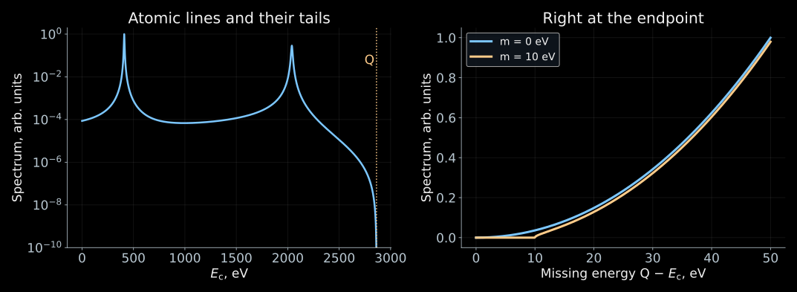{height="480" fig-alt="Illustrative two-line electron-capture spectrum: atomic peaks far from Q and suppression of the spectrum by the mass near the endpoint energy"}

- The atomic peaks account for most of the statistics.
  Sensitivity to a small mass lies near the endpoint $E_c\simeq Q$.

::: {.nh-text tone="muted" size="sm"}
A didactic two-line spectrum. The mass $10$ eV is chosen for illustration;
these are not ECHo or HOLMES data.
:::

### Phase space

- In the approximation of unresolved light masses, we introduce $x=Q-E_c$.
  For $x\ge m_\beta$:

$$
\boxed{
\frac{d\Gamma}{dE_c}
=C\,x\sqrt{x^2-m_\beta^2}\,\Theta(x-m_\beta)\,\mathcal A(E_c)
}.
$$

- $C$ is the normalization, $\mathcal A(E_c)$ is the atomic spectral function.
- The simplest model of independent lines:

$$
\mathcal A(E_c)\simeq
\sum_j a_j\,
\frac{\Gamma_j/(2\pi)}
{(E_c-E_j)^2+\Gamma_j^2/4}.
$$

- $E_j$, $\Gamma_j$, $a_j$ are the energy, width, and weight of a channel.
  The mass correction multiplies the entire atomic function.

### Atomic calculation

- The single-vacancy model gives a useful picture, but is insufficient
  for a precise analysis of the end of the spectrum.
- After the change of the nuclear charge, other electrons can additionally
  become excited or go into the continuum.
- Therefore $\mathcal A(E_c)$ requires a many-electron calculation
  and a check against the measured lines.
- In the effective single-mass model the endpoint equals $E_c^{\max}=Q-m_\beta$.
  The exact three-mass description contains thresholds $Q-m_i$ with weights $|V_{ei}|^2$.
- A small $Q$ is useful.
- The atomic peaks are needed to calibrate the detector and to check the spectrum model. To measure a small neutrino mass, sufficient statistics right at the endpoint of the spectrum are necessary.

::: {.nh-text tone="muted" size="sm"}
[Atomic spectrum and analysis of ECHo-1k](https://arxiv.org/abs/2509.03423).
:::

:::::

## How can the heating from a single decay be measured?

::::: {.panel-tabset .nh-story-tabs}

### Heat capacity

:::: {.columns}

::: {.column width="54%"}

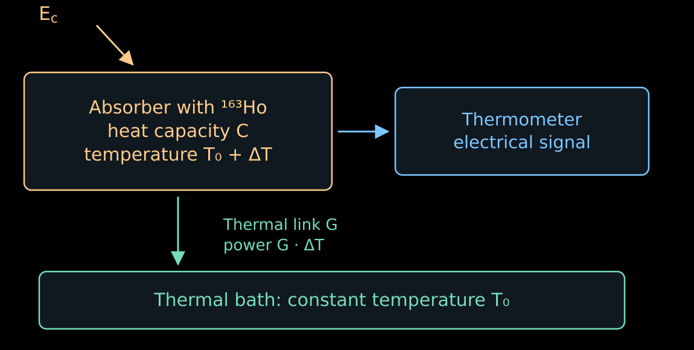{width="100%" fig-alt="An absorber with heat capacity C is connected to a thermometer and a cold thermal bath by thermal link G"}

:::

::: {.column width="43%"}

- The absorber is cooled to a temperature of the order of tens of millikelvin.
  Its heat capacity $C$ becomes small.
- A rapid energy release raises the temperature:

$$
\boxed{\Delta T\simeq\frac{E_c}{C}}.
$$

- For example, for $C=10^{-12}$ J/K an energy $2.86$ keV gives

$$
\Delta T\simeq0.46~\text{mK}.
$$

- The thermometer converts this temperature rise into an electrical signal.

:::

::::

### Return to the initial temperature

- After the decay the energy gradually flows out into the thermal bath through the thermal link $G$.
- In the linear model, once the energy release has already ended,

$$
C\frac{d\Delta T}{dt}=-G\Delta T.
$$

- Hence

$$
\boxed{
\Delta T(t)=\frac{E_c}{C}e^{-t/\tau_{\mathrm{th}}},
\qquad
\tau_{\mathrm{th}}=\frac{C}{G}
}.
$$

- A small $C$ increases the amplitude, while a large $G$ speeds up the return.
- The sensitivity is limited by thermometer noise and thermal fluctuations.
  Speed and energy resolution have to be chosen together.

:::::

## Two ways to turn temperature into a signal

::::: {.panel-tabset .nh-story-tabs}

### Magnetic thermometer

- ECHo uses metallic magnetic calorimeters.
  The sensor contains paramagnetic erbium ions in a metallic matrix.
- In a weak field the magnetic moments are partially ordered.
  Heating enhances thermal disordering and reduces the magnetization.
- The simplest picture is the Curie law $M\propto B/T$.
  A real sensor is calibrated at its operating temperature and field.
- The change of magnetic flux is read out by a SQUID — a superconducting quantum
  interference device, a sensitive magnetometer.

$$
E_c\ \longrightarrow\ \Delta T
\ \longrightarrow\ \Delta M
\ \longrightarrow\ \Delta\Phi.
$$

::: {.nh-text tone="muted" size="sm"}
[Metallic magnetic calorimeters](https://doi.org/10.1016/S0921-4526(02)02307-4).
:::

### Superconducting thermometer

- HOLMES uses sensors at the edge of the superconducting transition:
  TES is the accepted abbreviation for this type of thermometer.
- The sensor is held within a narrow temperature interval where the resistance
  changes sharply from almost zero to its normal value.
- A small heating noticeably raises the resistance.
  At a fixed voltage the current decreases:

$$
\Delta T>0\quad\Rightarrow\quad
\Delta R>0\quad\Rightarrow\quad
\Delta I<0.
$$

- As a result the Joule heating $P_J=V_{\mathrm{cm}}^2/R$ decreases.
  This negative feedback helps the sensor cool down.
- The actual pulse is determined by both the thermal and the electrical dynamics.

::: {.nh-text tone="muted" size="sm"}
[HOLMES thermometers with implanted holmium](https://arxiv.org/abs/2506.13665).
:::

### Sensor characteristics

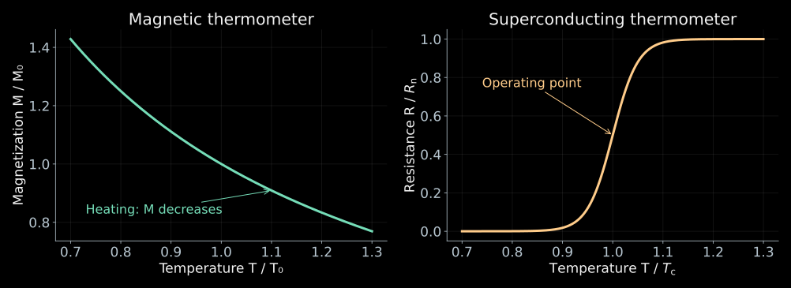{height="470" fig-alt="The magnetization of a paramagnetic sensor decreases on heating, the TES resistance rises sharply in the superconducting transition region"}

- The thermal signal is the same. What differs are the physical quantities
  used to measure the temperature.
- The curves are schematic; for the magnetic sensor the weak-field
  Curie law is shown, for the TES a transition model.

:::::

## Two decays can look like one

::::: {.panel-tabset .nh-story-tabs}

### Pulse pile-up

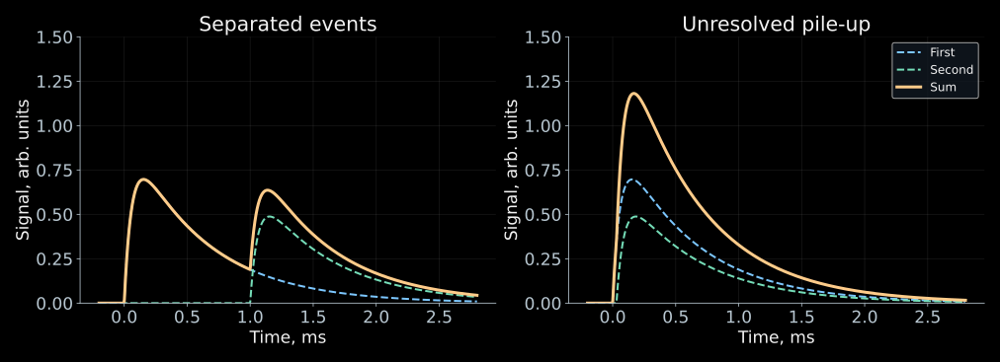{height="470" fig-alt="Thermal pulses far apart in time are distinguishable, while close ones add up into a single elevated signal"}

- If two events occur too close in time,
  the electronics can reconstruct a single event with energy $E_1+E_2$.
- Low-energy decays then fall into the region of the endpoint of the spectrum.
  The summed spectrum acquires events even above $Q$.

### Probability

- Let the activity of one pixel be $a$ decays per second,
  and let intervals shorter than $\tau_r$ be unresolved.
- The probability of the next decay within this interval:

$$
\boxed{
f_{\mathrm{ov}}=1-e^{-a\tau_r}
\simeq a\tau_r,\qquad a\tau_r\ll1
}.
$$

- For $a=10~\text{s}^{-1}$ and $\tau_r=1$ μs we obtain $f_{\mathrm{ov}}\sim10^{-5}$.
- This is a small fraction of all events, but the useful events near the endpoint
  are even fewer.
- For independent decays the energy distribution of the pile-up events
  is proportional to the convolution $S*S$, where $S(E_c)$ is the single-event spectrum.

### Why many pixels?

- For $N$ identical pixels and a total activity
  $A_{\mathrm{tot}}=Na$ the number of single decays grows as $A_{\mathrm{tot}}$.
- The rate of close pairs in the whole array is approximately

$$
\boxed{
R_{\mathrm{pu}}\simeq Na^2\tau_r
=\frac{A_{\mathrm{tot}}^2\tau_r}{N}
}.
$$

- At a fixed total activity, distributing it over a larger number
  of pixels reduces pile-up.
- Many channels must be read out and calibrated simultaneously.
  The channels can be distinguished by the individual frequencies of resonators
  in a common readout line.

::: {.nh-text tone="muted" size="sm"}
[Multichannel readout of HOLMES](https://arxiv.org/abs/1910.05217).
:::

:::::

## What have ECHo and HOLMES shown?

:::: {.columns}

::: {.column width="48%"}

**ECHo-1k, 2025**

- Magnetic microcalorimeters.
- About $2\cdot10^8$ events.
- From the spectrum the result $Q=2862(4)$ eV was obtained.

$$
\boxed{m_\beta<15~\text{eV}}
$$

at $90\%$ Bayesian credibility level.

[ECHo publication](https://arxiv.org/abs/2509.03423).

:::

::: {.column width="48%"}

**HOLMES, 2025**

- Superconducting TES thermometers.
- About $7\cdot10^7$ events.
- Average resolution about $6$ eV FWHM.

$$
\boxed{m_\beta<27~\text{eV}}
$$

at $90\%$ Bayesian credibility level.

[HOLMES publication](https://arxiv.org/abs/2503.19920).

:::

::::

::: {.nh-box tone="accent" size="md"}
The next improvement requires more events at the endpoint, fast readout,
and an accurately known atomic spectrum.
:::

## Why is not every low-energy decay convenient?

::::: {.panel-tabset .nh-story-tabs}

### Example: rhenium-187

- $^{187}\mathrm{Re}$ has a small β-decay energy,
  $Q\simeq2.47$ keV, and it can be embedded in a calorimeter.
- But its half-life is about $4.3\cdot10^{10}$ years.
  To obtain sufficient activity, many atoms are needed:

$$
A=\frac{\ln2}{T_{1/2}}N_{\mathrm{atoms}}.
$$

- A large absorber has a large heat capacity,
  so the temperature rise from a single event decreases.
- Additional difficulties are thermal relaxation and the change in the shape
  of the β spectrum due to the interaction of the electron with the crystalline medium.

### What to compare

- A small $Q$ increases the relative importance of a small mass.
- But the sensitivity is also determined by the activity, the number of events
  near the endpoint, the complexity of the spectrum theory, and the properties of the detector.
- For holmium, the main statistics lie in the atomic lines.
  For tritium, they lie in the continuous β spectrum.
- Therefore, a comparison based only on $Q$ or only on resolution
  does not determine which experiment will measure the smaller mass.

:::::

## Method three: compute the missing {#kinematics-intro}

::: {style="width:78%;"}

- The neutrino need not be caught at all. If all the other participants
  of the decay are known, its four-momentum is found by subtraction:

$$
\boxed{
P_\nu=P_{\text{init}}-\sum_a P_a,
\qquad
m_\nu^2=P_\nu^2
}
$$

- Further on in the formulas, $c=1$.
- The mass comes out as a difference of large quantities. This is the source of the whole difficulty.

:::

## Missing momentum: pion and tau {#missing-mass}

::::: {.panel-tabset .nh-story-tabs}

### Pion at rest

:::: {.columns}

::: {.column width="47%"}

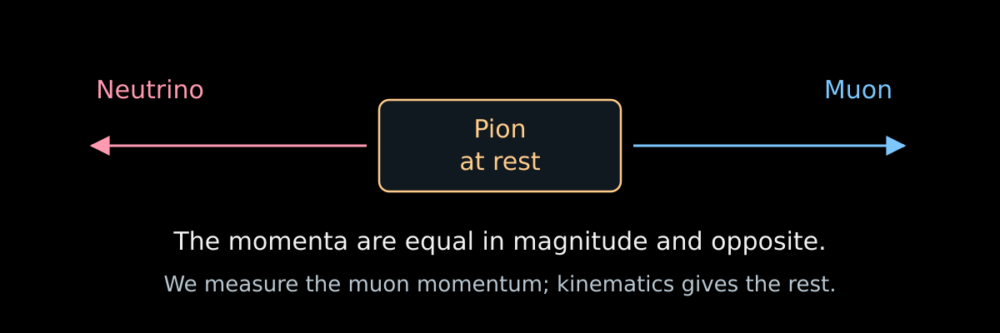{width="100%" fig-alt="A pion at rest decays into a muon and a neutrino with opposite momenta"}

:::

::: {.column width="50%"}

- In the decay $\pi^+\to\mu^++\nu_\mu$ the pion at rest gives the muon and the neutrino
  momenta of equal magnitude. It suffices to measure $p_\mu$:

$$
\boxed{
m_\nu^2=(P_\pi-P_\mu)^2
=m_\pi^2+m_\mu^2-2m_\pi\sqrt{p_\mu^2+m_\mu^2}
}.
$$

- For zero mass

$$
p_\mu=\frac{m_\pi^2-m_\mu^2}{2m_\pi}\simeq29.79~\text{MeV}.
$$

- Measurement by Assamagan et al.: $m_{\nu_\mu}<170$ keV ($90\%$).

:::

::::

::: {.nh-text tone="muted" size="sm"}
[Measurement of the muon momentum in pion decay](https://doi.org/10.1103/PhysRevD.53.6065).
The notation $m_{\nu_\mu}$ is traditional for this channel; the flavor state
has no definite mass of its own.
:::

### Bound in tau decay

:::: {.columns}

::: {.column width="52%"}

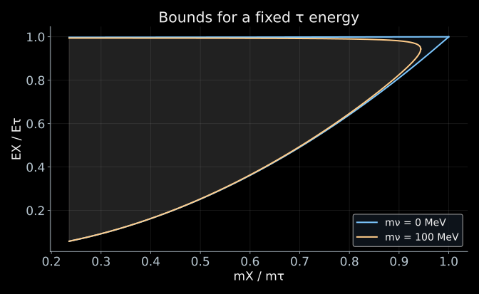{width="100%" fig-alt="A nonzero neutrino mass narrows the available region in mass and energy of the hadronic system"}

::: {.nh-text tone="muted" size="sm"}
[ALEPH, analysis of three- and five-prong decays, 1998](https://cds.cern.ch/record/337738).
:::

:::

::: {.column width="45%"}

- In $\tau^-\to X^-+\nu_\tau$ the four-momenta of the detected
  hadrons are summed, giving the mass $m_X$ and the energy $E_X$ of the visible system.
- The neutrino mass cuts off the edge of the accessible region:

$$
m_X\le m_\tau-m_\nu.
$$

- The tau is moving, so the energy boundary is smeared into a band between
  $\cos\theta^*=\pm1$. The mass is sought from how the events lie near the edge of the band.
- ALEPH: $m_{\nu_\tau}<18.2$ MeV ($95\%$).
- In the figure, $\gamma_\tau=10$ and the mass $100$ MeV are chosen so that the effect is visible.

:::

::::

### Why these limits are weak

- Let us differentiate the relation between the mass and the muon momentum:

$$
\delta m_\nu^2=-2m_\pi\frac{p_\mu}{E_\mu}\,\delta p_\mu.
$$

- To be sensitive to $m_\nu=1$ eV, the momentum of $29.79$ MeV must be known
  with a relative precision of $5\cdot10^{-16}$.
- Compare with tritium, where the limit is $0.45$ eV: the pion channel is weaker
  by a factor of $4\cdot10^5$, the tau channel by a factor of $4\cdot10^7$.
- The whole difference lies in the energy scale: tritium works with tens of keV,
  while here one has to subtract hundreds of MeV.

:::::

## Method four: record the arrival time {#sn-delay}

::::: {.panel-tabset .nh-story-tabs}

### Velocity and mass

- For the mass state $i$

$$
v_i=c\sqrt{1-\frac{m_i^2c^4}{E_\nu^2}}
\simeq c\left(1-\frac{m_i^2c^4}{2E_\nu^2}\right).
$$

- Relative to a particle emitted simultaneously and moving with velocity $c$,

$$
\boxed{
\Delta t_i=\frac{L}{v_i}-\frac{L}{c}
\simeq\frac{L}{2c}\frac{m_i^2c^4}{E_\nu^2}
}.
$$

- A long baseline amplifies the delay; a large energy reduces it.

### Estimate

:::: {.columns}

::: {.column width="54%"}

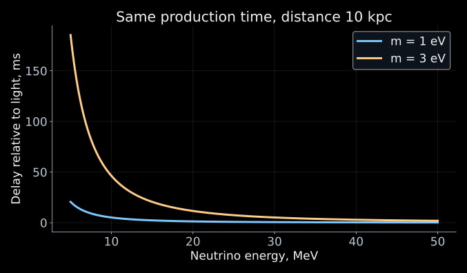{width="100%" fig-alt="For the same production time, low-energy massive neutrinos arrive later than high-energy ones"}

:::

::: {.column width="43%"}

$$
\Delta t_i\simeq5.15~\text{ms}
\left(\frac{L}{10~\text{kpc}}\right)
\left(\frac{m_ic^2}{1~\text{eV}}\right)^2
\left(\frac{10~\text{MeV}}{E_\nu}\right)^2.
$$

- Over tens of thousands of years of flight, a mass of the order of an eV gives a delay of the order of
  milliseconds.
- The energy dependence $1/E_\nu^2$ helps to search for this effect
  in a supernova signal.

:::

::::

### What gets in the way

- The detector measures the sum of three terms:

$$
t_{\mathrm{arr}}
=t_{\mathrm{prod}}+\frac{L}{c}+\Delta t_i.
$$

- The moment of the burst is unknown to us, and a shift of all times is absorbed by it at once
  without a trace. Only the dependence of the delay on energy works.
- Moreover, a supernova emits neutrinos over several seconds,
  while the sought delay is milliseconds.
- Therefore one needs either a model time profile of the source or a sufficiently
  sharp feature of the signal.
- A single quantity $m_\beta^2$ is not enough here: the flux contains the mass
  states individually.

### Reconstructing the mass



- In the coordinates $(1/E^2,\ t)$ the delay lies on a straight line, and its slope
  equals $m^2$.
- The slider for the spread of the emission time shows how quickly the signal is drowned out.
- On the right is the profile $-2\ln L(m^2)$; its minimum is the mass estimate,
  and the width at the level $+1$ gives the error.

::: {.nh-text tone="muted" size="sm"}
[Open the applet](../../ru/applets/sn-mass-likelihood.qmd) (in Russian) ·
the likelihood method is covered in my course on statistical analysis.
:::

:::::

## What do these measurements have in common?

| Method | What the instrument measures | Where the mass appears |
|---|---|---|
| CRES | the initial frequency of the electron track | in the shape of the reconstructed β spectrum |
| Calorimetry $^{163}\mathrm{Ho}$ | the heat from a single atomic decay | near the endpoint $E_c\simeq Q$ |
| $\pi\to\mu\nu$ | the muon momentum | in the missing four-momentum |
| $\tau\to X\nu$ | the mass and energy of the hadronic system | in the boundary of the accessible region |
| Time of flight | the times and energies of neutrinos | in the delay $\propto m_i^2/E_\nu^2$ |

- The mass enters through the dispersion relation $E_\nu^2=p_\nu^2+m_i^2$.
- Its effect is compared with a precise response model and the available statistics.
- "Direct measurement" does not mean the absence of a model of the instrument or of the source physics.

## Why strive for tens of millielectronvolts?

::::: {.panel-tabset .nh-story-tabs}

### Two mass orderings

:::: {.columns}

::: {.column width="54%"}

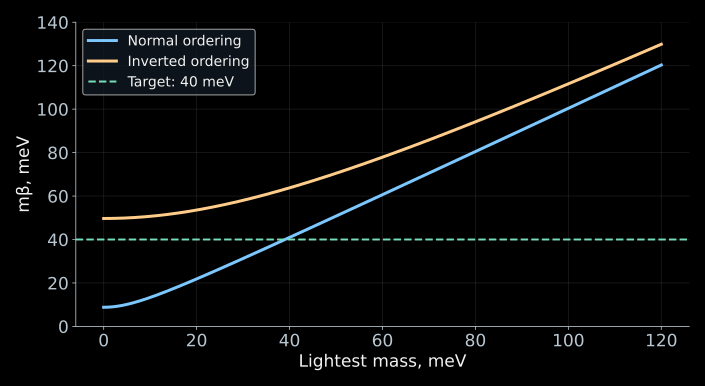{width="100%" fig-alt="The minimum value of the effective electron mass is about 9 meV for the normal ordering and about 50 meV for the inverted ordering"}

:::

::: {.column width="43%"}

- In tritium β decay and electron capture one measures

$$
m_\beta^2=\sum_i|V_{ei}|^2m_i^2.
$$

- Oscillations fix the mass-squared differences and the mixing coefficients,
  but leave the lightest mass unknown.
- Even if the lightest mass is small, $m_\beta$ does not vanish.
- The line $40$ meV in the plot marks the target of a future experiment.
  No constraints at this level have been obtained yet.

:::

::::

### Where do 9 and 50 meV come from?

- For normal ordering and $m_1\simeq0$:

$$
m_\beta^2
\simeq |V_{e2}|^2\Delta m_{21}^2
+|V_{e3}|^2\Delta m_{31}^2.
$$

- Let us substitute the rounded values
  $|V_{e2}|^2\simeq0.30$, $|V_{e3}|^2\simeq0.022$,
  $\Delta m_{21}^2\simeq7.5\cdot10^{-5}$ eV$^2$,
  $|\Delta m_{31}^2|\simeq2.5\cdot10^{-3}$ eV$^2$:

$$
m_\beta\simeq
\sqrt{0.30\cdot7.5\cdot10^{-5}+0.022\cdot2.5\cdot10^{-3}}
\simeq9~\text{meV}.
$$

- For inverted ordering and $m_3\simeq0$ almost the whole electron weight is concentrated
  in two states with masses of about $50$ meV; therefore
  $m_\beta\simeq50$ meV.

::: {.nh-text tone="muted" size="sm"}
[Rounded scales of the oscillation parameters: NuFIT 6.0](https://arxiv.org/abs/2410.05380).
:::

### Other observable masses

| Measurement | Combination of masses | Additional physics |
|---|---|---|
| Electron kinematics | $m_\beta^2=\sum_i|V_{ei}|^2m_i^2$ | decay spectrum and response |
| $0\nu2\beta$ via light neutrinos | $m_{\beta\beta}=|\sum_iV_{ei}^2m_i|$ | Majorana phases, nuclear amplitude |
| Cosmology | $\Sigma=m_1+m_2+m_3$ | evolution of the Universe and the set of observations |

- In the β spectrum, the different unobservable mass states are added
  by probabilities.
- In the Majorana amplitude, interference is possible.
  In cosmology, the influence of neutrinos on the evolution of matter is measured.
- Therefore these quantities cannot be compared as three measurements of one number.

:::::

## From absolute mass to oscillations

::: {style="width:80%;"}

- All four methods run into the same thing: the mass enters through the dispersion relation
  $E^2=p^2+m^2$, and its trace is the harder to notice the higher the energy. Therefore the decay
  with the smallest energy release wins.
- In the next lectures, the observable will be the mass-squared difference. It enters
  the phase that the mass states acquire during propagation,
  and it is measured millions of times more precisely.

:::

::: {.nh-box tone="success" size="md"}
Weighing a neutrino is hard. Comparing two neutrinos with each other is far easier.
:::

## References and materials

::::: {.panel-tabset .nh-story-tabs}

### CRES

- [Project 8: first tritium spectrum and mass limit](https://arxiv.org/abs/2212.05048),
  *Phys. Rev. Lett.* **131**, 102502 (2023).
- [Electron radiation and sidebands](https://arxiv.org/abs/1901.02844),
  *Phys. Rev. C* **100**, 015501 (2019).
- [Apparatus for krypton and tritium](https://arxiv.org/abs/2503.08807).
- [CRES signal in resonators](https://arxiv.org/abs/2601.07848), 2026.
- [Project 8: news and publications](https://www.project8.org/).

### Calorimetry

- [ECHo-1k: holmium spectrum and the limit $15$ eV](https://arxiv.org/abs/2509.03423), 2025.
- [HOLMES: holmium spectrum and the limit $27$ eV](https://arxiv.org/abs/2503.19920), 2025.
- [Magnetic microcalorimeters](https://doi.org/10.1016/S0921-4526(02)02307-4).
- [Effect of implanted holmium on the HOLMES thermometer](https://arxiv.org/abs/2506.13665).
- [HOLMES multichannel readout](https://arxiv.org/abs/1910.05217).

### Kinematics

- [Assamagan et al.: muon momentum and neutrino mass](https://doi.org/10.1103/PhysRevD.53.6065), 1996.
- [ALEPH: bounds in three- and five-prong τ decays](https://cds.cern.ch/record/337738), 1998.
- [NuFIT 6.0: oscillation parameters](https://arxiv.org/abs/2410.05380).
- [Problems for lecture 08](../../ru/exercises/08_alternative_neutrino_mass_exercises.qmd) (in Russian).

### Animations and applets

- [Applet "CRES sidebands"](../../ru/applets/cres-sidebands.qmd) (in Russian).
- [Applet "Frequency track of an electron"](../../ru/applets/cres-frequency-track.qmd) (in Russian).
- [Both models on one page](../../ru/applets/cres-observables.qmd) (in Russian).
- [Applet "Mass from arrival times"](../../ru/applets/sn-mass-likelihood.qmd) (in Russian).

:::::
