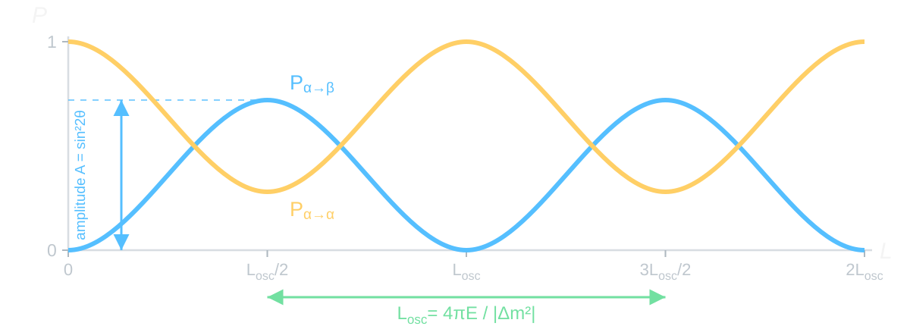

# In Plain Words

## Problem Statement

- In the Standard Model:
$$
\begin{aligned}
\text{possible}\qquad W^+\longrightarrow\ell_\alpha^++\nu_\alpha,
\qquad&\overset{L=0}{\longrightarrow}\qquad
\nu_\alpha+W^-\longrightarrow\ell_\alpha^-. \\
\text{impossible}\qquad W^+\longrightarrow\ell_\alpha^++\nu_\alpha,
\qquad&\overset{L=0}{\longrightarrow}\qquad
\nu_\alpha+W^-\longrightarrow\ell_\beta^-, \qquad \alpha\neq\beta.
\end{aligned}
$$
- If $L\ne 0$, $m_i \ne m_j$ and $\theta\ne 0$, then the impossible becomes possible:
$$
\text{possible}\qquad W^+\longrightarrow\ell_\alpha^++\nu_\alpha,
\qquad\overset{L\ne 0}{\longrightarrow}\qquad
\nu_\alpha+W^-\longrightarrow\ell_\beta^-, \qquad \alpha\neq\beta.
$$
- The probability of such processes is a (quasi)periodic function of the ratio $L/E$:
$$
\boxed{P_{\alpha\to\beta}(L/E)}.
$$
- This phenomenon is called **neutrino oscillations**.

## Quantum Chameleon {#quantum-chameleon}



## Periodicity Is in the Probabilities {#oscillation-phases}



::: {.media-caption}
The two components acquire different phases. Their sum at detection determines
the probabilities of the flavor outcomes.
:::

# Two Bases

## Flavor at Birth, Mass in Flight

:::: {.columns}

::: {.column width="48%"}

**Weak interaction**

$$
W^+\longrightarrow\ell_\alpha^++\nu_\alpha,
\qquad
\nu_\beta+N\longrightarrow\ell_\beta^-+X.
$$

The charged lepton defines the flavor basis for production and detection.

:::

::: {.column width="49%"}

**Free propagation**

$$
H_0|\nu_i\rangle=E_i|\nu_i\rangle,
\qquad i=1,2.
$$

The mass states are the eigenstates of the free Hamiltonian.

:::

::::

Both bases describe the same state space. Between them stands the mixing
angle $\theta$.

## One Angle Connects the Two Bases

$$
\boxed{
\begin{pmatrix}
|\nu_\alpha\rangle\\[2pt]
|\nu_\beta\rangle
\end{pmatrix}
=
\begin{pmatrix}
\cos\theta&\sin\theta\\
-\sin\theta&\cos\theta
\end{pmatrix}
\begin{pmatrix}
|\nu_1\rangle\\[2pt]
|\nu_2\rangle
\end{pmatrix}}
$$

- At $\theta=0$ each flavor coincides with one mass state.
- At $\theta=\pi/4$ both mass states enter $|\nu_\alpha\rangle$
  with amplitudes of equal modulus.

To compute the transition we will need two rows of this rotation:

$$
|\nu_\alpha\rangle=c_\theta|\nu_1\rangle+s_\theta|\nu_2\rangle,
\qquad
|\nu_\beta\rangle=-s_\theta|\nu_1\rangle+c_\theta|\nu_2\rangle,
$$

where $c_\theta=\cos\theta$ and $s_\theta=\sin\theta$.

## Phases of the Two Eigenstates

::: {.marginnote .absolute top=540 left=1250 width=300 style="--note-font-size: 0.62em;"}
$\hbar=c=1$. The free Hamiltonian does not depend on time.
:::

Let $\varphi_i$ be the phase accumulated by a mass component between the source
and the detector. Then

$$
|\nu_\alpha;t,L\rangle
=c_\theta e^{-i\varphi_1}|\nu_1\rangle
+s_\theta e^{-i\varphi_2}|\nu_2\rangle.
$$

If the initial state contains a single eigenstate, the phase factor
disappears when the probability is computed. Here two waves are present; after
factoring out the common factor, the difference remains:

$$
\boxed{\Delta\varphi=\varphi_2-\varphi_1}.
$$

As it accumulates, the result of adding the amplitudes at the detector changes.

## Projection onto the Other Flavor

:::: {.panel-tabset .nh-story-tabs}

### Detector

The detector looks for the state $|\nu_\beta\rangle$. We project the
evolved state onto it:

$$
\begin{aligned}
\mathcal A_{\alpha\to\beta}
&=\langle\nu_\beta|\nu_\alpha;t,L\rangle\\
&=(-s_\theta\langle\nu_1|+c_\theta\langle\nu_2|)
\left(c_\theta e^{-i\varphi_1}|\nu_1\rangle
+s_\theta e^{-i\varphi_2}|\nu_2\rangle\right).
\end{aligned}
$$

### Two Amplitudes

The mass states are orthonormal:
$\langle\nu_i|\nu_j\rangle=\delta_{ij}$. Two contributions remain:

$$
\boxed{
\mathcal A_{\alpha\to\beta}
=s_\theta c_\theta
\left(e^{-i\varphi_2}-e^{-i\varphi_1}\right)
}.
$$

At $L=0$ the phases are equal, and the two contributions cancel. Further on they diverge.

### Probability

We use

$$
\left|e^{-i\varphi_2}-e^{-i\varphi_1}\right|^2
=4\sin^2\frac{\Delta\varphi}{2},
\qquad
4s_\theta^2c_\theta^2=\sin^22\theta.
$$

By the Born rule

$$
\boxed{
P_{\alpha\to\beta}(t,L)
=\sin^22\theta\,
\sin^2\frac{\Delta\varphi(t,L)}{2}
}.
$$

::::

## Two Possible Outcomes

In the two-flavor model the probabilities exhaust all detection possibilities:

$$
\boxed{P_{\alpha\to\alpha}=1-P_{\alpha\to\beta}}.
$$

- For a nonzero mass splitting, the angle $\theta$ sets the height of the maxima:
  $P_{\alpha\to\beta}^{\max}=\sin^22\theta$.
- The phase difference sets the positions of the maxima and minima.
- At the point $L=0$ we obtain $P_{\alpha\to\beta}=0$ and
  $P_{\alpha\to\alpha}=1$.

# From Time to Distance

## Phase Along the Path

For a plane wave moving along the $L$ axis,

$$
e^{-i\varphi_i(t,L)}=e^{-i(E_it-p_iL)},
\qquad
\varphi_i(t,L)=E_it-p_iL.
$$

Here $p_i$ is the momentum along the direction from the source to the detector.

Hence,

$$
\boxed{\Delta\varphi(t,L)=\Delta E\,t-\Delta p\,L},
\qquad
\Delta E=E_2-E_1,
\quad
\Delta p=p_2-p_1.
$$

The detector is located at a distance $L$. For an ultrarelativistic
neutrino, the flight time $t\simeq L$ in units of $c=1$. Both components
must remain coherent until detection.

## From Mass to Phase

We use the dispersion relation of each mass wave:

$$
E_i^2-p_i^2=m_i^2
\quad\Longrightarrow\quad
E_i-p_i=\frac{m_i^2}{E_i+p_i}.
$$

For $t\simeq L$ and $E_i\simeq p_i\simeq E$, to leading order:

$$
\varphi_i(t,L)
\simeq(E_i-p_i)L
\simeq\frac{m_i^2L}{2E}.
$$

Therefore

$$
\boxed{
\Delta\varphi\simeq\frac{\Delta m^2L}{2E}},
\qquad
\Delta m^2=m_2^2-m_1^2.
$$

## Probability at Distance $L$

The argument of the sine contains half of the relative phase:

$$
\boxed{
P_{\alpha\to\beta}(L,E)
=\sin^22\theta\,
\sin^2\left(\frac{\Delta m^2L}{4E}\right)
}.
$$

The period in distance at fixed energy is

$$
\boxed{L_{\rm osc}=\frac{4\pi E}{|\Delta m^2|}}.
$$

The first transition maximum occurs at $L=L_{\rm osc}/2$.

## What the Plot Shows

{fig-alt="Appearance and survival probabilities, mixing amplitude and oscillation length" width="100%"}

- The height of the maximum gives $\sin^22\theta$.
- The distance between neighboring maxima, for a known $E$, gives
  $|\Delta m^2|$.

# Checking the Formula

## Build the Oscillation Yourself {#two-flavor-lab}



::: {.nh-text tone="muted" size="sm"}
- Set $\theta=0$: how does the curve change?
- Set $\theta=45^\circ$: find the first maximum.
- Move $L/L_{\rm osc}$ from $0$ to $1$: where does the transition probability
  return to zero?
:::

# Mechanical Model

## Two Pendulums of Different Masses



## Two Frequencies in One Mechanical System

:::: {.columns}

::: {.column width="49%"}

**We excite one pendulum**

The initial displacement decomposes into two normal modes. Each mode
oscillates with its own frequency $\omega_+$ or $\omega_-$.

:::

::: {.column width="49%"}

**We observe both pendulums**

The relative phase $(\omega_--\omega_+)t$ changes. The envelope of the motion
periodically shifts from one pendulum to the other.

:::

::::

$$
\boxed{
P_{1\to2}(t)=\sin^22\theta\,
\sin^2\!\left(\frac{(\omega_--\omega_+)t}{2}\right)
}.
$$

Here $P_i$ are the normalized squared moduli of the complex amplitudes of the local
pendulums. For weak coupling they are approximately equal to the fractions of the averaged energy.
The exact derivation is in [Problem 9.6](../exercises/09_vacuum_oscillations_exercises.qmd).

# Two Flavors

## The Formula and Its Physical Meaning

$$
\boxed{
P_{\alpha\to\beta}(L,E)
=\sin^22\theta\,
\sin^2\!\left(\frac{\Delta m^2L}{4E}\right)
}.
$$

- The weak interaction prepares and measures the flavor.
- The mass components acquire different phases during propagation.
- The interference of these components determines the fraction of events with flavor $\beta$.

In the [next lecture](10_vacuum_pmns.qmd) a third state will be added to the two
mass states.

[Problems for Lecture 09](../exercises/09_vacuum_oscillations_exercises.qmd) ·
[Two-flavor applet](../../ru/applets/two-flavor-oscillations.qmd) (in Russian) ·
[Coupled pendulums applet](../../ru/applets/coupled-pendula.qmd) (in Russian).
