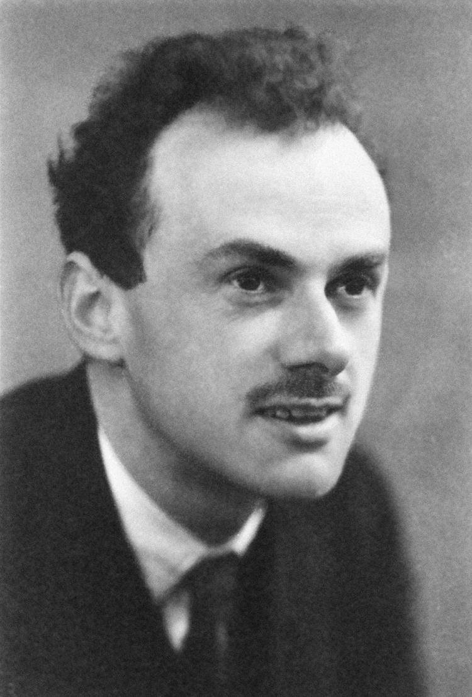
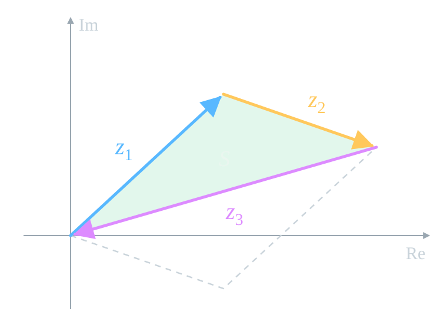
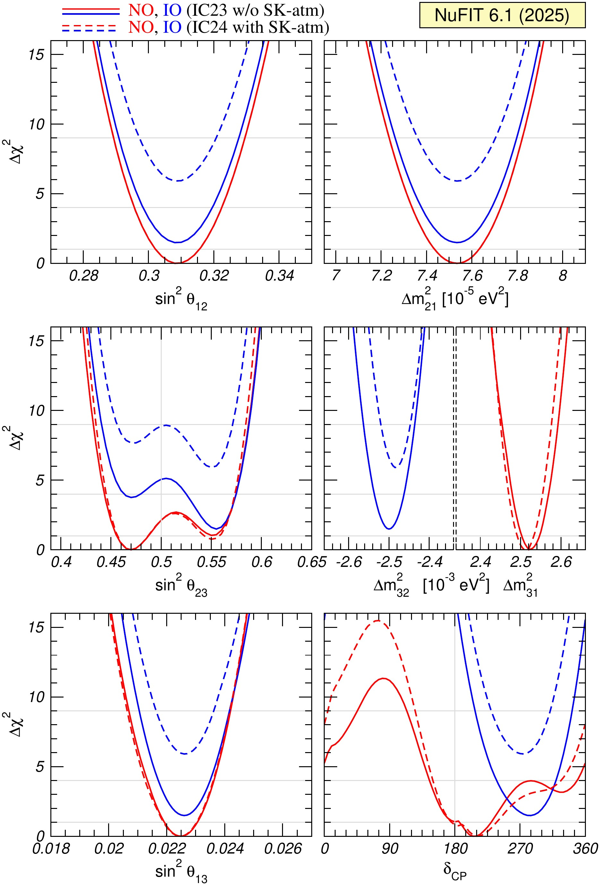
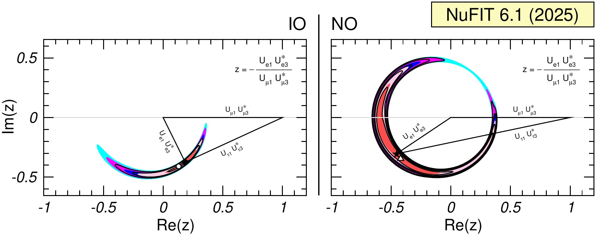

# Three Flavors

## Two Bases

:::: {.panel-tabset .nh-story-tabs}

### Flavor

The charged lepton at production or detection determines the flavor:

$$
\nu_e,\qquad\nu_\mu,\qquad\nu_\tau.
$$

These are three states distinguishable by the weak interaction.

### Mass

In vacuum, three eigenwaves propagate:

$$
H_0|\nu_i\rangle=E_i|\nu_i\rangle,
\qquad i=1,2,3.
$$

Each acquires a phase $e^{-i(E_it-p_iL)}$. Of the three phase differences, two are independent.

::::

The three angles describe the relative orientation of the bases; the complex phase
appears in the interference of the three mass waves.

## Mixing Matrix

$$
U=\begin{pmatrix}
U_{e1}&U_{e2}&U_{e3}\\
U_{\mu1}&U_{\mu2}&U_{\mu3}\\
U_{\tau1}&U_{\tau2}&U_{\tau3}
\end{pmatrix},
\qquad
\boxed{|\nu_\alpha\rangle
=\sum_{i=1}^{3}U_{\alpha i}^*|\nu_i\rangle}.
$$

- Row $\alpha$ corresponds to the flavor; column $i$ corresponds to the mass state.
- The number $|U_{\alpha i}|^2$ shows the fraction of the mass component $i$
  in the flavor state $\alpha$.
- The transition from one basis to the other preserves norms and scalar products.

## Ones on the Diagonal, Zeros Off It

Unitarity means

$$
\boxed{UU^\dagger=U^\dagger U=
\begin{pmatrix}
1&0&0\\
0&1&0\\
0&0&1
\end{pmatrix}}.
$$

:::: {.columns}

::: {.column width="49%"}

**Rows:**

$$
\sum_i|U_{\alpha i}|^2=1,
\qquad
\sum_iU_{\alpha i}U_{\beta i}^*=0
\quad(\alpha\ne\beta).
$$

:::

::: {.column width="49%"}

**Columns:**

$$
\sum_\alpha|U_{\alpha i}|^2=1,
\qquad
\sum_\alpha U_{\alpha i}^*U_{\alpha j}=0
\quad(i\ne j).
$$

:::

::::

The normalizations give three ones on the diagonal. The six off-diagonal zeros are pairwise
conjugate: these are three complex, that is, six real conditions.
In total, $U^\dagger U=I$ amounts to $3+6=9$ real conditions; for a square
matrix, $UU^\dagger=I$ follows from this and adds no new conditions.

## What an Experimental Test Means

- If $U$ is written as a product of three unitary rotations, the equality
  $U^\dagger U=I$ holds for any values of the angles and the phase.
- An experimental test requires determining the elements through different
  channels of production, disappearance, and appearance, allowing the data to violate
  the normalization and orthogonality conditions.
- The normalizations also require information on the absolute rates of weak
  processes, fluxes, and cross sections; the shapes of the curves in $L/E$ alone are not enough.

::: {.nh-box tone="accent" size="sm"}
A good agreement of the fit with a unitary matrix tests the model as a whole.
Testing unitarity itself requires an analysis in which its constraints
are not imposed in advance.
:::

# Three Angles and One Phase

## Three Rotations and One Phase

Let $c_{ij}=\cos\theta_{ij}$, $s_{ij}=\sin\theta_{ij}$, and
$\delta\equiv\delta_{\rm CP}$. The standard convention has the form

$$
\boxed{U=R_{23}U_{13}(\delta_{\rm CP})R_{12}},
$$

$$
\begin{aligned}
R_{23}&=\begin{pmatrix}1&0&0\\0&c_{23}&s_{23}\\0&-s_{23}&c_{23}\end{pmatrix},
&U_{13}&=\begin{pmatrix}c_{13}&0&s_{13}e^{-i\delta}\\0&1&0\\-s_{13}e^{i\delta}&0&c_{13}\end{pmatrix},
&R_{12}&=\begin{pmatrix}c_{12}&s_{12}&0\\-s_{12}&c_{12}&0\\0&0&1\end{pmatrix}.
\end{aligned}
$$

From right to left: $R_{12}$ rotates in the $12$ plane, $U_{13}$ acts
in the $13$ plane and carries the phase, $R_{23}$ rotates in the $23$ plane.
Each factor is unitary.

## PMNS Matrix

Multiplying the three factors, we obtain

$$
\boxed{
U=\begin{pmatrix}
c_{12}c_{13}&s_{12}c_{13}&s_{13}e^{-i\delta}\\
-s_{12}c_{23}-c_{12}s_{23}s_{13}e^{i\delta}
&c_{12}c_{23}-s_{12}s_{23}s_{13}e^{i\delta}
&s_{23}c_{13}\\
s_{12}s_{23}-c_{12}c_{23}s_{13}e^{i\delta}
&-c_{12}s_{23}-s_{12}c_{23}s_{13}e^{i\delta}
&c_{23}c_{13}
\end{pmatrix}}.
$$

The first row and the third column can be read off immediately:

$$
\frac{|U_{e2}|}{|U_{e1}|}=\tan\theta_{12},\qquad
|U_{e3}|^2=\sin^2\theta_{13},\qquad
\frac{|U_{\mu3}|}{|U_{\tau3}|}=\tan\theta_{23}.
$$

The multiplication and additional checks are in the problems for the lecture.

## What Is Visible in the Flavor Fractions

```{=html}
<div class="pmns-flavor-shares" role="img"
     aria-label="Electron, muon and tau flavor fractions in the three mass states for the NuFIT 6.1 best-fit point">
  <div class="pmns-flavor-shares__column">
    <strong>\(\nu_1\)</strong>
    <div class="pmns-flavor-shares__stack">
      <span class="flavor-e" style="height:67.6%">\(e:\;0.676\)</span>
      <span class="flavor-mu" style="height:11.2%">\(\mu:\;0.112\)</span>
      <span class="flavor-tau" style="height:21.2%">\(\tau:\;0.212\)</span>
    </div>
  </div>
  <div class="pmns-flavor-shares__column">
    <strong>\(\nu_2\)</strong>
    <div class="pmns-flavor-shares__stack">
      <span class="flavor-e" style="height:30.2%">\(e:\;0.302\)</span>
      <span class="flavor-mu" style="height:42.8%">\(\mu:\;0.428\)</span>
      <span class="flavor-tau" style="height:27.0%">\(\tau:\;0.270\)</span>
    </div>
  </div>
  <div class="pmns-flavor-shares__column">
    <strong>\(\nu_3\)</strong>
    <div class="pmns-flavor-shares__stack">
      <span class="flavor-e flavor-e--small" style="height:2.2%"></span>
      <span class="flavor-mu" style="height:45.9%">\(\mu:\;0.459\)</span>
      <span class="flavor-tau" style="height:51.9%">\(\tau:\;0.518\)</span>
    </div>
  </div>
</div>
```

- $\theta_{12}$ distributes the electron row between columns $1$ and $2$.
- $\theta_{13}$ determines the small electron fraction in column $3$:
  $|U_{e3}|^2=0.022$ (narrow light-blue strip).
- $\theta_{23}$ divides column $3$ between $\mu$ and $\tau$.
- $\delta_{\rm CP}$ through $\cos\delta_{\rm CP}$ changes the fractions of $\mu$ and $\tau$
  in columns $1$ and $2$.

::: {.nh-text tone="muted" size="sm"}
The example is computed from the NuFIT 6.1 best-fit point (NO, IC24 + SK-atm);
the fractions of each column sum to one up to rounding.
:::

## Dirac and Majorana: How Many Phases?

:::: {.panel-tabset .nh-story-tabs}

### Dirac Particle

::::: {.pmns-phase-count}

A unitary matrix $U$ of size $3\times3$ contains three angles and **six phases**.

:::: {.columns}
::: {.column width="47.5%"}

- In the mass basis:

$$
\begin{aligned}
\mathcal L_{\rm CC}
&=-\frac{g}{\sqrt2}\,W^-_\mu
\sum_{\alpha,i}\bar\ell_{\alpha L}\gamma^\mu U_{\alpha i}\nu_{iL}
+\mathrm{h.c.},\\
\mathcal L_{\rm mass}
&=-\sum_\alpha m_\alpha\bar\ell_\alpha\ell_\alpha
-\sum_i m_i\bar\nu_i\nu_i.
\end{aligned}
$$

- The mass terms are preserved under a change of field phases:

$$
\ell_\alpha\mapsto e^{i\phi_\alpha}\ell_\alpha,
\qquad
\nu_i\mapsto e^{i\psi_i}\nu_i.
$$

- The charged current keeps its form if

$$
\boxed{U_{\alpha i}'=
e^{i(\phi_\alpha-\psi_i)}U_{\alpha i}}.
$$

:::
::: {.column width="47.5%"}

- On $U$, the **differences** $\phi_\alpha-\psi_i$ act.
  A common shift of all six phases:

$$
\begin{gathered}
\phi_\alpha\mapsto\phi_\alpha+\chi,\quad
\psi_i\mapsto\psi_i+\chi:\\
(\phi_\alpha+\chi)-(\psi_i+\chi)=\phi_\alpha-\psi_i.
\end{gathered}
$$

- This shift does not change $U$. Subtracting $\psi_3$ from all phases,
  we obtain five independent parameters:

$$
\phi_e-\psi_3,\ \ \phi_\mu-\psi_3,\ \ \phi_\tau-\psi_3,\ \
\psi_1-\psi_3,\ \ \psi_2-\psi_3.
$$

- Five independent rephasings remove **five of the six phases $U$**:
  $\boxed{6-5=1}$. The physical phase $\delta_{\rm CP}$ remains.

:::
::::

:::::

### Majorana Particle

::::: {.pmns-phase-count}

The masses $m_i$ are chosen real and positive.
$\widetilde U$ denotes the full mixing matrix.

:::: {.columns}
::: {.column width="47.5%"}

- Majorana mass:

$$
\mathcal L_{\rm mass}^{(M)}
=-\frac12\sum_i m_i\,\overline{\nu_{iL}^{\,c}}\nu_{iL}
+\mathrm{h.c.}
$$

- For $\nu_{iL}\mapsto e^{i\psi_i}\nu_{iL}$:

$$
\overline{\nu_{iL}^{\,c}}\nu_{iL}
\mapsto e^{2i\psi_i}\overline{\nu_{iL}^{\,c}}\nu_{iL}.
$$

For fixed $m_i$, only $\psi_i=0,\pi$ are allowed.

- Three rephasings of the charged leptons remove the three common row phases.
  What remain are $\boxed{6-3=3}$ physical phases:
  $\delta_{\rm CP}$ and two Majorana phases.

:::
::: {.column width="47.5%"}

- The charged leptons remain Dirac.
  Their mass terms $-m_\alpha\bar\ell_\alpha\ell_\alpha$
  are preserved under $\ell_\alpha\mapsto e^{i\phi_\alpha}\ell_\alpha$.

$$
\widetilde U'=D_\ell\widetilde U,\qquad
D_\ell=\operatorname{diag}(e^{i\phi_e},e^{i\phi_\mu},e^{i\phi_\tau}).
$$

- Multiplication **from the left** changes the whole row $\alpha$:

$$
\widetilde U_{\alpha i}'=e^{i\phi_\alpha}\widetilde U_{\alpha i}
\qquad\text{for all }i.
$$

A single $\phi_\alpha$ multiplies the **entire row $\alpha$** by a common factor.
The relative phases of its elements are preserved.

:::
::::

:::::

### Column Phases

::::: {.pmns-phase-count}

After the phases of the charged leptons are chosen, the full matrix can be written
as $\widetilde U=U(\delta)D_M$. In $U(\delta)$ there are three angles and one phase
$\delta_{\rm CP}$.

:::: {.columns}
::: {.column width="47.5%"}

- The factor $e^{i\eta_i}$ belongs to the mass state $\nu_i$,
  that is, to **column $i$**:

$$
\widetilde U_{\alpha i}=U_{\alpha i}(\delta)e^{i\eta_i}.
$$

This is how multiplication from the right by

$$
D_M=\operatorname{diag}(e^{i\eta_1},e^{i\eta_2},e^{i\eta_3}).
$$

acts.

- In $D_M$ with three $\eta_i$, one common phase is redundant. The factor $e^{i\eta_1}$
  on the whole matrix is removed by the uniform replacement
  $\ell_\alpha\mapsto e^{-i\eta_1}\ell_\alpha$, which is already included
  in the three row rephasings. Physically, the differences
  $\eta_2-\eta_1$ and $\eta_3-\eta_1$ remain.

:::
::: {.column width="47.5%"}

- Majorana phases $\alpha_{j1}=2(\eta_j-\eta_1)$:

$$
D_M=\operatorname{diag}
\left(1,e^{i\alpha_{21}/2},e^{i\alpha_{31}/2}\right).
$$

- In oscillations, the column phase cancels:

$$
\widetilde U_{\beta i}\widetilde U_{\alpha i}^{*}
=U_{\beta i}U_{\alpha i}^{*}e^{i\eta_i}e^{-i\eta_i}
=U_{\beta i}U_{\alpha i}^{*}.
$$

- In $0\nu\beta\beta$, the phases double:

$$
m_{\beta\beta}=\left|\sum_i m_i\widetilde U_{ei}^{2}\right|,
\qquad \widetilde U_{ei}^{2}=U_{ei}^{2}e^{2i\eta_i}.
$$

:::
::::

:::::

::::

## Paul Dirac and Ettore Majorana

:::: {.panel-tabset .nh-story-tabs}

### Paul Dirac

:::: {.columns}
::: {.column width="28%"}
{.pmns-bio-photo width="100%" fig-alt="Paul Dirac"}
:::
::: {.column width="68%"}

**1902–1984.** The relativistic Dirac equation described a fermion with spin
$1/2$ and led to the prediction of the electron's antiparticle. In 1933, Dirac
shared the Nobel Prize in Physics with Erwin Schrödinger.

::: {.nh-text tone="muted" size="sm"}
[Biography: Nobel Prize](https://www.nobelprize.org/prizes/physics/1933/dirac/biographical/) ·
[photo: Wikimedia Commons, public domain](https://commons.wikimedia.org/wiki/File:Paul_Dirac,_1933.jpg).
:::
:::
::::

### Ettore Majorana

:::: {.columns}
::: {.column width="28%"}
{.pmns-bio-photo width="100%" fig-alt="Ettore Majorana"}
:::
::: {.column width="68%"}

**1906 — disappeared in 1938.** In 1937, Majorana constructed a theory
of a neutral fermion that coincides with its own antiparticle. Whether
this description applies to the neutrino is for experiment to say.

::: {.nh-text tone="muted" size="sm"}
[Biography: INFN](https://www.infn.it/en/70-years-of-neutrinos/) ·
[photo: Wikimedia Commons, public domain in Italy](https://commons.wikimedia.org/wiki/File:Ettore_Majorana.jpg).
:::
:::
::::

::::

# From State to Probability

## Transition Amplitude

:::: {.panel-tabset .nh-story-tabs}

### Source

The source prepares the flavor $\alpha$:

$$
|\nu_\alpha;0\rangle=\sum_iU_{\alpha i}^*|\nu_i\rangle.
$$

Each mass component propagates with its own phase.

### Propagation

For an ultrarelativistic neutrino after a distance $L$:

$$
|\nu_\alpha;L\rangle
=\sum_iU_{\alpha i}^*
\exp\!\left(-i\frac{m_i^2L}{2E}\right)|\nu_i\rangle.
$$

The phase common to the three components is dropped: it does not enter the probability.

### Detector

The detector projects the state onto the flavor $\beta$. The orthogonality
of the mass states leaves a single sum:

$$
\boxed{
\mathcal A_{\alpha\to\beta}(L,E)
=\sum_{i=1}^{3}
U_{\beta i}U_{\alpha i}^*
e^{-im_i^2L/(2E)}
}.
$$

In each term one can see the production, propagation, and detection of a single
mass component.

::::

## Three Pairs, Two Independent Differences

Denote

$$
\Delta_{ij}=\frac{\Delta m_{ij}^2L}{4E},
\qquad \Delta m_{ij}^2=m_i^2-m_j^2.
$$

Of the three possible pairs $21$, $31$ and $32$, two are independent:

$$
\boxed{\Delta m_{31}^2=\Delta m_{32}^2+\Delta m_{21}^2}.
$$

- The fast oscillations are set by the atmospheric splitting
  $|\Delta m_{31}^2|\approx|\Delta m_{32}^2|$.
- The slow modulation is set by the solar one, $\Delta m_{21}^2$.
- The sign of the large splitting sets the mass ordering. To extract it from
  the data, one compares the energy dependences, including those in matter.

## Squared Amplitude

Put

$$
a_i=U_{\beta i}U_{\alpha i}^*e^{-im_i^2L/(2E)},
\qquad
\mathcal A_{\alpha\to\beta}=a_1+a_2+a_3.
$$

Then the probability is a sum of three diagonal contributions and the
interference of the three pairs:

$$
\boxed{
P_{\alpha\to\beta}=\left|\sum_i a_i\right|^2
=\sum_i|a_i|^2+2\sum_{i>j}\operatorname{Re}(a_i a_j^*)
}.
$$

For a compact notation we introduce

$$
X_{\alpha\beta}^{ij}
=U_{\alpha i}^*U_{\beta i}U_{\alpha j}U_{\beta j}^*.
$$

The real part of $X^{ij}$ gives the familiar oscillation maxima.
The imaginary part will be needed when comparing neutrinos and antineutrinos.
The full expansion of the sum is problem 10.3.

## Survival and Appearance

:::: {.panel-tabset .nh-story-tabs}

### Survival

For $\beta=\alpha$ all the products $X_{\alpha\alpha}^{ij}$ are real:

$$
\boxed{
P_{\alpha\to\alpha}
=1-4\sum_{i>j}|U_{\alpha i}|^2|U_{\alpha j}|^2
\sin^2\Delta_{ij}
}.
$$

- The deficit of flavor $\alpha$ measures the moduli of row $\alpha$ and the periods
  set by $\Delta m_{ij}^2$. In vacuum the formula is the same for neutrinos
  and antineutrinos.

### Appearance

For $\alpha\ne\beta$:

$$
\boxed{
P_{\alpha\to\beta}
=-4\sum_{i>j}\operatorname{Re}X_{\alpha\beta}^{ij}
\sin^2\Delta_{ij}
+2\sum_{i>j}\operatorname{Im}X_{\alpha\beta}^{ij}
\sin2\Delta_{ij}
}.
$$

- Here products of elements from two rows enter, so the appearance channel
  is sensitive also to their relative phases. The interference part depends on $\delta_{\rm CP}$.

::::

The sum of the three final probabilities for a fixed initial flavor
equals one. The direct derivation and the two-flavor limit are in problem 10.3.

## Neutrinos and Antineutrinos in Vacuum

For antineutrinos the mixing matrix is complex conjugated:

$$
\boxed{\bar U=U^*}.
$$

Under this replacement

$$
\operatorname{Re}X^{ij}\longrightarrow\operatorname{Re}X^{ij},
\qquad
\operatorname{Im}X^{ij}\longrightarrow-\operatorname{Im}X^{ij}.
$$

Consequently, in the appearance channel the difference equals

$$
\boxed{
A_{\alpha\beta}^{\rm CP}
=P(\nu_\alpha\to\nu_\beta)
-P(\bar\nu_\alpha\to\bar\nu_\beta)
=4\sum_{i>j}\operatorname{Im}X_{\alpha\beta}^{ij}
\sin2\Delta_{ij}
}.
$$

For the survival channel in vacuum $A_{\alpha\alpha}^{\rm CP}=0$.

## Probabilities as Functions of Energy and Length {#three-flavor-probabilities}

```{=html}
<link rel="stylesheet" href="../../ru/slides/assets/05_vacuum_oscillations/three_flavor_probabilities.css">
```



```{=html}
<script src="../../ru/slides/assets/05_vacuum_oscillations/three_flavor_probabilities.js"></script>
```

::: {.nh-text tone="muted" size="sm"}
[Open the applet separately](../../ru/applets/three-flavor-probabilities.html) (in Russian) ·
[the same program in Python](../../ru/slides/assets/05_vacuum_oscillations/three_flavor_oscillations.py).
:::

## Three Probabilities in One Figure {#three-flavor-triangle}

```{=html}
<link rel="stylesheet" href="../../ru/slides/assets/05_vacuum_oscillations/three_flavor_triangle.css">
```



```{=html}
<script src="../../ru/slides/assets/05_vacuum_oscillations/three_flavor_triangle.js"></script>
```

::: {.nh-text tone="muted" size="sm"}
The point shows
$(P_{\alpha\to e},P_{\alpha\to\mu},P_{\alpha\to\tau})$.
The path $x=L/L_{\rm osc}^{21}$ is extended to three solar periods. The NO
and IO buttons set the angles and phase of the best-fit point of the corresponding ordering: NuFIT 6.1, IC24 + SK-atm.
:::

# CP Violation

## Comparing Conjugate Channels

In vacuum one compares transitions at the same $L$ and $E$:

$$
\nu_\alpha\to\nu_\beta,
\qquad
\bar\nu_\alpha\to\bar\nu_\beta.
$$

- For two flavors the mixing matrix can be made real.

- The three-flavor matrix admits a physical complex phase, which
  can give a nonzero probability difference.

- In long-baseline accelerator experiments, Earth's matter
  also affects this comparison.

## Cecilia Jarlskog

:::::: {.panel-tabset .nh-story-tabs .jarlskog-tabs}

### Invariant

:::: {.columns}

::: {.column width="31%"}

{width="100%" fig-alt="Cecilia Jarlskog"}

::: {.nh-text tone="muted" size="sm"}
[Photo: Rebeca Romero Escrivà / Lund University](https://www.fysik.lu.se/en/article/prestigious-award-cecilia-jarlskog).
:::

:::

::: {.column width="65%"}

In 1985 Jarlskog proposed, for quarks, a quantity that does not change
under redefinition of the field phases:

$$
\boxed{
J_{\rm CP}
=\operatorname{Im}
\left(U_{e2}^*U_{\mu2}U_{e1}U_{\mu1}^*\right)
}.
$$

In the standard parametrization

$$
\boxed{
J_{\rm CP}
=c_{12}s_{12}c_{23}s_{23}c_{13}^2s_{13}\sin\delta_{\rm CP}
}.
$$

$J_{\rm CP}\ne0$ only if all three angles differ from $0$ and $90^\circ$,
and $\sin\delta_{\rm CP}\ne0$.

::: {.nh-text tone="muted" size="sm"}
[C. Jarlskog, *Phys. Rev. Lett.* **55**, 1039 (1985)](https://doi.org/10.1103/PhysRevLett.55.1039).
:::

:::

::::

### Quadruple

::: {.marginnote .note-right .absolute top=250 left=1260 width=340 style="--note-font-size: 0.66em; --note-math-font-size: 1em;"}
<span class="note-title">Reminder</span>

Rephasing the fields
$\ell_\alpha\to e^{i\varphi_\alpha}\ell_\alpha$,
$\nu_i\to e^{i\psi_i}\nu_i$ does not change the physics
(the "Dirac particle" tab).
:::

::: {.jarlskog-main}

- The field phases are arbitrary:
  $U_{\alpha i}\to e^{i(\varphi_\alpha-\psi_i)}U_{\alpha i}$.
- A single element changes its phase, so its phase is unobservable.
- Of two elements only the pair
  $U_{\alpha i}U_{\alpha i}^*=|U_{\alpha i}|^2$ is invariant, and it is real.
- Rows $\alpha\ne\beta$ and columns $i\ne j$ give the quadruple

$$
Q_{\alpha\beta}^{ij}=U_{\alpha i}U_{\beta j}U_{\alpha j}^*U_{\beta i}^*.
$$

- Each index enters once in $U$ and once in $U^*$: the phases
  cancel, while $Q$ can be complex.
- For antineutrinos $U\to U^*$, therefore
  $\operatorname{Im}Q\to-\operatorname{Im}Q$: this is a CP-odd quantity.

:::

### Statement

::: {.marginnote .note-right .absolute top=250 left=1260 width=340 style="--note-font-size: 0.66em; --note-math-font-size: 1em;"}
<span class="note-title">Levi-Civita symbol</span>

$\varepsilon_{e\mu\tau}=\varepsilon_{123}=1$.

Swapping two indices changes the sign; if two indices coincide,
$\varepsilon=0$.
:::

::: {.jarlskog-main}

- The pair of rows $\{\alpha,\beta\}$ can be chosen in three ways, the pair of
  columns $\{i,j\}$ also in three.
- This gives $3\cdot3=9$ submatrices $2\times2$ and nine quadruples $Q$.

**Statement.** For three flavors their imaginary parts coincide up to
sign:

$$
\boxed{
\operatorname{Im}Q_{\alpha\beta}^{ij}
=J_{\rm CP}\sum_{\gamma,k}\varepsilon_{\alpha\beta\gamma}\,\varepsilon_{ijk}
},
\qquad
J_{\rm CP}=\operatorname{Im}Q_{e\mu}^{12}.
$$

- The sign is set by the product $\varepsilon_{\alpha\beta\gamma}\varepsilon_{ijk}$.
- Hence, for three flavors there is one CP-odd mixing invariant.

:::

### Proof

::: {.marginnote .note-right .absolute top=250 left=1260 width=340 style="--note-font-size: 0.66em; --note-math-font-size: 1em;"}
<span class="note-title">What is needed</span>

Orthogonality of rows:
$\sum_iU_{\alpha i}U_{\beta i}^*=0$ for $\alpha\ne\beta$.

$\operatorname{Im}|z|^2=0$,
$\operatorname{Im}(w z^*)=-\operatorname{Im}(z w^*)$.
:::

::: {.jarlskog-main}

1. For rows $\alpha\ne\beta$ put $z_i=U_{\alpha i}U_{\beta i}^*$.
   Orthogonality: $z_1+z_2+z_3=0$.
2. The product of two terms gives the quadruple:
   $z_1z_2^*=Q_{\alpha\beta}^{12}$.
3. Substitute $z_3=-(z_1+z_2)$:

$$
z_2z_3^*=-z_2z_1^*-|z_2|^2
\;\Rightarrow\;
\operatorname{Im}(z_2z_3^*)=\operatorname{Im}(z_1z_2^*).
$$

4. Likewise $\operatorname{Im}(z_3z_1^*)=\operatorname{Im}(z_1z_2^*)$, and
   swapping the columns changes the sign.
5. Orthogonality of the columns repeats steps 1–4 for pairs of rows. $\square$

:::

### Area

:::: {.columns}

::: {.column width="44%"}

{width="100%" fig-alt="The vectors z1, z2, z3 close the unitarity triangle; the dashed line completes the parallelogram on z1 and z2"}

:::

::: {.column width="54%"}

- $z_1+z_2+z_3=0$: the three vectors close a **unitarity triangle**.
- The triangle is half of the parallelogram on $z_1$ and $z_2$:

$$
\boxed{
S=\frac12\left|z_1\times z_2\right|
=\frac12\left|\operatorname{Im}(z_1^*z_2)\right|
=\frac12|J_{\rm CP}|
}.
$$

- All six triangles have the same area: three from rows and three from
  columns.
- $J_{\rm CP}=0$: the triangle degenerates into a segment.

:::

::::

### Consequences

::: {.marginnote .note-right .absolute top=250 left=1260 width=340 style="--note-font-size: 0.66em; --note-math-font-size: 1em;"}
<span class="note-title">Reminder</span>

$X_{\alpha\beta}^{ij}=U_{\alpha i}^*U_{\beta i}U_{\alpha j}U_{\beta j}^*$
enters the probability with $\sin2\Delta_{ij}$ (slide "Squared Amplitude").
:::

::: {.jarlskog-main}

- **Two flavors:** $z_1+z_2=0$, the triangle is degenerate, CP is conserved.
- **Oscillations:** $X^{ij}_{\alpha\beta}$ is also a quadruple,
  $\operatorname{Im}X^{ij}_{\alpha\beta}=\pm J_{\rm CP}$. Therefore
  $P(\nu_\alpha\to\nu_\beta)-P(\bar\nu_\alpha\to\bar\nu_\beta)\propto
  J_{\rm CP}$ (next slide).
- **Three distinct masses are needed:** for $\Delta m^2_{ij}=0$ the difference vanishes.
- **Survival:** $\varepsilon_{\alpha\alpha\gamma}=0$, no asymmetry.
- **Majorana phases** of the columns cancel in each quadruple.
- **$N$ flavors:** $(N-1)(N-2)/2$ Dirac phases; for $N\ge4$ a single
  $J_{\rm CP}$ is not enough.

:::

### Magnitude

::: {.marginnote .note-right .absolute top=250 left=1260 width=340 style="--note-font-size: 0.66em; --note-math-font-size: 1em;"}
<span class="note-title">Jarlskog, 1985</span>

For quarks

$$
\det[H_u,H_d]\propto iJ\,D_uD_d,
$$

where $H=MM^\dagger$, and $D_q$ is the product of the squared-mass differences.
Both the phase and the nondegenerate masses are needed.
:::

::: {.jarlskog-main}

$$
J_{\rm CP}=\frac18\sin2\theta_{12}\sin2\theta_{23}
\sin2\theta_{13}\cos\theta_{13}\sin\delta_{\rm CP}.
$$

- **Maximum:** $\theta_{12}=\theta_{23}=45^\circ$, $|\sin\delta_{\rm CP}|=1$,
  and $c_{13}^2s_{13}=(1-x)\sqrt x$ is maximal at $x=\sin^2\theta_{13}=1/3$:

$$
|J_{\rm CP}|\le\frac1{6\sqrt3}\approx0.096,\qquad |U_{\alpha i}|^2=\frac13.
$$

- **Leptons (NuFIT 6.1):** $J_{\rm CP}\approx0.034\sin\delta_{\rm CP}$;
  at the NO best-fit point $J_{\rm CP}\approx-0.018$.
- **Quarks:** $J\approx3\cdot10^{-5}$.

:::

::::::

## Vacuum CP Asymmetry

For the channel $e\to\mu$ the imaginary parts of the three interference products
are expressed through a single $J_{\rm CP}$. We obtain

$$
\boxed{
A_{e\mu}^{\rm CP}
=16J_{\rm CP}
\sin\Delta_{21}\sin\Delta_{32}\sin\Delta_{31}
}.
$$

- If $\theta_{13}=0$, then $J_{\rm CP}$ also vanishes.
- The factor $\sin\Delta_{21}$: without the solar scale there is no CP effect
  in a long-baseline experiment.
- By CPT $P(\nu_\mu\to\nu_e)=P(\bar\nu_e\to\bar\nu_\mu)$, therefore
  $A_{\mu e}^{\rm CP}=-A_{e\mu}^{\rm CP}$.

The derivation of the identity and an estimate of the size of the effect are homework problem 10.4.

# Mixing Matrix

## Doing the Fit by Hand

We use three experimental results:

- solar neutrinos:
  $P_{ee}\simeq1/3$;
- atmospheric and accelerator neutrinos:
  $\sin^22\theta_{23}\simeq1$;
- a small electron admixture of the third state:
  first put $|U_{e3}|^2=0$.

We will need the normalizations of rows and columns, then orthogonality. The connection
of the solar result with $|U_{e2}|^2$ relies on the adiabatic matter effect;
its physics will be derived in lecture 13.

## Building the matrix step by step {#pmns-from-data}

```{=html}
<link rel="stylesheet" href="../../ru/slides/assets/05_vacuum_oscillations/pmns_from_data.css">
```



```{=html}
<script src="../../ru/slides/assets/05_vacuum_oscillations/pmns_from_data.js"></script>
```

::: {.nh-text tone="muted" size="sm"}
[Open the applet separately](../../ru/applets/pmns-from-data.html) (in Russian).
:::

## What this reconstruction gave

At zeroth order we obtain the matrix of squared moduli

$$
\boxed{
|U_0|^2=
\begin{pmatrix}
2/3&1/3&0\\
1/6&1/3&1/2\\
1/6&1/3&1/2
\end{pmatrix}}.
$$

- Unitarity made it possible to fill in the entries that these experiments
  do not measure directly.
- To fix the signs, one real unitary representative was constructed
  $U_0$. Its phase $\delta_{\rm CP}$ at $U_{e3}=0$ is not observable.
- Reactor data give $|U_{e3}|^2\simeq0.0225$. The full matrix
  requires additional measurements and allows a complex phase.

::: {.nh-box tone="accent" size="sm"}
The combined analysis of different sources reconstructed the whole matrix, but its
unitarity was an initial condition of the reconstruction. For an independent test,
one allows deviations from unitarity and cross-checks different channels.
:::

# What has been measured today

## NuFIT 6.1: three angles

Normal mass ordering, atmospheric data IC24 and Super-Kamiokande.
Best-fit values and $3\sigma$ intervals:

::: {.nufit-large-table}

| Parameter | Best-fit value | $3\sigma$ interval |
|:---|---:|---:|
| $\sin^2\theta_{12}$ | $0.3088$ | $0.2893$–$0.3295$ |
| $\sin^2\theta_{13}$ | $0.02248$ | $0.02064$–$0.02418$ |
| $\sin^2\theta_{23}$ | $0.470$ | $0.435$–$0.584$ |

:::

- $\theta_{13}$ is small and measured precisely.
- The $\theta_{23}$ interval crosses $45^\circ$; its octant is still open.

::: {.nh-text tone="muted" size="sm"}
[NuFIT 6.1, parameter table; data up to November 2025](https://www.nu-fit.org/sites/default/files/v61.tbl-parameters.pdf).
:::

## NuFIT 6.1: CP phase and splittings

::: {.nufit-large-table}

| Parameter | Best-fit value | $3\sigma$ interval |
|:---|---:|---:|
| $\Delta m_{21}^2$ | $7.537\cdot10^{-5}\ \mathrm{eV}^2$ | $(7.236\text{–}7.823)\cdot10^{-5}\ \mathrm{eV}^2$ |
| $\Delta m_{31}^2$ (NO) | $+2.511\cdot10^{-3}\ \mathrm{eV}^2$ | $(2.450\text{–}2.576)\cdot10^{-3}\ \mathrm{eV}^2$ |
| $\delta_{\rm CP}$ (NO) | $212^\circ$ | $125^\circ$–$365^\circ$ |

:::

The interval for $\delta_{\rm CP}$ allows $180^\circ$ and
$360^\circ\equiv0^\circ$: CP-conserving values remain possible.
Separate intervals are given for the inverted mass ordering.

::: {.nh-text tone="muted" size="sm"}
[NuFIT 6.1, normal and inverted ordering](https://www.nu-fit.org/?q=node/309).
:::

## NuFIT 6.1: matrix elements

$3\sigma$ ranges for $|U_{\alpha i}|$ when the atmospheric data
IC24 and Super-Kamiokande are included:

::: {.nufit-large-table}

| Flavor | $\nu_1$ | $\nu_2$ | $\nu_3$ |
|:---|:---:|:---:|:---:|
| $e$ | $0.810$–$0.834$ | $0.532$–$0.568$ | $0.144$–$0.156$ |
| $\mu$ | $0.259$–$0.498$ | $0.514$–$0.678$ | $0.652$–$0.756$ |
| $\tau$ | $0.280$–$0.512$ | $0.488$–$0.659$ | $0.637$–$0.743$ |

:::

The intervals of different entries are correlated: their extreme values cannot
be substituted simultaneously into a single matrix. The table was obtained within the unitary
three-neutrino model.

::: {.nh-text tone="muted" size="sm"}
[NuFIT 6.1, table of matrix moduli](https://www.nu-fit.org/sites/default/files/v61.tbl-mixing.jpg).
:::

## Profiles: solar sector

::: {.nufit-profile-crop .nufit-profile-crop--top}
{fig-alt="Upper part of the NuFIT 6.1 profiles for the solar angle and the solar splitting"}
:::

- The position of the minimum gives the best-fit value.
- The width shows the precision after accounting for the other parameters.

::: {.nh-text tone="muted" size="sm"}
[Official NuFIT 6.1 profiles](https://www.nu-fit.org/sites/default/files/v61.fig-chisq-glob.jpg).
:::

## Profiles: atmospheric sector

::: {.nufit-profile-crop .nufit-profile-crop--middle}
{fig-alt="Middle part of the NuFIT 6.1 profiles for the atmospheric angle and the atmospheric splitting"}
:::

The $\theta_{23}$ profile allows solutions on both sides of $45^\circ$.
When comparing NO and IO, watch the notation
$\Delta m_{3\ell}^2$: for NO it is $\Delta m_{31}^2$, for IO it is
$\Delta m_{32}^2$.

::: {.nh-text tone="muted" size="sm"}
Red: NO; blue: IO. Solid curves: without tabulated SK-atm;
dashed: with them.
:::

## Profiles: $\theta_{13}$ and the CP phase

::: {.nufit-profile-crop .nufit-profile-crop--bottom}
{fig-alt="Lower part of the NuFIT 6.1 profiles for the angle theta 13 and the CP phase"}
:::

$\theta_{13}$ has a narrow minimum. The profile of the phase is much wider, and its shape
changes noticeably depending on the choice of the atmospheric data set.

::: {.nh-text tone="muted" size="sm"}
Red: NO; blue: IO. Solid curves: without tabulated SK-atm;
dashed: with them. [Source of the plot](https://www.nu-fit.org/sites/default/files/v61.fig-chisq-glob.jpg).
:::

## Unitarity triangle: what the figure shows

::: {.nufit-unitarity-figure}
{fig-alt="Allowed shapes of the leptonic unitarity triangle in NuFIT 6.1"}
:::

$$
U_{e1}U_{\mu1}^*+U_{e2}U_{\mu2}^*+U_{e3}U_{\mu3}^*=0.
$$

Three complex terms close a triangle. In the NuFIT figure, the
closure is imposed in advance, and the triangle shapes allowed
in the unitary model are shown. For a direct test, the closure is left free.

::: {.nh-text tone="muted" size="sm"}
[NuFIT 6.1, triangle](https://www.nu-fit.org/?q=node/309).
:::

# What remains to be checked

## What to look for in the formulas

- In $P_{\alpha\to\alpha}$, the moduli of the elements of one row set the depth of
  disappearance, while $\Delta m_{ij}^2$ sets the position of the maxima.
- In $P_{\alpha\to\beta}$ at $\alpha\ne\beta$, products of
  different rows appear; the comparison of neutrinos and antineutrinos is sensitive to their
  imaginary parts.
- Unitarity links the channels. Testing it independently requires
  relaxing these links in the data analysis.

The next lecture will begin with a question: how does matter change the phases of the neutrinos passing
through it?

[Problems for Lecture 10](../../ru/exercises/10_vacuum_pmns_exercises.qmd) (in Russian) ·
[Flavor triangle](../../ru/applets/flavor-triangle.qmd) (in Russian) ·
[Assemble the matrix](../../ru/applets/pmns-from-data.html) (in Russian).
