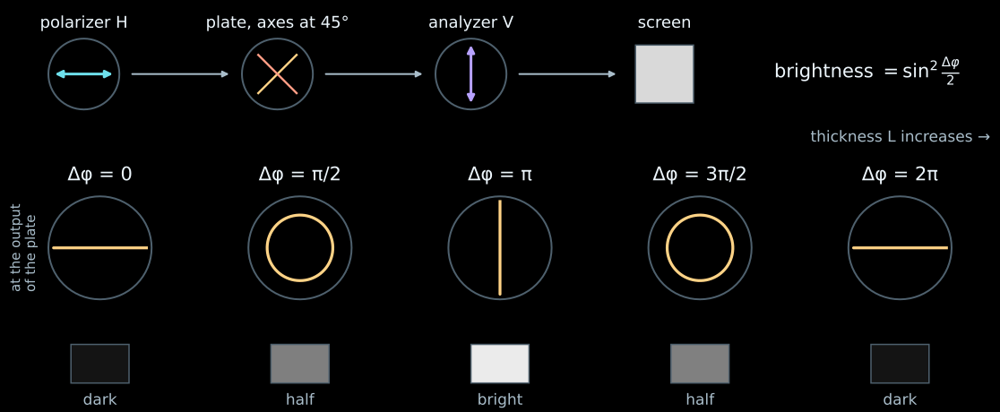
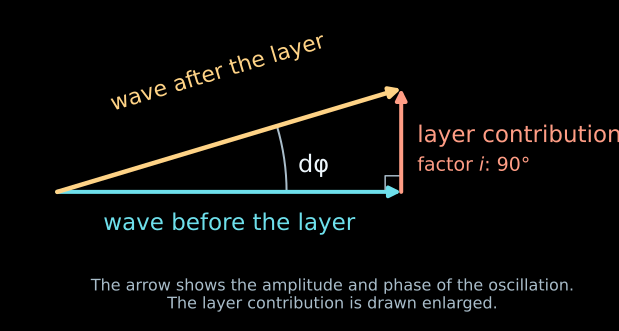
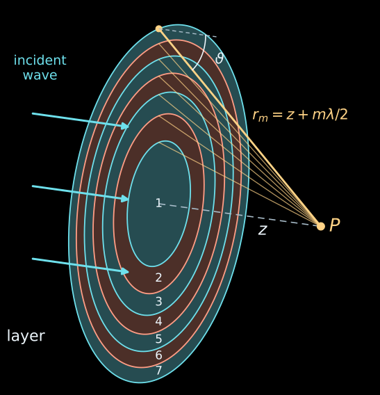
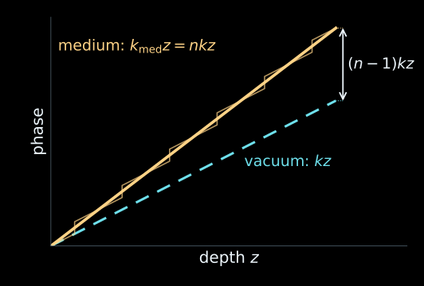
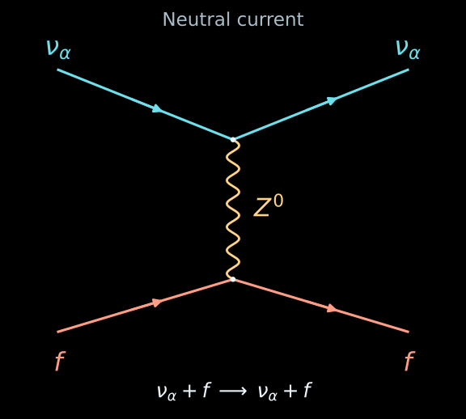
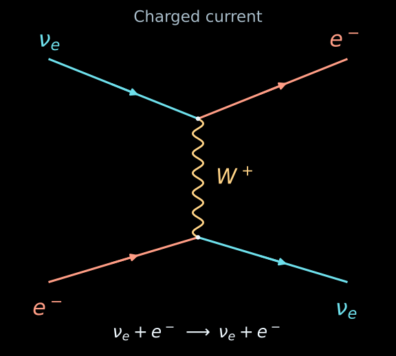
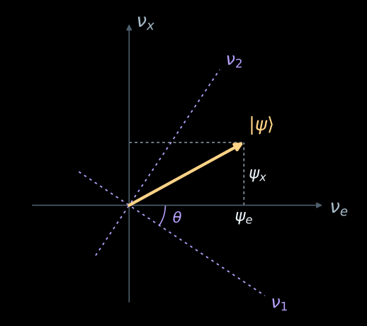
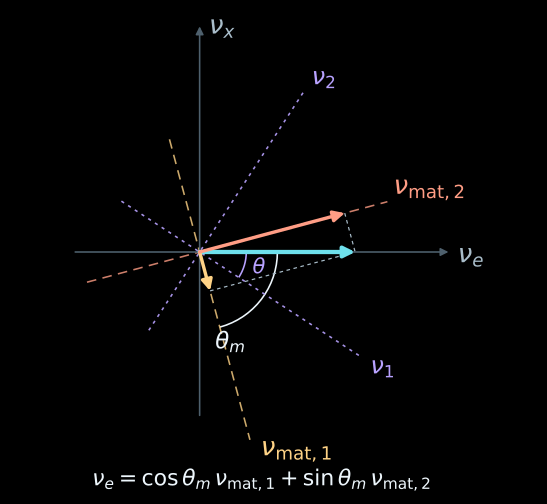

# The Sun as an Optical Medium

## Does the Matter of the Sun Affect Neutrino Oscillations?

::: incremental

- No! Because the Sun is transparent to neutrinos. The scattering probability of a neutrino with an energy of 10 MeV is of the order of $10^{-7}$.

- And yet... Light in a transparent medium is hardly absorbed, but it is refracted. Perhaps the neutrino is also refracted in the Sun?

- Yes! In this lecture we will see that the Sun and the vacuum are, for neutrinos, transparent crystals with two eigenstates and **different** refractive indices.

  - At the center of the Sun, at $E=10$ MeV, the matter contributions differ by $\delta n_e-\delta n_x\approx-8\cdot10^{-19}$.

  - From the center of the Sun to the surface there are about $6\cdot10^{21}$ wavelengths, and the contribution of matter to the phase difference of the flavor components is about $4\cdot10^{3}$ rad in absolute value; more than half of it
  comes from the inner tenth of the radius.

:::

. . .

::: {.nh-box tone="accent" size="md" weight="bold"}
The Sun and the vacuum are, for neutrinos, transparent crystals with two eigenstates and **different** refractive indices.

:::

# Birefringent Crystal

## Experiment: a plate between polarizers {#plate-experiment}

::: {.centered-figure style="--figure-width: 100%; --figure-max-height: 580px;"}
{width=1500 fig-alt="Polarizer H, a birefringent plate with axes at 45 degrees, analyzer V and a screen. Below: the output polarization and screen brightness for phase differences 0, pi/2, pi, 3 pi/2 and 2 pi: dark, half, bright, half, dark."}
:::

::: {.nh-text size="md" align="center"}
One frequency, two polarizations. Along the axes of the plate the refractive indices are $n_1\neq n_2$,
and the waves acquire a phase difference $\Delta\varphi=(n_1-n_2)kL$.
:::

. . .

::: {.nh-box tone="accent" size="md" align="center"}
$P=\sin^2 2\theta\,\sin^2\dfrac{\Delta\varphi}{2}$, where $\theta$ is the angle between the
polarizer and the axis of the plate; here $\theta=45^\circ$.
:::

## Two polarizations in a crystal {#invisible-plate}



## For neutrinos, the vacuum is a birefringent crystal

| Neutrino | Light in a crystal |
|:--|:--|
| mass states $\nu_1,\nu_2$ — the eigenaxes of the vacuum | axes 1 and 2 of the crystal |
| angle $\theta$ | angle to the polarizer |
| $E(n_1-n_2)\simeq\Delta m^2/(2E)$ | $(n_1-n_2)k$ |

## For neutrinos, matter is also a birefringent crystal

| Neutrino | Light in a crystal |
|:--|:--|
| axes $\nu_{\mathrm{mat},1},\nu_{\mathrm{mat},2}$  | axes 1 and 2 of the crystal |
| angle $\theta_m$ | angle to the polarizer |
| $E(n_{\mathrm{mat},1}-n_{\mathrm{mat},2})=\Delta m^2_{\mathrm{mat}}/(2E)$ | $(n_1-n_2)k$ |

# The Nature of the Refractive Index

## Light in glass

::: incremental

- Let us pass monochromatic light through a transparent plate.

- The incoming wave $\psi_{\rm in}$ drives the electrons of the atoms, and they radiate a wave $\psi_{\rm sc}$ at the same frequency.

- Behind the plate the waves add up: $\psi_{\rm out}=\psi_{\rm in}+\psi_{\rm sc}$.

- The refractive index $n$ arises from this sum: $\psi_{\rm out}=e^{inkz}$.

- At the output the light has the same frequency, but its phase changes.

:::

. . .

::: {.nh-box tone="accent" size="sm"}
Algorithm: we compute the total wave

- after a single scatterer

- after scattering on a thin plane perpendicular to the motion of the incident wave

- after passing through a medium of finite thickness

:::

## One thin layer {visibility="hidden"}

:::: {.columns}

::: {.column width="50%"}
Let a layer of thickness $dz$ hardly absorb the wave. In the convention
$e^{-i\omega t+ikz}$ its forward contribution gives

$$
\psi(z+dz)=e^{ikdz}\,[1+i\,d\varphi]\,\psi(z),
\qquad |d\varphi|\ll1.
$$

The addition $i\,d\varphi$ is perpendicular to the arrow of the wave. The length of the sum hardly
changes, while the arrow rotates by $d\varphi$: the phase is shifted,
the frequency stays the same.
:::

::: {.column width="50%"}
::: {.centered-figure style="--figure-width: 100%; --figure-max-height: 480px;"}
{width=760 fig-alt="Arrow of the wave before the layer, the perpendicular contribution of the layer, and the arrow of the wave after the layer, rotated by a small angle d phi."}
:::
:::

::::

::: {.nh-box tone="accent" size="sm"}
Where does the factor $i$ come from, and what is $d\varphi/dz$ equal to? Let us compute it from the waves
scattered by the particles of the layer.
:::

## One scatterer

:::: {.columns}

::: {.column width="50%"}
For the calculation of the phase, a scalar wave model is sufficient. Far from
a small scatterer the wave has the form

$$
\psi(\mathbf r)=e^{ikz}+f(\vartheta)\frac{e^{ikr}}{r}.
$$

- $e^{ikz}$ is the incident plane wave;
- $f(\vartheta)e^{ikr}/r$ is the diverging wave;
- $f(\vartheta)$ is the complex scattering amplitude, which has the dimension of length.

The light field is a vector field, but for adding phases in the direction of propagation
the scalar model suffices.
:::

::: {.column width="50%"}


::: {.nh-text tone="muted" size="sm"}
Cross section by a plane through the scatterer and the axis $z$, $f$ is real.
:::
:::

::::

## Fresnel rings {#fresnel-rings}

:::: {.columns}

::: {.column width="48%"}
::: incremental

- A layer of thickness $dz$ in the plane $z=0$, scatterer concentration $\mathcal N$. The observation point $P$ lies on the axis $z$ behind the layer.

- A scatterer at a distance $b$ from the axis sends to $P$ the wave $f(\vartheta)\,e^{ikr}/r$, where $r=\sqrt{z^2+b^2}$, $\cos\vartheta=z/r$.

- The points of the layer with the same $r$ form a **ring**: a sphere of radius $r$ centered at $P$ intersects the plane of the layer along a circle.

- **Fresnel zones**: $r_m=z+m\lambda/2$. For neighboring rings the path to $P$ differs by $\lambda/2$, and the contributions arrive in antiphase.

:::
:::

::: {.column width="52%"}
::: {.centered-figure style="--figure-width: 100%; --figure-max-height: 760px;"}
{width=760 fig-alt="A flat layer with seven Fresnel zones, observation point P on the axis at distance z, rays from the zone boundaries to P, distance r_m and the scattering angle."}
:::
:::

::::

## Why is the forward amplitude important?

A ring of radius $b$ has area $2\pi b\,db$, and $b\,db=r\,dr$. The factor $r$
cancels the $1/r$ of the spherical wave, and the sum over the layer is written exactly:

$$
d\psi_{\rm sc}=\mathcal N\,dz\int\!2\pi b\,db\,f(\vartheta)\frac{e^{ikr}}{r}
=2\pi\mathcal N\,dz\int_z^\infty\! f(\vartheta)\,e^{ikr}\,dr .
$$

. . .

The beam is finite and the wave was switched on at some time: the distant rings are damped by the factor
$e^{-\varepsilon r}$. We integrate by parts, the lower limit $r=z$ is the center of the layer:

$$
\int_z^\infty f\,e^{ikr}\,dr\;\simeq\;\frac{i}{k}\,f(0)\,e^{ikz}
\quad\Longrightarrow\quad
d\psi_{\rm sc}=i\,\frac{2\pi\mathcal N}{k}\,f(0)\,dz\,e^{ikz}.
$$

. . .

::: {.nh-box tone="accent" size="sm"}
The remainder is small as long as $f(\vartheta)$ hardly changes over the first zone:
$z\gg ka^2$, where $a$ is the size of the scatterer.
:::

. . .

:::: {.columns}

::: {.column width="58%"}
The contribution comes from the region of small angles, which is why $f(0)$ appears. The factor $i$ —
a rotation by $90^\circ$ — is given by the geometry of the plane layer. The phase of the layer's contribution
is equal to $90^\circ+\arg f(0)$. Together with the incident wave behind the layer

$$
\begin{aligned}
\psi&=e^{ikz}\,[1+i\,d\varphi],\\
d\varphi&=\frac{2\pi\mathcal N}{k}\,f(0)\,dz .
\end{aligned}
$$
:::

::: {.column width="42%"}
::: {.centered-figure style="--figure-width: 100%; --figure-max-height: 330px;"}
{width=760 fig-alt="Arrow of the wave before the layer, the perpendicular contribution of the layer, and the arrow of the wave after the layer, rotated by a small angle d phi."}
:::
:::

::::

## Sum over Fresnel zones {#fresnel-spiral}



::: {.nh-text tone="muted" size="sm"}
$f(0)$ is factored out, the moment of time is fixed; the button adds ever more distant
rings. The remainder up to the limit is $e^{-\pi(\varepsilon/k)m}$.
[Model with a charge response](../../ru/applets/refraction-origin.html) (in Russian).
:::

## Many layers: homogeneous matter

Let us add free propagation through $dz$ to the result for a thin layer (waves $e^{ikz-i\omega t}$):

$$
\psi(z+dz)=e^{ikdz}
\left[1+i\,\frac{2\pi\mathcal N}{k}f(0)\,dz\right]\psi(z).
$$

. . .

Let us divide the thickness $D$ into $M$ layers of $dz=D/M$ each:

$$
e^{ikD}\left(1+i\,\frac{2\pi\mathcal N f(0)}{k}\frac{D}{M}\right)^M
\xrightarrow[M\to\infty]{}
e^{ikD}\exp\!\left(i\,\frac{2\pi\mathcal N f(0)}{k}D\right).
$$

. . .

:::: {.columns}

::: {.column width="56%"}
$$
\psi(z)=e^{ik_{\rm med}z}\psi(0),
\qquad
k_{\rm med}=k+\frac{2\pi\mathcal N}{k}f(0),
$$

$$
k_{\rm med}=nk:\qquad
\boxed{n=1+\frac{2\pi\mathcal N}{k^2}f(0)}.
$$
:::

::: {.column width="44%"}
::: {.centered-figure style="--figure-width: 100%; --figure-max-height: 330px;"}
{width=600 fig-alt="Phase versus depth: in vacuum a straight line kz, in matter steps at each layer and an average slope nk; the phase difference is (n-1)kz."}
:::
:::

::::

::: {.nh-text tone="muted" size="sm"}
The exponential has accounted for all orders in $\mathcal N D$, while $n-1$ was found in the first
order in the concentration of independent scatterers; the backscattered wave
is neglected ($|n-1|\ll1$). In dense glass an atom is also acted upon by the field of neighboring
atoms (the Lorentz–Lorenz formula), but the meaning of $n$ is the same.
:::

## Refractive index and optics

- In a transparent medium $n$ can be considered real.

- For light $k=\omega/c$ in vacuum, while inside matter $k_{\rm med}=n\omega/c$.
Therefore

$$
\lambda_{\rm med}=\frac{\lambda_0}{n},
\qquad
v_{\rm ph}=\frac{c}{n},
\qquad
\Delta\varphi=k(n-1)z.
$$

- The frequency of a monochromatic wave is conserved in stationary matter.
- Over a length $z$ an additional phase $\Delta\varphi$ accumulates.
- At the boundary of media the phase must coincide along the surface. Hence
  $n_1\sin\theta_1=n_2\sin\theta_2$.

Thus a single quantity describes both the shift of interference fringes and
the refraction of a ray.

## If the refractive index is complex

Let $n=n_R+i n_I$. Then

$$
\psi(z)\propto e^{ikn_Rz}\,e^{-kn_Iz},
\qquad
\frac{I(z)}{I(0)}=e^{-2kn_Iz}.
$$

The real part of $f(0)$ determines the phase, the imaginary part — the attenuation
of the coherent beam. The optical theorem relates it to the total cross section:

$$
\sigma_{\rm tot}=\frac{4\pi}{k}\operatorname{Im}f(0)
\quad\Longrightarrow\quad
\frac{I(z)}{I(0)}=e^{-\mathcal N\sigma_{\rm tot}z}.
$$

A medium can hardly absorb a wave and at the same time noticeably change its phase.
For neutrinos this distinction will turn out to be decisive.

# Two Refractive Indices of a Neutrino

## The nature of the first refractive index   of a neutrino {#природа-первого-показателя-преломления-нейтрино}

:::: {.columns}

::: {.column width="56%"}
::: incremental

- If a neutrino of any flavor scatters elastically through zero angle in its interaction with the particles of the medium via the exchange of a $Z$ boson, then:

  - the state of the medium does not change, and

  - the neutrino keeps its direction.

  - The forward-scattered wave adds coherently to the wave that passed through
  without scattering.

  - A contribution to the refractive index common to the active flavors appears.

:::
:::

::: {.column width="44%"}
::: {.centered-figure style="--figure-width: 100%; --figure-max-height: 590px;"}
{width=680 fig-alt="Neutral-current diagram: a neutrino of any active flavor and a fermion of the medium scatter elastically with Z0 exchange. On each fermion line the particle type is conserved."}
:::

::: {.nh-text tone="muted" size="sm" align="center"}
$\alpha=e,\mu,\tau$, $\quad f=e^-,p,n$.
:::
:::

::::

## Nature of the second   refractive index of the neutrino {#природа-второго-показателя-преломления-нейтрино}

:::: {.columns}

::: {.column width="56%"}
::: incremental

- An ordinary (normal) medium consists of atomic nuclei and electrons. It contains no $\mu$, $\tau$.

- An electron neutrino $\nu_e$ can scatter elastically off an electron through the exchange of a $W^+$ boson, which changes the refractive index $\nu_e$.

- Therefore the matter contributions $\delta n_e$ and $\delta n_x$ are different.

- Matter changes both the refractive indices and the eigenstates of the vacuum "crystal".

:::

::: {.fragment .nh-text tone="muted" size="sm"}
[L. Wolfenstein. Neutrino oscillations in matter](https://doi.org/10.1103/PhysRevD.17.2369), 1978.
:::
:::

::: {.column width="44%"}
::: {.centered-figure style="--figure-width: 100%; --figure-max-height: 590px;"}
{width=680 fig-alt="Charged-current diagram for elastic scattering of an electron neutrino on an electron. Incoming lines on the left are nu_e and e-, outgoing lines on the right are e- and nu_e; the vertices are connected by W+."}
:::
:::

::::

## Neutrino state

:::: {.columns}

::: {.column width="58%"}
- A neutrino with a given energy $E$ travels along $z$. We use $\hbar=c=1$,
  and drop the common factor $e^{-iEt}$.

- We consider two flavors: $\nu_e$ and $\nu_x$ ($\nu_\mu$ or $\nu_\tau$
  or a combination of them).

- The state and its flavor amplitudes:

$$
|\psi\rangle=\psi_e|\nu_e\rangle+\psi_x|\nu_x\rangle,
\qquad
\psi_\alpha=\langle\nu_\alpha|\psi\rangle.
$$

::: {.fragment}
- The same vector can be expanded in the mass states $|\nu_1\rangle,|\nu_2\rangle$:

$$
|\psi\rangle=a_1|\nu_1\rangle+a_2|\nu_2\rangle,
\qquad a_i=\langle\nu_i|\psi\rangle.
$$
:::
:::

::: {.column width="42%"}
::: {.centered-figure style="--figure-width: 100%; --figure-max-height: 520px;"}
{width=560 fig-alt="Flavor axes nu_e and nu_x, projections psi_e and psi_x, and the mass axes nu_1 and nu_2 rotated by the angle theta."}
:::

::: {.nh-text tone="muted" size="sm"}
Diagram of the bases in the state space. The amplitudes are in general complex.
:::
:::

::::

## The vacuum crystal {#vacuum-index}

In vacuum the mass states $|\nu_i\rangle$ propagate independently.
Each wave has its own refractive index:

$$
n_i=\frac{k_{\mathrm{vac},i}}{E}
=\sqrt{1-\frac{m_i^2}{E^2}}
\simeq1-\frac{m_i^2}{2E^2}.
$$

. . .

Let us combine them into the refractive-index operator:

$$
\boxed{\hat n_{\mathrm{vac}}
=\sum_{i=1,2}n_i\,|\nu_i\rangle\langle\nu_i|.}
$$

The factor $|\nu_i\rangle\langle\nu_i|$ picks out the component along $|\nu_i\rangle$.
Hence

$$
\hat n_{\mathrm{vac}}|\nu_i\rangle=n_i|\nu_i\rangle.
$$

::: {.nh-box tone="accent" size="md"}
This is a definition of the operator through its eigenstates. Its matrix can be written in any basis.
:::

## How a state propagates in vacuum {#vacuum-evolution}

Each eigenstate acquires its own phase:

$$
a_i(z)=a_i(0)e^{iEn_i z},
\qquad
|\psi(z)\rangle=\sum_i a_i(0)e^{iEn_i z}|\nu_i\rangle.
$$

. . .

We differentiate the sum and use the definition $\hat n_{\mathrm{vac}}$:

$$
\frac{d|\psi\rangle}{dz}
=iE\sum_i n_i a_i(z)|\nu_i\rangle
=iE\hat n_{\mathrm{vac}}|\psi\rangle.
$$

$$
\boxed{\frac{d|\psi\rangle}{dz}=iE\hat n_{\mathrm{vac}}|\psi\rangle.}
$$

. . .

The oscillations are determined by the phase difference of the two waves:

$$
\Delta\varphi=E(n_1-n_2)z\simeq\frac{\Delta m^2}{2E}z,
\qquad \Delta m^2=m_2^2-m_1^2.
$$

## The matrix in the mass basis {#vacuum-mass-basis}

The matrix elements are projections of the operator onto the chosen basis states:

$$
\langle\nu_i|\hat n_{\mathrm{vac}}|\nu_j\rangle=n_i\delta_{ij}.
$$

Therefore, in the basis $(\nu_1,\nu_2)$

$$
\boxed{[\hat n_{\mathrm{vac}}]_{\mathrm{mass}}
=\begin{pmatrix}n_1&0\\0&n_2\end{pmatrix},}
\qquad
\frac{d}{dz}\begin{pmatrix}a_1\\a_2\end{pmatrix}
=iE\begin{pmatrix}n_1&0\\0&n_2\end{pmatrix}
\begin{pmatrix}a_1\\a_2\end{pmatrix}.
$$

. . .

The source and the detector distinguish flavors. To go over to their amplitudes we introduce
the matrix $U$:

$$
U_{\alpha i}=\langle\nu_\alpha|\nu_i\rangle,
\qquad
\begin{pmatrix}\psi_e\\\psi_x\end{pmatrix}
=U\begin{pmatrix}a_1\\a_2\end{pmatrix}.
$$

## The same operator in the flavor basis {#vacuum-flavor-basis}

$$
U=\begin{pmatrix}
\cos\theta&\sin\theta\\
-\sin\theta&\cos\theta
\end{pmatrix},
\qquad
\boxed{[\hat n_{\mathrm{vac}}]_f
=U\begin{pmatrix}n_1&0\\0&n_2\end{pmatrix}U^\dagger.}
$$

The rows and columns of this matrix refer to $(\nu_e,\nu_x)$:

$$
\langle\nu_\alpha|\hat n_{\mathrm{vac}}|\nu_\beta\rangle
=\sum_i n_i\,U_{\alpha i}U_{\beta i}^*.
$$

. . .

$$
[\hat n_{\mathrm{vac}}]_f=
\begin{pmatrix}
n_1\cos^2\theta+n_2\sin^2\theta
& (n_2-n_1)\sin\theta\cos\theta\\
(n_2-n_1)\sin\theta\cos\theta
& n_1\sin^2\theta+n_2\cos^2\theta
\end{pmatrix}.
$$

::: {.nh-box tone="accent" size="md"}
Under the change of basis the matrix became non-diagonal. The eigenstates $\nu_1,\nu_2$
and the indices $n_1,n_2$ stayed the same.
:::

## From light to neutrinos {#vacuum-crystal}



# Neutrinos in matter

## Matter adds its own contribution {#matter-index}

Coherent forward scattering in ordinary matter gives different contributions for
$\nu_e$ and $\nu_x$:

$$
\boxed{\delta\hat n
=\delta n_e|\nu_e\rangle\langle\nu_e|
+\delta n_x|\nu_x\rangle\langle\nu_x|.}
$$

Here $\delta n_\alpha$ is the contribution to the refractive index:

$$
\delta n_\alpha=\frac{2\pi}{E^2}
\sum_{a=e,p,n}\mathcal N_a\operatorname{Re}f_{\alpha a}(0).
$$

. . .

In a thin layer $dz$ the phase contributions of vacuum and matter add up.
The equation keeps its form:

$$
\boxed{\frac{d|\psi\rangle}{dz}=iE\hat n_{\mathrm{mat}}|\psi\rangle,
\qquad \hat n_{\mathrm{mat}}=\hat n_{\mathrm{vac}}+\delta\hat n.}
$$

::: {.nh-text tone="muted" size="sm"}
We keep the leading corrections to $n=1$ from the masses and the weak interaction.
We neglect the attenuation of the beam: the operator $\hat n_{\mathrm{mat}}$ is Hermitian.
:::

## Adding the matrices in one basis {#matter-bases}

In the flavor basis the matter contribution is diagonal:

$$
\boxed{[\hat n_{\mathrm{mat}}]_f
=U\begin{pmatrix}n_1&0\\0&n_2\end{pmatrix}U^\dagger
+\begin{pmatrix}\delta n_e&0\\0&\delta n_x\end{pmatrix}.}
$$

. . .

In the mass basis the vacuum contribution is diagonal:

$$
[\hat n_{\mathrm{mat}}]_{\mathrm{mass}}
=\begin{pmatrix}n_1&0\\0&n_2\end{pmatrix}
+U^\dagger\begin{pmatrix}\delta n_e&0\\0&\delta n_x\end{pmatrix}U.
$$

::: {.nh-box tone="accent" size="md"}
The vacuum and the matter contribution have different eigenaxes.
We find the eigenstates of the full medium from their sum.
:::

## New axes — new eigenstates {#matter-eigenstates}

:::: {.columns}

::: {.column width="58%"}
The eigenstates of the full medium satisfy the equation

$$
\hat n_{\mathrm{mat}}|\nu_{\mathrm{mat},i}\rangle
=n_{\mathrm{mat},i}|\nu_{\mathrm{mat},i}\rangle.
$$

Hence the spectral representation has the familiar form:

$$
\boxed{\hat n_{\mathrm{mat}}=\sum_i n_{\mathrm{mat},i}
|\nu_{\mathrm{mat},i}\rangle\langle\nu_{\mathrm{mat},i}|.}
$$

::: {.fragment}
- $n_1,n_2$ are the vacuum eigen-indices.
- $\delta n_e,\delta n_x$ are the flavor contributions of matter.
- $n_{\mathrm{mat},1},n_{\mathrm{mat},2}$ are the eigen-indices of the full medium.
:::
:::

::: {.column width="42%"}
::: {.centered-figure style="--figure-width: 100%; --figure-max-height: 580px;"}
{width=620 fig-alt="Flavor axes nu_e and nu_x; mass axes nu_1 and nu_2 at angle theta; matter eigenaxes nu_mat,1 and nu_mat,2 at angle theta_m. In dense matter nu_mat,2 is close to nu_e."}
:::
:::

::::

## Propagation in uniform matter {#matter-evolution}

At constant density the eigenaxes and the indices do not depend on $z$.
We expand the input state along these axes:

$$
|\psi(0)\rangle=\sum_i c_i(0)|\nu_{\mathrm{mat},i}\rangle,
\qquad c_i(0)=\langle\nu_{\mathrm{mat},i}|\psi(0)\rangle.
$$

. . .

Each component acquires its own phase:

$$
c_i(z)=e^{iEn_{\mathrm{mat},i}z}c_i(0).
$$

Adding the two eigenstates, we obtain

$$
\boxed{|\psi(z)\rangle
=\sum_i e^{iEn_{\mathrm{mat},i}z}
|\nu_{\mathrm{mat},i}\rangle
\langle\nu_{\mathrm{mat},i}|\psi(0)\rangle.}
$$

::: {.nh-text tone="muted" size="sm"}
A contribution proportional to the identity operator gives a common phase.
The probabilities are affected by the difference of the eigen-indices and by the orientation of the axes.
:::

## The source prepares $\nu_e$, the detector looks for $\nu_x$ {#source-detector}

- The mixing angle in matter $\theta_m$ determines the expansion of the flavors in
  the eigenstates:

$$
\begin{aligned}
|\nu_e\rangle&=\cos\theta_m|\nu_{\mathrm{mat},1}\rangle+\sin\theta_m|\nu_{\mathrm{mat},2}\rangle,\\
|\nu_x\rangle&=-\sin\theta_m|\nu_{\mathrm{mat},1}\rangle+\cos\theta_m|\nu_{\mathrm{mat},2}\rangle.
\end{aligned}
$$

. . .

- The source excites both waves, they acquire different phases, and the detector takes
  the projection onto $\nu_x$:

$$
A_{e\to x}(z)=\sum_{i=1,2}
\underbrace{\langle\nu_x|\nu_{\mathrm{mat},i}\rangle}_{\text{detector}}\,
\underbrace{e^{iEn_{\mathrm{mat},i}z}}_{\text{path}}\,
\underbrace{\langle\nu_{\mathrm{mat},i}|\nu_e\rangle}_{\text{source}} .
$$

. . .

- We substitute the projections. For $z=0$ the contributions cancel: the source prepared
  a pure $\nu_e$.

$$
\boxed{A_{e\to x}(z)=\sin\theta_m\cos\theta_m
\bigl(e^{iEn_{\mathrm{mat},2}z}-e^{iEn_{\mathrm{mat},1}z}\bigr)}.
$$

## Two waves: vacuum and solar matter {#refraction-two-modes}



## What already follows from this picture

$$
\boxed{P_{e\to x}=\sin^22\theta_m\,\sin^2\frac{\Delta\varphi}{2}},
\qquad
\Delta\varphi=E(n_{\mathrm{mat},1}-n_{\mathrm{mat},2})z.
$$

::: incremental

- In vacuum the result is the same, with $\theta$ and $\Delta\varphi\simeq(\Delta m^2/2E)z$:
  matter changes the eigenaxes and the difference of the refractive indices.
- This is the same interference of two eigenstates as in a plate between
  crossed polarizers: $\theta_m\leftrightarrow\theta$,
  $E(n_{\mathrm{mat},1}-n_{\mathrm{mat},2})\leftrightarrow(n_1-n_2)k$.
- For $\theta_m=0$ the state $\nu_e$ is itself an eigenstate, and there are no transitions.
- The formula holds at constant density. For variable density
  $\hat n_{\mathrm{mat}}=\hat n_{\mathrm{mat}}(z)$; in the basis of its local
  eigenstates one has to account for the rotation of the axes along the path.

:::

. . .

How matter changes $\theta_m$ and $n_{\mathrm{mat},1}-n_{\mathrm{mat},2}$
we will compute in lecture 12, and we will consider slowly varying density in lecture 13.

## Dictionary: neutrino and crystal {#crystal-dictionary}

| Neutrino | Light in a birefringent crystal |
|:--|:--|
| is born as $\nu_e$; the detector looks for $\nu_e$ or $\nu_x$ | polarizer H; analyzer H or V |
| $\nu_1,\nu_2$ are the vacuum eigenstates | polarizations along the crystal axes |
| mixing angle $\theta$ | angle between the crystal axis and the polarizer |
| $E(n_1-n_2)\simeq\Delta m^2/(2E)$ | $(n_1-n_2)k$ |
| matter: different contributions $\delta n_e,\delta n_x$ | deformation with an additional anisotropy along the H/V axes |
| $\nu_{\mathrm{mat},1},\nu_{\mathrm{mat},2}$ and angle $\theta_m$ | new axes of the deformed crystal |

::: {.nh-box tone="accent" size="sm"}
For neutrinos, empty space is already a crystal: $\hat n_{\mathrm{vac}}$ has eigenstates
$\nu_1,\nu_2$ with indices $n_i\simeq1-m_i^2/(2E^2)$.
Matter adds $\delta\hat n$, which is diagonal in the flavor basis.
The eigenstates of the sum $\hat n_{\mathrm{mat}}$ determine the propagation in matter.
:::

# Supplement

## Where the $f(0)$ for Light Comes From

An electron in an atom is an oscillator with natural frequency $\omega_0$ and
damping $\gamma$. Its forward scattering amplitude in Gaussian units,
$r_e=e^2/(mc^2)$:

$$
f(0)=r_e\,\frac{\omega^2}{\omega_0^2-\omega^2-i\gamma\omega},
\qquad
n-1=\frac{2\pi\mathcal N f(0)}{k^2}
=\frac{2\pi\mathcal N e^2}{m}\,\frac{1}{\omega_0^2-\omega^2-i\gamma\omega}.
$$

- $\omega<\omega_0$, visible light in glass: $n>1$ and grows with frequency —
  blue light is refracted more strongly than red.
- $\omega\gg\omega_0$, X-rays: $f(0)\to-r_e$ (Thomson scattering), $n<1$.
- Near $\omega_0$ the $\operatorname{Im}f(0)$ is large: the coherent beam
  is attenuated (by the optical theorem — due to absorption and scattering).
- For neutrinos, $f(0)$ is determined by the weak interaction; we will compute it in Lecture 12.

<!-- exercises:begin (generated by scripts/sync_exercise_slides.py) -->

## Problems for this lecture {#lecture-exercises}

::: {.nh-text size="md"}
:::: {.columns}
::: {.column width="50%"}

- **11.1.** The first Fresnel zone
- **11.2.** Phase and attenuation
- **11.3.** Two refractive indices
- **11.4.** When coherence is lost
- **11.5.** A plate and the accumulated phase

:::
::: {.column width="50%"}

- **11.6.** Two eigenstates
- **11.7.** A half-wave plate and neutrinos
- **11.8.** The refractive index operator
- **11.9.** Vacuum and the Sun: two crystals of the same scale
- **11.10.** A refractive index below one

:::
::::
:::

::: {.nh-box tone="question"}
[All problems for lecture 11 →](../exercises/11_matter_refraction_exercises.qmd) · [All course problems](../exercises/index.qmd)
:::

<!-- exercises:end -->
