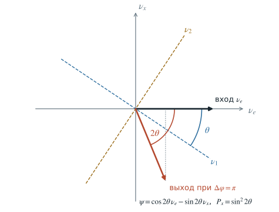
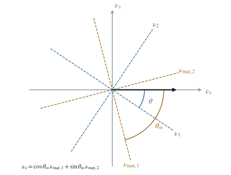

# Преломление нейтрино в веществе {#sec-matter-refraction}

::: {.book-lead}
Солнце почти прозрачно для нейтрино. Тем не менее вещество заметно меняет их
осцилляции. Причина та же, по которой прозрачное стекло преломляет свет:
исходная волна когерентно складывается с волнами, рассеянными вперёд. Мы
выведем показатель преломления из амплитуды рассеяния, увидим, что вакуум и
вещество для нейтрино играют роль двулучепреломляющего кристалла, и найдём
у этого кристалла собственные волны.
:::

## Влияет ли вещество Солнца на осцилляции?

Нейтрино с энергией порядка мегаэлектронвольта проходит солнечное вещество
почти без столкновений: вероятность рассеяния при $E=10$ МэВ порядка
$10^{-7}$. Поэтому первая догадка такая: вещество не должно играть заметной
роли.

Но стекло тоже почти не поглощает видимый свет. Оно всё же меняет его фазовую
скорость, и на границе двух сред луч преломляется. Может быть, нейтрино тоже
преломляется в Солнце?

Да. Мы увидим, что и вакуум, и Солнце для нейтрино — прозрачные кристаллы с
двумя собственными волнами и разными показателями преломления. В центре
Солнца при $E=10$ МэВ добавки вещества к показателям преломления
электронного и мюонного (или тау) нейтрино различаются на
$\delta n_e-\delta n_x\approx-8\cdot10^{-19}$. Число очень мало. Но от центра
до поверхности укладывается около $6\cdot10^{21}$ длин волн, и вклад вещества
в разность фаз флэйворных компонент по модулю составляет примерно $4\cdot10^{3}$
рад. Больше половины этой фазы набегает в центральной десятой части радиуса.

::: {.physical-comment title="План главы"}
Сначала разберём опыт с пластинкой между поляризаторами: он покажет, как два
показателя преломления превращаются в переход между состояниями. Затем
выведем показатель преломления из рассеяния вперёд. После этого перенесём всё
на нейтрино: вакуумный кристалл, добавку вещества и собственные волны суммы.
:::

## Опыт: пластинка между поляризаторами {#sec-matter-refraction-plate}

Поставим на пути света поляризатор $H$, затем двулучепреломляющую пластинку
и анализатор $V$, скрещённый с первым. Оси пластинки повёрнуты на угол $\theta$
к поляризатору. Вдоль осей показатели преломления $n_1\neq n_2$, поэтому две
компоненты света набирают разность фаз

$$
\Delta\varphi=(n_1-n_2)kL.
$$ {#eq-refraction-plate-phase}

Без пластинки экран за скрещёнными поляризаторами тёмный. С пластинкой
яркость экрана зависит от толщины:

$$
\boxed{P=\sin^2 2\theta\,\sin^2\frac{\Delta\varphi}{2}}.
$$ {#eq-refraction-plate-probability}

При $\Delta\varphi=0$ и $2\pi$ экран тёмный, при $\pi$ — светлый, а при
$\pi/2$ и $3\pi/2$ яркость половинная. Для $\theta=45^\circ$ яркость на
максимуме равна единице.

::: {#interactive-invisible-plate .interactive title="Две поляризации в кристалле" embed="../../applets/invisible-plate.html" height="38rem" poster="../assets/chapters/06_matter_oscillations/optics-poster.png"}
Меняйте входную поляризацию, угол осей и толщину пластинки. Голубая и жёлтая
кривые — две собственные поляризации, белая — их сумма. Справа показано
состояние на выходе.
:::

Формула [-@eq-refraction-plate-probability] понадобится нам ещё не раз. Дело в
том, что в ней нет ничего, кроме двух собственных волн с разными показателями
преломления и угла между осями кристалла и входной поляризацией. Это и есть
вся физика осцилляций двух состояний.

Выпишем словарь, которым мы будем пользоваться в дальнейшем.

| Нейтрино в вакууме | Свет в кристалле |
|:--|:--|
| массовые состояния $\nu_1,\nu_2$ — собственные оси вакуума | оси 1 и 2 кристалла |
| угол $\theta$ | угол к поляризатору |
| $E(n_1-n_2)\simeq\Delta m^2/(2E)$ | $(n_1-n_2)k$ |

Для нейтрино в веществе роль осей возьмут собственные волны
$\nu_{\mathrm{mat},1}$, $\nu_{\mathrm{mat},2}$, роль угла — $\theta_m$, а роль
разности показателей — $E(n_{\mathrm{mat},1}-n_{\mathrm{mat},2})$. Чтобы
убедиться, что всё это не игра слов, надо сначала понять, откуда вообще
берётся показатель преломления.

## Как прозрачная среда может действовать на волну

Пропустим монохроматический свет через прозрачную пластинку. Входящая волна
$\psi_{\mathrm{in}}$ раскачивает электроны атомов, и они излучают на той же
частоте волну $\psi_{\mathrm{sc}}$. За пластинкой волны складываются:

$$
\psi_{\mathrm{out}}=\psi_{\mathrm{in}}+\psi_{\mathrm{sc}}.
$$ {#eq-refraction-field-sum}

Частота сохраняется, а фаза суммы отличается от фазы исходной волны. Из этой
разницы и возникает показатель преломления $n$: $\psi_{\mathrm{out}}=e^{inkz}$.

Чтобы вычислить сумму, пройдём три шага:

(i) найдём волну после одного рассеивателя;

(ii) сложим вклады рассеивателей узкого слоя, перпендикулярного падающей
волне;

(iii) соберём слои в среду конечной толщины.

Рассеяние на конечный угол уводит волну из пучка. Рассеяние строго вперёд
оставляет импульс тем же, и в этом направлении падающую и рассеянную волны
нельзя различить. Их амплитуды складываются.

::: {.physical-comment title="В чём состоит задача"}
Вероятность редкого столкновения нас здесь почти не интересует. Нам нужна фаза
волны, прошедшей сквозь вещество без заметного изменения направления.
Сначала решим эту задачу для одной скалярной волны. Смешивание нейтрино
добавим, когда станет понятен обычный показатель преломления.
:::

## Один рассеиватель

Пусть на небольшой рассеиватель падает плоская волна с волновым числом $k$.
Вдали от него стационарное решение имеет вид

$$
\psi(\mathbf r)=e^{ikz}+f(\vartheta)\frac{e^{ikr}}{r}.
$$ {#eq-refraction-one-scatterer}

Первое слагаемое — падающая плоская волна. Второе — расходящаяся сферическая
волна, а комплексная функция $f(\vartheta)$ называется амплитудой рассеяния.
Её нормировка выбрана так, что

$$
\frac{d\sigma}{d\Omega}=|f(\vartheta)|^2.
$$ {#eq-refraction-differential-cross-section}

Амплитуда $f$ имеет размерность длины. Поле света векторное, но для сложения
фаз в направлении прохождения хватает скалярной модели.

Угол $\vartheta$ отсчитывается между падающим и рассеянным импульсами. Для
счётчика частиц важны конечные углы: частица изменила направление, и событие
можно зарегистрировать. Для преломления выделено направление

$$
\vartheta=0,\qquad \mathbf p_{\mathrm{out}}=\mathbf p_{\mathrm{in}}.
$$ {#eq-refraction-forward-condition}

::: {.marginnote title="Почему вперёд"}
При $\vartheta=0$ рассеиватель не получает различимой поперечной отдачи.
Разные атомы не сообщают, на каком из них рассеялась волна, поэтому амплитуды
складываются когерентно.
:::

В этом канале состояние среды после взаимодействия совпадает с начальным,
и амплитуда $f(0)$ может интерферировать с прошедшей волной.

::: {.physical-comment title="Что здесь означает когерентность"}
Альтернативы «волна прошла» и «волна рассеялась вперёд» не оставляют в среде
информации, по которой их можно различить. Если атом возбуждён, изменил импульс
или иначе пометил путь, амплитуды уже нельзя складывать как одну проходящую
волну.
:::

## Тонкий слой: кольца Френеля {#sec-matter-refraction-rings}

Поместим много одинаковых рассеивателей в слой толщины $dz$. Объёмная
концентрация равна $\mathcal N$. Слой лежит в плоскости $z=0$, а точка
наблюдения $P$ находится на оси за слоем, на расстоянии $z$.

Рассеиватель на расстоянии $b$ от оси посылает в $P$ волну
$f(\vartheta)\,e^{ikr}/r$, где

$$
r=\sqrt{z^2+b^2},\qquad \cos\vartheta=\frac zr.
$$ {#eq-refraction-layer-geometry}

Точки слоя с одинаковым $r$ образуют кольцо: сфера радиуса $r$ с центром в $P$
пересекает плоскость слоя по окружности. Нам нужна сумма по всем кольцам.

Площадь кольца равна $2\pi b\,db$, и $b\,db=r\,dr$. Множитель $r$ сокращает
$1/r$ сферической волны, поэтому сумма по слою записывается точно:

$$
d\psi_{\mathrm{sc}}
=\mathcal N\,dz\int 2\pi b\,db\,f(\vartheta)\frac{e^{ikr}}{r}
=2\pi\mathcal N\,dz\int_z^\infty f(\vartheta)\,e^{ikr}\,dr.
$$ {#eq-refraction-layer-ring-sum}

Здесь нет ни разложения по $b/z$, ни предположения, что слой «тонкий» по
поперечным размерам. Интеграл по $r$ быстро осциллирует, и вклады далёких
колец почти гасят друг друга. Чтобы сказать это аккуратно, вспомним: пучок
конечен, и волна когда-то включилась. Далёкие кольца гасим множителем
$e^{-\varepsilon r}$ и интегрируем по частям. Нижний предел $r=z$ — центр
слоя:

$$
\int_z^\infty f\,e^{ikr}\,dr\;\simeq\;\frac ik\,f(0)\,e^{ikz}.
$$ {#eq-refraction-by-parts}

Остаток мал, пока $f(\vartheta)$ почти не меняется на первой зоне:
$z\gg ka^2$, где $a$ — размер рассеивателя. Подставляя
[-@eq-refraction-by-parts] в [-@eq-refraction-layer-ring-sum], получаем
центральный результат вывода:

$$
\boxed{d\psi_{\mathrm{sc}}=i\,\frac{2\pi\mathcal N}{k}\,f(0)\,dz\,e^{ikz}}.
$$ {#eq-refraction-thin-layer-amplitude}

Вклад даёт область малых углов, поэтому в ответ входит $f(0)$. Множитель $i$ —
поворот на $90^\circ$ — приносит геометрия плоского слоя. Фаза вклада слоя
равна $90^\circ+\arg f(0)$.

::: {.physical-comment title="Зоны Френеля"}
Зонами Френеля называют кольца с границами $r_m=z+m\lambda/2$. У соседних
колец ход до $P$ различается на $\lambda/2$, и вклады приходят в противофазе.
На комплексной плоскости суммы по зонам закручиваются в спираль, и её предел
равен $i f(0)/k$. Множитель $e^{-\varepsilon r}$ как раз выбирает этот предел,
а остаток после $m$ колец убывает как $e^{-\pi(\varepsilon/k)m}$.
:::

::: {#interactive-refraction-origin .interactive title="Сумма по зонам Френеля" embed="../../applets/refraction-origin.html" height="38rem"}
Кнопка добавляет всё более далёкие кольца. Амплитуда $f(0)$ вынесена, момент
времени фиксирован. Без обрезания сумма ходит по окружности, при включении
затухания превращается в спираль и приходит в предельную точку.
:::

## От одного слоя к показателю преломления {#sec-matter-refraction-index}

Пусть $\psi(z)$ — амплитуда перед слоем. Свободное распространение через
$dz$ даёт множитель $e^{ikdz}$, а рассеяние вперёд — добавку из уравнения
[-@eq-refraction-thin-layer-amplitude]. Поэтому

$$
\psi(z+dz)=e^{ikdz}
\left[1+i\frac{2\pi\mathcal N}{k}f(0)\,dz\right]\psi(z).
$$ {#eq-refraction-one-layer-propagation}

Добавка $i\,d\varphi$ перпендикулярна стрелке волны на комплексной плоскости.
Длина суммы почти не меняется, а стрелка поворачивается на $d\varphi$:
фаза сдвигается, частота остаётся прежней.

Разобьём толщу $D$ на $M$ слоёв по $dz=D/M$. При постоянных $\mathcal N$ и
$f(0)$

$$
e^{ikD}\left[1+i\frac{2\pi\mathcal N f(0)}{k}\frac{D}{M}\right]^M
\xrightarrow[M\to\infty]{}
e^{ikD}\exp\!\left(i\frac{2\pi\mathcal N f(0)}{k}D\right).
$$ {#eq-refraction-layer-product}

Это означает замену волнового числа:

$$
k_{\mathrm{med}}=k+\frac{2\pi\mathcal N}{k}f(0).
$$ {#eq-refraction-medium-wavenumber}

Определим показатель преломления равенством $k_{\mathrm{med}}=nk$. Тогда

$$
\boxed{n=1+\frac{2\pi\mathcal N}{k^2}f(0)}.
$$ {#eq-refraction-index-forward-amplitude}

Экспонента учла все порядки по $\mathcal ND$. Сам показатель $n-1$ найден в
первом порядке по концентрации независимых рассеивателей, а волной, рассеянной
назад, мы пренебрегли: $|n-1|\ll1$. В плотном стекле на атом действует ещё поле
соседних атомов (поправка Лорентца–Лоренца), но смысл $n$ остаётся тем же.

Волны в вакууме и в среде имеют вид

$$
\psi_{\mathrm{vac}}(z,t)=A e^{-iEt+ikz},
\qquad
\psi_{\mathrm{med}}(z,t)=A e^{-iEt+inkz}.
$$ {#eq-refraction-vacuum-medium-waves}

Среда неподвижна, поэтому частота (в квантовом языке — энергия $E$)
сохраняется. Среда меняет пространственную фазу.

Для света $k=\omega/c$ в вакууме, а в прозрачной среде с действительным $n$

$$
\lambda_{\mathrm{med}}=\frac{\lambda_0}{n},
\qquad
v_{\mathrm{ph}}=\frac{c}{n},
\qquad
\Delta\varphi=k(n-1)D.
$$ {#eq-refraction-light-observables}

На границе двух сред фаза должна совпадать вдоль поверхности. Поэтому
сохраняется тангенциальная компонента волнового вектора,
$k_1\sin\theta_1=k_2\sin\theta_2$, и при общей частоте получаем

$$
n_1\sin\theta_1=n_2\sin\theta_2.
$$ {#eq-refraction-snell-law}

Одна величина описывает и сдвиг интерференционных полос, и изменение
направления луча.

::: {#interactive-refraction-layers .interactive title="Тонкий слой и накопленная фаза" embed="../../applets/refraction-layers.html" height="38rem" poster="../assets/chapters/06_matter_oscillations/refraction_layers.svg" url="https://neutrinohit.github.io/qr/neutrino-physics/0052/" qr="../assets/chapters/06_matter_oscillations/qr/refraction_layers.png" repo="https://github.com/NeutrinoHit/neutrinophysics/blob/main/introduction/ru/slides/assets/06_matter_oscillations/refraction_labs.js" repo-label="код апплета"}
Меняйте показатель преломления и толщину пластинки. После выхода длина
волны снова равна вакуумной, но накопленная фаза остаётся. Пунктир показывает
волну без пластинки. Отражение на границах в этой модели не учитывается.
:::

::: {.physical-comment title="Что сделала среда"}
Отдельный рассеиватель создаёт сферическую волну. Слой собирает сферические
волны в плоскую добавку. Последовательность слоёв накапливает эти добавки в
экспоненту. Показатель преломления — компактная запись этой когерентной суммы.
:::

### Действительная и мнимая части

Амплитуда $f(0)$ в общем случае комплексна, поэтому $n=n_R+in_I$ и

$$
\psi_{\mathrm{med}}(z,t)
=A e^{-iEt+ikn_Rz}e^{-kn_Iz}.
$$ {#eq-refraction-complex-index-wave}

Действительная часть $f(0)$ задаёт фазу и фазовую скорость, мнимая — ослабление
когерентного пучка. Мнимую часть с полным сечением связывает оптическая
теорема:

$$
\sigma_{\mathrm{tot}}=\frac{4\pi}{k}\operatorname{Im}f(0).
$$ {#eq-refraction-optical-theorem}

Интенсивность пропорциональна квадрату модуля амплитуды, поэтому

$$
\frac{I(D)}{I(0)}
=e^{-2kn_ID}
=e^{-\mathcal N\sigma_{\mathrm{tot}}D}.
$$ {#eq-refraction-beer-law}

Среда может почти не поглощать волну и заметно менять её фазу. Для нейтрино
в Солнце это различие решающее: поглощение ничтожно, а фаза набегает на тысячи
радиан.

### Откуда $f(0)$ у света

Посмотрим на модельный пример, где всё считается до конца. Электрон в атоме
— осциллятор с собственной частотой $\omega_0$ и затуханием $\gamma$. В
гауссовых единицах, с $r_e=e^2/(mc^2)$, его амплитуда рассеяния вперёд
(при соглашении $e^{-i\omega t}$) равна

$$
f(0)=r_e\,\frac{\omega^2}{\omega_0^2-\omega^2-i\gamma\omega},
\qquad
n-1=\frac{2\pi\mathcal Nf(0)}{k^2}
=\frac{2\pi\mathcal Ne^2}{m}\,\frac{1}{\omega_0^2-\omega^2-i\gamma\omega}.
$$ {#eq-refraction-lorentz-oscillator}

Три режима показывают, что формула ведёт себя как положено.

- При $\omega<\omega_0$ вдали от резонанса (видимый свет в стекле)
  $n>1$, и $n$ растёт с частотой. Синий свет преломляется сильнее красного.
- При $\omega\gg\omega_0$ (рентген) $f(0)\to-r_e$, это томсоновское рассеяние,
  и $n<1$.
- Вблизи $\omega_0$ велика $\operatorname{Im}f(0)$. Когерентный пучок
  ослабляется, а по оптической теореме — за счёт поглощения и рассеяния.

Реальный атом имеет много линий, и справа стоит сумма по ним с силами
осцилляторов. Для нейтрино роль $f(0)$ сыграет слабое взаимодействие.

## Два показателя преломления нейтрино

Нейтрино проходит Солнце без столкновений, и вещество действует на него только
через фазу. Откуда эта фаза берётся?

### Первый показатель: нейтральный ток

Любое активное нейтрино $\nu_\alpha$ ($\alpha=e,\mu,\tau$) упруго рассеивается
на частицах среды $f=e^-,p,n$ за счёт обмена $Z^0$-бозоном. На каждой
фермионной линии вид частицы сохраняется. Если рассеяние идёт на нулевой угол,
то состояние среды не меняется и нейтрино сохраняет направление. Рассеянная
вперёд волна когерентно складывается с прошедшей без рассеяния, и появляется
общая для активных флэйворов добавка к показателю преломления.

### Второй показатель: заряженный ток

Обычное вещество состоит из атомных ядер и электронов. Мюонов и таонов в нём
нет. Электронное нейтрино $\nu_e$ может упруго рассеяться на электроне ещё и
за счёт обмена $W^+$-бозоном. Это даёт добавку, которой нет у $\nu_\mu$ и
$\nu_\tau$. Поэтому добавки вещества $\delta n_e$ и $\delta n_x$ различны.

Вещество по-разному действует на флэйворы, а значит, меняет и собственные
волны вакуумного «кристалла». Эту идею предложил Л. Вольфенштейн в 1978 году.

## Состояние нейтрино и вакуумный кристалл {#sec-matter-refraction-vacuum}

Нейтрино с заданной энергией $E$ летит вдоль $z$. Используем $\hbar=c=1$ и
опускаем общий множитель $e^{-iEt}$. Рассматриваем два флэйвора: $\nu_e$ и
$\nu_x$ ($\nu_\mu$, $\nu_\tau$ или их комбинация). Состояние и его
флэйворные амплитуды:

$$
|\psi\rangle=\psi_e|\nu_e\rangle+\psi_x|\nu_x\rangle,
\qquad
\psi_\alpha=\langle\nu_\alpha|\psi\rangle.
$$ {#eq-refraction-flavor-state}

Тот же вектор можно разложить по массовым состояниям:

$$
|\psi\rangle=a_1|\nu_1\rangle+a_2|\nu_2\rangle,
\qquad a_i=\langle\nu_i|\psi\rangle.
$$ {#eq-refraction-mass-state}

В вакууме независимо распространяются массовые состояния. У каждой волны свой
показатель преломления:

$$
n_i=\frac{k_{\mathrm{vac},i}}{E}
=\sqrt{1-\frac{m_i^2}{E^2}}
\simeq1-\frac{m_i^2}{2E^2}.
$$ {#eq-refraction-vacuum-index}

Объединим их в оператор показателя преломления:

$$
\boxed{\hat n_{\mathrm{vac}}
=\sum_{i=1,2}n_i\,|\nu_i\rangle\langle\nu_i|.}
$$ {#eq-refraction-vacuum-operator}

Множитель $|\nu_i\rangle\langle\nu_i|$ выделяет компоненту вдоль $|\nu_i\rangle$,
поэтому $\hat n_{\mathrm{vac}}|\nu_i\rangle=n_i|\nu_i\rangle$. Это определение
оператора через собственные волны. Его матрицу можно записать в любом базисе.

### Как состояние распространяется в вакууме

Каждая собственная волна набирает свою фазу:

$$
a_i(z)=a_i(0)e^{iEn_i z},
\qquad
|\psi(z)\rangle=\sum_i a_i(0)e^{iEn_i z}|\nu_i\rangle.
$$ {#eq-refraction-vacuum-evolution}

Дифференцируем сумму и используем определение $\hat n_{\mathrm{vac}}$:

$$
\boxed{\frac{d|\psi\rangle}{dz}=iE\hat n_{\mathrm{vac}}|\psi\rangle.}
$$ {#eq-refraction-vacuum-equation}

Осцилляции определяет разность фаз двух волн:

$$
\Delta\varphi=E(n_1-n_2)z\simeq\frac{\Delta m^2}{2E}z,
\qquad \Delta m^2=m_2^2-m_1^2.
$$ {#eq-refraction-vacuum-phase}

### Матрица в двух базисах

Элементы матрицы оператора — его проекции на выбранные базисные состояния.
В массовом базисе $(\nu_1,\nu_2)$ матрица диагональна:

$$
[\hat n_{\mathrm{vac}}]_{\mathrm{mass}}
=\begin{pmatrix}n_1&0\\0&n_2\end{pmatrix},
\qquad
\frac{d}{dz}\begin{pmatrix}a_1\\a_2\end{pmatrix}
=iE\begin{pmatrix}n_1&0\\0&n_2\end{pmatrix}
\begin{pmatrix}a_1\\a_2\end{pmatrix}.
$$ {#eq-refraction-vacuum-mass-basis}

Источник и детектор различают флэйворы. Чтобы перейти к флэйворным амплитудам,
введём матрицу $U_{\alpha i}=\langle\nu_\alpha|\nu_i\rangle$:

$$
\begin{pmatrix}\psi_e\\\psi_x\end{pmatrix}
=U\begin{pmatrix}a_1\\a_2\end{pmatrix},
\qquad
U=\begin{pmatrix}
\cos\theta&\sin\theta\\
-\sin\theta&\cos\theta
\end{pmatrix}.
$$ {#eq-refraction-mixing-matrix}

Во флэйворном базисе $[\hat n_{\mathrm{vac}}]_f=U\,\mathrm{diag}(n_1,n_2)\,U^\dagger$,
то есть

$$
[\hat n_{\mathrm{vac}}]_f=
\begin{pmatrix}
n_1\cos^2\theta+n_2\sin^2\theta
& (n_2-n_1)\sin\theta\cos\theta\\
(n_2-n_1)\sin\theta\cos\theta
& n_1\sin^2\theta+n_2\cos^2\theta
\end{pmatrix}.
$$ {#eq-refraction-vacuum-flavor-basis}

При смене базиса матрица стала недиагональной. Собственные волны
$\nu_1,\nu_2$ и показатели $n_1,n_2$ остались прежними.

## От света к нейтрино {#sec-matter-refraction-bridge}

Теперь можно наложить две картины друг на друга. Пусть на входе чистое
состояние: свет с поляризацией $H$ или нейтрино $\nu_e$. Это одна и та же
точка на плоскости состояний, ось $H$ соответствует оси $\nu_e$, а ось $V$ —
оси $\nu_x$. Оси кристалла — это $\nu_1$ и $\nu_2$, и они повёрнуты относительно
флэйворных осей на угол $-\theta$.

Разложим вход по осям:

$$
\nu_e=\cos\theta\,\nu_1+\sin\theta\,\nu_2.
$$ {#eq-refraction-vacuum-decomposition}

Если разность фаз между волнами равна $\pi$ (полуволновая пластинка), то
составляющая вдоль оси 2 меняет знак, а вдоль оси 1 остаётся прежней:

$$
\psi=\cos\theta\,\nu_1-\sin\theta\,\nu_2
=\cos2\theta\,\nu_e-\sin2\theta\,\nu_x.
$$ {#eq-refraction-half-wave-output}

Вход, отражённый от оси 1, оказывается повёрнутым на $2\theta$ от $\nu_e$ и не
совпадает ни с одной из осей. Состояние остаётся линейной суперпозицией, потому
что две компоненты идут в фазе или в противофазе. При другой разности фаз
фигура на выходе — эллипс. Вероятность найти $\nu_x$ в точке $\Delta\varphi=\pi$
равна $\sin^22\theta$. Для $\theta=33{,}7^\circ$ получаем $P_x=0{,}852$ и
$P_e=0{,}148$, то есть ровно те же доли интенсивности $I_V$ и $I_H$, что у
света.

{#fig-refraction-half-wave width="62%"}

::: {#interactive-vacuum-bridge .interactive title="От света к нейтрино" embed="../../slides/assets/06_matter_oscillations/crystal/bridge.html" height="38rem"}
Кнопка меняет физический смысл одной и той же конструкции. Поляризации
становятся массовыми состояниями, доли интенсивности — вероятностями. Справа
показано состояние на выходе. Бледная стрелка — вход, дуга — поворот на
$2\alpha$ (для нейтрино $2\theta$), внизу кривая $I_V(L)\to P_x(L)$ на одном
периоде.
:::

## Вещество добавляет свой вклад {#sec-matter-refraction-matter}

Когерентное рассеяние вперёд в обычном веществе даёт разные добавки для
$\nu_e$ и $\nu_x$. Запишем их как оператор, диагональный во флэйворном базисе:

$$
\boxed{\delta\hat n
=\delta n_e|\nu_e\rangle\langle\nu_e|
+\delta n_x|\nu_x\rangle\langle\nu_x|.}
$$ {#eq-refraction-matter-operator}

Каждая добавка получается из амплитуды рассеяния вперёд. Формула та же, что
для света, с заменой $k\to E$:

$$
\delta n_\alpha=\frac{2\pi}{E^2}
\sum_{a=e,p,n}\mathcal N_a\operatorname{Re}f_{\alpha a}(0).
$$ {#eq-refraction-matter-index}

На тонком слое $dz$ фазовые вклады вакуума и вещества складываются, а
уравнение сохраняет вид:

$$
\boxed{\frac{d|\psi\rangle}{dz}=iE\hat n_{\mathrm{mat}}|\psi\rangle,
\qquad \hat n_{\mathrm{mat}}=\hat n_{\mathrm{vac}}+\delta\hat n.}
$$ {#eq-refraction-matter-equation}

Мы учитываем ведущие поправки к $n=1$ от масс и слабого взаимодействия и
пренебрегаем ослаблением пучка, поэтому $\hat n_{\mathrm{mat}}$ эрмитов.

Сложим матрицы в одном базисе. Во флэйворном базисе диагональна добавка
вещества:

$$
[\hat n_{\mathrm{mat}}]_f
=U\begin{pmatrix}n_1&0\\0&n_2\end{pmatrix}U^\dagger
+\begin{pmatrix}\delta n_e&0\\0&\delta n_x\end{pmatrix}.
$$ {#eq-refraction-matter-flavor-basis}

В массовом базисе диагонален вакуумный вклад:

$$
[\hat n_{\mathrm{mat}}]_{\mathrm{mass}}
=\begin{pmatrix}n_1&0\\0&n_2\end{pmatrix}
+U^\dagger\begin{pmatrix}\delta n_e&0\\0&\delta n_x\end{pmatrix}U.
$$ {#eq-refraction-matter-mass-basis}

У вакуума и добавки вещества разные собственные оси. Поэтому в сумме
диагонального нет нигде, и собственные волны полной среды нужно искать заново.

### Новые оси — новые волны

Собственные волны полной среды удовлетворяют уравнению

$$
\hat n_{\mathrm{mat}}|\nu_{\mathrm{mat},i}\rangle
=n_{\mathrm{mat},i}|\nu_{\mathrm{mat},i}\rangle,
$$ {#eq-refraction-matter-eigenproblem}

и спектральная запись знакома:

$$
\boxed{\hat n_{\mathrm{mat}}=\sum_i n_{\mathrm{mat},i}
|\nu_{\mathrm{mat},i}\rangle\langle\nu_{\mathrm{mat},i}|.}
$$ {#eq-refraction-matter-spectral}

Теперь в задаче три набора величин: $n_1,n_2$ — собственные показатели
вакуума, $\delta n_e,\delta n_x$ — флэйворные добавки вещества и
$n_{\mathrm{mat},1},n_{\mathrm{mat},2}$ — собственные показатели полной
среды. Оси $\nu_{\mathrm{mat},i}$ повёрнуты от флэйворных на угол $\theta_m$.
В плотном веществе $\nu_{\mathrm{mat},2}$ оказывается близка к $\nu_e$.

{#fig-refraction-matter-axes width="62%"}

### Распространение в однородном веществе

При постоянной плотности собственные оси и показатели не зависят от $z$.
Разложим входное состояние по этим осям:

$$
|\psi(0)\rangle=\sum_i c_i(0)|\nu_{\mathrm{mat},i}\rangle,
\qquad c_i(0)=\langle\nu_{\mathrm{mat},i}|\psi(0)\rangle.
$$ {#eq-refraction-matter-input-expansion}

Каждая компонента набирает свою фазу, $c_i(z)=e^{iEn_{\mathrm{mat},i}z}c_i(0)$,
и после сложения

$$
\boxed{|\psi(z)\rangle
=\sum_i e^{iEn_{\mathrm{mat},i}z}
|\nu_{\mathrm{mat},i}\rangle
\langle\nu_{\mathrm{mat},i}|\psi(0)\rangle.}
$$ {#eq-refraction-matter-solution}

Добавка, пропорциональная единичному оператору, даёт общую фазу и в
вероятности не входит. Вероятность определяют разность собственных показателей
и ориентация осей.

### Источник готовит $\nu_e$, детектор ищет $\nu_x$

Угол смешивания в веществе $\theta_m$ задаёт разложение флэйворов по
собственным волнам:

$$
\begin{aligned}
|\nu_e\rangle&=\cos\theta_m|\nu_{\mathrm{mat},1}\rangle+\sin\theta_m|\nu_{\mathrm{mat},2}\rangle,\\
|\nu_x\rangle&=-\sin\theta_m|\nu_{\mathrm{mat},1}\rangle+\cos\theta_m|\nu_{\mathrm{mat},2}\rangle.
\end{aligned}
$$ {#eq-refraction-matter-mode-rotation}

Источник возбуждает обе волны, они набирают разные фазы, и детектор берёт
проекцию на $\nu_x$:

$$
\mathcal A_{e\to x}(z)=\sum_{i=1,2}
\underbrace{\langle\nu_x|\nu_{\mathrm{mat},i}\rangle}_{\text{детектор}}\,
\underbrace{e^{iEn_{\mathrm{mat},i}z}}_{\text{путь}}\,
\underbrace{\langle\nu_{\mathrm{mat},i}|\nu_e\rangle}_{\text{источник}} .
$$ {#eq-refraction-two-mode-sum}

Подставим проекции. При $z=0$ вклады сокращаются, потому что источник
приготовил чистое $\nu_e$:

$$
\boxed{\mathcal A_{e\to x}(z)=\sin\theta_m\cos\theta_m
\bigl(e^{iEn_{\mathrm{mat},2}z}-e^{iEn_{\mathrm{mat},1}z}\bigr)}.
$$ {#eq-refraction-two-mode-amplitude}

Квадрат модуля даёт

$$
\boxed{
P_{e\to x}(z)=
\sin^22\theta_m\,
\sin^2\!\frac{\Delta\varphi}{2}
},
\qquad
\Delta\varphi=E(n_{\mathrm{mat},1}-n_{\mathrm{mat},2})z,
\qquad P_{e\to e}=1-P_{e\to x}.
$$ {#eq-refraction-two-mode-probability}

Это та же формула, что для пластинки между скрещёнными поляризаторами:
$\theta_m\leftrightarrow\theta$ и
$E(n_{\mathrm{mat},1}-n_{\mathrm{mat},2})\leftrightarrow(n_1-n_2)k$. В вакууме
результат тот же, с $\theta$ и $\Delta\varphi\simeq(\Delta m^2/2E)z$. Вещество
меняет собственные оси и разность показателей.

Две границы стоит запомнить. При $\theta_m=0$ электронный флэйвор сам является
собственной волной, и переходов нет. При равных показателях $n_{\mathrm{mat},1}=n_{\mathrm{mat},2}$ относительная
фаза не возникает, и переходов опять нет.

::: {#interactive-refraction-two-modes .interactive title="Две волны в веществе" embed="../../applets/refraction-two-modes.html" height="38rem" poster="../assets/chapters/06_matter_oscillations/refraction_two_modes.svg" url="https://neutrinohit.github.io/qr/neutrino-physics/0053/" qr="../assets/chapters/06_matter_oscillations/qr/refraction_two_modes.png" repo="https://github.com/NeutrinoHit/neutrinophysics/blob/main/introduction/ru/slides/assets/06_matter_oscillations/refraction_labs.js" repo-label="код апплета"}
Задавайте угол $\theta_m$ и относительную фазу нормальных волн независимо.
Фазоры слева показывают их фазы, а график справа — результат проекции на
другой флэйвор. Величины $\theta_m$ и $E(n_{\mathrm{mat},1}-n_{\mathrm{mat},2})$
пока заданы. Их зависимость от плотности и энергии мы найдём в следующей главе.
:::

::: {#interactive-solar-crystal .interactive title="Вакуум и солнечное вещество" embed="../../slides/assets/06_matter_oscillations/crystal/solar.html" height="38rem" poster="../assets/chapters/06_matter_oscillations/solar-poster.png"}
Одинаковый путь, $\nu_e$ на входе. Плотность центра Солнца постоянна на всём
участке, $E=10$ МэВ. В вакууме амплитуда перехода $0{,}852$ и период
$330{,}7$ км, в веществе амплитуда $0{,}235$ и период $173{,}6$ км. Пример не
описывает весь выход из настоящего Солнца.
:::

Формула верна при постоянной плотности. При переменной плотности
$\hat n_{\mathrm{mat}}=\hat n_{\mathrm{mat}}(z)$, и в базисе локальных
собственных волн нужно учесть поворот осей вдоль пути. Если плотность
меняется медленно, волна успевает следовать за вращающейся собственной
осью. К этому вопросу мы придём в главе о медленно меняющейся плотности.

## Словарь: нейтрино и кристалл

Подведём итог в таблице.

| Нейтрино | Свет в двулучепреломляющем кристалле |
|:--|:--|
| рождается $\nu_e$; детектор ищет $\nu_e$ или $\nu_x$ | поляризатор $H$; анализатор $H$ или $V$ |
| $\nu_1,\nu_2$ — собственные волны вакуума | поляризации вдоль осей кристалла |
| угол смешивания $\theta$ | угол между осью кристалла и поляризатором |
| $E(n_1-n_2)\simeq\Delta m^2/(2E)$ | $(n_1-n_2)k$ |
| вещество: разные добавки $\delta n_e,\delta n_x$ | деформация с добавочной анизотропией по осям $H/V$ |
| $\nu_{\mathrm{mat},1},\nu_{\mathrm{mat},2}$ и угол $\theta_m$ | новые оси деформированного кристалла |

Для нейтрино пустота уже кристалл. Вещество добавляет к нему $\delta\hat n$,
диагональную во флэйворном базисе, и распространение определяют собственные
волны суммы.

## Итоги главы

- Прозрачность среды не означает отсутствия воздействия на фазу волны.
- Когерентная сумма сферических волн от тонкого слоя определяется амплитудой
  рассеяния вперёд $f(0)$. Точное суммирование по кольцам Френеля даёт
  $d\psi_{\mathrm{sc}}=i(2\pi\mathcal N/k)f(0)\,dz\,e^{ikz}$.
- Для одной компоненты $n-1=2\pi\mathcal Nf(0)/k^2$. Действительная часть
  меняет фазу, мнимая описывает ослабление когерентного пучка.
- Нейтрино имеет два показателя преломления. Нейтральный ток даёт добавку
  всем активным флэйворам, заряженный — только $\nu_e$.
- Вакуум для нейтрино — двулучепреломляющий кристалл с осями $\nu_1,\nu_2$ и
  оператором $\hat n_{\mathrm{vac}}$. При разности фаз $\pi$ вход $\nu_e$
  поворачивается на $2\theta$ и уходит от осей кристалла.
- Вещество добавляет $\delta\hat n$ с другими осями. Собственные волны суммы
  дают $P_{e\to x}=\sin^22\theta_m\sin^2(\Delta\varphi/2)$.

## Задачи



## Литература {.unnumbered}

::: {.chapter-literature}
1. M. L. Goldberger, K. M. Watson. *Collision Theory*. Wiley, 1964.
2. J. D. Jackson. *Classical Electrodynamics*. 3rd ed. Wiley, 1998.
3. L. Wolfenstein. Neutrino oscillations in matter. *Physical Review D*
   **17**, 2369–2374 (1978).
   [doi:10.1103/PhysRevD.17.2369](https://doi.org/10.1103/PhysRevD.17.2369).
4. C. Giunti, C. W. Kim. *Fundamentals of Neutrino Physics and
   Astrophysics*. Oxford University Press, 2007.
5. R. P. Feynman, R. B. Leighton, M. Sands. *The Feynman Lectures on Physics*.
   Vol. I, Chapter 31, §§31.1–31.2.
   [The Origin of the Refractive Index](https://www.feynmanlectures.caltech.edu/I_31.html);
   Chapter 33, §33–3.
:::
