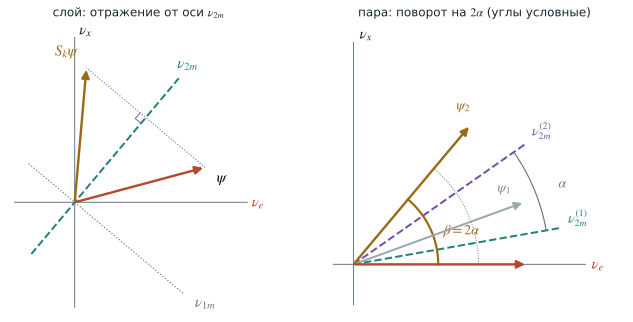
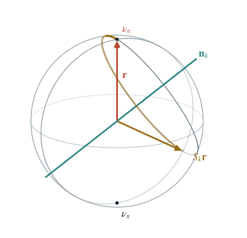

# Резонанс и адиабатический MSW-эффект {#sec-matter-adiabatic-msw}

::: {.book-lead}
В однородном слое вещество меняет высоту и период осцилляций. Сначала найдём
плотность, при которой высота становится единичной, — MSW-резонанс — и
посмотрим, как его открыли. Затем соберём профиль из слоёв и увидим, что
чередование слоёв, ни один из которых не близок к резонансу, может полностью
перевести $\nu_e$ в $\nu_x$. Наконец, в Солнце плотность падает плавно, и
собственные векторы непрерывно поворачиваются. Главный вопрос второй половины
главы прост: успевает ли нейтрино поворачиваться вместе с ними?
:::

## Резонанс {#sec-msw-resonance}

В главе [-@sec-matter-constant-density] для $\nu_e$, вошедшего в однородный
слой, получена вероятность [-@eq-matter-constant-probability-a]. Её удобно
читать как произведение двух множителей:

- высота максимумов $\sin^22\theta_m=\sin^22\theta/R^2$ — доля $\nu_x$, до
  которой дорастает переход; в вакууме она равна $\sin^22\theta$, в плотном
  веществе стремится к нулю;
- период $L_m=L_{\mathrm{vac}}/R$ из уравнения [-@eq-matter-oscillation-length]:
  расщепление $\Delta_m=\Delta R$ задаёт, как быстро набегает фаза.

Знаменатель $R^2=(\cos2\theta-A)^2+\sin^22\theta$ минимален, а высота
максимумов равна единице, когда $\cos2\theta-A=0$. При любом, даже очень малом,
вакуумном угле переход в слое может стать полным. Это условие и называют
резонансом.

### Условие резонанса

Диагональные элементы гамильтониана [-@eq-matter-flavor-hamiltonian] равны
$\pm\tfrac12(V-\Delta\cos2\theta)$ и обращаются в нуль при

$$
\boxed{
V_{\mathrm{res}}=\Delta\cos2\theta,
\qquad
A_{\mathrm{res}}=\cos2\theta}.
$$ {#eq-matter-resonance-condition}

В резонансе остаётся только внедиагональный элемент,
$H_f'=\tfrac12\Delta\sin2\theta\,\sigma_x$. Его собственные векторы
$(1,\pm1)/\sqrt2$, поэтому $\theta_m=45^\circ$ и $\sin^22\theta_m=1$.
Подстановка $A=2EV/\Delta m^2$ и $V=\sqrt2G_FN_e$ даёт резонансную
электронную плотность

$$
\boxed{
N_{e,\mathrm{res}}=
\frac{\Delta m^2\cos2\theta}{2\sqrt2\,G_FE}}.
$$ {#eq-matter-resonance-density}

Для солнечных параметров NuFIT 6.1, $\sin^2\theta_{12}=0.3088$ и
$\Delta m^2_{21}=7.537\times10^{-5}\ \text{эВ}^2$, получаем
$\cos2\theta_{12}=0.382$ и $\Delta m^2_{21}\cos2\theta_{12}=
2.88\times10^{-5}\ \text{эВ}^2$. С $V=7.63\times10^{-14}\ \text{эВ}\cdot\rho Y_e$
(где $\rho Y_e$ в г/см³) условие $2EV=\Delta m^2\cos2\theta$ даёт

$$
\rho Y_e\big|_{\mathrm{res}}\approx19\ \text{г/см}^3\cdot\frac{10\ \text{МэВ}}{E}.
$$ {#eq-msw-solar-resonance-density}

В центре Солнца $\rho Y_e\approx100$ г/см³, поэтому резонанс внутри Солнца
есть при $E\gtrsim1.9$ МэВ.

Физическая плотность положительна. Для нейтрино $V>0$, и условие
$A=\cos2\theta$ требует одинаковых знаков у $\Delta m^2$ и $\cos2\theta$:

$$
\boxed{V\,\Delta m^2\cos2\theta>0}.
$$ {#eq-matter-resonance-sign}

У антинейтрино $\bar V=-V$, и условие меняет знак. В солнечном секторе
$\Delta m^2_{21}>0$ и $\cos2\theta_{12}>0$: резонанс есть у нейтрино и нет у
антинейтрино в обычном веществе. При обратном порядке масс,
$\Delta m^2_{31}<0$, резонанс атмосферного сектора переходит к антинейтрино.
Так вещество позволяет измерить знак $\Delta m^2$.

Резонанс делает огибающую вероятности единичной, но не гарантирует полной
конверсии в однородном слое: нужна также фаза

$$
\frac{\Delta_mL}{2}=\frac{\pi}{2},\frac{3\pi}{2},\ldots
$$ {#eq-matter-full-conversion-phase}

На резонансе при малом вакуумном угле амплитуда велика, но период длинен:
$L_m=L_{\mathrm{vac}}/\sin2\theta$. Полное превращение в плавно меняющейся
плотности устроено иначе; к нему мы придём в разделе [-@sec-msw-profile].

### Режимы постоянной плотности

| Режим | $A$ | $\theta_m$ | $\sin^22\theta_m$ | $L_m/L_{\mathrm{vac}}$ |
|---|:---:|:---:|:---:|:---:|
| вакуум | $0$ | $\theta$ | $\sin^22\theta$ | $1$ |
| резонанс | $\cos2\theta$ | $45^\circ$ | $1$ | $1/\sin2\theta$ |
| высокая плотность | $A\gg1$ | $\to90^\circ$ | $\approx\sin^22\theta/A^2$ | $\approx1/A$ |
| антинейтрино, $\Delta m^2>0$ | $A<0$ | $<\theta$ | $<\sin^22\theta$ | $<1$ |

: Четыре режима однородного слоя. {#tbl-msw-regimes}

При $A\gg1$ из $R^2=A^2-2A\cos2\theta+1$ следует $R\simeq A$, поэтому
$\cos2\theta_m=(\cos2\theta-A)/R\to-1$ и $\theta_m\to90^\circ$. Далеко за
резонансом $\nu_e$ почти совпадает с собственным состоянием $\nu_{2m}$:
высокая плотность подавляет переход, хотя потенциал велик.

У антинейтрино при $\Delta m^2>0$ и $\cos2\theta>0$ величина $A$
отрицательна, и

$$
R^2=(\cos2\theta+|A|)^2+\sin^22\theta=1+2|A|\cos2\theta+A^2>1.
$$

Поэтому $\sin^22\theta_m<\sin^22\theta$ и $L_m<L_{\mathrm{vac}}$. Так как
$\cos2\theta_m>0$, угол $2\theta_m$ меньше $\pi/2$, и меньший $\sin2\theta_m$
означает $\theta_m<\theta$. Резонанса нет, вещество только подавляет
смешивание.

### Избегаемое пересечение

Без смешивания, $\sin2\theta=0$, уровни $\nu_e$ и $\nu_x$ равны диагональным
элементам $H_f'$:

$$
\lambda_{e,x}=\pm\frac\Delta2\,(A-\cos2\theta).
$$

Они пересекались бы при $A=\cos2\theta$. Внедиагональный элемент
$\tfrac12\Delta\sin2\theta$ раздвигает уровни:
$\lambda_{2m}-\lambda_{1m}=\Delta_m=\Delta R\geq\Delta\sin2\theta$. Минимум
достигается ровно в точке пересечения:

$$
\boxed{\Delta_{m,\min}=\Delta\sin2\theta}.
$$ {#eq-matter-minimum-gap}

Ненулевое смешивание оставляет минимальный зазор — избегаемое пересечение.

Обратный поворот к флэйворным состояниям даёт состав верхнего уровня:

$$
\nu_{2m}=\sin\theta_m\,\nu_e+\cos\theta_m\,\nu_x.
$$ {#eq-msw-upper-level-composition}

При $A\ll\cos2\theta$ угол $\theta_m$ мал, и $\nu_{2m}\approx\nu_x$. При
$A\gg\cos2\theta$ угол $\theta_m\to\pi/2$, и $\nu_{2m}\approx\nu_e$. Состав
меняется в полосе $|A-\cos2\theta|\lesssim\sin2\theta$ около резонанса: чем
меньше $\theta$, тем уже полоса и меньше зазор. Нейтрино, рождённое в центре
Солнца на верхнем уровне, сможет пройти эту полосу, оставаясь на нём; это
предмет второй половины главы.

::: {#interactive-matter-constant .interactive title="Осцилляции при постоянной плотности" embed="../../applets/matter-constant.html" poster="../assets/chapters/06_matter_oscillations/msw_constant_matter.png" url="https://neutrinohit.github.io/qr/neutrino-physics/0054/" qr="../assets/chapters/06_matter_oscillations/qr/matter_constant.png" repo="https://github.com/NeutrinoHit/neutrinophysics/blob/main/introduction/ru/applets/matter-constant.qmd" repo-label="код апплета"}
Сравните вакуум, резонанс и область высокой плотности. Вещество меняет две
разные величины: высоту огибающей $\sin^22\theta_m$ и длину осцилляций
$L_m$. На резонансе огибающая поднимается до единицы, а период растёт в
$1/\sin2\theta$ раз. Далеко за резонансом и у антинейтрино переход подавлен,
а период короче вакуумного.
:::

### Кто открыл резонанс

Резонанс часто связывают со всеми тремя буквами MSW, но в оригинальных
статьях роли распределены иначе.

- **1978.** Л. Вольфенстайн [5] вывел когерентное рассеяние
  вперёд, уравнение эволюции, угол $\theta_m$ и длину осцилляций в веществе.
  Усиление перехода при совпадении вакуумной длины осцилляций с
  характерной длиной вещества попало у него в таблицу без обсуждения, а о
  Солнце он заключил, что заметных осцилляций внутри Солнца нет.
- **1980.** V. Barger, K. Whisnant, S. Pakvasa и R. J. N. Phillips [6] записали
  условие максимального смешивания $A=\cos2\theta$ и разный ответ для
  нейтрино и антинейтрино. Слова «резонанс» в их статье нет.
- **1984.** С. Михеев, работавший с атмосферными нейтрино Баксанского
  телескопа, спросил А. Смирнова, верна ли статья Вольфенстайна и нужно ли
  учитывать вещество. Смирнов построил кривую $\sin^22\theta_m(A)$ и увидел
  резонансный пик шириной $\sin2\theta$.
- **1985–1986.** Михеев и Смирнов описали резонансное усиление в постоянной
  плотности и адиабатическое превращение в меняющейся. Phys. Lett. B
  отклонил статью; она вышла в «Ядерной физике» и в *Il Nuovo Cimento C*
  [1], теория превращения — в ЖЭТФ и УФН [2].
- **1986.** На Мориондской конференции А. Мессиа назвал механизм эффектом
  MSW, Х. Бете описал его как пересечение уровней, а В. Хакстон и С. Парк
  рассчитали перескок по Ландау—Зинеру.

Хронология восстановлена по воспоминаниям А. Ю. Смирнова [7].

::: {.biography name="Станислав Михеев" years="1940–2011" source="https://www.ictp.it/news/2011/5/memoriam" source-label="Международный центр теоретической физики"}
Станислав Михеев работал в Институте ядерных исследований РАН. Вместе с
Алексеем Смирновым он применил идею Вольфенстайна к среде переменной плотности
и в 1985 году обнаружил резонансное усиление и адиабатическую конверсию
солнечных нейтрино. За эту работу Михеев и Смирнов получили премию Сакураи
Американского физического общества 2008 года.
:::

::: {.biography name="Алексей Смирнов" source="https://www.ictp.it/news/2019/3/scientist-achievement" source-label="Международный центр теоретической физики"}
Алексей Смирнов развил теорию резонансного преобразования нейтрино вместе со
Станиславом Михеевым и продолжил исследование осцилляций в Солнце, Земле и
астрофизических средах. В его изложениях MSW-эффект последовательно отделён
от простой фразы «резонанс усиливает осцилляции»: сильная солнечная конверсия
возникает благодаря прохождению по меняющейся собственной ветви.
:::

## Несколько слоёв {#sec-msw-layers}

### Кусочно-постоянный профиль

Внутри слоя постоянной плотности работает точное решение
главы [-@sec-matter-constant-density]. Запишем пропагатор
[-@eq-matter-layer-propagator-compact] слоя $k$ через единичный вектор
$\mathbf n_k$ — ось гамильтониана слоя в пространстве матриц Паули:

$$
H_k=\frac{\Delta_{m,k}}{2}\,\mathbf n_k\boldsymbol\sigma,
\qquad
\mathbf n_k=(\sin2\theta_{m,k},\,0,\,-\cos2\theta_{m,k}),
$$ {#eq-msw-layer-axis}

$$
\boxed{
S_k=\cos\phi_k-i\sin\phi_k\,\mathbf n_k\boldsymbol\sigma,
\qquad
\phi_k=\frac{\Delta_{m,k}L_k}{2}}.
$$ {#eq-msw-layer-operator}

Это та же матрица [-@eq-matter-layer-propagator]: в явном виде

$$
\mathbf n_k\boldsymbol\sigma=
\begin{pmatrix}-\cos2\theta_{m,k}&\sin2\theta_{m,k}\\
\sin2\theta_{m,k}&\cos2\theta_{m,k}\end{pmatrix},
\qquad
(\mathbf n_k\boldsymbol\sigma)^2=\mathbb I .
$$ {#eq-msw-layer-axis-matrix}

На границе слоёв состояние непрерывно, поэтому операторы перемножаются:

$$
\boxed{S_{\mathrm{total}}=S_N S_{N-1}\cdots S_2S_1}.
$$ {#eq-matter-multilayer-propagator}

Первым действует первый слой, поэтому он стоит справа. Порядок множителей
существен: при $A_1\neq A_2$ гамильтонианы слоёв не коммутируют,

$$
[H_1,H_2]\neq0
\quad\Rightarrow\quad
S_2S_1\neq S_1S_2 .
$$ {#eq-matter-layer-noncommutativity}

Поэтому слои нельзя заменить средней плотностью $\bar A$: усреднение теряет
фазы, набранные в каждом слое. Пример из природы — нейтрино, пересекающее
Землю через ядро: мантия, ядро и снова мантия.

Пусть теперь ни один слой не близок к резонансу. Тогда в каждом слое переход
мал, $P_{e\to x}\leq\sin^22\theta_{m,k}\ll1$. Может ли последовательность
таких слоёв перевести $\nu_e$ в $\nu_x$ полностью? Может, если подобрать
длины слоёв. Это параметрический резонанс.

### Параметрическое усиление: постановка {#sec-msw-parametric}

Возьмём $\theta=8^\circ$; резонанс лежит при $A=\cos2\theta=0.96$. Чередуются
две среды выше резонанса, $A_1=1.6$ и $A_2=4.0$, с углами
$\theta_{m1}=78.3^\circ$ и $\theta_{m2}=87.4^\circ$. Каждый слой длится
половину своей длины осцилляций, $L_k=L_{m,k}/2$, то есть $\phi_k=\pi/2$.

{#fig-msw-parametric-profile width="92%"}

**Почему полпериода.** В однородном слое
$P_{e\to x}=\sin^22\theta_m\sin^2\phi$. При $\phi=\pi/2$ вероятность в слое
достигает максимума, и слой длины $L_{m,k}/2$ обрывается ровно на нём:
следующий слой начинает с самого выгодного для себя состояния. Это частная
настройка, а не общее решение для слоёв. Общее условие параметрического
резонанса для пары слоёв, найденное Е. Ахмедовым [8], —

$$
\sin\phi_1\cos\phi_2\cos2\theta_{m1}+\cos\phi_1\sin\phi_2\cos2\theta_{m2}=0;
$$ {#eq-msw-parametric-condition}

полупериодные слои $\phi_1=\phi_2=\pi/2$ (и вообще $\pi/2+k\pi$) — его
простейшее решение. При других длинах повторение пар тоже раскачивает
переход, но не до единицы (см. ниже, раздел о сфере Блоха).

**На что похоже.**

- *Качели.* Ребёнок приседает и выпрямляется дважды за период и раскачивает
  качели без толчков извне. Малые изменения параметра накапливаются, если
  идут в такт колебаниям: это параметрический резонанс в механике.
- *Стопка полуволновых пластинок.* Полуволновая пластинка отражает
  поляризацию относительно своей оси. $N$ пластинок с осями, чередующимися
  на $\pm\rho$, поворачивают поляризацию на $90^\circ$ при $\rho=\pi/4N$:
  складной фильтр Шольца (1953). Ср. с пластинкой между поляризаторами в
  главе [-@sec-matter-refraction].
- *Прецессия в переключаемом поле.* Состояние прецессирует вокруг оси
  $\mathbf n_k$, как магнитный момент вокруг поля. Если переключать ось в
  такт прецессии, малые повороты складываются в переворот. Это аналогия
  уравнений, а не спина: о ней ниже, в разделе о сфере Блоха.

**Где в природе.**

- *Земля.* Нейтрино с надирным углом меньше $33^\circ$ проходят мантию
  ($\rho\approx4.5$ г/см³), ядро ($\rho\approx11.5$ г/см³) и снова мантию:
  полтора периода ступенчатого профиля.
- *Атмосферные нейтрино через ядро.* Для перехода $\nu_\mu\to\nu_e$ через
  $\theta_{13}$ при $E\approx3$–$6$ ГэВ условие [-@eq-msw-parametric-condition]
  выполняется почти точно. По этому усилению ищут порядок масс
  (раздел [-@sec-three-matter-atmospheric]).
- *Солнечные нейтрино ночью*, пересекающие ядро Земли.
- *В лаборатории* условия не создать: нужна слишком длинная база или слишком
  плотное вещество.

**История.**

- **1986.** В. К. Ермилова, В. А. Царёв и В. А. Чечин (Краткие сообщения по
  физике ФИАН) рассмотрели раскачку осцилляций нейтрино в Земле.
- **1987–1988.** Е. Х. Ахмедов (ЯФ **47**, 475) ввёл название
  «параметрический резонанс» и нашёл точное решение для периодического
  ступенчатого профиля.
- **1989.** П. Крастев и А. Смирнов исследовали параметрические эффекты в
  осцилляциях.
- **1998.** Ц. Лю и А. Смирнов показали, что в Земле условия почти выполнены
  для атмосферных нейтрино, С. Петков [10] — то же для солнечных
  нейтрино через ядро.
- **1999.** Е. Х. Ахмедов [8] получил точное решение для Земли
  для атмосферных и солнечных нейтрино.

Обзор истории дан в работе [9].

### Параметрическое усиление: решение

**Слой — зеркало.** При $\phi_k=\pi/2$ из [-@eq-msw-layer-operator] остаётся

$$
S_k=-i\,\mathbf n_k\boldsymbol\sigma .
$$ {#eq-msw-half-period-layer}

Собственные векторы матрицы [-@eq-msw-layer-axis-matrix] — $\nu_{2m}$ с числом
$+1$ и $\nu_{1m}$ с числом $-1$. Значит, полупериодный слой зеркально отражает
вектор $(\psi_e,\psi_x)$ относительно оси $\nu_{2m}$ этого слоя: компонента
$\nu_{1m}$ меняет знак. Множитель $-i$ лишь общая фаза.

**Пара — поворот.** Пара слоёв — два отражения подряд:

$$
S_2S_1=(-i)^2(\mathbf n_2\boldsymbol\sigma)(\mathbf n_1\boldsymbol\sigma)
=-(\mathbf n_2\boldsymbol\sigma)(\mathbf n_1\boldsymbol\sigma).
$$

Два отражения относительно прямых с углом $\alpha$ между ними дают поворот
на $2\alpha$. Оси $\nu_{2m}$ двух слоёв расходятся на
$\alpha=\theta_{m2}-\theta_{m1}$, поэтому пара поворачивает состояние на
$\beta=2(\theta_{m2}-\theta_{m1})$.

{#fig-msw-mirrors width="88%"}

**Проверка алгеброй.** Произведение двух матриц Паули равно

$$
(\mathbf a\boldsymbol\sigma)(\mathbf b\boldsymbol\sigma)
=\mathbf a\mathbf b+i\,(\mathbf a\times\mathbf b)\boldsymbol\sigma .
$$ {#eq-msw-pauli-product}

Оба вектора $\mathbf n_k$ лежат в плоскости $xz$, а угол между ними
$2(\theta_{m2}-\theta_{m1})=\beta$ вдвое больше угла между осями $\nu_{2m}$:
$\mathbf n_2\mathbf n_1=\cos\beta$, $\mathbf n_2\times\mathbf n_1=(0,\sin\beta,0)$.
С $i\sigma_y=\begin{pmatrix}0&1\\-1&0\end{pmatrix}$ получаем

$$
(\mathbf n_2\boldsymbol\sigma)(\mathbf n_1\boldsymbol\sigma)
=\cos\beta+i\sin\beta\,\sigma_y
=\begin{pmatrix}\cos\beta&\sin\beta\\-\sin\beta&\cos\beta\end{pmatrix}
=U(\beta),
\qquad
S_2S_1=-U(\beta).
$$ {#eq-msw-pair-rotation}

**N пар.** Повороты на один и тот же угол складываются:
$S_{\mathrm{total}}=(S_2S_1)^N=(-1)^NU(N\beta)$. Начальное
$\nu_e=(1,0)^T$ переходит в $(-1)^N(\cos N\beta,\,-\sin N\beta)^T$, и

$$
\boxed{
P_{e\to x}=\sin^2N\beta=\sin^2\bigl[2N(\theta_{m2}-\theta_{m1})\bigr]}.
$$ {#eq-msw-parametric-probability}

Каждая пара добавляет угол $\beta$; полный переход наступает при
$N\beta=90^\circ$. В примере $\beta=18.2^\circ$, и при $N=5$ угол
$N\beta=91^\circ$ даёт $P=1.00$.

**Чему удивиться.**

- Ни один слой не в резонансе, смешивание в каждом мало, а переход полный.
- Средняя плотность даёт $P\leq0.06$, чередование даёт $P=1$: важна не
  плотность, а фазы.
- MSW-резонанс усиливает амплитуду осцилляций, параметрический подстраивает
  фазу: каждая полуволна вероятности ложится на предыдущую.
- Порядок внутри пары на ответ не влияет: $S_1S_2=-U(-\beta)$ даёт ту же
  вероятность. Важны длины слоёв.
- Та же математика описывает стопку полуволновых пластинок в оптике.

### Сфера Блоха

Состояние $\psi=(\psi_e,\psi_x)$ с $|\psi_e|^2+|\psi_x|^2=1$ без общей фазы
задаётся точкой на единичной сфере. Её радиус-вектор — вектор Блоха

$$
\mathbf r=\psi^\dagger\boldsymbol\sigma\psi,
\qquad
r_z=|\psi_e|^2-|\psi_x|^2,
\qquad
r_x+ir_y=2\psi_e^*\psi_x .
$$ {#eq-msw-bloch-vector}

Северный полюс — $\nu_e$, южный — $\nu_x$, и
$P_{e\to x}=\tfrac12(1-r_z)$. Оператор $S_k=e^{-i\phi_k\mathbf n_k\boldsymbol\sigma}$
поворачивает $\mathbf r$ вокруг оси $\mathbf n_k$ на угол $2\phi_k$;
полупериодный слой — на пол-оборота. Углы на сфере вдвое больше, чем в
плоскости $(\nu_e,\nu_x)$: от направления на $\nu_x$ ось $\mathbf n_k$
отклонена на $2\theta_{m,k}$, а зеркало $\nu_{2m}$ — на $\theta_{m,k}$. На
большом круге $r_y=0$ вещественных амплитуд пол-оборота вокруг $\mathbf n_k$
совпадает с отражением [-@eq-msw-half-period-layer].

{#fig-msw-bloch width="60%"}

Вектор $\mathbf r$ — не спин: он живёт в пространстве ароматов, от спина
взята только алгебра матриц Паули. Зато на сфере видно общее условие
[-@eq-msw-parametric-condition]. По формуле [-@eq-msw-pauli-product] пара
слоёв с любыми фазами тоже даёт поворот,
$S_2S_1=Y-i\,\mathbf X\boldsymbol\sigma$, вокруг оси $\mathbf X$ с

$$
X_3=-\left(\sin\phi_1\cos\phi_2\cos2\theta_{m1}+
\cos\phi_1\sin\phi_2\cos2\theta_{m2}\right).
$$ {#eq-msw-period-axis}

Повторение пар вращает $\mathbf r$ вокруг $\mathbf X$, и северный полюс
достигает южного, только если ось лежит в экваторе, $X_3=0$. Иначе высота
перехода равна $1-X_3^2/|\mathbf X|^2<1$.

::: {#interactive-matter-layers .interactive title="Слои вещества и параметрическое усиление" embed="../../applets/matter-layers.html" poster="../assets/chapters/06_matter_oscillations/matter_layers.jpg" url="https://neutrinohit.github.io/qr/neutrino-physics/0018/" qr="../assets/chapters/06_matter_oscillations/qr/msw_parametric.png" repo="https://github.com/NeutrinoHit/neutrinophysics/blob/main/introduction/ru/applets/matter-layers.qmd" repo-label="код апплета"}
Соберите профиль из слоёв постоянной плотности и проведите нейтрино по нему.
Сценарий «параметрическое усиление» повторяет пример этого раздела: две среды
выше резонанса по отдельности дают $P_{e\to x}\leq0.16$ и
$P_{e\to x}\leq0.01$, а их чередование полупериодными слоями за пять пар
полностью переводит $\nu_e$ в $\nu_x$. На сфере Блоха каждый слой
поворачивает вектор $\mathbf r$ на пол-оборота вокруг своей оси. Сдвиньте
одну границу, и рост остановится.
:::

## От слоя к профилю {#sec-msw-profile}

Пусть теперь потенциал меняется вдоль траектории плавно:

$$
V=V(x),
\qquad
\theta_m=\theta_m(x),
\qquad
\Delta_m=\Delta_m(x).
$$ {#eq-msw-varying-parameters}

В каждой точке гамильтониан можно диагонализовать тем же поворотом, что и в
однородной среде:

$$
H_f'(x)=U(\theta_m(x))
\frac12\begin{pmatrix}-\Delta_m(x)&0\\0&\Delta_m(x)\end{pmatrix}
U^T(\theta_m(x)).
$$ {#eq-msw-local-diagonalization}

Но локальная диагонализация ещё не решает задачу. Пока нейтрино проходит
малый участок, сам базис успевает измениться. Поэтому нужно выяснить, не
создаёт ли вращение базиса переходы между мгновенными модами.

::: {.physical-comment title="Что требуется доказать"}
Фраза «нейтрино следует за собственной модой» не является новым постулатом.
Она должна следовать из уравнения движения. Для этого перейдём в мгновенный
базис и сравним внедиагональную связь, вызванную вращением базиса, с зазором
между уровнями.
:::

## Уравнение в мгновенном базисе

Запишем флэйворные амплитуды через мгновенные массовые амплитуды $b(x)$:

$$
\psi_f(x)=U_m(x)b(x),
\qquad
U_m(x)\equiv U(\theta_m(x)).
$$ {#eq-msw-instantaneous-basis-definition}

Исходное уравнение распространения имеет вид

$$
i\frac{d\psi_f}{dx}=H_f'(x)\psi_f.
$$ {#eq-msw-flavor-evolution}

Дифференцируя уравнение [-@eq-msw-instantaneous-basis-definition], получаем

$$
i\left(\frac{dU_m}{dx}b+U_m\frac{db}{dx}\right)=H_f'U_mb.
$$ {#eq-msw-differentiated-state}

Умножим слева на $U_m^T=U_m^{-1}$ и воспользуемся локальной
диагонализацией [-@eq-msw-local-diagonalization]:

$$
i\frac{db}{dx}=
\left[
\frac12\begin{pmatrix}-\Delta_m&0\\0&\Delta_m\end{pmatrix}
-iU_m^T\frac{dU_m}{dx}
\right]b.
$$ {#eq-msw-instantaneous-hamiltonian-general}

Для вещественной матрицы поворота

$$
U_m^T\frac{dU_m}{dx}=
\begin{pmatrix}
0&d\theta_m/dx\\
-d\theta_m/dx&0
\end{pmatrix}.
$$ {#eq-msw-connection-matrix}

Следовательно,

$$
\boxed{
i\frac d{dx}
\begin{pmatrix}b_1\\b_2\end{pmatrix}
=
\begin{pmatrix}
-\Delta_m/2&-i\,d\theta_m/dx\\
i\,d\theta_m/dx&\Delta_m/2
\end{pmatrix}
\begin{pmatrix}b_1\\b_2\end{pmatrix}}.
$$ {#eq-msw-instantaneous-evolution}

Диагональные элементы раздвигают фазы двух мгновенных мод. Внедиагональные
элементы появляются только потому, что базис вращается. Они и переводят
$\nu_{1m}$ в $\nu_{2m}$ и обратно.

Если

$$
\boxed{
\left|\frac{d\theta_m}{dx}\right|\ll\Delta_m},
$$ {#eq-msw-adiabatic-condition}

вращение базиса мало за длину, на которой две моды набирают относительную фазу
порядка единицы. Тогда

$$
|b_1(x)|^2\simeq\mathrm{const},
\qquad
|b_2(x)|^2\simeq\mathrm{const}.
$$ {#eq-msw-adiabatic-populations}

Сохраняется заселённость мгновенной моды, а не её флэйворный состав. Сам
собственный вектор продолжает поворачиваться.

## Где адиабатичность нарушается первой

Напомним определения

$$
A(x)=\frac{V(x)}{\Delta},
\qquad
R(x)=\sqrt{[\cos2\theta-A(x)]^2+\sin^22\theta},
\qquad
\Delta_m=\Delta R.
$$ {#eq-msw-local-r-definitions}

Из

$$
2\theta_m=\operatorname{atan2}
\bigl(\sin2\theta,\cos2\theta-A\bigr)
$$ {#eq-msw-angle-atan2}

следует

$$
\boxed{
\frac{d\theta_m}{dx}=
\frac{\sin2\theta}{2R^2}\frac{dA}{dx}}.
$$ {#eq-msw-angle-derivative}

Удобная локальная мера неадиабатичности равна

$$
\boxed{
\eta(x)\equiv
\frac{|d\theta_m/dx|}{\Delta_m}
=\frac{|dA/dx|\sin2\theta}{2\Delta R^3}}.
$$ {#eq-msw-nonadiabaticity}

- При $\eta\ll1$ состояние следует за мгновенной ветвью.
- При $\eta\gtrsim1$ возможен переход между ветвями.

В окрестности резонанса $A=\cos2\theta$ зазор минимален,
$R=\sin2\theta$, и поэтому адиабатичность наиболее уязвима. На резонансе

$$
\eta_{\mathrm{res}}=
\frac{|dA/dx|_{\mathrm{res}}}{2\Delta\sin^22\theta}.
$$ {#eq-msw-resonance-eta}

Обратную величину принято записывать как

$$
\boxed{
\gamma_{\mathrm{res}}=
\frac{\Delta\sin^22\theta}
{\cos2\theta\,|d\ln N_e/dx|_{\mathrm{res}}}},
\qquad
\eta_{\mathrm{res}}=\frac1{2\gamma_{\mathrm{res}}}.
$$ {#eq-msw-resonance-gamma}

Для линейного пересечения, продолженного достаточно далеко по обе стороны,
формула Ландау—Зенера даёт приближённую вероятность скачка между
адиабатическими ветвями:

$$
\boxed{P_c\simeq\exp\!\left(-\frac{\pi}{2}\gamma_{\mathrm{res}}\right)}.
$$ {#eq-msw-landau-zener}

Это не универсальная формула для любого профиля. Она опирается на локальную
линейность диагональной разности и постоянство внедиагональной связи. Для
реального солнечного профиля надёжнее интегрировать исходное уравнение.

::: {#anim-msw-adiabatic-passage .animation title="Адиабатический и неадиабатический проход через резонанс" src="nh:pendulum-msw/adiabatic-passage" poster="../assets/chapters/06_matter_oscillations/msw_adiabatic_passage.png" url="https://neutrinohit.github.io/qr/neutrino-physics/0019/" qr="../assets/chapters/06_matter_oscillations/qr/msw_adiabatic_passage.png"}
При плавном изменении плотности нейтрино следует за мгновенным собственным
состоянием. При быстром проходе через резонанс состояние отстаёт от
поворачивающегося собственного вектора, и появляется скачок между ветвями.
:::

## Солнечный выход

Рассмотрим электронное нейтрино, рождённое в солнечном ядре. Для достаточно
высокой энергии

$$
A_0\gg\cos2\theta,
\qquad
\theta_m(x_0)\simeq\frac\pi2.
$$ {#eq-msw-high-density-production}

Из определения собственных состояний вещества следует

$$
|\nu_e\rangle\simeq|\nu_{2m}(x_0)\rangle.
$$ {#eq-msw-electron-upper-branch}

Если условие [-@eq-msw-adiabatic-condition] выполнено, верхняя мода остаётся
заселённой:

$$
b_2(x)=e^{-i\Phi_2(x)}b_2(x_0),
\qquad
b_1(x)\simeq0,
\qquad
\Phi_2(x)=\int_{x_0}^{x}\frac{\Delta_m(x')}{2}\,dx'.
$$ {#eq-msw-upper-branch-evolution}

У поверхности $N_e\to0$, поэтому $\theta_m\to\theta$ и
$|\nu_{2m}\rangle\to|\nu_2\rangle$. Получаем

$$
\boxed{
|\nu_e\rangle_{\mathrm{core}}
\longrightarrow e^{-i\Phi_2}|\nu_2\rangle_{\mathrm{vacuum}}}.
$$ {#eq-msw-adiabatic-solar-conversion}

Детектор видит массовое состояние $\nu_2$ как электронный флэйвор с
вероятностью

$$
\boxed{
P_{ee}^{\text{high }E}\simeq
|\langle\nu_e|\nu_2\rangle|^2=\sin^2\theta}.
$$ {#eq-msw-high-energy-survival}

Для солнечного угла это около $0.30$. Сильное изменение вероятности возникло
без поглощения и без настройки длины Солнца на нечётное число полупериодов.

::: {#anim-msw-solar-bases .animation title="Солнечный выход в трёх базисах" src="nh:pendulum-msw/solar-exit-bases" poster="../assets/chapters/06_matter_oscillations/msw_solar_exit_bases.png" url="https://neutrinohit.github.io/qr/neutrino-physics/0020/" qr="../assets/chapters/06_matter_oscillations/qr/msw_solar_exit_bases.png"}
Одно и то же состояние показано во флэйворном, фиксированном вакуумном
массовом и мгновенном массовом базисах. Заселённость $\nu_{2m}$ почти не
меняется, хотя проекции на $\nu_e$ и $\nu_2$ меняются сильно.
:::

### Общая адиабатическая вероятность

Пусть нейтрино родилось как $\nu_e$ при угле $\theta_m^0$. После длинного
пути к Земле когерентность между $\nu_1$ и $\nu_2$ теряется из-за конечной
ширины области рождения, энергетического разрешения и размера волновых
пакетов. Тогда вероятности массовых альтернатив складываются:

$$
P_{ee}=
|U_{e1}|^2|U^m_{e1}(x_0)|^2+
|U_{e2}|^2|U^m_{e2}(x_0)|^2.
$$ {#eq-msw-decoherent-projection}

Следовательно,

$$
\boxed{
P_{ee}^{\mathrm{ad,decoh}}
=\cos^2\theta\cos^2\theta_m^0+
\sin^2\theta\sin^2\theta_m^0
=\frac12\left(1+\cos2\theta\cos2\theta_m^0\right)}.
$$ {#eq-msw-adiabatic-survival}

Два предела уравнения [-@eq-msw-adiabatic-survival] различны:

$$
\boxed{
P_{ee}\simeq
\begin{cases}
1-\dfrac12\sin^22\theta,&A_0\ll1,\\[2mm]
\sin^2\theta,&A_0\gg1.
\end{cases}}
$$ {#eq-msw-survival-limits}

При низкой энергии получаются вакуумные осцилляции с усреднённой фазой. При
высокой — адиабатическая конверсия. Между двумя плато лежит плавный подъём
$P_{ee}$ при уменьшении энергии; это не узкий пик на одной резонансной
энергии.

Если эволюция частично неадиабатична, после декогеренции формула Парка даёт

$$
\boxed{
P_{ee}=\frac12+
\left(\frac12-P_c\right)
\cos2\theta_m^0\cos2\theta}.
$$ {#eq-msw-parke-survival}

При $P_c=0$ возвращается адиабатический результат. Точное значение $P_c$
зависит от профиля плотности; для современных параметров солнечного сектора
основная часть распространения в Солнце очень близка к адиабатической.

::: {#interactive-msw-adiabatic-passage .interactive title="Медленный и быстрый проход через избегаемое пересечение" embed="../../applets/matter-adiabatic.html" poster="../assets/chapters/06_matter_oscillations/msw_adiabatic_passage.png" url="https://neutrinohit.github.io/qr/neutrino-physics/0055/" qr="../assets/chapters/06_matter_oscillations/qr/matter_adiabatic.png" repo="https://github.com/NeutrinoHit/neutrinophysics/blob/main/introduction/ru/applets/matter-adiabatic.qmd" repo-label="код апплета"}
При медленном профиле $P_{2m}$ остаётся близкой к единице. При быстром
профиле состояние отстаёт от поворачивающегося собственного вектора и
появляется настоящий переход между мгновенными ветвями.
:::

## Как считать произвольный профиль

Разобьём траекторию на короткие участки. На шаге $\delta x$ возьмём
потенциал в середине и применим точный пропагатор постоянного слоя:

$$
\psi_f(x+\delta x)=
\exp[-iH_f'(V(x+\delta x/2))\delta x]\,\psi_f(x).
$$ {#eq-msw-midpoint-layer-step}

Каждый шаг унитарен, поэтому норма не дрейфует. Сходимость проверяют,
последовательно уменьшая $\delta x$. Одновременно полезно вычислять проекции

$$
\psi_m=U^T(\theta)\psi_f,
\qquad
b=U^T(\theta_m)\psi_f,
$$ {#eq-msw-three-basis-projections}

и контролировать

$$
|\psi_e|^2+|\psi_x|^2
=|c_1|^2+|c_2|^2
=|b_1|^2+|b_2|^2=1.
$$ {#eq-msw-unitarity-check}

Разные наборы проекций не являются разными процессами. Это одно состояние,
записанное в трёх координатных системах.

## Что сохраняется в статическом профиле

Потенциал в Солнце зависит от положения, но почти не зависит от времени:
$V=V(\mathbf x)$. Такая среда не обладает пространственной однородностью и
может менять импульс волны, но обладает временной однородностью и сохраняет
энергию.

В уравнении распространения

$$
i\frac d{dx}\psi=H_{\mathrm{osc}}(x;E)\psi
$$ {#eq-msw-spatial-evolution-generator}

лабораторная энергия $E$ фиксирована. Матрица $H_{\mathrm{osc}}$ имеет размерность
энергии, но здесь она служит генератором фазы по расстоянию — поправкой к
локальному волновому числу. По мере движения меняются локальный импульс,
фазовая скорость и состав собственных мод.

Для настоящей временной эволюции

$$
i\frac d{dt}|\psi\rangle=H(t)|\psi\rangle
$$ {#eq-msw-time-evolution}

выполняется

$$
\boxed{
\frac d{dt}\langle H\rangle=
\left\langle\frac{\partial H}{\partial t}\right\rangle}.
$$ {#eq-msw-energy-change-theorem}

Если среда стационарна, $\partial H/\partial t=0$ и энергия сохраняется.
Если плотность действительно меняет внешний привод, нейтринная подсистема
может обмениваться энергией с ним; полная система по-прежнему сохраняет
энергию.

::: {.physical-comment title="Простая классическая аналогия"}
Луч света проходит через неподвижную границу стекла: частота сохраняется, а
длина волны меняется. Если же показатель преломления самого стекла
модулировать во времени, частота света может измениться — энергию отдаёт
привод. Пространственно меняющийся солнечный профиль относится к первой
постановке, не ко второй.
:::

## Итоги главы

- Резонанс $A=\cos2\theta$ делает смешивание максимальным при любом
  вакуумном угле; он есть только при $V\Delta m^2\cos2\theta>0$, поэтому
  различает нейтрино и антинейтрино и знак $\Delta m^2$.
- Минимальный зазор $\Delta\sin2\theta$ — избегаемое пересечение; около него
  верхний уровень меняет состав с $\nu_x$ на $\nu_e$.
- Слои перемножаются как $S_N\cdots S_1$. Полупериодный слой — зеркало,
  пара — поворот на $2(\theta_{m2}-\theta_{m1})$, и чередование нерезонансных
  слоёв даёт $P_{e\to x}=\sin^2[2N(\theta_{m2}-\theta_{m1})]$:
  параметрический резонанс.
- В мгновенном базисе вращение собственных векторов создаёт связь
  $d\theta_m/dx$ между ветвями.
- Адиабатическое условие сравнивает эту связь с локальным зазором
  $\Delta_m$.
- Высокоэнергетическое $\nu_e$, рождённое в солнечном ядре, следует по верхней
  ветви и выходит преимущественно как $\nu_2$.
- После декогеренции солнечная вероятность меняется от
  $1-\tfrac12\sin^22\theta$ при низкой энергии до $\sin^2\theta$ при высокой.
- В статически неоднородной среде сохраняется энергия; меняются локальные
  волновые числа и состав мод.

## Задачи



## Литература {.unnumbered}

::: {.chapter-literature}
1. S. P. Mikheyev, A. Yu. Smirnov. Resonance amplification of neutrino
   oscillations in matter and solar-neutrino spectroscopy. *Il Nuovo Cimento
   C* **9**, 17–26 (1986).
   [doi:10.1007/BF02508049](https://doi.org/10.1007/BF02508049).
2. S. P. Mikheyev, A. Yu. Smirnov. Neutrino oscillations in a medium with
   variable density. *Soviet Physics Uspekhi* **29**, 1155–1157 (1986).
   [doi:10.1070/PU1986v029n12ABEH003628](https://doi.org/10.1070/PU1986v029n12ABEH003628).
3. S. J. Parke. Nonadiabatic level crossing in resonant neutrino
   oscillations. *Physical Review Letters* **57**, 1275–1278 (1986).
   [doi:10.1103/PhysRevLett.57.1275](https://doi.org/10.1103/PhysRevLett.57.1275).
4. M. Blennow, A. Yu. Smirnov. Neutrino propagation in matter. *Advances in
   High Energy Physics* **2013**, 972485 (2013).
   [doi:10.1155/2013/972485](https://doi.org/10.1155/2013/972485).
5. L. Wolfenstein. Neutrino oscillations in matter. *Physical Review D*
   **17**, 2369–2374 (1978).
   [doi:10.1103/PhysRevD.17.2369](https://doi.org/10.1103/PhysRevD.17.2369).
6. V. Barger, K. Whisnant, S. Pakvasa, R. J. N. Phillips. Matter effects on
   three-neutrino oscillations. *Physical Review D* **22**, 2718 (1980).
   [doi:10.1103/PhysRevD.22.2718](https://doi.org/10.1103/PhysRevD.22.2718).
7. A. Yu. Smirnov. The Mikheyev—Smirnov—Wolfenstein (MSW) effect.
   [arXiv:1901.11473](https://arxiv.org/abs/1901.11473) (2019).
8. E. Kh. Akhmedov. Parametric resonance of neutrino oscillations and passage
   of solar and atmospheric neutrinos through the Earth. *Nuclear Physics B*
   **538**, 25–51 (1999).
   [doi:10.1016/S0550-3213(98)00723-8](https://doi.org/10.1016/S0550-3213(98)00723-8).
9. E. Kh. Akhmedov. Remarks on parametric resonance of neutrino oscillations
   in the Earth. [arXiv:hep-ph/9903302](https://arxiv.org/abs/hep-ph/9903302);
   [doi:10.1007/s12043-000-0006-4](https://doi.org/10.1007/s12043-000-0006-4).
10. S. T. Petcov. Diffractive-like (or parametric-resonance-like?) enhancement
    of the Earth (day-night) effect for solar neutrinos crossing the Earth
    core. *Physics Letters B* **434**, 321 (1998).
    [doi:10.1016/S0370-2693(98)00742-4](https://doi.org/10.1016/S0370-2693(98)00742-4).
:::
