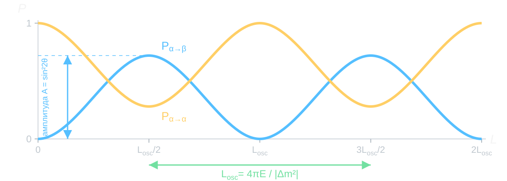

# Простыми словами

## Постановки задачи

- В Стандартной модели:
$$
\begin{aligned}
\text{возможно}\qquad W^+\longrightarrow\ell_\alpha^++\nu_\alpha,
\qquad&\overset{L=0}{\longrightarrow}\qquad
\nu_\alpha+W^-\longrightarrow\ell_\alpha^-. \\
\text{невозможно}\qquad W^+\longrightarrow\ell_\alpha^++\nu_\alpha,
\qquad&\overset{L=0}{\longrightarrow}\qquad
\nu_\alpha+W^-\longrightarrow\ell_\beta^-, \qquad \alpha\neq\beta.
\end{aligned}
$$
- Если $L\ne 0$, $m_i \ne m_j$ и $\theta\ne 0$, то невозможное становится возможным:
$$
\text{возможно}\qquad W^+\longrightarrow\ell_\alpha^++\nu_\alpha,
\qquad\overset{L\ne 0}{\longrightarrow}\qquad
\nu_\alpha+W^-\longrightarrow\ell_\beta^-, \qquad \alpha\neq\beta.
$$
- Вероятность таких процессов (квази)периодическая функция от отношения $L/E$:
$$
\boxed{P_{\alpha\to\beta}(L/E)}.
$$
- это явление называется **осцилляциями нейтрино**.

## Квантовый хамелеон {#quantum-chameleon}



## Периодичность — в вероятностях {#oscillation-phases}

<video
  class="slide-video media-width-full"
  style="--media-width: 96%; --media-max-height: 650px;"
  data-autoplay autoplay loop muted playsinline controls preload="metadata"
  aria-label="Две массовые фазы нейтрино и возникающие вероятности осцилляций"
  src="assets/05_vacuum_oscillations/neutrino_oscillation_phases.mp4">
</video>

::: {.media-caption}
Две компоненты набирают разные фазы. Их сумма при регистрации определяет
вероятности флэйворных исходов.
:::

# Два базиса

## Флэйвор при рождении, масса в пути

:::: {.columns}

::: {.column width="48%"}

**Слабое взаимодействие**

$$
W^+\longrightarrow\ell_\alpha^++\nu_\alpha,
\qquad
\nu_\beta+N\longrightarrow\ell_\beta^-+X.
$$

Заряженный лептон задаёт флэйворный базис рождения и регистрации.

:::

::: {.column width="49%"}

**Свободное распространение**

$$
H_0|\nu_i\rangle=E_i|\nu_i\rangle,
\qquad i=1,2.
$$

Массовые состояния — собственные волны свободного гамильтониана.

:::

::::

Оба базиса описывают одно пространство состояний. Между ними стоит угол
смешивания $\theta$.

## Один угол связывает два базиса

$$
\boxed{
\begin{pmatrix}
|\nu_\alpha\rangle\\[2pt]
|\nu_\beta\rangle
\end{pmatrix}
=
\begin{pmatrix}
\cos\theta&\sin\theta\\
-\sin\theta&\cos\theta
\end{pmatrix}
\begin{pmatrix}
|\nu_1\rangle\\[2pt]
|\nu_2\rangle
\end{pmatrix}}
$$

- При $\theta=0$ каждый флэйвор совпадает с одним массовым состоянием.
- При $\theta=\pi/4$ оба массовых состояния входят в $|\nu_\alpha\rangle$
  с равными по модулю амплитудами.

Для вычисления перехода понадобятся две строки этого поворота:

$$
|\nu_\alpha\rangle=c_\theta|\nu_1\rangle+s_\theta|\nu_2\rangle,
\qquad
|\nu_\beta\rangle=-s_\theta|\nu_1\rangle+c_\theta|\nu_2\rangle,
$$

где $c_\theta=\cos\theta$ и $s_\theta=\sin\theta$.

## Фазы двух собственных волн

::: {.marginnote .absolute top=350 left=1515 width=285 style="--note-font-size: 0.62em;"}
$\hbar=c=1$. Свободный гамильтониан не зависит от времени.
:::

Пусть $\varphi_i$ — фаза, накопленная массовой компонентой между источником
и детектором. Тогда

$$
|\nu_\alpha;t,L\rangle
=c_\theta e^{-i\varphi_1}|\nu_1\rangle
+s_\theta e^{-i\varphi_2}|\nu_2\rangle.
$$

Если начальное состояние содержит одну собственную волну, фазовый множитель
исчезает при вычислении вероятности. Здесь присутствуют две волны; после
вынесения общего множителя остаётся разность

$$
\boxed{\Delta\varphi=\varphi_2-\varphi_1}.
$$

По мере её накопления меняется результат сложения амплитуд в детекторе.

## Проекция на другой флэйвор

:::: {.panel-tabset .story-tabs}

### Детектор

Детектор ищет состояние $|\nu_\beta\rangle$. Проецируем на него
эволюционировавшее состояние:

$$
\begin{aligned}
\mathcal A_{\alpha\to\beta}
&=\langle\nu_\beta|\nu_\alpha;t,L\rangle\\
&=(-s_\theta\langle\nu_1|+c_\theta\langle\nu_2|)
\left(c_\theta e^{-i\varphi_1}|\nu_1\rangle
+s_\theta e^{-i\varphi_2}|\nu_2\rangle\right).
\end{aligned}
$$

### Две амплитуды

Массовые состояния ортонормированы:
$\langle\nu_i|\nu_j\rangle=\delta_{ij}$. Остаются два вклада:

$$
\boxed{
\mathcal A_{\alpha\to\beta}
=s_\theta c_\theta
\left(e^{-i\varphi_2}-e^{-i\varphi_1}\right)
}.
$$

При $L=0$ фазы одинаковы, и два вклада сокращаются. Дальше они расходятся.

### Вероятность

Используем

$$
\left|e^{-i\varphi_2}-e^{-i\varphi_1}\right|^2
=4\sin^2\frac{\Delta\varphi}{2},
\qquad
4s_\theta^2c_\theta^2=\sin^22\theta.
$$

По правилу Борна

$$
\boxed{
P_{\alpha\to\beta}(t,L)
=\sin^22\theta\,
\sin^2\frac{\Delta\varphi(t,L)}{2}
}.
$$

::::

## Два возможных исхода

В двухфлэйворной модели вероятности исчерпывают все варианты регистрации:

$$
\boxed{P_{\alpha\to\alpha}=1-P_{\alpha\to\beta}}.
$$

- При ненулевом расщеплении масс угол $\theta$ задаёт высоту максимумов:
  $P_{\alpha\to\beta}^{\max}=\sin^22\theta$.
- Разность фаз задаёт положение максимумов и минимумов.
- В точке $L=0$ получаем $P_{\alpha\to\beta}=0$ и
  $P_{\alpha\to\alpha}=1$.

# От времени к расстоянию

## Фаза вдоль пути

Для плоской волны, движущейся вдоль оси $L$,

$$
e^{-i\varphi_i(t,L)}=e^{-i(E_it-p_iL)},
\qquad
\varphi_i(t,L)=E_it-p_iL.
$$

Здесь $p_i$ — импульс вдоль направления от источника к детектору.

Значит,

$$
\boxed{\Delta\varphi(t,L)=\Delta E\,t-\Delta p\,L},
\qquad
\Delta E=E_2-E_1,
\quad
\Delta p=p_2-p_1.
$$

Детектор расположен на расстоянии $L$. Для ультрарелятивистского
нейтрино время пролёта $t\simeq L$ в единицах $c=1$. Обе компоненты
должны сохранять когерентность до регистрации.

## От массы к фазе

Используем закон дисперсии каждой массовой волны:

$$
E_i^2-p_i^2=m_i^2
\quad\Longrightarrow\quad
E_i-p_i=\frac{m_i^2}{E_i+p_i}.
$$

При $t\simeq L$ и $E_i\simeq p_i\simeq E$, в ведущем порядке:

$$
\varphi_i(t,L)
\simeq(E_i-p_i)L
\simeq\frac{m_i^2L}{2E}.
$$

Поэтому

$$
\boxed{
\Delta\varphi\simeq\frac{\Delta m^2L}{2E}},
\qquad
\Delta m^2=m_2^2-m_1^2.
$$

## Вероятность на расстоянии $L$

В аргумент синуса входит половина относительной фазы:

$$
\boxed{
P_{\alpha\to\beta}(L,E)
=\sin^22\theta\,
\sin^2\left(\frac{\Delta m^2L}{4E}\right)
}.
$$

Период по расстоянию при фиксированной энергии равен

$$
\boxed{L_{\rm osc}=\frac{4\pi E}{|\Delta m^2|}}.
$$

Первый максимум перехода приходится на $L=L_{\rm osc}/2$.

## Что видно на графике

{fig-alt="Вероятности появления и выживания, амплитуда смешивания и длина осцилляций" width="100%"}

- Высота максимума даёт $\sin^22\theta$.
- Расстояние между соседними максимумами при известной $E$ даёт
  $|\Delta m^2|$.

# Проверяем формулу

## Соберите осцилляцию {#two-flavor-lab}



::: {.nh-text tone="muted" size="sm"}
- Поставьте $\theta=0$: как меняется кривая?
- Поставьте $\theta=45^\circ$: найдите первый максимум.
- Передвиньте $L/L_{\rm osc}$ от $0$ до $1$: где вероятность перехода
  возвращается к нулю?
:::

# Механическая модель

## Два маятника разных масс



## Две частоты в одной механической системе

:::: {.columns}

::: {.column width="49%"}

**Возбуждаем один маятник**

Начальное отклонение раскладывается по двум нормальным модам. Каждая мода
колеблется со своей частотой $\omega_+$ или $\omega_-$.

:::

::: {.column width="49%"}

**Наблюдаем оба маятника**

Относительная фаза $(\omega_--\omega_+)t$ меняется. Огибающая движения
периодически смещается от одного маятника к другому.

:::

::::

$$
\boxed{
P_{1\to2}(t)=\sin^22\theta\,
\sin^2\!\left(\frac{(\omega_--\omega_+)t}{2}\right)
}.
$$

Здесь $P_i$ — нормированные квадраты модулей комплексных амплитуд локальных
маятников. При слабой связи они приближённо равны долям усреднённой энергии.
Точный вывод — в [главе книги](../book/chapters/09_vacuum_two_flavors.qmd)
и [задаче 9.6](../exercises/09_vacuum_oscillations_exercises.qmd).

# Два флэйвора

## Формула и её физический смысл

$$
\boxed{
P_{\alpha\to\beta}(L,E)
=\sin^22\theta\,
\sin^2\!\left(\frac{\Delta m^2L}{4E}\right)
}.
$$

- Слабое взаимодействие готовит и измеряет флэйвор.
- Массовые компоненты при распространении набирают разные фазы.
- Интерференция этих компонент определяет долю событий с флэйвором $\beta$.

В [следующей лекции](10_vacuum_pmns.qmd) к двум массовым состояниям
добавится третье.

[Задачи к лекции 09](../exercises/09_vacuum_oscillations_exercises.qmd) ·
[Апплет двух флэйворов](../applets/two-flavor-oscillations.qmd) ·
[Апплет связанных маятников](../applets/coupled-pendula.qmd).
