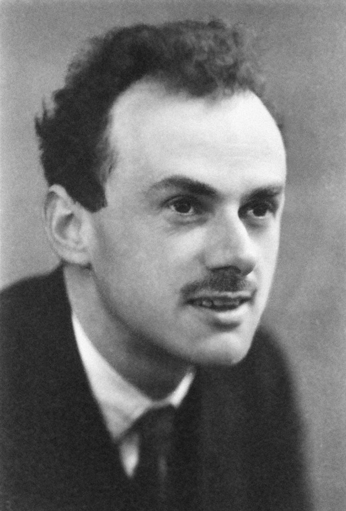
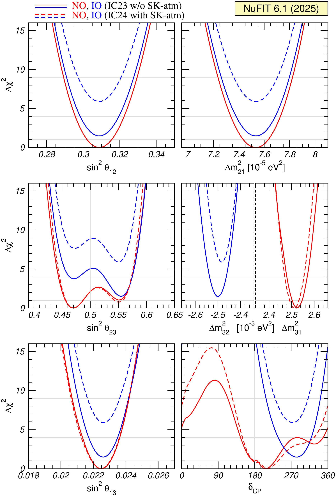
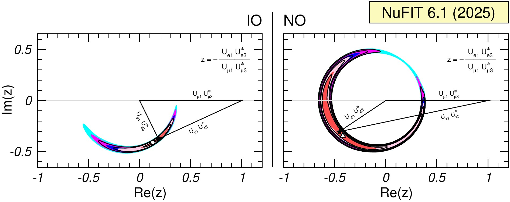

# Три флэйвора

## Два базиса

:::: {.panel-tabset .story-tabs}

### Флэйворный

Заряженный лептон при рождении или регистрации определяет флэйвор:

$$
\nu_e,\qquad\nu_\mu,\qquad\nu_\tau.
$$

Это три состояния, различимые слабым взаимодействием.

### Массовый

В вакууме распространяются три собственные волны:

$$
H_0|\nu_i\rangle=E_i|\nu_i\rangle,
\qquad i=1,2,3.
$$

Каждая набирает фазу $e^{-i(E_it-p_iL)}$. Из трёх разностей фаз независимы две.

::::

Три угла описывают взаимное расположение базисов; комплексная фаза
появляется в интерференции трёх массовых волн.

## Матрица смешивания

$$
U=\begin{pmatrix}
U_{e1}&U_{e2}&U_{e3}\\
U_{\mu1}&U_{\mu2}&U_{\mu3}\\
U_{\tau1}&U_{\tau2}&U_{\tau3}
\end{pmatrix},
\qquad
\boxed{|\nu_\alpha\rangle
=\sum_{i=1}^{3}U_{\alpha i}^*|\nu_i\rangle}.
$$

- Строка $\alpha$ отвечает флэйвору; столбец $i$ — массовому состоянию.
- Число $|U_{\alpha i}|^2$ показывает долю массовой компоненты $i$
  во флэйворном состоянии $\alpha$.
- Переход от одного базиса к другому сохраняет нормы и скалярные произведения.

## Единицы на диагонали, нули вне

Унитарность означает

$$
\boxed{UU^\dagger=U^\dagger U=
\begin{pmatrix}
1&0&0\\
0&1&0\\
0&0&1
\end{pmatrix}}.
$$

:::: {.columns}

::: {.column width="49%"}

**Строки:**

$$
\sum_i|U_{\alpha i}|^2=1,
\qquad
\sum_iU_{\alpha i}U_{\beta i}^*=0
\quad(\alpha\ne\beta).
$$

:::

::: {.column width="49%"}

**Столбцы:**

$$
\sum_\alpha|U_{\alpha i}|^2=1,
\qquad
\sum_\alpha U_{\alpha i}^*U_{\alpha j}=0
\quad(i\ne j).
$$

:::

::::

Нормировки заполняют диагональ единицами. Ортогональность даёт шесть нулей.

## Что означает экспериментальная проверка

- Если записать $U$ как произведение трёх унитарных поворотов, равенство
  $U^\dagger U=I$ выполнится при любых значениях углов и фазы.
- Экспериментальная проверка требует определить элементы по различным
  каналам рождения, исчезновения и появления, позволяя данным нарушить
  условия нормировки и ортогональности.
- Для нормировок нужны также сведения об абсолютных скоростях слабых
  процессов, потоках и сечениях; одних форм кривых по $L/E$ недостаточно.

::: {.nh-box tone="accent" size="sm"}
Хорошее согласие подгонки с унитарной матрицей проверяет модель целиком.
Проверка самой унитарности требует анализа, в котором её ограничения
не наложены заранее.
:::

# Три угла и одна фаза

## Три поворота и одна фаза

Положим $c_{ij}=\cos\theta_{ij}$, $s_{ij}=\sin\theta_{ij}$ и
$\delta\equiv\delta_{\rm CP}$. Стандартное соглашение имеет вид

$$
\boxed{U=R_{23}U_{13}(\delta_{\rm CP})R_{12}},
$$

$$
\begin{aligned}
R_{23}&=\begin{pmatrix}1&0&0\\0&c_{23}&s_{23}\\0&-s_{23}&c_{23}\end{pmatrix},
&U_{13}&=\begin{pmatrix}c_{13}&0&s_{13}e^{-i\delta}\\0&1&0\\-s_{13}e^{i\delta}&0&c_{13}\end{pmatrix},
&R_{12}&=\begin{pmatrix}c_{12}&s_{12}&0\\-s_{12}&c_{12}&0\\0&0&1\end{pmatrix}.
\end{aligned}
$$

Справа налево: $R_{12}$ поворачивает в плоскости $12$, $U_{13}$ действует
в плоскости $13$ и несёт фазу, $R_{23}$ поворачивает в плоскости $23$.
Каждый множитель унитарен.

## Матрица PMNS

Перемножая три множителя, получаем

$$
\boxed{
U=\begin{pmatrix}
c_{12}c_{13}&s_{12}c_{13}&s_{13}e^{-i\delta}\\
-s_{12}c_{23}-c_{12}s_{23}s_{13}e^{i\delta}
&c_{12}c_{23}-s_{12}s_{23}s_{13}e^{i\delta}
&s_{23}c_{13}\\
s_{12}s_{23}-c_{12}c_{23}s_{13}e^{i\delta}
&-c_{12}s_{23}-s_{12}c_{23}s_{13}e^{i\delta}
&c_{23}c_{13}
\end{pmatrix}}.
$$

Первая строка и третий столбец читаются сразу:

$$
\frac{|U_{e2}|}{|U_{e1}|}=\tan\theta_{12},\qquad
|U_{e3}|^2=\sin^2\theta_{13},\qquad
\frac{|U_{\mu3}|}{|U_{\tau3}|}=\tan\theta_{23}.
$$

Перемножение и дополнительные проверки — в задачах к лекции.

## Что видно в долях флэйворов

```{=html}
<div class="pmns-flavor-shares" role="img"
     aria-label="Доли электронного, мюонного и тау-флэйворов в трёх массовых состояниях по одной лучшей точке NuFIT 6.1">
  <div class="pmns-flavor-shares__column">
    <strong>\(\nu_1\)</strong>
    <div class="pmns-flavor-shares__stack">
      <span class="flavor-e" style="height:67.6%">\(e:\;0.676\)</span>
      <span class="flavor-mu" style="height:11.2%">\(\mu:\;0.112\)</span>
      <span class="flavor-tau" style="height:21.2%">\(\tau:\;0.212\)</span>
    </div>
  </div>
  <div class="pmns-flavor-shares__column">
    <strong>\(\nu_2\)</strong>
    <div class="pmns-flavor-shares__stack">
      <span class="flavor-e" style="height:30.2%">\(e:\;0.302\)</span>
      <span class="flavor-mu" style="height:42.8%">\(\mu:\;0.428\)</span>
      <span class="flavor-tau" style="height:27.0%">\(\tau:\;0.270\)</span>
    </div>
  </div>
  <div class="pmns-flavor-shares__column">
    <strong>\(\nu_3\)</strong>
    <div class="pmns-flavor-shares__stack">
      <span class="flavor-e flavor-e--small" style="height:2.2%"></span>
      <span class="flavor-mu" style="height:45.9%">\(\mu:\;0.459\)</span>
      <span class="flavor-tau" style="height:51.9%">\(\tau:\;0.518\)</span>
    </div>
  </div>
</div>
```

- $\theta_{12}$ распределяет электронную строку между столбцами $1$ и $2$.
- $\theta_{13}$ определяет небольшую электронную долю в столбце $3$:
  $|U_{e3}|^2=0.022$ (узкая голубая полоска).
- $\theta_{23}$ делит столбец $3$ между $\mu$ и $\tau$.
- $\delta_{\rm CP}$ через $\cos\delta_{\rm CP}$ меняет доли $\mu$ и $\tau$
  в столбцах $1$ и $2$.

::: {.nh-text tone="muted" size="sm"}
Пример вычислен из лучшей точки NuFIT 6.1 (NO, IC24 + SK-atm);
доли каждого столбца дают в сумме единицу с точностью до округления.
:::

## Дирак и Майорана: сколько фаз?

:::: {.panel-tabset .story-tabs}

### Частица Дирака

::::: {.pmns-phase-count}

Унитарная матрица $U$ размера $3\times3$ содержит три угла и **шесть фаз**.

:::: {.columns}
::: {.column width="47.5%"}

- В массовом базисе:

$$
\begin{aligned}
\mathcal L_{\rm CC}
&=-\frac{g}{\sqrt2}\,W^-_\mu
\sum_{\alpha,i}\bar\ell_{\alpha L}\gamma^\mu U_{\alpha i}\nu_{iL}
+\mathrm{h.c.},\\
\mathcal L_{\rm mass}
&=-\sum_\alpha m_\alpha\bar\ell_\alpha\ell_\alpha
-\sum_i m_i\bar\nu_i\nu_i.
\end{aligned}
$$

- Массовые члены сохраняются при замене фаз полей:

$$
\ell_\alpha\mapsto e^{i\phi_\alpha}\ell_\alpha,
\qquad
\nu_i\mapsto e^{i\psi_i}\nu_i.
$$

- Заряженный ток сохраняет вид, если

$$
\boxed{U_{\alpha i}'=
e^{i(\phi_\alpha-\psi_i)}U_{\alpha i}}.
$$

:::
::: {.column width="47.5%"}

- На $U$ действуют **разности** $\phi_\alpha-\psi_i$.
  Общий сдвиг всех шести фаз:

$$
\begin{aligned}
\phi_\alpha&\mapsto\phi_\alpha+\chi,\\
\psi_i&\mapsto\psi_i+\chi.
\end{aligned}
$$

$$
(\phi_\alpha+\chi)-(\psi_i+\chi)=\phi_\alpha-\psi_i.
$$

- Этот сдвиг не меняет $U$. Вычитая $\psi_3$ из всех фаз,
  получаем пять независимых параметров:

$$
\begin{gathered}
\phi_e-\psi_3,\quad\phi_\mu-\psi_3,\quad\phi_\tau-\psi_3,\\
\psi_1-\psi_3,\quad\psi_2-\psi_3.
\end{gathered}
$$

:::
::::

- Пять независимых перефазировок убирают **пять из шести фаз $U$**:
  $\boxed{6-5=1}$. Остаётся физическая фаза $\delta_{\rm CP}$.

:::::

### Частица Майораны

::::: {.pmns-phase-count}

Массы $m_i$ выбраны вещественными и положительными.
$\widetilde U$ обозначает полную матрицу смешивания.

:::: {.columns}
::: {.column width="47.5%"}

- Майорановская масса:

$$
\mathcal L_{\rm mass}^{(M)}
=-\frac12\sum_i m_i\,\overline{\nu_{iL}^{\,c}}\nu_{iL}
+\mathrm{h.c.}
$$

- При $\nu_{iL}\mapsto e^{i\psi_i}\nu_{iL}$:

$$
\overline{\nu_{iL}^{\,c}}\nu_{iL}
\mapsto e^{2i\psi_i}\overline{\nu_{iL}^{\,c}}\nu_{iL}.
$$

При фиксированных $m_i$ допустимы только $\psi_i=0,\pi$.

:::
::: {.column width="47.5%"}

- Заряженные лептоны остаются дираковскими.
  Их массовые члены $-m_\alpha\bar\ell_\alpha\ell_\alpha$
  сохраняются при $\ell_\alpha\mapsto e^{i\phi_\alpha}\ell_\alpha$.

$$
\widetilde U'=D_\ell\widetilde U,\qquad
D_\ell=\operatorname{diag}(e^{i\phi_e},e^{i\phi_\mu},e^{i\phi_\tau}).
$$

- Умножение **слева** меняет всю строку $\alpha$:

$$
\widetilde U_{\alpha i}'=e^{i\phi_\alpha}\widetilde U_{\alpha i}
\qquad\text{для всех }i.
$$

Один $\phi_\alpha$ умножает **всю строку $\alpha$** на общий множитель.
Относительные фазы её элементов сохраняются.

:::
::::

- Три перефазировки заряженных лептонов убирают три общие фазы строк.
  Остаются $\boxed{6-3=3}$ физических фазы:
  $\delta_{\rm CP}$ и две майорановские.

:::::

### Фазы столбцов

::::: {.pmns-phase-count}

После выбора фаз заряженных лептонов полную матрицу можно записать
как $\widetilde U=U(\delta)D_M$. В $U(\delta)$ три угла и одна фаза
$\delta_{\rm CP}$.

:::: {.columns}
::: {.column width="47.5%"}

- Множитель $e^{i\eta_i}$ относится к массовому состоянию $\nu_i$,
  то есть к **столбцу $i$**:

$$
\widetilde U_{\alpha i}=U_{\alpha i}(\delta)e^{i\eta_i}.
$$

Так действует умножение справа на

$$
D_M=\operatorname{diag}(e^{i\eta_1},e^{i\eta_2},e^{i\eta_3}).
$$

Диагональный $D_M$ умножает столбцы на фазы.
Полная $\widetilde U$ смешивает флэйворы и массы.

- Общий множитель $e^{i\eta_1}$ снимается уже учтённой заменой
  $\ell_\alpha\mapsto e^{-i\eta_1}\ell_\alpha$ для всех $\alpha$.
  Поэтому физически остаются разности $\eta_2-\eta_1$ и $\eta_3-\eta_1$.

:::
::: {.column width="47.5%"}

- Обозначим относительные фазы через $\alpha_{21}/2$ и $\alpha_{31}/2$:

$$
D_M=\operatorname{diag}
\left(1,e^{i\alpha_{21}/2},e^{i\alpha_{31}/2}\right).
$$

Здесь $\alpha_{21}=2(\eta_2-\eta_1)$,
$\alpha_{31}=2(\eta_3-\eta_1)$.

- В осцилляциях фаза столбца сокращается:

$$
\widetilde U_{\beta i}\widetilde U_{\alpha i}^{*}
=U_{\beta i}U_{\alpha i}^{*}
\underbrace{e^{i\eta_i}e^{-i\eta_i}}_{1}.
$$

- В $0\nu\beta\beta$ фазы удваиваются:

$$
m_{\beta\beta}=\left|\sum_i m_i\widetilde U_{ei}^{2}\right|,
\qquad \widetilde U_{ei}^{2}=U_{ei}^{2}e^{2i\eta_i}.
$$

:::
::::

:::::

### Поль Дирак

:::: {.columns}
::: {.column width="28%"}
{.pmns-bio-photo width="100%" fig-alt="Поль Дирак"}
:::
::: {.column width="68%"}

**1902–1984.** Релятивистское уравнение Дирака описало фермион со спином
$1/2$ и привело к предсказанию античастицы электрона. В 1933 году Дирак
разделил Нобелевскую премию по физике с Эрвином Шрёдингером.

::: {.nh-text tone="muted" size="sm"}
[Биография: Nobel Prize](https://www.nobelprize.org/prizes/physics/1933/dirac/biographical/) ·
[фото: Wikimedia Commons, общественное достояние](https://commons.wikimedia.org/wiki/File:Paul_Dirac,_1933.jpg).
:::
:::
::::

### Этторе Майорана

:::: {.columns}
::: {.column width="28%"}
{.pmns-bio-photo width="100%" fig-alt="Этторе Майорана"}
:::
::: {.column width="68%"}

**1906 — исчез в 1938 году.** В 1937 году Майорана построил теорию
нейтрального фермиона, совпадающего со своей античастицей. О том,
применимо ли это описание к нейтрино, должен сказать эксперимент.

::: {.nh-text tone="muted" size="sm"}
[Биография: INFN](https://www.infn.it/en/70-years-of-neutrinos/) ·
[фото: Wikimedia Commons, общественное достояние в Италии](https://commons.wikimedia.org/wiki/File:Ettore_Majorana.jpg).
:::
:::
::::

::::

# От состояния к вероятности

## Амплитуда перехода

:::: {.panel-tabset .story-tabs}

### Источник

Источник готовит флэйвор $\alpha$:

$$
|\nu_\alpha;0\rangle=\sum_iU_{\alpha i}^*|\nu_i\rangle.
$$

Каждый массовый компонент распространяется со своей фазой.

### Распространение

Для ультрарелятивистского нейтрино после расстояния $L$:

$$
|\nu_\alpha;L\rangle
=\sum_iU_{\alpha i}^*
\exp\!\left(-i\frac{m_i^2L}{2E}\right)|\nu_i\rangle.
$$

Общая для трёх компонент фаза опущена: в вероятность она не входит.

### Детектор

Детектор проецирует состояние на флэйвор $\beta$. Ортогональность
массовых состояний оставляет одну сумму:

$$
\boxed{
\mathcal A_{\alpha\to\beta}(L,E)
=\sum_{i=1}^{3}
U_{\beta i}U_{\alpha i}^*
e^{-im_i^2L/(2E)}
}.
$$

В каждом слагаемом видны рождение, распространение и регистрация одной
массовой компоненты.

::::

## Три пары, две независимые разности

Обозначим

$$
\Delta_{ij}=\frac{\Delta m_{ij}^2L}{4E},
\qquad \Delta m_{ij}^2=m_i^2-m_j^2.
$$

Из трёх возможных пар $21$, $31$ и $32$ независимы две:

$$
\boxed{\Delta m_{31}^2=\Delta m_{32}^2+\Delta m_{21}^2}.
$$

- Быстрые колебания задаёт атмосферное расщепление
  $|\Delta m_{31}^2|\approx|\Delta m_{32}^2|$.
- Медленную модуляцию задаёт солнечное $\Delta m_{21}^2$.
- Знак большого расщепления задаёт порядок масс. Чтобы извлечь его из
  данных, сравнивают энергетические зависимости, в том числе в веществе.

## Квадрат амплитуды

Положим

$$
a_i=U_{\beta i}U_{\alpha i}^*e^{-im_i^2L/(2E)},
\qquad
\mathcal A_{\alpha\to\beta}=a_1+a_2+a_3.
$$

Тогда вероятность складывается из трёх диагональных вкладов и
интерференции трёх пар:

$$
\boxed{
P_{\alpha\to\beta}=\left|\sum_i a_i\right|^2
=\sum_i|a_i|^2+2\sum_{i>j}\operatorname{Re}(a_i a_j^*)
}.
$$

Для краткой записи введём

$$
X_{\alpha\beta}^{ij}
=U_{\alpha i}^*U_{\beta i}U_{\alpha j}U_{\beta j}^*.
$$

Действительная часть $X^{ij}$ даёт знакомые осцилляционные максимумы.
Мнимая часть понадобится при сравнении нейтрино и антинейтрино.
Полное раскрытие суммы — задача 10.3.

## Выживание и появление

:::: {.panel-tabset .story-tabs}

### Выживание

При $\beta=\alpha$ все произведения $X_{\alpha\alpha}^{ij}$ вещественны:

$$
\boxed{
P_{\alpha\to\alpha}
=1-4\sum_{i>j}|U_{\alpha i}|^2|U_{\alpha j}|^2
\sin^2\Delta_{ij}
}.
$$

- Дефицит флэйвора $\alpha$ измеряет модули строки $\alpha$ и периоды,
  заданные $\Delta m_{ij}^2$. В вакууме формула одинакова для нейтрино
  и антинейтрино.

### Появление

Для $\alpha\ne\beta$:

$$
\boxed{
P_{\alpha\to\beta}
=-4\sum_{i>j}\operatorname{Re}X_{\alpha\beta}^{ij}
\sin^2\Delta_{ij}
+2\sum_{i>j}\operatorname{Im}X_{\alpha\beta}^{ij}
\sin2\Delta_{ij}
}.
$$

- Здесь входят произведения элементов двух строк, поэтому канал появления
  чувствителен и к их относительным фазам. От $\delta_{\rm CP}$ зависит
  интерференционная часть.

::::

Сумма трёх конечных вероятностей при фиксированном начальном флэйворе
равна единице. Прямой вывод и двухфлэйворный предел — в задаче 10.3.

## Нейтрино и антинейтрино в вакууме

Для антинейтрино матрица смешивания комплексно сопрягается:

$$
\boxed{\bar U=U^*}.
$$

При этой замене

$$
\operatorname{Re}X^{ij}\longrightarrow\operatorname{Re}X^{ij},
\qquad
\operatorname{Im}X^{ij}\longrightarrow-\operatorname{Im}X^{ij}.
$$

Следовательно, в канале появления разность равна

$$
\boxed{
A_{\alpha\beta}^{\rm CP}
=P(\nu_\alpha\to\nu_\beta)
-P(\bar\nu_\alpha\to\bar\nu_\beta)
=4\sum_{i>j}\operatorname{Im}X_{\alpha\beta}^{ij}
\sin2\Delta_{ij}
}.
$$

Для канала выживания в вакууме $A_{\alpha\alpha}^{\rm CP}=0$.

## Вероятности как функции энергии и длины {#three-flavor-probabilities}

```{=html}
<link rel="stylesheet" href="assets/05_vacuum_oscillations/three_flavor_probabilities.css">
```



```{=html}
<script src="assets/05_vacuum_oscillations/three_flavor_probabilities.js"></script>
```

::: {.nh-text tone="muted" size="sm"}
[Открыть апплет отдельно](../applets/three-flavor-probabilities.html) ·
[та же программа на Python](assets/05_vacuum_oscillations/three_flavor_oscillations.py).
:::

## Три вероятности на одном рисунке {#three-flavor-triangle}

```{=html}
<link rel="stylesheet" href="assets/05_vacuum_oscillations/three_flavor_triangle.css">
```



```{=html}
<script src="assets/05_vacuum_oscillations/three_flavor_triangle.js"></script>
```

::: {.nh-text tone="muted" size="sm"}
Точка показывает
$(P_{\alpha\to e},P_{\alpha\to\mu},P_{\alpha\to\tau})$.
Путь $x=L/L_{\rm osc}^{21}$ продлён до трёх солнечных периодов; начальные
параметры — NuFIT 6.1, NO, IC24 + SK-atm.
:::

# CP-нарушение

## Сравниваем сопряжённые каналы

В вакууме сравнивают переходы при одинаковых $L$ и $E$:

$$
\nu_\alpha\to\nu_\beta,
\qquad
\bar\nu_\alpha\to\bar\nu_\beta.
$$

- При двух флэйворах матрицу смешивания можно сделать вещественной.

- Трёхфлэйворная матрица допускает физическую комплексную фазу, которая
  может дать ненулевую разность вероятностей.

- В ускорительных экспериментах с длинной базой на это сравнение влияет
  и вещество Земли.

## Сесилия Ярлског

:::::: {.panel-tabset .story-tabs}

### Инвариант

:::: {.columns}

::: {.column width="31%"}

{width="100%" fig-alt="Сесилия Ярлског"}

::: {.nh-text tone="muted" size="sm"}
[Фото: Rebeca Romero Escrivà / Lund University](https://www.fysik.lu.se/en/article/prestigious-award-cecilia-jarlskog).
:::

:::

::: {.column width="65%"}

В 1985 году Ярлског предложила для кварков величину, которая не меняется
при переопределении фаз полей:

$$
\boxed{
J_{\rm CP}
=\operatorname{Im}
\left(U_{e2}^*U_{\mu2}U_{e1}U_{\mu1}^*\right)
}.
$$

В стандартной параметризации

$$
\boxed{
J_{\rm CP}
=c_{12}s_{12}c_{23}s_{23}c_{13}^2s_{13}\sin\delta_{\rm CP}
}.
$$

$J_{\rm CP}\ne0$, только если все три угла отличны от $0$ и $90^\circ$,
а $\sin\delta_{\rm CP}\ne0$.

::: {.nh-text tone="muted" size="sm"}
[C. Jarlskog, *Phys. Rev. Lett.* **55**, 1039 (1985)](https://doi.org/10.1103/PhysRevLett.55.1039).
:::

:::

::::

### Почему эти элементы

:::: {.columns}

::: {.column width="53%"}

**Почему четыре множителя.** Фазы полей можно переопределить:
$U_{\alpha i}\to e^{i(\varphi_\alpha-\psi_i)}U_{\alpha i}$. Наблюдаемая
величина от этого меняться не должна, поэтому каждый индекс строки и столбца
входит в произведение дважды: один раз в $U$, другой в $U^*$. Один элемент
даёт вещественное $|U_{\alpha i}|^2$. Самое короткое произведение, в котором
может остаться фаза, занимает две строки и два столбца.

**Почему $e,\mu$ и $1,2$.** Выбор удобен, но не обязателен. Из унитарности

$$
\operatorname{Im}\!\left(U_{\alpha i}U_{\beta j}U_{\alpha j}^*U_{\beta i}^*\right)
=J_{\rm CP}\sum_{\gamma,k}\varepsilon_{\alpha\beta\gamma}\,\varepsilon_{ijk}.
$$

Все девять подматриц $2\times2$ дают $\pm J_{\rm CP}$; перестановка двух
строк или двух столбцов меняет знак.

:::

::: {.column width="44%"}

**Что ещё он описывает.** Для трёх флэйворов это единственный инвариант
такого рода. В вакууме все разности
$P(\nu_\alpha\to\nu_\beta)-P(\bar\nu_\alpha\to\bar\nu_\beta)$
пропорциональны $J_{\rm CP}$, и при различных массах CP в осцилляциях
сохраняется тогда и только тогда, когда $J_{\rm CP}=0$. От параметризации он
не зависит.

Майорановские фазы в $J_{\rm CP}$ не входят: в осцилляциях они сокращаются.
При четырёх флэйворах и более независимых фаз больше, и одного $J_{\rm CP}$
уже не хватает.

Теоретический максимум $1/(6\sqrt3)\approx0.096$. Для лептонов при
$|\sin\delta_{\rm CP}|=1$ получается около $0.034$; у кварков измерено
всего $3\cdot10^{-5}$.

:::

::::

::::::

## Вакуумная CP-асимметрия

Для канала $e\to\mu$ мнимые части трёх интерференционных произведений
выражаются через один $J_{\rm CP}$. Получаем

$$
\boxed{
A_{e\mu}^{\rm CP}
=16J_{\rm CP}
\sin\Delta_{21}\sin\Delta_{32}\sin\Delta_{31}
}.
$$

- Если $\theta_{13}=0$, исчезает и $J_{\rm CP}$.
- Множитель $\sin\Delta_{21}$: без солнечного масштаба CP-эффекта
  в длиннобазовом эксперименте нет.
- Для $\mu\to e$ знак асимметрии противоположен.

Вывод тождества и оценка размера эффекта — домашняя задача 10.4.

# Матрица смешивания

## Делаем фит руками

Используем три экспериментальных результата:

- солнечные нейтрино:
  $P_{ee}\simeq1/3$;
- атмосферные и ускорительные нейтрино:
  $\sin^22\theta_{23}\simeq1$;
- малая электронная примесь третьего состояния:
  сначала положим $|U_{e3}|^2=0$.

Понадобятся нормировки строк и столбцов, затем ортогональность. Связь
солнечного результата с $|U_{e2}|^2$ опирается на адиабатический эффект
вещества; его физика будет выведена в лекции 13.

## Собираем матрицу по шагам {#pmns-from-data}

```{=html}
<link rel="stylesheet" href="assets/05_vacuum_oscillations/pmns_from_data.css">
```



```{=html}
<script src="assets/05_vacuum_oscillations/pmns_from_data.js"></script>
```

::: {.nh-text tone="muted" size="sm"}
[Открыть апплет отдельно](../applets/pmns-from-data.html).
:::

## Что дала эта реконструкция

В нулевом приближении получается матрица квадратов модулей

$$
\boxed{
|U_0|^2=
\begin{pmatrix}
2/3&1/3&0\\
1/6&1/3&1/2\\
1/6&1/3&1/2
\end{pmatrix}}.
$$

- Унитарность позволила заполнить клетки, которые эти эксперименты
  напрямую не измеряют.
- Для выбора знаков был построен один вещественный унитарный представитель
  $U_0$. Его фаза $\delta_{\rm CP}$ при $U_{e3}=0$ не наблюдается.
- Реакторные данные дают $|U_{e3}|^2\simeq0.0225$. Полная матрица
  требует дополнительных измерений и допускает комплексную фазу.

::: {.nh-box tone="accent" size="sm"}
Совместный анализ разных источников восстановил всю матрицу, но её
унитарность была исходным условием реконструкции. Для независимого теста
допускают отступления от унитарности и сверяют разные каналы.
:::

# Что измерено сегодня

## NuFIT 6.1: три угла

Нормальный порядок масс, атмосферные данные IC24 и Super-Kamiokande.
Лучшие значения и интервалы $3\sigma$:

::: {.nufit-large-table}

| Параметр | Лучшее значение | Интервал $3\sigma$ |
|:---|---:|---:|
| $\sin^2\theta_{12}$ | $0.3088$ | $0.2893$–$0.3295$ |
| $\sin^2\theta_{13}$ | $0.02248$ | $0.02064$–$0.02418$ |
| $\sin^2\theta_{23}$ | $0.470$ | $0.435$–$0.584$ |

:::

- $\theta_{13}$ мал и измерен точно.
- Интервал $\theta_{23}$ пересекает $45^\circ$; его октант ещё открыт.

::: {.nh-text tone="muted" size="sm"}
[NuFIT 6.1, таблица параметров; данные до ноября 2025 года](https://www.nu-fit.org/sites/default/files/v61.tbl-parameters.pdf).
:::

## NuFIT 6.1: CP-фаза и расщепления

::: {.nufit-large-table}

| Параметр | Лучшее значение | Интервал $3\sigma$ |
|:---|---:|---:|
| $\Delta m_{21}^2$ | $7.537\cdot10^{-5}\ \mathrm{эВ}^2$ | $(7.236\text{–}7.823)\cdot10^{-5}\ \mathrm{эВ}^2$ |
| $\Delta m_{31}^2$ (NO) | $+2.511\cdot10^{-3}\ \mathrm{эВ}^2$ | $(2.450\text{–}2.576)\cdot10^{-3}\ \mathrm{эВ}^2$ |
| $\delta_{\rm CP}$ (NO) | $212^\circ$ | $125^\circ$–$365^\circ$ |

:::

Интервал для $\delta_{\rm CP}$ допускает $180^\circ$ и
$360^\circ\equiv0^\circ$: CP-сохраняющие значения остаются возможны.
Для обратного порядка масс приводятся отдельные интервалы.

::: {.nh-text tone="muted" size="sm"}
[NuFIT 6.1, нормальный и обратный порядок](https://www.nu-fit.org/?q=node/309).
:::

## NuFIT 6.1: элементы матрицы

Диапазоны $3\sigma$ для $|U_{\alpha i}|$ при включении атмосферных данных
IC24 и Super-Kamiokande:

::: {.nufit-large-table}

| Флэйвор | $\nu_1$ | $\nu_2$ | $\nu_3$ |
|:---|:---:|:---:|:---:|
| $e$ | $0.810$–$0.834$ | $0.532$–$0.568$ | $0.144$–$0.156$ |
| $\mu$ | $0.259$–$0.498$ | $0.514$–$0.678$ | $0.652$–$0.756$ |
| $\tau$ | $0.280$–$0.512$ | $0.488$–$0.659$ | $0.637$–$0.743$ |

:::

Интервалы разных клеток коррелированы: их крайние значения нельзя
одновременно подставлять в одну матрицу. Таблица получена внутри унитарной
трёхнейтринной модели.

::: {.nh-text tone="muted" size="sm"}
[NuFIT 6.1, таблица модулей матрицы](https://www.nu-fit.org/sites/default/files/v61.tbl-mixing.jpg).
:::

## Профили: солнечный сектор

::: {.nufit-profile-crop .nufit-profile-crop--top}
{fig-alt="Верхняя часть профилей NuFIT 6.1 для солнечного угла и солнечного расщепления"}
:::

- Положение минимума даёт лучшее значение.
- Ширина показывает точность после учёта остальных параметров.

::: {.nh-text tone="muted" size="sm"}
[Официальные профили NuFIT 6.1](https://www.nu-fit.org/sites/default/files/v61.fig-chisq-glob.jpg).
:::

## Профили: атмосферный сектор

::: {.nufit-profile-crop .nufit-profile-crop--middle}
{fig-alt="Средняя часть профилей NuFIT 6.1 для атмосферного угла и атмосферного расщепления"}
:::

Профиль $\theta_{23}$ допускает решения по обе стороны $45^\circ$.
При сравнении NO и IO следите за обозначением
$\Delta m_{3\ell}^2$: для NO это $\Delta m_{31}^2$, для IO —
$\Delta m_{32}^2$.

## Профили: $\theta_{13}$ и CP-фаза

::: {.nufit-profile-crop .nufit-profile-crop--bottom}
{fig-alt="Нижняя часть профилей NuFIT 6.1 для угла тета 13 и CP-фазы"}
:::

У $\theta_{13}$ узкий минимум. Профиль фазы гораздо шире, и его вид
заметно меняется при выборе набора атмосферных данных.

::: {.nh-text tone="muted" size="sm"}
Красный: NO; синий: IO. Сплошные кривые: без табулированных SK-atm;
пунктирные: с ними. [Источник графика](https://www.nu-fit.org/sites/default/files/v61.fig-chisq-glob.jpg).
:::

## Треугольник унитарности: что показывает рисунок

::: {.nufit-unitarity-figure}
{fig-alt="Разрешённые формы лептонного треугольника унитарности в NuFIT 6.1"}
:::

$$
U_{e1}U_{\mu1}^*+U_{e2}U_{\mu2}^*+U_{e3}U_{\mu3}^*=0.
$$

Три комплексных слагаемых замыкают треугольник. На рисунке NuFIT
замыкание наложено заранее, и показаны формы треугольника, разрешённые
в унитарной модели. Для прямого теста замыкание оставляют свободным.

::: {.nh-text tone="muted" size="sm"}
[NuFIT 6.1, треугольник](https://www.nu-fit.org/?q=node/309).
:::

# Что осталось проверить

## На что смотреть в формулах

- В $P_{\alpha\to\alpha}$ модули элементов одной строки задают глубину
  исчезновения, а $\Delta m_{ij}^2$ — положение максимумов.
- В $P_{\alpha\to\beta}$ при $\alpha\ne\beta$ появляются произведения
  разных строк; сравнение нейтрино и антинейтрино чувствительно к их
  мнимым частям.
- Унитарность связывает каналы. Её самостоятельная проверка требует
  ослабить эти связи в анализе данных.

Следующая лекция начнёт с вопроса: как вещество меняет фазы проходящих
через него нейтрино?

[Задачи к лекции 10](../exercises/10_vacuum_pmns_exercises.qmd) ·
[Треугольник флэйворов](../applets/flavor-triangle.qmd) ·
[Соберите матрицу](../applets/pmns-from-data.html).
