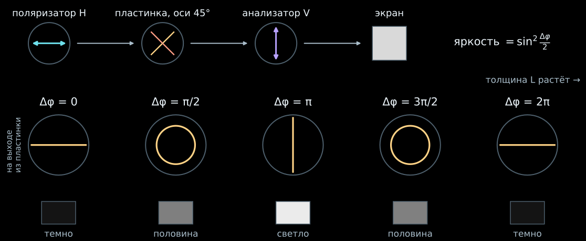
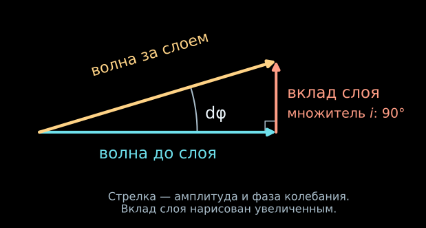
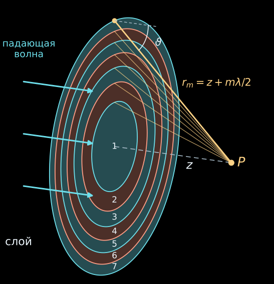
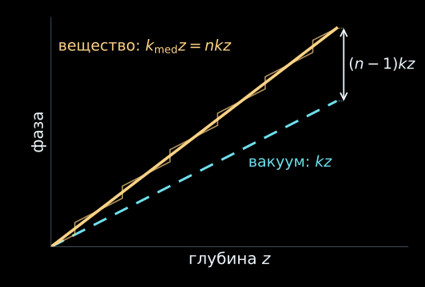
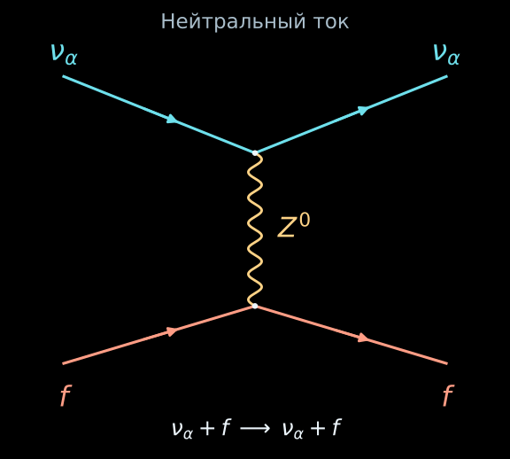
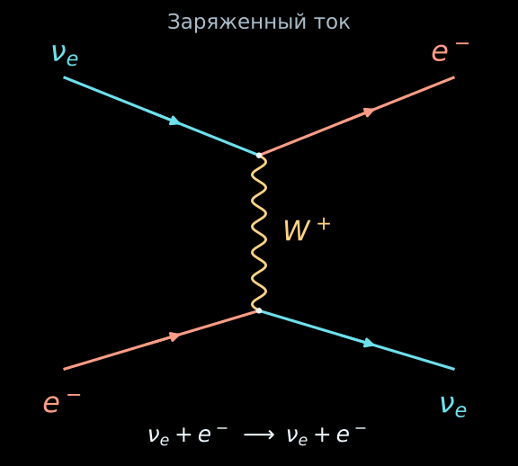
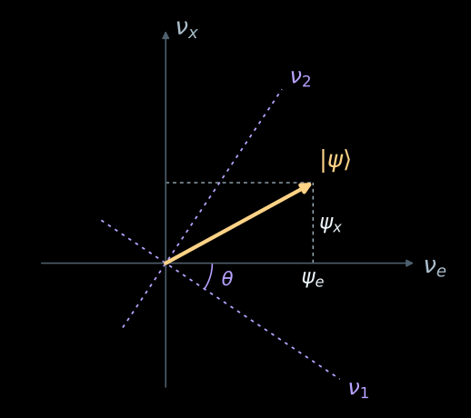
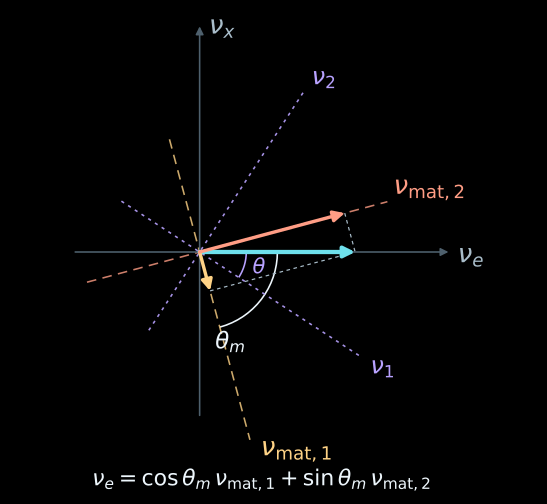

# Солнце как оптическая среда

## Влияет ли вещество Солнца  на осцилляции нейтрино?

::: incremental

- Нет! Потому, что Солнце прозрачно для нейтрино. Вероятность рассеяния нейтрино с энергией 10 МэВ порядка $10^{-7}$.

- Хотя... Свет в прозрачной среде почти не поглощается, но преломляется. Может быть, и нейтрино преломляется в Солнце?

- Да! Мы увидим в этой лекции, что Солнце и вакуум для нейтрино это прозрачные кристаллы с двумя собственными состояниями и **разными** показателями преломления.

  - В центре Солнца при $E=10$ МэВ добавки вещества различаются на $\delta n_e-\delta n_x\approx-8\cdot10^{-19}$.

  - От центра Солнца до поверхности около $6\cdot10^{21}$ длин волн, и вклад вещества в разность фаз флэйворных компонент составляет по модулю примерно $4\cdot10^{3}$ рад; больше половины из них
  приходится на внутреннюю десятую часть радиуса.

:::

. . .

::: {.nh-box tone="accent" size="md" weight="bold"}
Солнце и вакуум для нейтрино это прозрачные кристаллы с двумя собственными состояниями и **разными** показателями преломления.

:::

# Двулучепреломляющий кристалл

## Опыт: пластинка между поляризаторами {#plate-experiment}

::: {.centered-figure style="--figure-width: 100%; --figure-max-height: 580px;"}
{width=1500 fig-alt="Поляризатор H, двулучепреломляющая пластинка с осями под 45 градусов, анализатор V и экран. Ниже поляризация на выходе и яркость экрана при разности фаз 0, пи на 2, пи, 3 пи на 2 и 2 пи: темно, половина, светло, половина, темно."}
:::

::: {.nh-text size="md" align="center"}
Одна частота, две поляризации. Вдоль осей пластинки показатели $n_1\neq n_2$,
и волны набирают разность фаз $\Delta\varphi=(n_1-n_2)kL$.
:::

. . .

::: {.nh-box tone="accent" size="md" align="center"}
$P=\sin^2 2\theta\,\sin^2\dfrac{\Delta\varphi}{2}$, где $\theta$ — угол между
поляризатором и осью пластинки; здесь $\theta=45^\circ$.
:::

## Две поляризации в кристалле {#invisible-plate}



## Вакуум это двулучпреломляющий кристалл для нейтрино

| Нейтрино | Свет в кристалле |
|:--|:--|
| массовые состояния $\nu_1,\nu_2$ — собственные оси вакуума | оси 1 и 2 кристалла |
| угол $\theta$ | угол к поляризатору |
| $E(n_1-n_2)\simeq\Delta m^2/(2E)$ | $(n_1-n_2)k$ |

## Вещество это тоже двулучпреломляющий кристалл для нейтрино

| Нейтрино | Свет в кристалле |
|:--|:--|
| оси $\nu_{\mathrm{mat},1},\nu_{\mathrm{mat},2}$  | оси 1 и 2 кристалла |
| угол $\theta_m$ | угол к поляризатору |
| $E(n_{\mathrm{mat},1}-n_{\mathrm{mat},2})=\Delta m^2_{\mathrm{mat}}/(2E)$ | $(n_1-n_2)k$ |

# Природа показателя преломления

## Свет в стекле

::: incremental

- Пропустим монохроматический свет через прозрачную пластинку.

- Входящая волна $\psi_{\rm in}$ раскачивает электроны атомов, и они излучают на той же частоте волну $\psi_{\rm sc}$.

- За пластинкой волны складываются: $\psi_{\rm out}=\psi_{\rm in}+\psi_{\rm sc}$.

- Из этой суммы и возникает показатель преломления $n$: $\psi_{\rm out}=e^{inkz}$.

- На выходе остаётся свет той же частоты, но меняется его фаза.

:::

. . .

::: {.nh-box tone="accent" size="sm"}
Алгоритм: вычислим суммарную волну

-  после одного рассеивателя

- после рассеяния на узкой плоскости, перпендикулярной движению падающей волны

- после прохождения конечной толщины среды

:::

## Один тонкий слой {visibility="hidden"}

:::: {.columns}

::: {.column width="50%"}
Пусть слой толщины $dz$ почти не поглощает волну. В соглашении
$e^{-i\omega t+ikz}$ его вклад вперёд даёт

$$
\psi(z+dz)=e^{ikdz}\,[1+i\,d\varphi]\,\psi(z),
\qquad |d\varphi|\ll1.
$$

Добавка $i\,d\varphi$ перпендикулярна стрелке волны. Длина суммы почти
не меняется, а стрелка поворачивается на $d\varphi$: фаза сдвигается,
частота остаётся прежней.
:::

::: {.column width="50%"}
::: {.centered-figure style="--figure-width: 100%; --figure-max-height: 480px;"}
{width=760 fig-alt="Стрелка волны до слоя, перпендикулярный вклад слоя и стрелка волны за слоем, повёрнутая на малый угол d phi."}
:::
:::

::::

::: {.nh-box tone="accent" size="sm"}
Откуда множитель $i$ и чему равно $d\varphi/dz$? Вычислим из волн,
рассеянных частицами слоя.
:::

## Один рассеиватель

:::: {.columns}

::: {.column width="50%"}
Для расчёта фазы достаточно скалярной волновой модели. Вдали от
небольшого рассеивателя волна имеет вид

$$
\psi(\mathbf r)=e^{ikz}+f(\vartheta)\frac{e^{ikr}}{r}.
$$

- $e^{ikz}$ — падающая плоская волна;
- $f(\vartheta)e^{ikr}/r$ — расходящаяся волна;
- $f(\vartheta)$ — комплексная амплитуда рассеяния, имеющая размерность длины.

Поле света векторное, но для сложения фаз в направлении прохождения
скалярной модели хватает.
:::

::: {.column width="50%"}


::: {.nh-text tone="muted" size="sm"}
Сечение плоскостью через рассеиватель и ось $z$, $f$ вещественна.
:::
:::

::::

## Кольца Френеля {#fresnel-rings}

:::: {.columns}

::: {.column width="48%"}
::: incremental

- Слой толщины $dz$ в плоскости $z=0$, концентрация рассеивателей $\mathcal N$. Точка наблюдения $P$ лежит на оси $z$ за слоем.

- Рассеиватель на расстоянии $b$ от оси посылает в $P$ волну $f(\vartheta)\,e^{ikr}/r$, где $r=\sqrt{z^2+b^2}$, $\cos\vartheta=z/r$.

- Точки слоя с одинаковым $r$ образуют **кольцо**: сфера радиуса $r$ с центром в $P$ пересекает плоскость слоя по окружности.

- **Зоны Френеля**: $r_m=z+m\lambda/2$. У соседних колец ход до $P$ различается на $\lambda/2$, и вклады приходят в противофазе.

:::
:::

::: {.column width="52%"}
::: {.centered-figure style="--figure-width: 100%; --figure-max-height: 760px;"}
{width=760 fig-alt="Плоский слой с семью зонами Френеля, точка наблюдения P на оси на расстоянии z, лучи от границ зон до P, расстояние r_m и угол рассеяния."}
:::
:::

::::

## Почему важна амплитуда вперёд?

Кольцо радиуса $b$ имеет площадь $2\pi b\,db$, а $b\,db=r\,dr$. Множитель $r$
сокращает $1/r$ сферической волны, и сумма по слою записывается точно:

$$
d\psi_{\rm sc}=\mathcal N\,dz\int\!2\pi b\,db\,f(\vartheta)\frac{e^{ikr}}{r}
=2\pi\mathcal N\,dz\int_z^\infty\! f(\vartheta)\,e^{ikr}\,dr .
$$

. . .

Пучок конечен, волна когда-то включилась: дальние кольца гасим множителем
$e^{-\varepsilon r}$. Интегрируем по частям, нижний предел $r=z$ — центр слоя:

$$
\int_z^\infty f\,e^{ikr}\,dr\;\simeq\;\frac{i}{k}\,f(0)\,e^{ikz}
\quad\Longrightarrow\quad
d\psi_{\rm sc}=i\,\frac{2\pi\mathcal N}{k}\,f(0)\,dz\,e^{ikz}.
$$

. . .

::: {.nh-box tone="accent" size="sm"}
Остаток мал, пока $f(\vartheta)$ почти не меняется на первой зоне:
$z\gg ka^2$, где $a$ — размер рассеивателя.
:::

. . .

:::: {.columns}

::: {.column width="58%"}
Вклад даёт область малых углов, поэтому стоит $f(0)$. Множитель $i$ —
поворот на $90^\circ$ — даёт геометрия плоского слоя. Фаза вклада слоя
равна $90^\circ+\arg f(0)$. С падающей волной за слоем

$$
\begin{aligned}
\psi&=e^{ikz}\,[1+i\,d\varphi],\\
d\varphi&=\frac{2\pi\mathcal N}{k}\,f(0)\,dz .
\end{aligned}
$$
:::

::: {.column width="42%"}
::: {.centered-figure style="--figure-width: 100%; --figure-max-height: 330px;"}
{width=760 fig-alt="Стрелка волны до слоя, перпендикулярный вклад слоя и стрелка волны за слоем, повёрнутая на малый угол d phi."}
:::
:::

::::

## Сумма по зонам Френеля {#fresnel-spiral}



::: {.nh-text tone="muted" size="sm"}
$f(0)$ вынесен, момент времени фиксирован; кнопка добавляет всё более далёкие
кольца. Остаток до предела — $e^{-\pi(\varepsilon/k)m}$.
[Модель с откликом заряда](../applets/refraction-origin.html).
:::

## Много слоёв: однородное вещество

Добавим свободное распространение через $dz$ к результату для тонкого слоя (волны $e^{ikz-i\omega t}$):

$$
\psi(z+dz)=e^{ikdz}
\left[1+i\,\frac{2\pi\mathcal N}{k}f(0)\,dz\right]\psi(z).
$$

. . .

Разобьём толщу $D$ на $M$ слоёв по $dz=D/M$:

$$
e^{ikD}\left(1+i\,\frac{2\pi\mathcal N f(0)}{k}\frac{D}{M}\right)^M
\xrightarrow[M\to\infty]{}
e^{ikD}\exp\!\left(i\,\frac{2\pi\mathcal N f(0)}{k}D\right).
$$

. . .

:::: {.columns}

::: {.column width="56%"}
$$
\psi(z)=e^{ik_{\rm med}z}\psi(0),
\qquad
k_{\rm med}=k+\frac{2\pi\mathcal N}{k}f(0),
$$

$$
k_{\rm med}=nk:\qquad
\boxed{n=1+\frac{2\pi\mathcal N}{k^2}f(0)}.
$$
:::

::: {.column width="44%"}
::: {.centered-figure style="--figure-width: 100%; --figure-max-height: 330px;"}
{width=600 fig-alt="Фаза от глубины: в вакууме прямая kz, в веществе ступеньки на каждом слое и средний наклон nk; разность фаз (n-1)kz."}
:::
:::

::::

::: {.nh-text tone="muted" size="sm"}
Экспонента учла все порядки по $\mathcal N D$, а $n-1$ найдено в первом
порядке по концентрации независимых рассеивателей; волной, рассеянной назад,
пренебрегаем ($|n-1|\ll1$). В плотном стекле на атом действует ещё поле соседних
атомов (формула Лорентца–Лоренца), но смысл $n$ тот же.
:::

## Показатель преломления и оптика

- В прозрачной среде $n$ можно считать действительным.

- Для света $k=\omega/c$ в вакууме, а внутри вещества $k_{\rm med}=n\omega/c$.
Поэтому

$$
\lambda_{\rm med}=\frac{\lambda_0}{n},
\qquad
v_{\rm ph}=\frac{c}{n},
\qquad
\Delta\varphi=k(n-1)z.
$$

- Частота монохроматической волны сохраняется в неподвижном веществе.
- На длине $z$ накапливается добавочная фаза $\Delta\varphi$.
- На границе сред фаза должна совпадать вдоль поверхности. Отсюда
  $n_1\sin\theta_1=n_2\sin\theta_2$.

Так одна величина описывает сдвиг интерференционных полос и
преломление луча.

## Если показатель преломления комплексен

Пусть $n=n_R+i n_I$. Тогда

$$
\psi(z)\propto e^{ikn_Rz}\,e^{-kn_Iz},
\qquad
\frac{I(z)}{I(0)}=e^{-2kn_Iz}.
$$

Действительная часть $f(0)$ задаёт фазу, мнимая — ослабление
когерентного пучка. Оптическая теорема связывает её с полным сечением:

$$
\sigma_{\rm tot}=\frac{4\pi}{k}\operatorname{Im}f(0)
\quad\Longrightarrow\quad
\frac{I(z)}{I(0)}=e^{-\mathcal N\sigma_{\rm tot}z}.
$$

Среда может почти не поглощать волну и при этом заметно менять её фазу.
Для нейтрино это различие окажется решающим.

# Два показателя преломления нейтрино

## Природа первого показателя  преломления нейтрино {#природа-первого-показателя-преломления-нейтрино}

:::: {.columns}

::: {.column width="56%"}
::: incremental

- Если нейтрино любого флэйвора упруго рассеивается на нулевой угол при взаимодействии с частицами среды за счет обмена $Z$ бозоном, то:

  - состояние среды не меняется и

  - нейтрино сохраняет направление.

  - Рассеянная вперёд волна когерентно складывается с волной, прошедшей
  без рассеяния.

  - Появляется общая для активных флэйворов добавка к показателю преломления.

:::
:::

::: {.column width="44%"}
::: {.centered-figure style="--figure-width: 100%; --figure-max-height: 590px;"}
{width=680 fig-alt="Диаграмма нейтрального тока: нейтрино любого активного флэйвора и фермион среды упруго рассеиваются с обменом Z0. На каждой фермионной линии вид частицы сохраняется."}
:::

::: {.nh-text tone="muted" size="sm" align="center"}
$\alpha=e,\mu,\tau$, $\quad f=e^-,p,n$.
:::
:::

::::

## Природа второго показателя  преломления нейтрино {#природа-второго-показателя-преломления-нейтрино}

:::: {.columns}

::: {.column width="56%"}
::: incremental

- Обычная (нормальная) среда состоит из атомных ядер и электронов. В ней нет $\mu$, $\tau$.

- Электронное нейтрино $\nu_e$ может упруго рассеяться на электроне за счет обмена $W^+$ бозоном, что изменяет показатель преломления $\nu_e$.

- Поэтому добавки вещества $\delta n_e$ и $\delta n_x$ различны.

- Вещество меняет и показатели преломления, и собственные состояния вакуумного «кристалла».

:::

::: {.fragment .nh-text tone="muted" size="sm"}
[Л. Вольфенштейн. Осцилляции нейтрино в веществе](https://doi.org/10.1103/PhysRevD.17.2369), 1978.
:::
:::

::: {.column width="44%"}
::: {.centered-figure style="--figure-width: 100%; --figure-max-height: 590px;"}
{width=680 fig-alt="Диаграмма заряженного тока при упругом рассеянии электронного нейтрино на электроне. Во входящих линиях слева nu_e и e-, в выходящих справа e- и nu_e; вершины соединяет W+."}
:::
:::

::::

## Состояние нейтрино

:::: {.columns}

::: {.column width="58%"}
- Нейтрино с заданной энергией $E$ летит вдоль $z$. Используем $\hbar=c=1$,
  общий множитель $e^{-iEt}$ опускаем.

- Рассматриваем два флэйвора: $\nu_e$ и $\nu_x$ ($\nu_\mu$ или $\nu_\tau$
  или их комбинация).

- Состояние и его флэйворные амплитуды:

$$
|\psi\rangle=\psi_e|\nu_e\rangle+\psi_x|\nu_x\rangle,
\qquad
\psi_\alpha=\langle\nu_\alpha|\psi\rangle.
$$

::: {.fragment}
- Тот же вектор можно разложить по массовым состояниям $|\nu_1\rangle,|\nu_2\rangle$:

$$
|\psi\rangle=a_1|\nu_1\rangle+a_2|\nu_2\rangle,
\qquad a_i=\langle\nu_i|\psi\rangle.
$$
:::
:::

::: {.column width="42%"}
::: {.centered-figure style="--figure-width: 100%; --figure-max-height: 520px;"}
{width=560 fig-alt="Флэйворные оси nu_e и nu_x, проекции psi_e и psi_x и повёрнутые на угол theta массовые оси nu_1 и nu_2."}
:::

::: {.nh-text tone="muted" size="sm"}
Схема базисов в пространстве состояний. Амплитуды в общем случае комплексны.
:::
:::

::::

## Вакуумный кристалл {#vacuum-index}

В вакууме независимо распространяются массовые состояния $|\nu_i\rangle$.
У каждой волны свой показатель преломления:

$$
n_i=\frac{k_{\mathrm{vac},i}}{E}
=\sqrt{1-\frac{m_i^2}{E^2}}
\simeq1-\frac{m_i^2}{2E^2}.
$$

. . .

Объединим их в оператор показателя преломления:

$$
\boxed{\hat n_{\mathrm{vac}}
=\sum_{i=1,2}n_i\,|\nu_i\rangle\langle\nu_i|.}
$$

Множитель $|\nu_i\rangle\langle\nu_i|$ выделяет компоненту вдоль $|\nu_i\rangle$.
Поэтому

$$
\hat n_{\mathrm{vac}}|\nu_i\rangle=n_i|\nu_i\rangle.
$$

::: {.nh-box tone="accent" size="md"}
Это определение оператора через собственные состояния. Его матрицу можно записать в любом базисе.
:::

## Как распространяется состояние в вакууме {#vacuum-evolution}

Каждое собственное состояние набирает свою фазу:

$$
a_i(z)=a_i(0)e^{iEn_i z},
\qquad
|\psi(z)\rangle=\sum_i a_i(0)e^{iEn_i z}|\nu_i\rangle.
$$

. . .

Дифференцируем сумму и используем определение $\hat n_{\mathrm{vac}}$:

$$
\frac{d|\psi\rangle}{dz}
=iE\sum_i n_i a_i(z)|\nu_i\rangle
=iE\hat n_{\mathrm{vac}}|\psi\rangle.
$$

$$
\boxed{\frac{d|\psi\rangle}{dz}=iE\hat n_{\mathrm{vac}}|\psi\rangle.}
$$

. . .

Осцилляции определяет разность фаз двух волн:

$$
\Delta\varphi=E(n_1-n_2)z\simeq\frac{\Delta m^2}{2E}z,
\qquad \Delta m^2=m_2^2-m_1^2.
$$

## Матрица в массовом базисе {#vacuum-mass-basis}

Элементы матрицы — проекции оператора на выбранные базисные состояния:

$$
\langle\nu_i|\hat n_{\mathrm{vac}}|\nu_j\rangle=n_i\delta_{ij}.
$$

Поэтому в базисе $(\nu_1,\nu_2)$

$$
\boxed{[\hat n_{\mathrm{vac}}]_{\mathrm{mass}}
=\begin{pmatrix}n_1&0\\0&n_2\end{pmatrix},}
\qquad
\frac{d}{dz}\begin{pmatrix}a_1\\a_2\end{pmatrix}
=iE\begin{pmatrix}n_1&0\\0&n_2\end{pmatrix}
\begin{pmatrix}a_1\\a_2\end{pmatrix}.
$$

. . .

Источник и детектор различают флэйворы. Для перехода к их амплитудам введём
матрицу $U$:

$$
U_{\alpha i}=\langle\nu_\alpha|\nu_i\rangle,
\qquad
\begin{pmatrix}\psi_e\\\psi_x\end{pmatrix}
=U\begin{pmatrix}a_1\\a_2\end{pmatrix}.
$$

## Тот же оператор во флэйворном базисе {#vacuum-flavor-basis}

$$
U=\begin{pmatrix}
\cos\theta&\sin\theta\\
-\sin\theta&\cos\theta
\end{pmatrix},
\qquad
\boxed{[\hat n_{\mathrm{vac}}]_f
=U\begin{pmatrix}n_1&0\\0&n_2\end{pmatrix}U^\dagger.}
$$

Строки и столбцы этой матрицы относятся к $(\nu_e,\nu_x)$:

$$
\langle\nu_\alpha|\hat n_{\mathrm{vac}}|\nu_\beta\rangle
=\sum_i n_i\,U_{\alpha i}U_{\beta i}^*.
$$

. . .

$$
[\hat n_{\mathrm{vac}}]_f=
\begin{pmatrix}
n_1\cos^2\theta+n_2\sin^2\theta
& (n_2-n_1)\sin\theta\cos\theta\\
(n_2-n_1)\sin\theta\cos\theta
& n_1\sin^2\theta+n_2\cos^2\theta
\end{pmatrix}.
$$

::: {.nh-box tone="accent" size="md"}
При смене базиса матрица стала недиагональной. Собственные состояния $\nu_1,\nu_2$
и показатели $n_1,n_2$ остались прежними.
:::

## От света к нейтрино {#vacuum-crystal}



# Нейтрино в веществе

## Вещество добавляет свой вклад {#matter-index}

Когерентное рассеяние вперёд в обычном веществе даёт разные добавки для
$\nu_e$ и $\nu_x$:

$$
\boxed{\delta\hat n
=\delta n_e|\nu_e\rangle\langle\nu_e|
+\delta n_x|\nu_x\rangle\langle\nu_x|.}
$$

Здесь $\delta n_\alpha$ — добавка к показателю преломления:

$$
\delta n_\alpha=\frac{2\pi}{E^2}
\sum_{a=e,p,n}\mathcal N_a\operatorname{Re}f_{\alpha a}(0).
$$

. . .

На тонком слое $dz$ фазовые вклады вакуума и вещества складываются.
Уравнение сохраняет вид:

$$
\boxed{\frac{d|\psi\rangle}{dz}=iE\hat n_{\mathrm{mat}}|\psi\rangle,
\qquad \hat n_{\mathrm{mat}}=\hat n_{\mathrm{vac}}+\delta\hat n.}
$$

::: {.nh-text tone="muted" size="sm"}
Учитываем ведущие поправки к $n=1$ от масс и слабого взаимодействия.
Ослаблением пучка пренебрегаем: оператор $\hat n_{\mathrm{mat}}$ эрмитов.
:::

## Складываем матрицы в одном базисе {#matter-bases}

Во флэйворном базисе диагональна добавка вещества:

$$
\boxed{[\hat n_{\mathrm{mat}}]_f
=U\begin{pmatrix}n_1&0\\0&n_2\end{pmatrix}U^\dagger
+\begin{pmatrix}\delta n_e&0\\0&\delta n_x\end{pmatrix}.}
$$

. . .

В массовом базисе диагонален вакуумный вклад:

$$
[\hat n_{\mathrm{mat}}]_{\mathrm{mass}}
=\begin{pmatrix}n_1&0\\0&n_2\end{pmatrix}
+U^\dagger\begin{pmatrix}\delta n_e&0\\0&\delta n_x\end{pmatrix}U.
$$

::: {.nh-box tone="accent" size="md"}
У вакуума и добавки вещества разные собственные оси.
Собственные состояния полной среды найдём из их суммы.
:::

## Новые оси — новые собственные состояния {#matter-eigenstates}

:::: {.columns}

::: {.column width="58%"}
Собственные состояния полной среды удовлетворяют уравнению

$$
\hat n_{\mathrm{mat}}|\nu_{\mathrm{mat},i}\rangle
=n_{\mathrm{mat},i}|\nu_{\mathrm{mat},i}\rangle.
$$

Значит, спектральная запись имеет знакомый вид:

$$
\boxed{\hat n_{\mathrm{mat}}=\sum_i n_{\mathrm{mat},i}
|\nu_{\mathrm{mat},i}\rangle\langle\nu_{\mathrm{mat},i}|.}
$$

::: {.fragment}
- $n_1,n_2$ — собственные показатели вакуума.
- $\delta n_e,\delta n_x$ — флэйворные добавки вещества.
- $n_{\mathrm{mat},1},n_{\mathrm{mat},2}$ — собственные показатели полной среды.
:::
:::

::: {.column width="42%"}
::: {.centered-figure style="--figure-width: 100%; --figure-max-height: 580px;"}
{width=620 fig-alt="Флэйворные оси nu_e и nu_x; массовые оси nu_1 и nu_2 под углом theta; собственные оси вещества nu_mat,1 и nu_mat,2 под углом theta_m. В плотном веществе nu_mat,2 близка к nu_e."}
:::
:::

::::

## Распространение в однородном веществе {#matter-evolution}

При постоянной плотности собственные оси и показатели не зависят от $z$.
Разложим входное состояние по этим осям:

$$
|\psi(0)\rangle=\sum_i c_i(0)|\nu_{\mathrm{mat},i}\rangle,
\qquad c_i(0)=\langle\nu_{\mathrm{mat},i}|\psi(0)\rangle.
$$

. . .

Каждая компонента набирает свою фазу:

$$
c_i(z)=e^{iEn_{\mathrm{mat},i}z}c_i(0).
$$

Складывая два собственных состояния, получаем

$$
\boxed{|\psi(z)\rangle
=\sum_i e^{iEn_{\mathrm{mat},i}z}
|\nu_{\mathrm{mat},i}\rangle
\langle\nu_{\mathrm{mat},i}|\psi(0)\rangle.}
$$

::: {.nh-text tone="muted" size="sm"}
Добавка, пропорциональная единичному оператору, даёт общую фазу.
На вероятности влияют разность собственных показателей и ориентация осей.
:::

## Источник готовит $\nu_e$, детектор ищет $\nu_x$ {#source-detector}

- Угол смешивания в веществе $\theta_m$ задаёт разложение флэйворов по
  собственным состояниям:

$$
\begin{aligned}
|\nu_e\rangle&=\cos\theta_m|\nu_{\mathrm{mat},1}\rangle+\sin\theta_m|\nu_{\mathrm{mat},2}\rangle,\\
|\nu_x\rangle&=-\sin\theta_m|\nu_{\mathrm{mat},1}\rangle+\cos\theta_m|\nu_{\mathrm{mat},2}\rangle.
\end{aligned}
$$

. . .

- Источник возбуждает обе волны, они набирают разные фазы, детектор берёт
  проекцию на $\nu_x$:

$$
A_{e\to x}(z)=\sum_{i=1,2}
\underbrace{\langle\nu_x|\nu_{\mathrm{mat},i}\rangle}_{\text{детектор}}\,
\underbrace{e^{iEn_{\mathrm{mat},i}z}}_{\text{путь}}\,
\underbrace{\langle\nu_{\mathrm{mat},i}|\nu_e\rangle}_{\text{источник}} .
$$

. . .

- Подставим проекции. При $z=0$ вклады сокращаются: источник приготовил
  чистое $\nu_e$.

$$
\boxed{A_{e\to x}(z)=\sin\theta_m\cos\theta_m
\bigl(e^{iEn_{\mathrm{mat},2}z}-e^{iEn_{\mathrm{mat},1}z}\bigr)}.
$$

## Две волны: вакуум и солнечное вещество {#refraction-two-modes}



## Что уже следует из этой картины

$$
\boxed{P_{e\to x}=\sin^22\theta_m\,\sin^2\frac{\Delta\varphi}{2}},
\qquad
\Delta\varphi=E(n_{\mathrm{mat},1}-n_{\mathrm{mat},2})z.
$$

::: incremental

- В вакууме результат тот же, с $\theta$ и $\Delta\varphi\simeq(\Delta m^2/2E)z$:
  вещество меняет собственные оси и разность показателей преломления.
- Это та же интерференция двух собственных состояний, что в пластинке между
  скрещёнными поляризаторами: $\theta_m\leftrightarrow\theta$,
  $E(n_{\mathrm{mat},1}-n_{\mathrm{mat},2})\leftrightarrow(n_1-n_2)k$.
- При $\theta_m=0$ состояние $\nu_e$ само — собственное состояние, переходов нет.
- Формула верна при постоянной плотности. При переменной плотности
  $\hat n_{\mathrm{mat}}=\hat n_{\mathrm{mat}}(z)$; в базисе его локальных
  собственных состояний нужно учесть поворот осей вдоль пути.

:::

. . .

Как вещество меняет $\theta_m$ и $n_{\mathrm{mat},1}-n_{\mathrm{mat},2}$,
вычислим в лекции 12, а медленно меняющуюся плотность рассмотрим в лекции 13.

## Словарь: нейтрино и кристалл {#crystal-dictionary}

| Нейтрино | Свет в двулучепреломляющем кристалле |
|:--|:--|
| рождается $\nu_e$; детектор ищет $\nu_e$ или $\nu_x$ | поляризатор H; анализатор H или V |
| $\nu_1,\nu_2$ — собственные состояния вакуума | поляризации вдоль осей кристалла |
| угол смешивания $\theta$ | угол между осью кристалла и поляризатором |
| $E(n_1-n_2)\simeq\Delta m^2/(2E)$ | $(n_1-n_2)k$ |
| вещество: разные добавки $\delta n_e,\delta n_x$ | деформация с добавочной анизотропией по осям H/V |
| $\nu_{\mathrm{mat},1},\nu_{\mathrm{mat},2}$ и угол $\theta_m$ | новые оси деформированного кристалла |

::: {.nh-box tone="accent" size="sm"}
Для нейтрино пустота уже кристалл: $\hat n_{\mathrm{vac}}$ имеет собственные
состояния $\nu_1,\nu_2$ с показателями $n_i\simeq1-m_i^2/(2E^2)$.
Вещество добавляет $\delta\hat n$, диагональную во флэйворном базисе.
Собственные состояния суммы $\hat n_{\mathrm{mat}}$ определяют распространение в веществе.
:::

# Дополнение

## Откуда $f(0)$ у света

Электрон в атоме — осциллятор с собственной частотой $\omega_0$ и
затуханием $\gamma$. Его амплитуда рассеяния вперёд в гауссовых единицах,
$r_e=e^2/(mc^2)$:

$$
f(0)=r_e\,\frac{\omega^2}{\omega_0^2-\omega^2-i\gamma\omega},
\qquad
n-1=\frac{2\pi\mathcal N f(0)}{k^2}
=\frac{2\pi\mathcal N e^2}{m}\,\frac{1}{\omega_0^2-\omega^2-i\gamma\omega}.
$$

- $\omega<\omega_0$, видимый свет в стекле: $n>1$ и растёт с частотой —
  синий свет преломляется сильнее красного.
- $\omega\gg\omega_0$, рентген: $f(0)\to-r_e$ (томсоновское рассеяние), $n<1$.
- Вблизи $\omega_0$ велика $\operatorname{Im}f(0)$: когерентный пучок
  ослабляется (по оптической теореме — за счёт поглощения и рассеяния).
- Для нейтрино $f(0)$ задаёт слабое взаимодействие; его вычислим в лекции 12.
