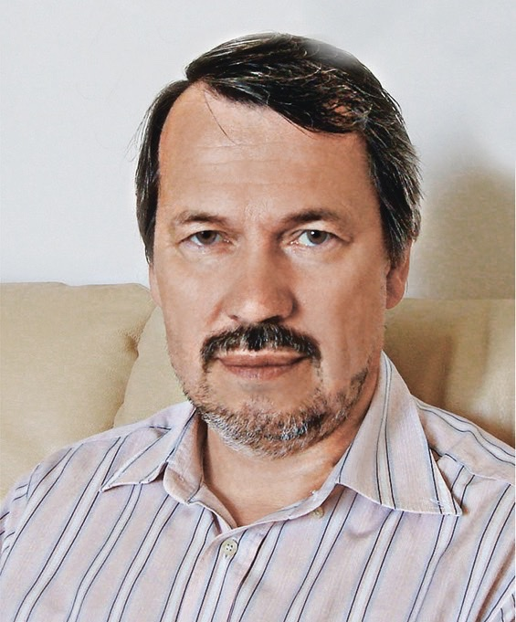

# Резонанс

## Напоминание: слой постоянной плотности {#matter-recap}

В лекции 12 для $\nu_e$, вошедшего в однородный слой с $A=2EV/\Delta m^2$, получено

$$
\boxed{P_{e\to x}=\sin^22\theta_m\,\sin^2\!\left[\frac{\Delta m^2L}{4E}\,R\right]},
\qquad
\boxed{\sin^22\theta_m=\frac{\sin^22\theta}{R^2}},
\qquad
R=\sqrt{(\cos2\theta-A)^2+\sin^22\theta}.
$$

:::: {.columns}
::: {.column width="50%"}

**Высота максимумов** $\sin^22\theta_m$: доля $\nu_x$, до которой дорастает
переход. В вакууме $\sin^22\theta$, в плотном веществе ($A\gg1$) стремится к нулю.

:::
::: {.column width="50%"}

**Период** $L_m=L_{\rm vac}/R$: расщепление мод $\Delta_m=\Delta\cdot R$ задаёт,
как быстро набегает фаза.

:::
::::

Знаменатель $R^2$ минимален, а высота максимумов равна единице, когда

$$
\cos2\theta-A=0 .
$$

Это и есть резонанс: при любом вакуумном угле переход может стать полным.
Посмотрим на это условие внимательнее.

## MSW-резонанс

:::::: {.panel-tabset .nh-story-tabs .l12-board}

### Результат

Диагональные элементы $H_f'$ обращаются в нуль при

$$
\boxed{A_{\rm res}=\cos2\theta},
\qquad
\theta_m=45^\circ,
\qquad
\sin^22\theta_m=1,
\qquad
\boxed{N_{e,\rm res}=\frac{\Delta m^2\cos2\theta}{2\sqrt2\,G_FE}}.
$$

Для солнечных параметров NuFIT 6.1

$$
\sin^2\theta_{12}=0.3088,
\qquad
\Delta m^2_{21}=7.537\times10^{-5}\ \mathrm{эВ^2}
$$

резонанс приходится на

$$
\rho Y_e\approx19\ \mathrm{г/см^3}\cdot\frac{10\ \text{МэВ}}{E}.
$$

В центре Солнца $\rho Y_e\approx100\ \mathrm{г/см^3}$, поэтому резонанс внутри Солнца есть
при $E\gtrsim1.9$ МэВ.

Плотность положительна, и резонанс возможен только при

$$
\boxed{V\,\Delta m^2\cos2\theta>0}.
$$

Так вещество позволяет измерить знак $\Delta m^2$. Подробности — во вкладке «3. Знак».

### 1. Условие

Где смешивание максимально?

(i) Диагональный элемент $\tfrac12(V-\Delta\cos2\theta)=0$ при

    $$
    A_{\rm res}=\frac V\Delta=\cos2\theta.
    $$

(ii) В резонансе остаётся только внедиагональный элемент:

     $$
     H_f'=\tfrac12\Delta\sin2\theta\,\sigma_x.
     $$

     Собственные векторы $(1,\pm1)/\sqrt2$, значит $\theta_m=45^\circ$.

(iii) Подставляем $A=2EV/\Delta m^2$ и $V=\sqrt2\,G_FN_e$:

      $$
      N_{e,\rm res}=\frac{\Delta m^2\cos2\theta}{2\sqrt2\,G_FE}.
      $$

### 2. Числа для Солнца

(i) $\cos2\theta_{12}=1-2\cdot0.3088=0.382$, и

    $$
    \Delta m^2_{21}\cos2\theta_{12}=2.88\times10^{-5}\ \mathrm{эВ^2}.
    $$

(ii) Из $2EV=\Delta m^2\cos2\theta$ при $E=10$ МэВ:

     $$
     \rho Y_e=\frac{2.88\times10^{-5}\ \mathrm{эВ^2}}
     {2\cdot10^{7}\ \text{эВ}\cdot7.63\times10^{-14}\ \text{эВ}}
     \approx19\ \mathrm{г/см^3}.
     $$

(iii) Плотность резонанса обратно пропорциональна $E$. В центре Солнца $\rho Y_e\approx100$, поэтому резонанс есть при $E\gtrsim1.9$ МэВ.

### 3. Знак

(i) Для нейтрино $V>0$, потому что $N_e>0$. Условие $A=2EV/\Delta m^2=\cos2\theta$ требует одинаковых знаков у $\Delta m^2$ и $\cos2\theta$:

    $$
    V\,\Delta m^2\cos2\theta>0.
    $$

(ii) У антинейтрино $\bar V=-V$, и условие меняет знак.

(iii) В солнечном секторе $\Delta m^2_{21}>0$ и $\cos2\theta_{12}>0$. Резонанс есть у нейтрино и нет у антинейтрино. При обратном порядке масс, $\Delta m^2_{31}<0$, резонанс переходит к антинейтрино.

Так вещество позволяет измерить знак $\Delta m^2$.

::::::

::: {.nh-text tone="muted" size="sm"}
В однородном слое резонанс делает максимальной амплитуду. Для полного
перехода нужна ещё фаза $\Delta_mL/2=\pi/2$. Переход в плавно меняющейся
плотности устроен иначе: к нему мы придём в этой лекции.
:::

## MSW-резонанс {#msw-history}

:::::: {.panel-tabset .nh-story-tabs}

### Кто открыл

~~~{=html}

  <article class="l12-person">
    
ЛВ

    <h3>Линкольн Вольфенштейн</h3>
    
1923–2015 · Carnegie Mellon, США

    <ul>
      <li>1978: когерентное рассеяние вперёд меняет фазу \(\nu_e\). Вывел уравнение эволюции, угол \(\theta_m\) и длину осцилляций в веществе.</li>
      <li>Заметил усиление перехода при \(L_{\rm vac}\approx l_0\), но не обсуждал его и полюс в \(\tan2\theta_m\) оставил без внимания. О Солнце: «заметных осцилляций внутри Солнца нет».</li>
      <li>Автор параметризации матрицы CKM. Премия Сакураи 1992.</li>
    </ul>
  </article>
  <article class="l12-person">
    
СМ

    <h3>Станислав Михеев</h3>
    
1940–2011 · ИЯИ РАН

    <ul>
      <li>Экспериментатор Баксанского телескопа: анализ атмосферных нейтрино, первые поиски осцилляций.</li>
      <li>В 1984 году спросил Смирнова, верна ли статья Вольфенштейна и нужно ли учитывать вещество для атмосферных нейтрино.</li>
      <li>Вместе со Смирновым нашёл резонанс: при \(A=\cos2\theta\) глубина осцилляций максимальна, ширина пика \(\sin2\theta\).</li>
    </ul>
  </article>
  <article class="l12-person">
    
АС

    <h3>Алексей Смирнов</h3>
    
род. 1951 · ИЯИ, Триест, Гейдельберг

    <ul>
      <li>Построил кривую \(\sin^22\theta_m(A)\) и увидел резонансную форму: «результат был поразительным».</li>
      <li>С Михеевым: резонансное усиление в постоянной плотности и адиабатическое превращение в меняющейся. К нему мы придём в этой лекции.</li>
      <li>ИЯИ, ICTP, Институт Макса Планка. Премия Сакураи 2008 вместе с Михеевым.</li>
    </ul>
  </article>

~~~

### История

::: {.history-tight}
- **1978.** Л. Вольфенштейн, [Phys. Rev. D **17**, 2369](https://doi.org/10.1103/PhysRevD.17.2369):
  когерентное рассеяние вперёд, уравнение эволюции, угол $\theta_m$ и длина осцилляций в веществе.
  Усиление при $L_{\rm vac}\approx l_0$ попало в таблицу без обсуждения; о Солнце: «заметных осцилляций нет».
- **1980.** V. Barger, K. Whisnant, S. Pakvasa, R. J. N. Phillips,
  [Phys. Rev. D **22**, 2718](https://doi.org/10.1103/PhysRevD.22.2718): условие максимального
  смешивания $A=\cos2\theta$, разный ответ для $\nu$ и $\bar\nu$. Слова «резонанс» в статье нет.
- **1984.** С. Михеев спрашивает А. Смирнова, верна ли статья Вольфенштейна и важно ли вещество для
  атмосферных нейтрино Баксана. Смирнов строит $\sin^22\theta_m(A)$ и видит резонансный пик шириной $\sin2\theta$.
- **1985.** Михеев и Смирнов: резонансное усиление в постоянной плотности и адиабатическое превращение
  в меняющейся. Phys. Lett. B отклоняет статью; она выходит в ЯФ **42**, 1441 и в
  [Nuovo Cim. C **9**, 17 (1986)](https://doi.org/10.1007/BF02508049); теория превращения: ЖЭТФ **91**, 7 (1986).
- **1986.** Морионд: А. Мессиа называет механизм «эффектом MSW», Х. Бете описывает его как пересечение
  уровней, В. Хакстон и С. Парк считают перескок по Ландау–Зинеру.
- Источник: воспоминания А. Ю. Смирнова, [arXiv:1901.11473](https://arxiv.org/abs/1901.11473).
  Премию Понтекорво (ОИЯИ) за работы по эффекту получили все трое.
:::

::::::

## Режимы постоянной плотности {.lecture12-regimes}

:::::: {.panel-tabset .nh-story-tabs .l12-board}

### Результат

| Режим | $A$ | $\theta_m$ | $\sin^22\theta_m$ | $L_m/L_{\rm vac}$ |
|---|:---:|:---:|:---:|:---:|
| вакуум | $0$ | $\theta$ | $\sin^22\theta$ | $1$ |
| резонанс | $\cos2\theta$ | $45^\circ$ | $1$ | $1/\sin2\theta$ |
| высокая плотность | $A\gg1$ | $\to90^\circ$ | $\approx\sin^22\theta/A^2$ | $\approx1/A$ |
| антинейтрино, $\Delta m^2>0$ | $A<0$ | $<\theta$ | $<\sin^22\theta$ | $<1$ |

Далеко за резонансом $\nu_e$ почти совпадает с собственной волной
$\nu_{2m}$. Высокая плотность подавляет переход, хотя потенциал велик.

### Графики

~~~{=html}

  

    <label>\(\theta\) <input data-control="theta" type="range" min="2" max="44" step="0.1" value="20"><output data-out="theta">20.0</output>°</label>
    синяя кривая: вещество, пунктир: вакуум, красная черта: амплитуда. Период — расстояние между максимумами в вакуумных длинах
  

  <figure data-regime="vacuum">
    
\(A=0\)вакуум

    <svg viewBox="0 0 700 245" role="img" aria-label="Вакуум"></svg>
    
амплитуда <b data-v="amp"></b> · период <b data-v="period"></b>

  </figure>
  <figure data-regime="resonance">
    
\(A=\cos2\theta\)резонанс

    <svg viewBox="0 0 700 245" role="img" aria-label="Резонанс"></svg>
    
амплитуда <b data-v="amp"></b> · период <b data-v="period"></b>

  </figure>
  <figure data-regime="dense">
    
\(A=4\)плотная среда

    <svg viewBox="0 0 700 245" role="img" aria-label="Плотная среда"></svg>
    
амплитуда <b data-v="amp"></b> · период <b data-v="period"></b>

  </figure>
  <figure data-regime="antinu">
    
\(A=-1.5\)антинейтрино

    <svg viewBox="0 0 700 245" role="img" aria-label="Антинейтрино"></svg>
    
амплитуда <b data-v="amp"></b> · период <b data-v="period"></b>

  </figure>

~~~

### 1. Высокая плотность

(i) При $A\gg1$ раскроем $R^2=A^2-2A\cos2\theta+1$:

    $$
    R=A\sqrt{1-\frac{2\cos2\theta}{A}+\frac1{A^2}}\simeq A.
    $$

(ii) Отсюда $\cos2\theta_m=(\cos2\theta-A)/R\to-1$ и $\theta_m\to90^\circ$:

     $$
     \sin^22\theta_m\simeq\frac{\sin^22\theta}{A^2},
     \qquad
     \frac{L_m}{L_{\rm vac}}=\frac1R\simeq\frac1A.
     $$

### 2. Антинейтрино

(i) $A<0$ при $\Delta m^2>0$ и $\cos2\theta>0$. Тогда

    $$
    R^2=(\cos2\theta+|A|)^2+\sin^22\theta=1+2|A|\cos2\theta+A^2>1.
    $$

(ii) Поэтому $\sin^22\theta_m<\sin^22\theta$ и $L_m/L_{\rm vac}<1$.

(iii) Так как $\cos2\theta_m>0$, угол $2\theta_m<\pi/2$, и меньший $\sin2\theta_m$ значит $\theta_m<\theta$.

Резонанса нет, вещество только подавляет смешивание.

::::::

## Избегаемое пересечение уровней

:::::: {.panel-tabset .nh-story-tabs .l12-board}

### Результат

Без смешивания, $\sin2\theta=0$, уровни $\nu_e$ и $\nu_x$

$$
\lambda_{e,x}=\pm\frac\Delta2\,(A-\cos2\theta)
$$

пересекались бы при $A=\cos2\theta$. Смешивание оставляет между
уровнями $\pm\Delta_m/2$ зазор не меньше

$$
\boxed{\Delta_{m,\min}=\Delta\sin2\theta}.
$$

Верхний уровень $\nu_{2m}$ при $A\ll\cos2\theta$ состоит в основном из
$\nu_x$, а при $A\gg\cos2\theta$ почти совпадает с $\nu_e$. Состав меняется
в полосе $|A-\cos2\theta|\lesssim\sin2\theta$ около резонанса.

Дальше плотность будет меняться вдоль пути. Нейтрино, рождённое в
центре Солнца на верхнем уровне, сможет пройти эту полосу, оставаясь на
нём.

### 1. Зазор

(i) Диагональные элементы $H_f'$ — энергии $\nu_e$ и $\nu_x$ без смешивания:

    $$
    \lambda_{e,x}=\pm\frac\Delta2\,(A-\cos2\theta).
    $$

Они пересекаются при $A=\cos2\theta$.

(ii) Внедиагональный элемент $\tfrac12\Delta\sin2\theta$ раздвигает уровни:

     $$
     \lambda_+-\lambda_-=\Delta\sqrt{(A-\cos2\theta)^2+\sin^22\theta}\ \ge\ \Delta\sin2\theta.
     $$

Минимум достигается ровно в точке пересечения.

### 2. Состав

(i) Обратный поворот к флэйворным состояниям

    $$
    \nu_e=\cos\theta_m\,\nu_{1m}+\sin\theta_m\,\nu_{2m},
    \qquad
    \nu_x=-\sin\theta_m\,\nu_{1m}+\cos\theta_m\,\nu_{2m}
    $$

    даёт

    $$
    \nu_{2m}=\sin\theta_m\,\nu_e+\cos\theta_m\,\nu_x.
    $$

(ii) При $A\ll\cos2\theta$ угол $\theta_m$ мал, и $\nu_{2m}\approx\nu_x$.

(iii) При $A\gg\cos2\theta$ угол $\theta_m\to\pi/2$, и $\nu_{2m}\approx\nu_e$.

(iv) Состав меняется в полосе $|A-\cos2\theta|\sim\sin2\theta$. Чем меньше $\theta$, тем уже полоса и меньше зазор.

::::::

## Лаборатория одного слоя {#matter-constant-lab-slide .matter-lab-slide}



::: {.nh-text tone="muted" size="sm"}
«Вакуум»: синяя кривая совпадает с пунктирной. «Резонанс»: огибающая
поднимается до единицы, а период растёт в $1/\sin2\theta$ раз.
$A\gg1$ и «антинейтрино»: переход подавлен, период короче вакуумного.
[Открыть апплет отдельно](../applets/matter-constant.html).
:::

# Несколько слоёв

## Кусочно-постоянный профиль {#piecewise-profile}

:::::: {.panel-tabset .nh-story-tabs .l12-board}

### Общий ответ

::: {.l13-margin}
[Из лекции 12](12_matter_constant_density.qmd#/layer-evolution-operator){.l13-margin-title}

$$
H_k=\frac{\Delta_{m,k}}{2}\,\mathbf n_k\boldsymbol\sigma,
$$

$$
\mathbf n_k=(\sin2\theta_{m,k},\,0,\,-\cos2\theta_{m,k}),
$$

$$
S_k=\cos\phi_k-i\sin\phi_k\,\mathbf n_k\boldsymbol\sigma,
$$

$\phi_k=\Delta_{m,k}L_k/2$, $\boldsymbol\sigma$ — матрицы Паули.
:::

- Внутри слоя $k$ плотность постоянна, и работает решение лекции 12.
- На границе состояние непрерывно, поэтому операторы слоёв перемножаются:

$$
\boxed{S_{\rm total}=S_N\cdots S_2S_1}.
$$

- Первым действует первый слой, поэтому он стоит справа.

~~~{=html}

<figure><svg viewBox="0 0 1000 250" role="img" aria-label="Ступенчатый профиль плотности: слои с операторами эволюции от S_1 до S_N"></svg></figure>

~~~

### Порядок важен

- При $A_1\ne A_2$ гамильтонианы слоёв не коммутируют:

$$
[H_1,H_2]\ne0
\quad\Rightarrow\quad
S_2S_1\ne S_1S_2 .
$$

- Поэтому слои нельзя заменить средней плотностью $\bar A$: усреднение теряет
  фазы, набранные в каждом слое.
- Пример из природы: нейтрино, пересекающее Землю через ядро, проходит
  мантию, ядро и снова мантию.

### Вопрос

- Пусть ни один слой не близок к резонансу $A=\cos2\theta$.
- Тогда в каждом слое переход мал: $P_{e\to x}\le\sin^22\theta_m\ll1$.
- Может ли последовательность таких слоёв перевести $\nu_e$ в $\nu_x$ полностью?
- Может, если подобрать длины слоёв. Это **параметрический резонанс**.

::::::

## Параметрическое усиление: задача {#parametric-setup}

:::::: {.panel-tabset .nh-story-tabs .l12-board}

### Постановка

- $\theta=8^\circ$, резонанс при $A=\cos2\theta=0.96$. Чередуются две среды выше резонанса: $A_1=1.6$ и $A_2=4.0$.
- Каждый слой длится половину своей длины осцилляций: $L_k=L_{m,k}/2$.

~~~{=html}

  <figure>
    <svg data-plot="profile" viewBox="0 0 1000 140" role="img" aria-label="Профиль: пять пар слоёв с потенциалами 1.6 и 4.0, оба выше резонанса"></svg>
    <svg data-plot="probability" viewBox="0 0 1000 200" role="img" aria-label="Вероятность перехода вдоль пути для чередования слоёв, для каждой среды отдельно и для средней плотности"></svg>
    <figcaption class="l13-keys">чередованиетолько \(A_1\): \(P\le0.16\)только \(A_2\): \(P\le0.01\)средняя \(\bar A=2.05\): \(P\le0.06\)</figcaption>
  </figure>

~~~

### Почему полпериода

- В однородном слое $P_{e\to x}=\sin^22\theta_m\,\sin^2\phi$, $\phi=\Delta_mL/2$.
- При $\phi=\pi/2$, то есть $L=L_m/2$, вероятность в слое достигает максимума.
- Слой длины $L_{m,k}/2$ обрывается ровно на этом максимуме. Следующий слой
  начинает с самого выгодного для себя состояния.
- Это частная настройка, а не общее решение для слоёв. Общее условие
  параметрического резонанса (Ахмедов):

$$
\sin\phi_1\cos\phi_2\cos2\theta_{m1}+\cos\phi_1\sin\phi_2\cos2\theta_{m2}=0 .
$$

- Полупериодные слои, $\phi_1=\phi_2=\pi/2$, — его простейшее решение.
  При других длинах повторение пар тоже раскачивает переход, но не до единицы.

### На что похоже

- **Качели.** Ребёнок приседает и выпрямляется дважды за период и раскачивает
  качели без толчков извне. Малые изменения параметра накапливаются, если идут
  в такт колебаниям: это параметрический резонанс в механике.
- **Стопка полуволновых пластинок.** Полуволновая пластинка отражает
  поляризацию относительно своей оси. $N$ пластинок с осями, чередующимися на
  $\pm\rho$, поворачивают поляризацию на $90^\circ$ при $\rho=\pi/4N$: складной
  фильтр Шольца (1953). Сравните с [пластинкой между поляризаторами](11_matter_refraction.qmd#/plate-experiment) в лекции 11.
- **Спин в магнитном поле.** Состояние нейтрино прецессирует вокруг оси
  $\mathbf n_k$, как спин вокруг поля. Если переключать ось в такт прецессии,
  малые повороты складываются в переворот.

### Где в природе

- **Земля.** Нейтрино с надирным углом меньше $33^\circ$ проходят мантию
  ($\rho\approx4.5$ г/см³), ядро ($\rho\approx11.5$ г/см³) и снова мантию:
  полтора периода ступенчатого профиля.
- **Атмосферные нейтрино через ядро.** Для перехода $\nu_\mu\to\nu_e$ через
  $\theta_{13}$ при $E\approx3$–$6$ ГэВ условия выполняются почти точно. По этому
  усилению ищут порядок масс, см. [лекцию 15](15_matter_three_flavors.qmd#/earth-gev).
- **Солнечные нейтрино ночью**, пересекающие ядро Земли.
- **В лаборатории** условия не создать: нужна слишком длинная база или слишком
  плотное вещество.

### История

::: {.history-tight}
- **1986.** В. К. Ермилова, В. А. Царёв, В. А. Чечин, Краткие сообщения по физике
  ФИАН **5**, 26: раскачка осцилляций нейтрино в Земле.
- **1987–1988.** Е. Х. Ахмедов, ЯФ **47**, 475: название «параметрический
  резонанс» и точное решение для периодического ступенчатого профиля.
- **1989.** П. Крастев, А. Смирнов, Phys. Lett. B **226**, 341: параметрические
  эффекты в осцилляциях.
- **1998.** Ц. Лю, А. Смирнов, Nucl. Phys. B **524**, 505: в Земле условия почти
  выполнены для атмосферных нейтрино. С. Петков, [Phys. Lett. B **434**, 321](https://doi.org/10.1016/S0370-2693%2898%2900742-4):
  то же для солнечных нейтрино через ядро.
- **1999.** Е. Х. Ахмедов, [Nucl. Phys. B **538**, 25](https://doi.org/10.1016/S0550-3213%2898%2900723-8):
  точное решение для Земли, атмосферные и солнечные нейтрино.
- Обзор истории: Е. Х. Ахмедов, [hep-ph/9903302](https://arxiv.org/abs/hep-ph/9903302).
:::

::::::

## Параметрическое усиление: решение {#parametric-solution}

:::::: {.panel-tabset .nh-story-tabs .l12-board}

### Результат

::: {.l13-margin}
[Из лекции 12](12_matter_constant_density.qmd#/layer-evolution-operator){.l13-margin-title}

$$
S_k=\cos\phi_k-i\sin\phi_k\,\mathbf n_k\boldsymbol\sigma,
$$

$$
\mathbf n_k=(\sin2\theta_{m,k},\,0,\,-\cos2\theta_{m,k}).
$$

Это $e^{-iH_kL_k}$ при $H_k=\tfrac12\Delta_{m,k}\,\mathbf n_k\boldsymbol\sigma$ и $(\mathbf n_k\boldsymbol\sigma)^2=1$.
:::

- Полупериодный слой, $\phi_k=\pi/2$:

$$
S_k=-i\,\mathbf n_k\boldsymbol\sigma .
$$

- Пара слоёв:

$$
S_2S_1=-U(\beta),\qquad \beta=2(\theta_{m2}-\theta_{m1}).
$$

- После $N$ пар:

$$
\boxed{P_{e\to x}=\sin^2\bigl[2N(\theta_{m2}-\theta_{m1})\bigr]}.
$$

- В примере $\theta_{m1}=78.3^\circ$, $\theta_{m2}=87.4^\circ$, $\beta=18.2^\circ$;
  при $N=5$ угол $N\beta=91^\circ$ и $P=1.00$.

### 1. Слой — зеркало

~~~{=html}

<figure><svg viewBox="0 0 420 360" role="img" aria-label="Полупериодный слой отражает вектор состояния относительно оси nu_2m: компонента вдоль nu_1m меняет знак"></svg><figcaption>компонента вдоль \(\nu_{1m}\) меняет знак</figcaption></figure>

~~~

(i) Вектор $\mathbf n_k$ — ось гамильтониана слоя в пространстве матриц Паули:

    $$
    \mathbf n_k\boldsymbol\sigma=
    \begin{pmatrix}-\cos2\theta_{m,k}&\sin2\theta_{m,k}\\ \sin2\theta_{m,k}&\cos2\theta_{m,k}\end{pmatrix}.
    $$

(ii) При $\phi_k=\pi/2$ из $S_k=\cos\phi_k-i\sin\phi_k\,\mathbf n_k\boldsymbol\sigma$ остаётся

     $$
     S_k=-i\,\mathbf n_k\boldsymbol\sigma .
     $$

(iii) Собственные векторы $\mathbf n_k\boldsymbol\sigma$: $\nu_{2m}$ с числом $+1$ и $\nu_{1m}$ с числом $-1$.

(iv) Значит, полупериодный слой зеркально отражает вектор $(\psi_e,\psi_x)$
     относительно оси $\nu_{2m}$ этого слоя: компонента $\nu_{1m}$ меняет знак.
     Множитель $-i$ лишь общая фаза.

### 2. Пара — поворот

~~~{=html}

<figure><svg viewBox="0 0 420 360" role="img" aria-label="Два отражения относительно осей, разошедшихся на угол альфа, дают поворот на два альфа"></svg><figcaption>углы условные</figcaption></figure>

~~~

(i) Пара слоёв — два отражения подряд:

    $$
    S_2S_1=(-i)^2(\mathbf n_2\boldsymbol\sigma)(\mathbf n_1\boldsymbol\sigma)
    =-(\mathbf n_2\boldsymbol\sigma)(\mathbf n_1\boldsymbol\sigma).
    $$

(ii) Два отражения относительно прямых с углом $\alpha$ между ними дают поворот на $2\alpha$.

(iii) Оси $\nu_{2m}$ двух слоёв расходятся на $\alpha=\theta_{m2}-\theta_{m1}$, поэтому пара поворачивает состояние на

      $$
      \beta=2(\theta_{m2}-\theta_{m1}).
      $$

### 3. Алгебра

(i) Произведение двух матриц Паули:

    $$
    (\mathbf a\boldsymbol\sigma)(\mathbf b\boldsymbol\sigma)=\mathbf a\mathbf b+i\,(\mathbf a\times\mathbf b)\boldsymbol\sigma .
    $$

(ii) Оба $\mathbf n_k$ лежат в плоскости $xz$, а угол между ними $2(\theta_{m2}-\theta_{m1})=\beta$,
     вдвое больше угла между осями $\nu_{2m}$:

     $$
     \mathbf n_2\mathbf n_1=\cos\beta,
     \qquad
     \mathbf n_2\times\mathbf n_1=(0,\ \sin\beta,\ 0).
     $$

(iii) С $i\sigma_y=\begin{pmatrix}0&1\\-1&0\end{pmatrix}$:

      $$
      (\mathbf n_2\boldsymbol\sigma)(\mathbf n_1\boldsymbol\sigma)=\cos\beta+i\sin\beta\,\sigma_y
      =\begin{pmatrix}\cos\beta&\sin\beta\\-\sin\beta&\cos\beta\end{pmatrix}=U(\beta).
      $$

### 4. N пар

(i) Повороты на один и тот же угол складываются:

    $$
    S_{\rm total}=(S_2S_1)^N=(-1)^N\,U(N\beta).
    $$

(ii) Начальное $\nu_e=(1,0)^T$ переходит в $(-1)^N(\cos N\beta,\ -\sin N\beta)^T$:

     $$
     P_{e\to x}=\sin^2N\beta=\sin^2\bigl[2N(\theta_{m2}-\theta_{m1})\bigr].
     $$

(iii) Каждая пара добавляет угол $\beta$. Полный переход при $N\beta=90^\circ$.

### Чему удивиться

- Ни один слой не в резонансе, смешивание в каждом мало, а переход полный.
- Средняя плотность даёт $P\le0.06$, чередование даёт $P=1$: важна не
  плотность, а фазы.
- MSW-резонанс усиливает **амплитуду** осцилляций, параметрический подстраивает
  **фазу**: каждая полуволна вероятности ложится на предыдущую.
- Порядок внутри пары на ответ не влияет: $S_1S_2=-U(-\beta)$ даёт ту же
  вероятность. Важны длины слоёв.
- Та же математика описывает стопку полуволновых пластинок в оптике.

### Сфера Блоха

~~~{=html}

<figure><svg viewBox="0 0 420 380" role="img" aria-label="Сфера Блоха: полупериодный слой поворачивает вектор r на пол-оборота вокруг оси n_k"></svg><figcaption>полупериодный слой: пол-оборота вокруг \(\mathbf n_k\)</figcaption></figure>

~~~

- Состояние $\psi=(\psi_e,\psi_x)$ без общей фазы — точка на единичной
  сфере. Её радиус-вектор — вектор Блоха:

$$
\mathbf r=\psi^\dagger\boldsymbol\sigma\psi,\qquad
r_z=|\psi_e|^2-|\psi_x|^2 .
$$

- Северный полюс — $\nu_e$, южный — $\nu_x$:
  $P_{e\to x}=\tfrac12(1-r_z)$.
- Слой $S_k$ поворачивает $\mathbf r$ вокруг оси $\mathbf n_k$ на угол
  $2\phi_k$. Полупериодный слой — пол-оборота.
- Углы на сфере вдвое больше, чем в плоскости $(\nu_e,\nu_x)$: от
  направления на $\nu_x$ ось $\mathbf n_k$ отклонена на $2\theta_{m,k}$,
  зеркало $\nu_{2m}$ — на $\theta_{m,k}$.
- Это не спин: $\mathbf r$ живёт в пространстве ароматов. От спина взята
  только алгебра матриц Паули.

::::::

## Построй свою материю {#matter-layers-lab-slide .matter-lab-slide}



::: {.nh-text tone="muted"}
- «Пройти профиль»: каждый слой даёт пол-оборота вектора Блоха $\mathbf r$ вокруг оси $\mathbf n_k$. Сдвиньте одну границу, и рост остановится.
- «Мантия, ядро, мантия»: полтора периода, как у нейтрино через ядро Земли. [Апплет отдельно](../applets/matter-layers.html).
:::

# Мгновенный базис

## Плотность меняется вдоль пути

В слое постоянной плотности угол $\theta_m$ и расщепление $\Delta_m$ одни на
весь путь. В Солнце электронная плотность падает от центра к поверхности,
и вместе с ней меняется

$$
A(x)=\frac{2E\,V(x)}{\Delta m^2},
\qquad
\tan2\theta_m(x)=\frac{\sin2\theta}{\cos2\theta-A(x)},
\qquad
\Delta_m(x)=\Delta\cdot R(x),
$$

где $\Delta=\Delta m^2/2E$ и $R=\sqrt{(\cos2\theta-A)^2+\sin^22\theta}$.

В каждой точке гамильтониан диагонализуется своим поворотом:

$$
H_f'(x)=U(\theta_m(x))\,
\frac12\begin{pmatrix}-\Delta_m(x)&0\\0&\Delta_m(x)\end{pmatrix}
U^T(\theta_m(x)).
$$

Мгновенные моды $\nu_{1m}(x)$ и $\nu_{2m}(x)$ поворачиваются вместе с
$\theta_m(x)$. Успевает ли нейтрино оставаться в одной из них?

## Уравнение в мгновенном базисе

:::: {.panel-tabset .nh-story-tabs}

### Подстановка

Разложим состояние по мгновенным модам:

$$
\psi_f(x)=U(\theta_m(x))\,b(x),
\qquad
b=\binom{b_1}{b_2}.
$$

Подставим в $i\psi_f'=H_f'\psi_f$ и умножим слева на $U^T$:

$$
i b'=
\left[
\frac12\begin{pmatrix}-\Delta_m&0\\0&\Delta_m\end{pmatrix}
-iU^TU'
\right]b.
$$

Штрих обозначает производную по координате вдоль пути.

### Результат

Для поворота на угол $\theta_m(x)$

$$
U^TU'=\theta_m'\begin{pmatrix}0&1\\-1&0\end{pmatrix},
$$

поэтому

$$
\boxed{
i\frac{d}{dx}\binom{b_1}{b_2}
=
\begin{pmatrix}
-\Delta_m/2&-i\theta_m'\\
i\theta_m'&\Delta_m/2
\end{pmatrix}
\binom{b_1}{b_2}}.
$$

Моды связывает только скорость поворота базиса $\theta_m'$.

::::

## Адиабатическое следование

Если базис поворачивается медленно,

$$
\boxed{|\theta_m'|\ll\Delta_m},
$$

внедиагональный член мал по сравнению с расщеплением мод, и переходов между
ними нет:

$$
|b_1(x)|^2\simeq{\rm const},
\qquad
|b_2(x)|^2\simeq{\rm const}.
$$

Каждая мода набирает свою фазу:

$$
b_{1,2}(x)\simeq e^{\pm i\Phi(x)}\,b_{1,2}(x_0),
\qquad
\Phi(x)=\frac12\int_{x_0}^{x}\Delta_m(x')\,dx'.
$$

Номер занятой моды сохраняется. Сама мода меняется: её разложение по
$\nu_e,\nu_x$ и по $\nu_1,\nu_2$ следует за углом $\theta_m(x)$.

# Где следование нарушается

## Параметр адиабатичности

Угол $2\theta_m=\operatorname{atan2}(\sin2\theta,\cos2\theta-A)$ поворачивается
вместе с $A(x)$:

$$
\theta_m'=\frac{\sin2\theta}{2R^2}\,A'.
$$

Отношение скорости поворота к расщеплению

$$
\boxed{
\eta(x)\equiv\frac{|\theta_m'|}{\Delta_m}
=\frac{\sin2\theta\,|A'|}{2\Delta\cdot R^3}}
$$

быстро растёт при малом $R$. Опаснее всего резонанс $A=\cos2\theta$, где
$R=\sin2\theta$. Там вводят параметр адиабатичности

$$
\boxed{
\gamma\equiv\frac{1}{2\eta_{\rm res}}
=\frac{\Delta\sin^22\theta}
{\cos2\theta\,|d\ln N_e/dx|_{\rm res}}}.
$$

Следование выполняется при $\gamma\gg1$.

## Перескок между ветвями

Если $\gamma$ невелико, нейтрино с вероятностью $P_c$ переходит на другую
мгновенную ветвь. Для линейного хода $A(x)$ через резонанс задача
Ландау–Зинера решается точно:

$$
\boxed{P_c=e^{-\pi\gamma/2}}.
$$

Для экспоненциального профиля $N_e\propto e^{-x/r_0}$ и рождения при
$A\gg\cos2\theta$ точный ответ нашёл Петков:

$$
P_c=\frac{e^{-\pi\gamma F/2}-e^{-\pi\gamma F/(2\sin^2\theta)}}
{1-e^{-\pi\gamma F/(2\sin^2\theta)}},
\qquad
F=1-\tan^2\theta .
$$

При $\gamma=0.5$ и $\sin^2\theta_{12}=0.3088$ Ландау–Зинер даёт $P_c=0.46$, формула
Петкова $0.53$. В лаборатории ниже профиль гладкий, а не экспоненциальный:
перескок виден по $P_{2m}<1$ на выходе и по стрелке вдоль $\nu_{1m}$.

В Солнце $N_e\propto e^{-r/r_0}$, $r_0\simeq R_\odot/10.5$. При $E=10$ МэВ и
$\Delta m^2_{21}=7.537\times10^{-5}\ {\rm эВ^2}$

$$
\gamma\simeq3\times10^3,
\qquad
P_c\simeq0.
$$

Выход нейтрино из Солнца адиабатичен во всём солнечном спектре.

::: {.nh-text tone="muted" size="sm"}
S. T. Petcov, Phys. Lett. B 200 (1988) 373. В этом виде формула приведена в обзоре
M. C. Gonzalez-Garcia, Y. Nir, Rev. Mod. Phys. 75 (2003) 345.
:::

# Выход из Солнца

## От центра до поверхности

:::: {.columns}
::: {.column width="32%"}

**Центр**

$A_0\gg\cos2\theta$, поэтому $\theta_m(x_0)\to90^\circ$:

$$
|\nu_e\rangle\simeq|\nu_{2m}(x_0)\rangle.
$$

:::
::: {.column width="32%"}

**Путь**

$\gamma\gg1$, поэтому

$$
b_1\simeq0,
\qquad
|b_2|=1.
$$

:::
::: {.column width="32%"}

**Поверхность**

$A\to0$, поэтому $\theta_m\to\theta$:

$$
|\nu_{2m}\rangle\to|\nu_2\rangle.
$$

:::
::::

$$
\boxed{
|\nu_e\rangle_{\rm центр}\longrightarrow e^{-i\Phi}|\nu_2\rangle_{\rm поверхность}},
\qquad
\boxed{P_{ee}=|\langle\nu_e|\nu_2\rangle|^2=\sin^2\theta\simeq0.31}.
$$

До Земли летит одно массовое состояние, поэтому вероятность не зависит от
расстояния.

Для $^8$B при 10 МэВ условие $A_0\gg\cos2\theta$ выполнено грубо: $A_0\simeq2$,
$\theta_m^0\simeq75^\circ$. Примесь $\nu_{1m}$ с весом $\cos^2\theta_m^0\simeq0.06$
даёт $P_{ee}=\sin^2\theta+\cos2\theta\cos^2\theta_m^0\simeq0.33$.

## Поворот мгновенного базиса {.matter-lab-slide}



::: {.nh-text tone="muted" size="sm"}
- «адиабатично» ($\gamma\gg1$): стрелка остаётся на оси $\nu_{2m}$, а сама ось поворачивается от $\nu_e$ к $\nu_2$; $P_{2m}\simeq1$ на всём пути, $P_2$ растёт до 1.
- «быстро» ($\gamma\lesssim1$, $\eta_{\max}\sim1$): базис поворачивается быстрее, чем успевает состояние; появляется стрелка вдоль $\nu_{1m}$, и $P_{2m}$ на выходе меньше единицы.
- «малый $\theta$»: зазор $\Delta_{m,\min}=\Delta\sin2\theta$ сужается, и для следования нужен более длинный профиль.
:::

## Вероятность выживания $\nu_e$

В центре $|\nu_e\rangle=\cos\theta_m^0|\nu_{1m}\rangle+\sin\theta_m^0|\nu_{2m}\rangle$.
Каждая мода адиабатически переходит в свою вакуумную, а фаза между $\nu_1$ и
$\nu_2$ на пути до Земли усредняется:

$$
\boxed{
P_{ee}=\cos^2\theta_m^0\cos^2\theta+\sin^2\theta_m^0\sin^2\theta
=\frac12\left(1+\cos2\theta\cos2\theta_m^0\right)}.
$$

:::: {.columns}
::: {.column width="54%"}

::: {.lecture13-table}
| | pp | $^7$Be | $^8$B |
|:--|:-:|:-:|:-:|
| $E$, МэВ | 0.3 | 0.86 | 10 |
| $A_0$ | 0.06 | 0.18 | 2.0 |
| $\theta_m^0$ | $35^\circ$ | $39^\circ$ | $75^\circ$ |
| $P_{ee}$ | 0.56 | 0.54 | 0.33 |
:::

:::
::: {.column width="44%"}

Предельные значения:

- $A_0\ll1$: $P_{ee}\to1-\tfrac12\sin^22\theta\simeq0.57$;
- $A_0\gg1$: $P_{ee}\to\sin^2\theta\simeq0.31$.

С перескоком $P_c$ на резонансе

$$
P_{ee}=\frac12+\left(\frac12-P_c\right)\cos2\theta\cos2\theta_m^0.
$$

:::
::::

::: {.nh-text tone="muted" size="sm"}
Два флэйвора, NuFIT 6.1: $\sin^2\theta_{12}=0.3088$, $\Delta m^2_{21}=7.537\times10^{-5}\ {\rm эВ^2}$,
рождение в центре Солнца при $\rho Y_e=100\ {\rm г/см^3}$. Поправку от
$\theta_{13}$ учтём в лекции 15.
:::

## Сохраняется ли энергия?

Солнце за время пролёта нейтрино не меняется: $N_e=N_e(r)$ и
$\partial H/\partial t=0$. Поэтому

$$
\frac{d}{dt}\langle H\rangle=\left\langle\frac{\partial H}{\partial t}\right\rangle=0.
$$

Уравнение по координате решаем при фиксированной энергии $E$:

$$
i\frac{d\psi}{dx}=H(x;E)\,\psi.
$$

Здесь $H(x;E)$ задаёт набег фазы на единицу пути, то есть поправку к локальному
волновому числу. В статическом профиле энергия нейтрино сохраняется, а
меняются локальный импульс и состав мод. Для антинейтрино $V_{\bar\nu}=-V_\nu$:
закон дисперсии сдвигается в другую сторону, и энергия тоже сохраняется.

Если плотность меняется со временем, $\partial H/\partial t\ne0$, и энергию
нейтрино может менять внешний источник. Сохраняется энергия всей системы.

# Итоги

## Итоги

- При $A=\cos2\theta$ смешивание в веществе максимально. Резонанс есть, если
  $V\Delta m^2\cos2\theta>0$.
- Слоистая среда описывается произведением операторов слоёв. Полупериодные
  слои двух плотностей дают параметрический резонанс,
  $P_{e\to x}=\sin^2[2N(\theta_{m2}-\theta_{m1})]$, без единого резонансного слоя.
- Уравнение в мгновенном базисе связывает моды только через $\theta_m'$.
- При $|\theta_m'|\ll\Delta_m$, или $\gamma\gg1$ на резонансе, занятая мода
  сохраняется, а её состав поворачивается вместе с $\theta_m(x)$.
- Солнечное $\nu_e$ высокой энергии рождается почти как $\nu_{2m}$ и выходит
  как $\nu_2$:

$$
\boxed{P_{ee}=\frac12+\left(\frac12-P_c\right)\cos2\theta\cos2\theta_m^0},
\qquad
P_c=e^{-\pi\gamma/2}\simeq0.
$$

Подробнее в [апплете адиабатического перехода](../applets/matter-adiabatic.qmd).

[Назад: постоянная плотность](12_matter_constant_density.qmd) ·
[Далее: интерференция и маятники](14_matter_interference_pendulums.qmd)

<!-- exercises:begin (generated by scripts/sync_exercise_slides.py) -->

## Задачи к лекции {#lecture-exercises}

::: {.nh-text size="md"}
:::: {.columns}
::: {.column width="50%"}

- **13.1.** Плотность солнечного резонанса
- **13.2.** Резонанс — не полная конверсия
- **13.3.** Два слоя
- **13.4.** Вращение базиса
- **13.5.** Экспоненциальный профиль

:::
::: {.column width="50%"}

- **13.6.** Два солнечных предела
- **13.7.** Сходимость послойного решения
- **13.8.** Пространственный и временной профиль
- **13.9.** Условие параметрического резонанса
- **13.10.** Резонансная кривая и избегаемое пересечение

:::
::::
:::

::: {.nh-box tone="question"}
[Все задачи к лекции 13 →](../exercises/13_matter_adiabatic_msw_exercises.qmd) · [Все задачи курса](../exercises/index.qmd)
:::

<!-- exercises:end -->
