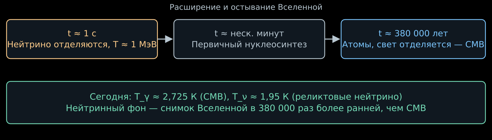
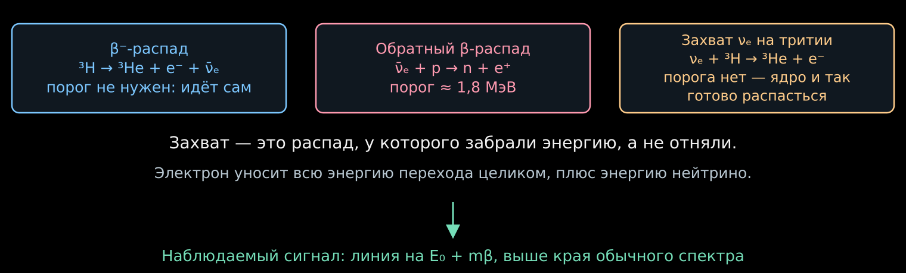
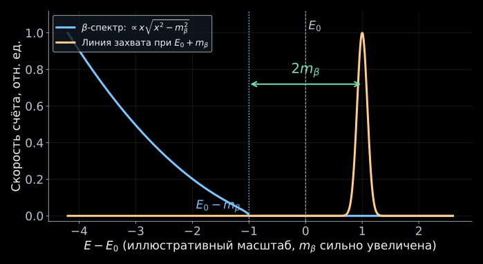
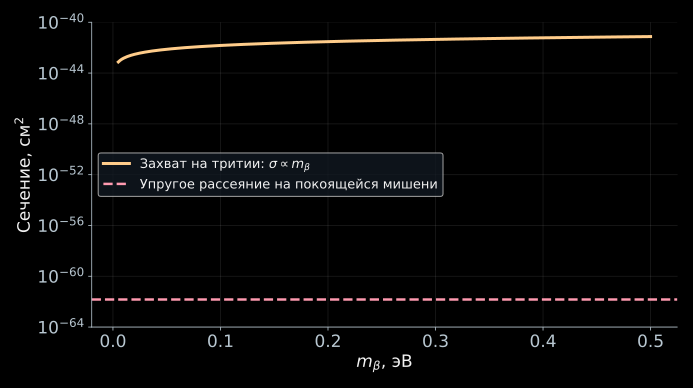
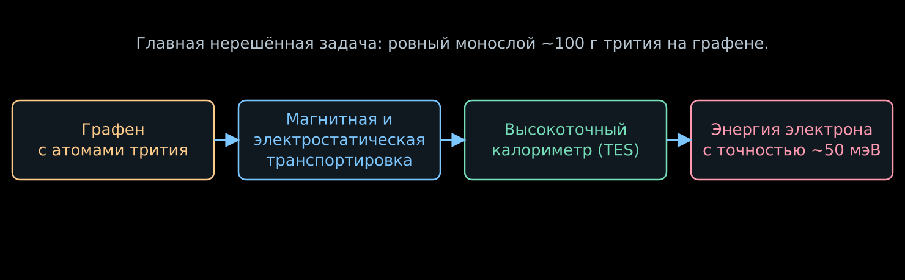
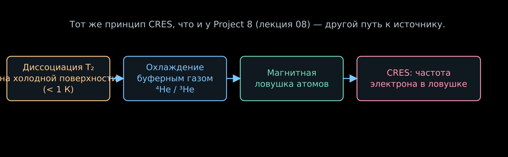

## Снимок Вселенной на секунде её жизни

{width="90%" fig-alt="Нейтрино отделяются через секунду после Большого взрыва, фотоны реликтового излучения — через 380000 лет"}

- Реликтовое излучение (CMB) — снимок Вселенной в возрасте $380\,000$ лет,
  когда образовались атомы и свет перестал рассеиваться.
- Реликтовые нейтрино отделились от остальной плазмы гораздо раньше —
  когда Вселенной была всего секунда.
- В принципе, это самый ранний снимок Вселенной, который вообще можно
  получить с помощью частиц.

::: {.nh-box tone="question" size="md"}
Как поймать частицы со средней энергией в десять тысяч раз меньше энергии
теплового фотона при комнатной температуре?
:::

## Когда нейтрино перестали сталкиваться с веществом {#cnb-decoupling}

::::: {.panel-tabset .story-tabs}

### Скорость взаимодействий против расширения

- Пока Вселенная горячая и плотная, нейтрино непрерывно рассеиваются на
  электронах, позитронах и друг на друге через слабое взаимодействие.
- Сечение слабого процесса растёт с энергией: $\sigma\sim G_F^2T^2$.
  При температуре $T$ число столкновений в единицу времени —

$$
\Gamma\sim n\sigma v\sim G_F^2T^5.
$$

- Скорость расширения Вселенной задаёт темп остывания:

$$
H\sim\frac{T^2}{M_{\mathrm{Pl}}}.
$$

- Пока $\Gamma\gg H$, нейтрино успевают перерассеиваться быстрее, чем
  меняются условия, и остаются в тепловом равновесии с плазмой.

### Оценка температуры отделения

- Взаимодействия перестают успевать за расширением, когда $\Gamma\sim H$:

$$
\boxed{
T_{\mathrm{отд}}\sim\left(G_F^2M_{\mathrm{Pl}}\right)^{-1/3}
}.
$$

- Подстановка $G_F\simeq1.166\cdot10^{-5}~\text{ГэВ}^{-2}$,
  $M_{\mathrm{Pl}}\simeq1.22\cdot10^{19}~\text{ГэВ}$ даёт порядок величины

$$
T_{\mathrm{отд}}\sim1~\text{МэВ}.
$$

- Это грубая оценка по порядку величины: точный расчёт с учётом числа
  релятивистских степеней свободы даёт близкий результат,
  $T_{\mathrm{отд}}\simeq2$–$3$ МэВ для разных сортов нейтрино.
- Соответствующий возраст Вселенной — около одной секунды.

::: {.nh-text tone="muted" size="sm"}
[Обзор космологии нейтрино: отделение и реликтовый фон](https://arxiv.org/abs/2212.05161).
:::

### После отделения

- Дальше нейтрино уже не сталкиваются: они свободно летят вместе с
  расширением пространства.
- Импульс каждого нейтрино растягивается расширением, $p\propto1/a$,
  где $a$ — масштабный фактор.
- Распределение по импульсам сохраняет форму теплового распределения
  Ферми — Дирака, но с температурой, которая падает как $1/a$,
  даже после того как нейтрино перестали быть в буквальном
  тепловом равновесии.

:::::

## Реликтовый фон чуть холоднее, чем кажется {#cnb-temperature}

::::: {.panel-tabset .story-tabs}

### Кто нагрел фотоны

- Вскоре после отделения нейтрино температура упала настолько, что стали
  аннигилировать электрон-позитронные пары: $e^++e^-\to2\gamma$.
- Нейтрино эту энергию уже не получают — они не взаимодействуют
  с плазмой. Всё энерговыделение аннигиляции достаётся фотонам.
- Поэтому после аннигиляции фотоны немного «теплее» нейтрино:
  сохранение энтропии в фотон-электрон-позитронной подсистеме даёт

$$
\boxed{
T_\nu=\left(\frac{4}{11}\right)^{1/3}T_\gamma
}.
$$

- Множитель $4/11$ считают из числа степеней свободы фотона (2) и
  электрона с позитроном (по $2\times\frac{7}{8}$ каждый, фермионный
  множитель $7/8$) до и после аннигиляции.

### Число сегодня

- Температуру реликтовых фотонов измеряют по спектру CMB:
  $T_\gamma=2.725$ К.
- Тогда

$$
T_\nu=1.95~\text{К}\simeq1.68\cdot10^{-4}~\text{эВ}.
$$

- Для сравнения: комнатная температура $\sim300$ К $\simeq0.026$ эВ —
  почти в $150$ раз теплее реликтовых нейтрино.

::: {.nh-text tone="muted" size="sm"}
Скрипт с проверкой всех чисел этой лекции:
`../assets/28_relic_neutrinos/generate_figures.py`.
:::

:::::

## Сколько нейтрино в чашке чая {#cnb-density}

::::: {.panel-tabset .story-tabs}

### Формула плотности

- Число фотонов реликтового излучения в кубическом сантиметре измерено:
  $n_\gamma\simeq411~\text{см}^{-3}$.
- Числовая плотность нейтрино одного сорта (частицы и античастицы вместе)
  отличается тем же температурным множителем и статистическим множителем
  Ферми — Дирака $3/4$ относительно бозонных фотонов:

$$
\boxed{
n_\nu=\frac34\left(\frac{4}{11}\right)n_\gamma=\frac{3}{11}\,n_\gamma
}.
$$

### Число сегодня

$$
n_\nu\simeq112~\text{см}^{-3}\quad(\text{один сорт}),
\qquad
n_{\nu,\,\text{всего}}\simeq336~\text{см}^{-3}\quad(\text{три сорта}).
$$

::: {.nh-box tone="accent" size="md"}
В чашке чая ($\sim200$ см³) — около $70\,000$ реликтовых нейтрино.
Для сравнения, атомов там на много порядков больше, но и то, и другое —
конечное число в конечном объёме, просто разного масштаба.
:::

- Реликтовых нейтрино почти в миллиард раз больше, чем барионов
  (протонов и нейтронов) во Вселенной. Их почти никто не видел.

:::::

## При такой температуре нейтрино почти не движутся {#cnb-nonrelativistic}

::::: {.panel-tabset .story-tabs}

### Средний импульс

- Для теплового фермионного газа среднее значение импульса

$$
\langle p\rangle=\frac{7\pi^4}{180\,\zeta(3)}\,T_\nu\simeq3.15\,T_\nu
\simeq5.3\cdot10^{-4}~\text{эВ}.
$$

- Это в тысячи раз меньше границы на сумму масс нейтрино из космологии,
  $\sum_im_i\lesssim0.1$–$0.12$ эВ, о которой пойдёт речь в лекции 31.

### Не релятивистские

- Все нейтрино, которые мы видели в этом курсе — от Солнца, реакторов,
  ускорителей, распадов трития — рождаются с энергией во много
  порядков выше их массы: $E_\nu\gg m_i$.
- У реликтовых нейтрино всё наоборот. Если хотя бы одно массовое
  состояние имеет $m_i\gtrsim10^{-3}$ эВ — а осцилляции это
  гарантируют, — то

$$
m_i\gg\langle p\rangle,
$$

  и реликтовое нейтрино сегодня нерелятивистское.

::: {.nh-box tone="warning" size="sm"}
Реликтовый фон — единственное известное место, где нейтрино движутся
медленно. Это одновременно и открывает счёт по массе, и создаёт всю
экспериментальную трудность.
:::

:::::

## Почему нельзя просто рассеять реликтовый нейтрино {#cnb-scattering-hopeless}

::::: {.panel-tabset .story-tabs}

### Оценка сечения

- Упругое рассеяние нейтрино на покоящейся мишени идёт через то же
  слабое взаимодействие, что и в лекции 20. По порядку величины

$$
\sigma_{\mathrm{упр}}\sim G_F^2E_\nu^2.
$$

- При $E_\nu\sim\langle p\rangle\simeq5\cdot10^{-4}$ эВ подстановка даёт

$$
\boxed{
\sigma_{\mathrm{упр}}\sim10^{-62}~\text{см}^2
}.
$$

- Реакторные антинейтрино с энергией в несколько МэВ уже почти
  недетектируемы без тонны мишени; здесь энергия меньше в $10^{10}$ раз,
  а сечение падает как квадрат энергии — то есть ещё в $10^{20}$ раз.

### Почему это тупик

- Для сравнения: сечение взаимодействия нейтрино с веществом Земли по
  всему её диаметру — доля порядка $10^{-12}$.
  Здесь же длина свободного пробега на много порядков превышает
  размер наблюдаемой Вселенной.
- Простое упругое рассеяние реликтового нейтрино на любой лабораторной
  мишени экспериментально безнадёжно при любой мыслимой массе прибора.

::: {.nh-box tone="danger" size="sm"}
Нужен другой механизм — не рассеяние, а реакция, где крошечная энергия
нейтрино не единственный источник сигнала.
:::

:::::

## Ядро, которое и так готово распасться, поглотит нейтрино даром {#cnb-capture}

::::: {.panel-tabset .story-tabs}

### Три родственные реакции

{width="95%" fig-alt="Бета-распад трития не имеет порога, обратный бета-распад требует 1.8 МэВ, а захват нейтрино на тритии тоже не имеет порога"}

- Тритий самопроизвольно распадается: $^3\mathrm H\to{}^3\mathrm{He}+e^-+\bar\nu_e$.
  Знакомая нам реакция из лекций 04–07.
- Обратный бета-распад $\bar\nu_e+p\to n+e^+$, на котором работают
  реакторные и многие другие детекторы, требует энергии не меньше
  разницы масс нейтрона, протона и позитрона — порядка $1.8$ МэВ.
- А что если реликтовый нейтрино $\nu_e$ (не антинейтрино!) поглотится
  тем же тритием, который и так неустойчив?

$$
\boxed{
\nu_e+{}^3\mathrm H\to{}^3\mathrm{He}+e^-
}.
$$

### Почему у захвата нет порога

- Ядро трития уже энергетически невыгодно: масса $^3\mathrm H$ больше
  суммы масс $^3\mathrm{He}$ и электрона на величину $E_0$ — ту же,
  что задаёт край обычного бета-спектра.
- В обычном распаде эта энергия делится между электроном и антинейтрино.
  В захвате её всю получает электрон — плюс энергию самого налетевшего
  нейтрино.
- Поглотить частицу с произвольно малой энергией можно всегда: реакция
  идёт даже при $E_\nu\to0$. Порог отсутствует в принципе, а не
  только практически.

::: {.nh-box tone="success" size="md"}
Захват — это тот же самый распад, у которого забрали немного энергии,
а не отняли лишнюю. Именно поэтому у него нет порога.
:::

:::::

## Где на спектре электрона искать сигнал {#cnb-spectrum-line}

::::: {.panel-tabset .story-tabs}

### Кинематика захвата

- Используем обозначения лекций 04 и 07: $E_0$ — край бета-спектра при
  нулевой массе нейтрино, $m_\beta$ — эффективная масса,
  $E_\nu\simeq m_\beta$ для нерелятивистского реликтового нейтрино.
- Закон сохранения энергии для захвата (без учёта тепловых поправок
  и отдачи ядра) даёт кинетическую энергию электрона

$$
T_e^{\,\mathrm{захват}}=E_0+E_\nu\simeq E_0+m_\beta.
$$

- Из лекции 07 обычный бета-спектр заканчивается при

$$
T_e^{\,\max}(\beta)=E_0-m_\beta.
$$

### Разрыв $2m_\beta$

$$
\boxed{
T_e^{\,\mathrm{захват}}-T_e^{\,\max}(\beta)=2m_\beta
}.
$$

{width="95%" fig-alt="Непрерывный бета-спектр обрывается на E0 минус m, линия захвата стоит на E0 плюс m, между ними разрыв 2m"}

- Сигнал — узкая линия чуть выше края обычного спектра, на фиксированном
  расстоянии $2m_\beta$ от него.
- На рисунке масса сильно увеличена для наглядности. В реальности разрыв
  $2m_\beta$ на много порядков меньше энергии электрона $E_0$ и меньше
  любого достигнутого на сегодня энергетического разрешения спектрометра.

::: {.nh-text tone="muted" size="sm"}
Та же форма $x\sqrt{x^2-m_\beta^2}$ около края спектра, что и в лекциях 07–08.
:::

:::::

## Сколько событий может дать 100 граммов трития {#cnb-rate}

::::: {.panel-tabset .story-tabs}

### Сечение захвата

- В отличие от упругого рассеяния, сечение захвата на нестабильном ядре
  не подавлено малой энергией нейтрино — оно растёт при уменьшении
  скорости налетающей частицы, как и в обычном захвате медленных
  нейтрон. По порядку величины

$$
\sigma_{\mathrm{захв}}\simeq1.5\cdot10^{-41}
\left(\frac{m_\beta}{1~\text{эВ}}\right)~\text{см}^2.
$$

- При $m_\beta=0.05$ эВ это $\sigma_{\mathrm{захв}}\simeq7.5\cdot10^{-43}$ см² —
  на двадцать порядков больше, чем оценка упругого рассеяния со слайда
  «Почему нельзя просто рассеять реликтовый нейтрино».

{width="90%" fig-alt="Сечение захвата растёт с массой нейтрино и остаётся на двадцать порядков выше сечения упругого рассеяния"}

### Ожидаемая скорость счёта

- В $100$ г трития содержится

$$
N\simeq\frac{100~\text{г}}{3~\text{г/моль}}\,N_A\simeq2\cdot10^{25}
$$

  ядер. Подробный расчёт с учётом локальной плотности и скорости
  реликтовых нейтрино даёт

$$
\boxed{
\Gamma^{\,D}\simeq4~\text{соб./год},
\qquad
\Gamma^{\,M}\simeq8~\text{соб./год}
}
$$

  для $100$ г трития — для дираковских и майорановских нейтрино
  соответственно. Разница возникает из-за интерференции путей захвата,
  доступной только майорановским нейтрино.

::: {.nh-text tone="muted" size="sm"}
[Long, Lunardini, Sabancilar: скорость захвата на тритии](https://arxiv.org/abs/1405.7654),
*JCAP* **08**, 038 (2014).
:::

### Что скрывается за этим числом

- Несколько событий в год нужно выделить на фоне обычного бета-распада
  того же трития — а его активность в $100$ г образца порядка
  $10^{14}$ распадов в секунду.
- Различить сигнал и фон помогает только форма спектра: линия захвата
  и хвост обычного спектра разделены на $2m_\beta$.
- Поэтому вопрос не «можно ли поймать хотя бы одно событие», а «можно ли
  измерить энергию электрона достаточно точно, чтобы отличить его от
  соседей».

:::::

## Почему нужно разрешение лучше десятков миллиэлектронвольт {#cnb-resolution}

::::: {.panel-tabset .story-tabs}

### Масштаб задачи

- KATRIN (лекция 07) достигает разрешения порядка $1$ эВ и измеряет
  $m_\beta$ с точностью порядка $0.1$–$0.3$ эВ².
- Разрыв $2m_\beta$, который нужно увидеть здесь, при $m_\beta\sim0.05$ эВ
  составляет всего $0.1$ эВ — меньше ширины фильтра KATRIN.
- Дело не только в том, чтобы разрешить сам разрыв: нужно ещё подавить
  хвост обычного бета-спектра под линией захвата на много порядков.

### Заявленная цель

- Проект PTOLEMY ставит целью энергетическое разрешение
  порядка $0.05$ эВ — на порядок лучше, чем нужно для одного лишь
  разрешения $2m_\beta$ при массах, которые ещё не исключены
  космологией.
- Это требование определяет выбор технологии: не электростатический
  фильтр, как в KATRIN, а прямое калориметрическое измерение энергии
  каждого электрона — тот же принцип, что и в лекции 08, но на
  порядок точнее.

::: {.nh-box tone="warning" size="md"}
Энергетическое разрешение, а не только скорость счёта, здесь — главный
ограничивающий параметр.
:::

:::::

## PTOLEMY: тритий на атомарно тонкой подложке {#ptolemy-concept}

::::: {.panel-tabset .story-tabs}

### Зачем графен

{width="95%" fig-alt="Графен с тритием, магнитная транспортировка, калориметр TES и итоговая энергия электрона с точностью 50 мэВ"}

- Источник должен быть атомарно тонким по той же причине, что и
  безоконный источник KATRIN в лекции 07: электрон не должен терять
  энергию на пути к спектрометру, иначе линия захвата размажется на
  величину, большую самого $2m_\beta$.
- Графен — монослой атомов углерода — предложен как подложка,
  на которой удерживается тонкий слой атомарного (не молекулярного)
  трития: атомарный источник дополнительно убирает молекулярное
  уширение спектра, знакомое по лекции 08.
- Электроны транспортируются к калориметру на основе датчиков перехода
  в сверхпроводящее состояние (TES, знакомых по лекции 08 и HOLMES).

### Масштаб цели

- Чтобы получить чувствительность порядка нескольких событий в год,
  нужно порядка $100$ г трития, равномерно распределённого по
  площади графена в один атомный слой.
- Площадь монослоя с такой массой трития — это десятки квадратных
  метров детекторной поверхности с контролируемой плотностью покрытия
  на атомном уровне.
- Именно этот шаг — от лабораторных образцов площадью в доли
  квадратного сантиметра до детектора нужного масштаба — остаётся
  главной нерешённой технологической задачей проекта.

::: {.nh-text tone="muted" size="sm"}
[PTOLEMY: предложение проекта](https://arxiv.org/abs/1808.01892).
:::

:::::

## PTOLEMY: где проект находится сейчас {#ptolemy-status}

::::: {.panel-tabset .story-tabs}

### Тринадцать лет разработки

- Проект предложен в 2013 году. Прототипы и часть аппаратуры
  разрабатываются в подземной лаборатории Гран-Сассо (LNGS, Италия).
- Гран-Сассо — не тритиевая площадка: там нет инфраструктуры для
  работы с граммовыми количествами радиоактивного трития. Первоначально
  обсуждалась площадка в США, сертифицированная для работы с тритием.
- Поэтому центральная технология проекта — монослой атомарного трития
  на графене нужной площади — не была продемонстрирована в полном
  масштабе.

### Что реально сделано

- За 2025–2026 годы вышел ряд публикаций с конкретными техническими
  результатами:
  разрешение TES-калориметра около $0.48$ эВ (пока не $0.05$ эВ
  из цели, но прогресс в нужную сторону);
  прецизионная система высокого напряжения;
  исследование долговременной стабильности гидрированного графена
  в вакууме и на воздухе;
  расчёт бета-спектра трития на графене методами теории функционала
  плотности.
- То есть отдельные технические элементы установки продолжают
  развиваться. Не решена именно самая трудная часть — масштабируемый
  тритиевый источник.

::: {.nh-box tone="accent" size="md"}
Справедливая оценка — не «проект мёртв» и не «прогресс идёт по плану»,
а «периферийные технологии движутся, центральная — застряла на том же
месте, что и годы назад».
:::

::: {.nh-text tone="muted" size="sm"}
[Публикации проекта PTOLEMY](https://ptolemy.lngs.infn.it/publications/) ·
[Демонстрация адсорбции трития на графене](https://pmc.ncbi.nlm.nih.gov/articles/PMC11134268/).
:::

:::::

## QTNM: другой путь к атомарному тритию {#qtnm}

::::: {.panel-tabset .story-tabs}

### От CRES к реликтовым нейтрино

{width="95%" fig-alt="Диссоциация трития на холодной поверхности, охлаждение буферным газом, магнитная ловушка и считывание CRES"}

- QTNM (Quantum Technologies for Neutrino Mass) — британский проект,
  Университетский колледж Лондона при участии других групп, часть
  государственной программы квантовых технологий для фундаментальной
  физики.
- Ближайшая цель — измерение $m_\beta$ методом CRES (лекция 08),
  на уровне чувствительности KATRIN и выше. Захват на тритии здесь
  не рабочий метод: CRES измеряет энергию отдельного электрона от
  обычного бета-распада, а не ищет линию захвата.
- Более отдалённая, явно заявленная цель — если источник атомарного
  трития удастся масштабировать, тот же принцип в перспективе можно
  применить и для более амбициозных задач, включая поиск реликтовых
  нейтрино.

### Свой источник атомарного трития

- Вместо графена QTNM предлагает криогенный источник: диссоциация
  молекул $\mathrm T_2$ на холодной поверхности при температуре
  ниже $1$ К, охлаждение атомов буферным газом ($^4$He или $^3$He)
  вместо контакта со стенками, и удержание в магнитной ловушке.
- Заявленный поток — свыше $10^{15}$ атомов в секунду при энергиях
  порядка $100$ мК, подходящих для магнитного захвата.
- Это статус концептуального предложения: опубликован расчёт схемы,
  а не работающий демонстратор.

::: {.nh-text tone="muted" size="sm"}
[Криогенный источник атомарного трития для QTNM](https://arxiv.org/abs/2511.08313) ·
[Определение массы нейтрино квантовыми технологиями](https://iopscience.iop.org/article/10.1088/1367-2630/adc624).
:::

:::::

## Что нужно, чтобы когда-нибудь увидеть реликтовый фон {#cnb-outlook}

- **Макроскопическая мишень:** порядка $100$ г радиоактивного изотопа,
  а не лабораторный образец.
- **Атомарный, а не молекулярный источник:** чтобы не размывать
  спектр молекулярными возбуждениями, знакомыми по лекции 08.
- **Энергетическое разрешение** в десятки миллиэлектронвольт —
  на порядок лучше, чем у лучших современных спектрометров массы
  нейтрино.
- **Подавление фона** обычного бета-распада того же источника на много
  порядков — с активностью $10^{14}$ распадов в секунду в том же
  образце.
- Ни одно из этих требований по отдельности не является новым: каждое
  уже решалось в KATRIN, Project 8, ECHo или HOLMES. Вместе их пока
  никто не решил.

::: {.nh-box tone="success" size="md"}
Обнаружение реликтового нейтринного фона остаётся, вероятно, самой
трудной нерешённой задачей прямых измерений в физике нейтрино —
и одной из немногих, что дала бы снимок Вселенной раньше, чем через
секунду после Большого взрыва.
:::

## Литература и материалы

::::: {.panel-tabset .story-tabs}

### Космология реликтовых нейтрино

- [Обзор космологии нейтрино](https://arxiv.org/abs/2212.05161).
- [Cosmic neutrino background — обзорная статья](https://en.wikipedia.org/wiki/Cosmic_neutrino_background).

### PTOLEMY

- [PTOLEMY: развитие эксперимента по детектированию реликтовых нейтрино](https://arxiv.org/abs/1307.4738), 2013.
- [PTOLEMY: предложение проекта](https://arxiv.org/abs/1808.01892), 2018.
- [Long, Lunardini, Sabancilar: скорость захвата на тритии](https://arxiv.org/abs/1405.7654),
  *JCAP* **08**, 038 (2014).
- [Демонстрация адсорбции трития на графене](https://pmc.ncbi.nlm.nih.gov/articles/PMC11134268/).
- [Публикации и статус проекта PTOLEMY, LNGS](https://ptolemy.lngs.infn.it/publications/).

### QTNM

- [QTNM, UCL: страница проекта](https://www.ucl.ac.uk/mathematical-physical-sciences/physics-astronomy/research/research-groups/high-energy-physics/research-high-energy-physics-group/qtnm).
- [Определение абсолютной массы нейтрино квантовыми технологиями](https://iopscience.iop.org/article/10.1088/1367-2630/adc624).
- [Криогенный источник атомарного трития](https://arxiv.org/abs/2511.08313), 2025.

### Скрипт с проверкой чисел

- [`generate_figures.py`](../assets/28_relic_neutrinos/generate_figures.py) — все числа этой
  лекции пересчитаны и проверены в одном месте.

:::::
