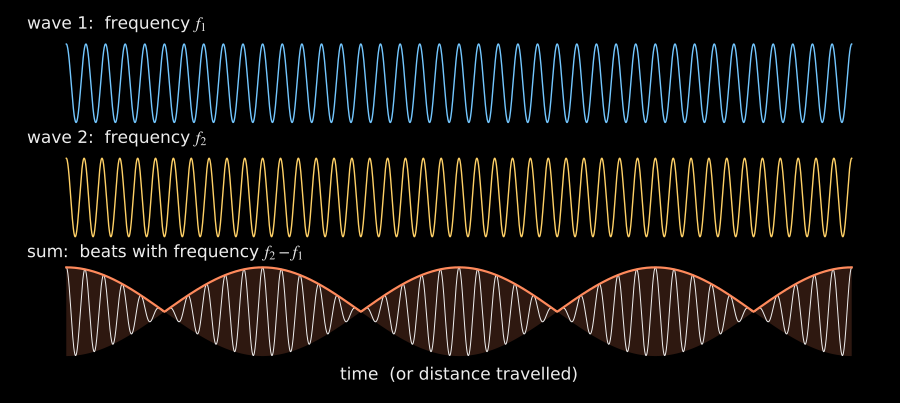
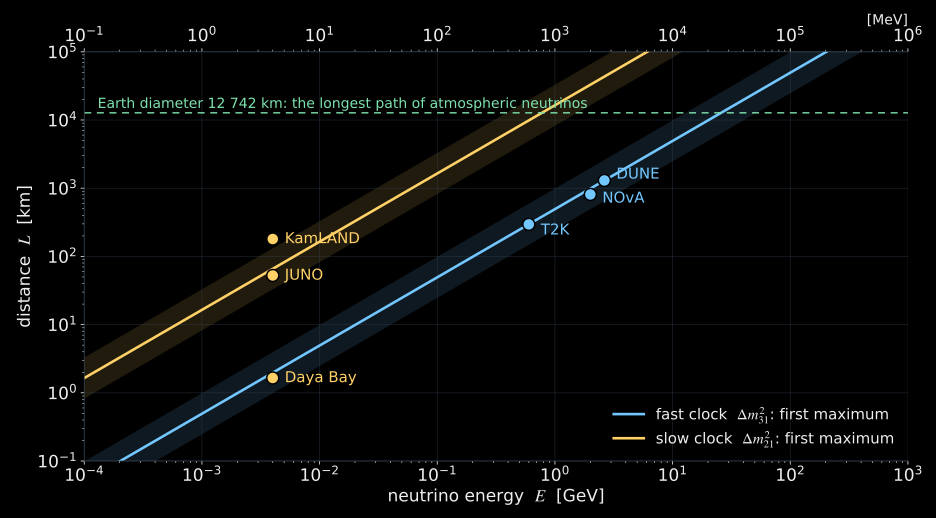
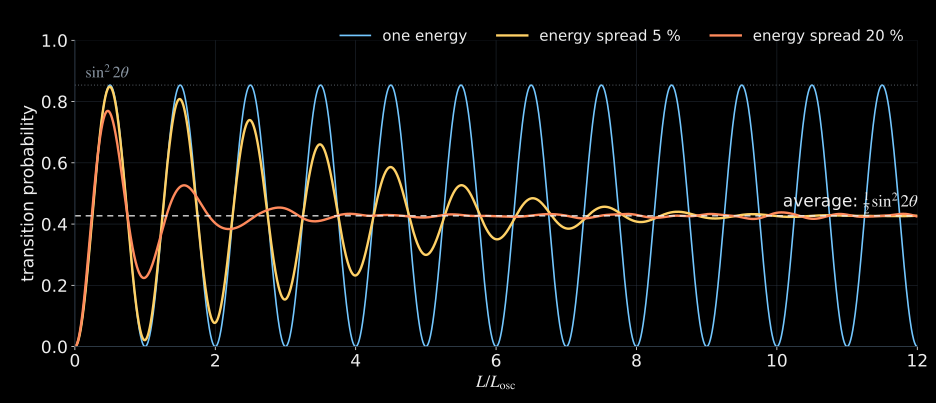
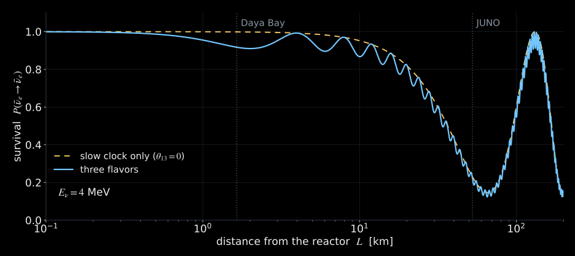

## Three lectures, one question {#plan}

::: {.columns}

::: {.column width="33%"}

::: {.card}
[I · Vacuum]{.card-title}

- Ghost particles and missing neutrinos
- One neutrino, two waves
- The formula and its two knobs
- Numbers: lengths, energies, masses
- Three flavors, two clocks

:::

:::

::: {.column width="33%"}

::: {.card}
[II · Matter and the Sun]{.card-title}

- Refraction of neutrinos
- Resonance: small mixing made large
- Slowly changing density
- The Sun as a flavor converter
- Matter and the mass ordering

:::

:::

::: {.column width="34%"}

::: {.card}
[III · The Earth]{.card-title}

- What geophysics knows
- Absorption: the Earth's mass
- Oscillations: the core's electrons
- Geoneutrinos: the Earth's heat

:::

:::

:::

::: {.takeaway}
Can a particle that crosses the whole Earth almost unnoticed be used to look inside it?

:::

# Ghost particles

## How invisible is a neutrino? {#invisible}

::: {.columns}
::: {.column width="50%"}
**From the Sun**

::: {.big-number}
$6.5\times10^{10}$

:::
::: {.big-number-caption}
neutrinos through each cm² every second, day and night

:::
:::
::: {.column width="50%"}
**In water**

::: {.big-number}
$\approx 60$ light-years

:::
::: {.big-number-caption}
mean free path of a 3 MeV reactor antineutrino

:::
:::
:::

$$
\lambda=\frac{1}{n_p\,\sigma},\qquad
\sigma(\bar\nu_e p\to e^+n)\big|_{3\,\rm MeV}\simeq2.6\times10^{-43}\ \mathrm{cm^2},\qquad
n_p=6.7\times10^{22}\ \mathrm{cm^{-3}}.
$$

::: {.takeaway}
The weak interaction makes neutrinos hard to catch, and for the same reason they carry undisturbed information from deep inside the Sun and the Earth.

:::

::: {.media-caption}
Flux: standard solar model B16-GS98, sum of the tabulated components ([Vinyoles et al. 2017](https://arxiv.org/abs/1611.09867)). Cross section: [Vogel & Beacom 1999](https://arxiv.org/abs/hep-ph/9903554), zeroth order; free protons of water.

:::

## A neutrino is named after its partner {#flavors}

::: {.columns}
::: {.column width="55%"}
The weak interaction always creates or absorbs a neutrino **together with a charged lepton**:

$$
\begin{aligned}
\pi^+&\to\mu^+ +\nu_\mu, & n&\to p+e^-+\bar\nu_e,\\
\nu_e+n&\to p+e^-, & \nu_\mu+n&\to p+\mu^- .
\end{aligned}
$$

- Three charged leptons $e,\mu,\tau$ give three **flavors** $\nu_e,\nu_\mu,\nu_\tau$.
- The flavor is the label written at birth: it says which charged lepton the neutrino will produce in a detector.

:::
::: {.column width="45%"}
::: {.card}
[Naive expectation]{.card-title}

A $\nu_\mu$ born with a muon must produce a muon in the detector,
no matter how far away the detector is.

[Observation]{.card-title}

Far away, part of the $\nu_\mu$ produce electrons or taus, or nothing visible.

:::
:::
:::

## How a detector reads the flavor {#detection}

::: {.columns}

::: {.column width="58%"}

<video class="slide-video" style="--media-max-height: 470px;" width="1920" height="1080" muted controls preload="metadata" playsinline poster="media/video/cherenkov_radiation_poster.jpg" src="media/video/cherenkov_radiation_en.mp4"></video>

:::

::: {.column width="42%"}

- A neutrino is seen only through the charged lepton it makes: $e$, $\mu$ or $\tau$.
- In water a charged particle faster than light in water emits **Cherenkov light** on a cone.
- Super-Kamiokande, 50 000 t of water: a **muon** gives a sharp ring; an **electron** showers and gives a smeared ring.
- Reactor $\bar\nu_e$ in liquid scintillator: $\bar\nu_e+p\to e^++n$ — a prompt flash, then ~200 μs later a 2.2 MeV γ from neutron capture.

:::

:::

::: {.media-caption}
[Super-Kamiokande, PRD 71, 112005 (2005)](https://arxiv.org/abs/hep-ex/0501064) · [KamLAND, GRL 49, e2022GL099566 (2022)](https://arxiv.org/abs/2205.14934)

:::

## Two puzzles, one answer {#puzzles}

::: {.columns}
::: {.column width="50%"}
::: {.card}
[The Sun: too few $\nu_e$]{.card-title}

- Homestake (chlorine, $\nu_e$ only): $2.56\pm0.16\pm0.16$ SNU against $7.6^{+1.3}_{-1.1}$ SNU predicted — about one third.
- SNO (2002) counted $\nu_e$ and **all flavors** separately: $\Phi_{\nu_e}=1.76$, $\Phi_{\rm all}=5.09$ (×10⁶ cm⁻² s⁻¹). About one third arrive as $\nu_e$; the total agrees with the solar model.

:::
:::
::: {.column width="50%"}
::: {.card}
[The atmosphere: too few from below]{.card-title}

- Cosmic rays make $\nu_\mu$ everywhere around the Earth.
- Super-Kamiokande (1998): $\nu_\mu$ coming **up through the Earth** (up to 12 700 km) are depleted; those from above, crossing only the atmosphere, are not.
- Up–down asymmetry of multi-GeV $\mu$-like events: $-0.296\pm0.048\pm0.01$; for $e$-like events: $-0.036\pm0.067\pm0.02$, consistent with zero.

:::
:::
:::

::: {.takeaway}
Neutrinos are not lost: they change flavor on the way, and the change depends on the distance travelled. Nobel Prize 2015: T. Kajita and A. B. McDonald.

:::

::: {.media-caption}
[Cleveland et al., ApJ 496, 505 (1998)](https://doi.org/10.1086/305343) · prediction: [Bahcall, Pinsonneault & Basu, ApJ 555, 990 (2001)](https://arxiv.org/abs/astro-ph/0010346) · [SNO, PRL 89, 011301 (2002)](https://arxiv.org/abs/nucl-ex/0204008) · [Super-Kamiokande, PRL 81, 1562 (1998)](https://arxiv.org/abs/hep-ex/9807003)

:::

## A quantum chameleon {#chameleon}



# One neutrino, two waves

## Two ways to describe the same neutrino {#two-bases}

::: {.columns}
::: {.column width="48%"}
**Flavor states** $\nu_e,\nu_\mu$

Created and detected by the weak interaction.

**Mass states** $\nu_1,\nu_2$

Waves with definite masses $m_1,m_2$: they travel without changing.

:::
::: {.column width="52%"}
One state space, two sets of axes, turned by the **mixing angle** $\theta$:

$$
\boxed{
\begin{aligned}
|\nu_e\rangle&=\cos\theta\,|\nu_1\rangle+\sin\theta\,|\nu_2\rangle\\
|\nu_\mu\rangle&=-\sin\theta\,|\nu_1\rangle+\cos\theta\,|\nu_2\rangle
\end{aligned}}
$$

- $\theta=0$: each flavor *is* a mass state; nothing happens.
- $\theta\neq0$: a $\nu_e$ is a superposition of two waves.

:::
:::

::: {.takeaway}
Like polarized light behind a rotated polarizer: what is created along one axis is detected along another.

:::

## Two phases, one probability {#phases-film}

<video class="slide-video" style="--media-max-height: 620px;" width="1920" height="1080" data-autoplay muted loop controls preload="metadata" playsinline src="media/video/neutrino_oscillation_phases.mp4"></video>

::: {.media-caption}
Two mass components acquire different phases. Their sum at detection sets the probabilities of the flavor outcomes.

:::

## An everyday analogy: beats {#beats}

{.slide-media .nostretch style="--media-max-height: 470px;" fig-alt="Two waves with slightly different frequencies and their sum; the sum swells and fades with the difference frequency."}

- Two tuning forks with slightly different pitch: you hear a slow swelling and fading — the **beat**.
- The beat period is set by the **difference** of the frequencies, not by the frequencies themselves.
- A neutrino carries two mass waves; the detector "hears" their beat as a varying flavor content.

## Where does the frequency difference come from? {#phase}

At fixed energy $E$ the two mass waves have slightly different momenta:

$$
p_i=\sqrt{E^2-m_i^2}\simeq E-\frac{m_i^2}{2E}
\qquad(\hbar=c=1,\ m_i\ll E).
$$

After a distance $L$ the two waves acquire different phases $p_iL$. Their difference:

$$
\boxed{\Delta\varphi=(p_1-p_2)\,L=\frac{\Delta m^2\,L}{2E}},
\qquad \Delta m^2=m_2^2-m_1^2 .
$$

::: {.columns}
::: {.column width="50%"}
- Grows with distance $L$.
- Shrinks with energy $E$: fast neutrinos age slowly.

:::
::: {.column width="50%"}
- Needs **different masses**: $\Delta m^2\neq0$.
- Only $\Delta m^2$ enters, never the masses themselves.

:::
:::

## The oscillation formula {#formula}

Project the evolved state onto $\nu_\mu$ and square:

$$
\boxed{
P(\nu_e\to\nu_\mu)=\sin^2 2\theta\;\sin^2\!\left(\frac{\Delta m^2L}{4E}\right)
=\sin^2 2\theta\;\sin^2\!\left(1.267\,\frac{\Delta m^2[\mathrm{eV^2}]\;L[\mathrm{km}]}{E[\mathrm{GeV}]}\right)}
$$

::: {.columns}
::: {.column width="50%"}
::: {.card}
[Knob 1: the angle $\theta$]{.card-title}

Sets the **height** of the oscillation: $P_{\max}=\sin^22\theta$.

:::
:::
::: {.column width="50%"}
::: {.card}
[Knob 2: $\Delta m^2\cdot L/E$]{.card-title}

Sets **where** the maxima are. The oscillation length:

$$
L_{\rm osc}=\frac{4\pi E}{\Delta m^2}=2.48\ \mathrm{km}\;\frac{E[\mathrm{GeV}]}{\Delta m^2[\mathrm{eV^2}]}
$$

:::
:::
:::

::: {.media-caption}
$1.267=10^{3}/(4\cdot10^{9}\,\hbar c)$ with $\hbar c=197.327\ \mathrm{MeV\,fm}$ (CODATA 2022). Survival: $P(\nu_e\to\nu_e)=1-P(\nu_e\to\nu_\mu)$.

:::

## Build an oscillation yourself {#two-flavor-lab}



::: {.small .muted}
Set $\theta=0$: what happens? Set $\theta=45^\circ$: where is the first maximum? Where does the transition probability return to zero?

:::

## The same physics with two pendulums {#pendula}



::: {.small .muted}
Push one pendulum: the swing moves slowly to the other one and back. Each normal mode keeps its own frequency; the energy transfer is their beat.

:::

# Numbers

## How small is the effect? {#how-small}

::: {.columns}
::: {.column width="52%"}
Take $\Delta m^2=2.5\times10^{-3}\ \mathrm{eV^2}$ and $E=1$ GeV:

$$
\frac{\Delta m^2}{2E}=1.3\times10^{-12}\ \mathrm{eV},
\qquad
\frac{\Delta m^2/2E}{E}=1.3\times10^{-21}.
$$

Yet after $L_{\rm osc}\approx 1000$ km this tiny difference has turned into a full $2\pi$ of phase.

:::
::: {.column width="48%"}
::: {.card}
[An interferometer]{.card-title}

A relative precision of $10^{-21}$ is like measuring the Sun–Earth distance to

::: {.big-number}
0.2 nm

:::

the size of an atom.

:::
:::
:::

::: {.takeaway}
Oscillations are interference: they reach masses far too small for any balance — at least one neutrino is heavier than $\sqrt{2.5\times10^{-3}}\ \mathrm{eV}=0.05$ eV, ten million times lighter than the electron.

:::

## Oscillation lengths {#lengths}

$L_{\rm osc}=2.48\ \mathrm{km}\cdot E[\mathrm{GeV}]/\Delta m^2[\mathrm{eV^2}]$ with the two measured splittings $\Delta m^2_{31}=2.5\times10^{-3}$ and $\Delta m^2_{21}=7.5\times10^{-5}\ \mathrm{eV^2}$:

::: {.school-table}

| Source | Example energy | $L_{\rm osc}$, fast clock $\Delta m^2_{31}$ | $L_{\rm osc}$, slow clock $\Delta m^2_{21}$ | Typical $L$ |
|:---|---:|---:|---:|---:|
| Sun | 1 MeV | 1 km | 33 km | $1.5\times10^{8}$ km |
| Reactor | 4 MeV | 4 km | 130 km | 1.65–180 km |
| Accelerator | 0.6–2 GeV | 600–2000 km | $2\text{–}7\times10^{4}$ km | 295–1300 km |
| Atmosphere | 10 GeV | $10^4$ km | $3\times10^{5}$ km | up to 12 700 km |

:::

::: {.takeaway}
The first maximum sits at $L=L_{\rm osc}/2$. Choosing $L/E$ chooses which clock you watch.

:::

## Where experiments sit {#le-map}

{.slide-media .nostretch style="--media-max-height: 640px;" fig-alt="Distance against energy on logarithmic axes. Two diagonal bands show the first oscillation maximum for the fast and the slow mass splitting; reactor, accelerator and atmospheric experiments are placed on the map."}

::: {.media-caption}
Lines: $1.267\,\Delta m^2L/E=\pi/2$; bands: factor 2 around it. Baselines: Daya Bay far hall 1.65 km, JUNO 52.5 km, KamLAND ≈180 km, T2K 295 km (0.6 GeV), NOvA 810 km (2 GeV), DUNE 1300 km (drawn at its first maximum, 2.6 GeV). Reactors drawn at 4 MeV.

:::

## When the clock is too fast to read {#averaging}

{.slide-media .nostretch style="--media-max-height: 520px;" fig-alt="Transition probability against L over L_osc for a single energy and for beams with 5 and 20 percent energy spread; the spread washes out the oscillations to half of sin squared two theta."}

- Real sources have a spread of energies and a finite size; detectors have finite resolution.
- Far beyond $L_{\rm osc}$ the phases of different neutrinos scatter: the oscillation **averages out** to $\tfrac12\sin^22\theta$.
- Solar neutrinos travel $10^{8}L_{\rm osc}$: in vacuum we would only see the average, $P_{ee}=1-\tfrac12\sin^22\theta_{12}\approx0.57$.

# Three flavors

## Three neutrinos, two clocks {#three}

::: {.columns}
::: {.column width="46%"}
Three mass states give two independent splittings:

$$
\frac{\Delta m^2_{31}}{\Delta m^2_{21}}\approx 33 .
$$

**Flavor content of the mass states** (fractions $|U_{\alpha i}|^2$):

::: {.school-table}

| | $\nu_1$ | $\nu_2$ | $\nu_3$ |
|:---|:---:|:---:|:---:|
| $e$ | 0.68 | 0.30 | 0.02 |
| $\mu$ | 0.11 | 0.43 | 0.46 |
| $\tau$ | 0.21 | 0.27 | 0.52 |

:::
:::
::: {.column width="54%"}
<video class="slide-video" style="--media-max-height: 470px;" width="1280" height="720" data-autoplay muted loop controls preload="metadata" playsinline poster="media/video/mass_ordering.jpg" src="media/video/NeutrinoHierarchyScales.mp4"></video>

Is $\nu_3$ the heaviest or the lightest? The **mass ordering** is not yet established; normal ordering is preferred at about 2–3σ.

:::
:::

::: {.media-caption}
Best-fit values, normal ordering: [NuFIT 6.1 (2025)](https://www.nu-fit.org/?q=node/309). Three angles $\theta_{12}\approx34^\circ$, $\theta_{23}\approx43^\circ$, $\theta_{13}\approx8.6^\circ$ and one CP phase. Ordering: NuFIT 6.1, $\Delta\chi^2_{\rm IO}=5.9$ with SK atmospheric data; [JUNO (2026)](https://arxiv.org/abs/2609.37895), NO favoured at ≥2.1σ.

:::

## Three flavors on one triangle {#triangle}



::: {.small .muted}
Each point of the triangle is a flavor mixture $(P_e,P_\mu,P_\tau)$. Start with $\nu_\mu$ and watch the slow and the fast clock draw the path.

:::

## Explore three-flavor probabilities {#three-flavor-probabilities}



## Two clocks in one experiment {#two-clocks}

{.slide-media .nostretch style="--media-max-height: 450px;" fig-alt="Survival probability of 4 MeV reactor antineutrinos against distance from 0.1 to 200 km on a logarithmic axis: a small fast dip near 2 km from theta13 and a deep slow dip near 60 km from theta12, with fast ripples on top."}

- **Near (1–2 km)**: a shallow dip from the fast clock; its depth $\sin^22\theta_{13}\approx0.09$ — measured by Daya Bay (2012).
- **Far (50–60 km)**: the deep dip of the slow clock with fast ripples on top. Their phase depends on the mass ordering: this is what JUNO measures.

::: {.media-caption}
Computed: three-flavor vacuum oscillations, NuFIT 6.1 best fit, $E_\nu=4$ MeV. First measurement: Daya Bay, $\sin^22\theta_{13}=0.092\pm0.016\pm0.005$ ([PRL 108, 171803 (2012)](https://arxiv.org/abs/1203.1669)).

:::

## What oscillations tell us — and what they do not {#what-we-know}

::: {.columns}
::: {.column width="50%"}
::: {.card}
[Established]{.card-title}

- Neutrinos have mass: physics beyond the minimal Standard Model.
- Three flavors mix through three angles.
- Two mass splittings, $7.5\times10^{-5}$ and $2.5\times10^{-3}\ \mathrm{eV^2}$.
- Solar, atmospheric, reactor and accelerator data fit one picture.

:::
:::
::: {.column width="50%"}
::: {.card}
[Open]{.card-title}

- The **ordering**: is $\nu_3$ heaviest or lightest?
- **CP violation**: do neutrinos and antineutrinos oscillate differently?
- The **absolute** mass scale: oscillations see only differences.
- Is $\theta_{23}$ exactly $45^\circ$?

:::
:::
:::

## Summary of Lecture I {#summary-1}

$$
\boxed{P_{\alpha\to\beta}=\sin^22\theta\,\sin^2\!\left(1.267\,\frac{\Delta m^2L}{E}\right)}
$$

1. Flavor is created and detected; mass states propagate. The mismatch, set by $\theta$, makes interference possible.
2. Different masses give different phases: a clock that ticks with $\Delta m^2L/E$.
3. The effect is a relative difference of $10^{-21}$, made visible over hundreds of kilometres.
4. Three flavors, two clocks: $\Delta m^2_{31}$ (fast) and $\Delta m^2_{21}$ (slow).

::: {.takeaway}
So far the neutrino flew through empty space. Next: what matter does to the clock — in the Sun, and on long paths through the Earth.

:::
