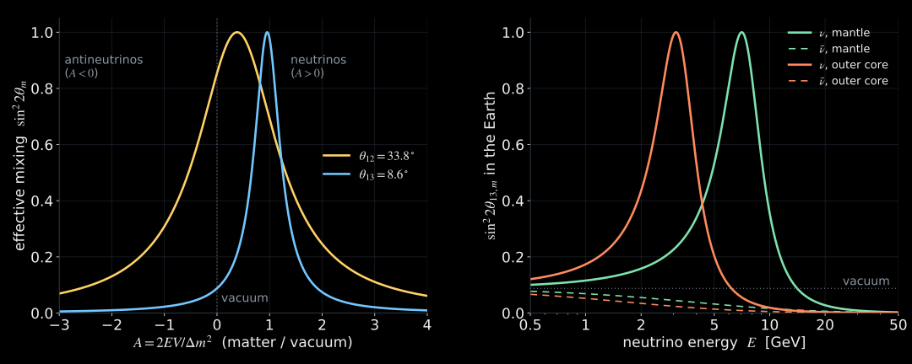
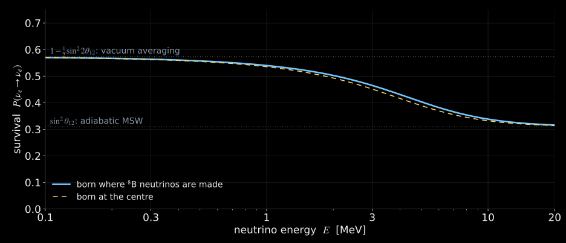

## Where we stopped {#recap}

::: {.columns}
::: {.column width="55%"}
$$
\boxed{P_{\alpha\to\beta}=\sin^22\theta\,\sin^2\!\left(1.267\,\frac{\Delta m^2[\mathrm{eV^2}]\,L[\mathrm{km}]}{E[\mathrm{GeV}]}\right)}
$$

- Flavor states are superpositions of mass waves.
- The waves accumulate different phases: $\Delta\varphi=\Delta m^2L/2E$.
- Two clocks: $\Delta m^2_{31}=2.5\times10^{-3}$, $\Delta m^2_{21}=7.5\times10^{-5}\ \mathrm{eV^2}$.

:::
::: {.column width="45%"}
::: {.card}
[Today]{.card-title}

1. Matter acts on neutrinos like glass on light.
2. A resonance makes small mixing large.
3. Slowly changing density: the Sun converts $\nu_e$ into one mass state.
4. Matter tells neutrinos from antineutrinos: the mass ordering.

:::
:::
:::

# Neutrinos in matter

## Light in glass {#glass}

::: {.columns}
::: {.column width="52%"}
- Light in glass is slower: refractive index $n\approx1.5$.
- No photon is absorbed. Each atom scatters a little **forward**; the scattered waves add **coherently** to the incoming wave and shift its phase.
- The phase shift accumulates with distance: $\delta\varphi=(n-1)\,\omega L/c$.

:::
::: {.column width="48%"}
::: {.card}
[For neutrinos]{.card-title}

The same coherent forward scattering exists, but is tiny. In rock at $E=1$ GeV:

::: {.big-number}
$|n-1|\approx 2\times10^{-22}$

:::

Does it matter at all?

:::
:::
:::

::: {.takeaway}
It matters if it is comparable to the vacuum effect: the mass-induced difference $\Delta m^2/2E$ is itself only $10^{-21}$ of the energy.

:::

## Phase from many thin layers {#refraction-layers}



::: {.small .muted}
Each thin layer adds a small forward-scattered wave. Together they only shift the phase of the passing wave: this is the refractive index.

:::

## Only $\nu_e$ feels the electrons {#potential}

::: {.columns}
::: {.column width="52%"}
- Matter contains electrons, protons, neutrons.
- **All flavors** scatter forward via $Z$ exchange equally: a common phase, invisible in oscillations.
- **Only $\nu_e$** also scatters on electrons via $W$ exchange: an extra potential energy

$$
\boxed{V=\sqrt2\,G_F\,n_e}
$$

- Antineutrinos: $V\to-V$.

:::
::: {.column width="48%"}
In practical units

$$
\boxed{V=7.63\times10^{-14}\ \mathrm{eV}\;\;Y_e\,\frac{\rho}{\mathrm{g\,cm^{-3}}}}
$$

$Y_e$: electrons per nucleon; $\rho$: mass density.

::: {.card}
Neutrinos measure the **electron density** $n_e=Y_e\,\rho\,N_A$ — not the mass density.

:::
:::
:::

::: {.media-caption}
$7.63\times10^{-14}=\sqrt2\,G_FN_A(\hbar c)^3$ with $G_F/(\hbar c)^3=1.1663787\times10^{-5}\ \mathrm{GeV^{-2}}$, CODATA 2022.

:::

## Tiny, but compared to what? {#compare}

::: {.columns}
::: {.column width="50%"}
**Matter potential** $V$

::: {.school-table}

| Medium | $Y_e\rho$ [g/cm³] | $V$ [eV] |
|:---|---:|---:|
| Earth's crust | 1.3 | $1.0\times10^{-13}$ |
| Earth's mantle | 2.2 | $1.7\times10^{-13}$ |
| Earth's outer core | 5.1 | $3.9\times10^{-13}$ |

:::
:::
::: {.column width="50%"}
**Vacuum term** $\Delta m^2_{31}/2E$

::: {.school-table}

| $E$ | $\Delta m^2_{31}/2E$ [eV] |
|:---|---:|
| 1 GeV | $1.3\times10^{-12}$ |
| 3 GeV | $4.2\times10^{-13}$ |
| 10 GeV | $1.3\times10^{-13}$ |

:::
:::
:::

::: {.takeaway}
For neutrinos of a few GeV crossing the Earth, matter and vacuum terms are equal. The natural measure is $A=2EV/\Delta m^2$: matter grows in importance with energy.

:::

::: {.media-caption}
Computed: $Y_e\rho$ averaged over PREM layers with model compositions (mantle: Mg₂SiO₄, $Y_e=0.497$; core: Fe, $Y_e=0.466$).

:::

## Two waves in matter {#refraction-two-modes}



::: {.small .muted}
In matter the waves that travel unchanged are no longer $\nu_1$ and $\nu_2$: new eigenstates with a new mixing angle $\theta_m$ and a new splitting.

:::

## Mixing in matter {#mixing-matter}

$$
\boxed{\sin^22\theta_m=\frac{\sin^22\theta}{(\cos2\theta-A)^2+\sin^22\theta}},
\qquad A=\frac{2EV}{\Delta m^2}.
$$

{.slide-media .nostretch style="--media-max-height: 440px;" fig-alt="Left: effective mixing in matter against A for the two vacuum angles; both reach unit height at the resonance, A = cos 2 theta. Right: effective theta13 mixing in the Earth against energy: neutrinos resonate near 7 GeV in the mantle and 3 GeV in the core; antineutrinos are suppressed."}

- **Resonance** at $A=\cos2\theta$: even the small angle $\theta_{13}=8.6^\circ$ becomes maximal mixing (MSW: Mikheyev, Smirnov, Wolfenstein).
- Antineutrinos ($A<0$) have no resonance: matter tells $\nu$ from $\bar\nu$ and the **sign** of $\Delta m^2$.

## One layer of constant density {#matter-lab}



::: {.small .muted}
Press "resonance": the amplitude reaches 1. Press "A ≫ 1": dense matter freezes the flavor. Press "antineutrino": no resonance.

:::

# Slowly changing density

## When the density changes slowly {#adiabatic}

::: {.columns}
::: {.column width="52%"}
- In a uniform layer the two matter eigenstates keep their flavor composition.
- If the density changes **slowly**, a state that starts as one eigenstate **stays** in it, while the eigenstate itself turns from one flavor to another.
- Like a spin following a slowly rotating magnetic field: no jump, only following.

$$
\gamma_{\rm res}=\frac{\Delta m^2\sin^22\theta}{2E\cos2\theta\,|d\ln n_e/dx|_{\rm res}}\gg1
$$

:::
::: {.column width="48%"}

::: {.card}
[Fast change: a jump]{.card-title}

If the density changes quickly, the state can jump to the other branch. For a linear crossing the jump probability is approximately

$$
P_c\simeq e^{-\pi\gamma_{\rm res}/2}.
$$

:::

:::
:::

::: {.media-caption}
$\gamma_{\rm res}$: adiabaticity parameter at the resonance; Landau–Zener estimate. MSW: [Wolfenstein, Phys. Rev. D 17, 2369 (1978)](https://doi.org/10.1103/PhysRevD.17.2369); Mikheyev & Smirnov, Sov. J. Nucl. Phys. 42, 913 (1985).

:::

## Follow the branch {#adiabatic-lab}



::: {.small .muted}
"Adiabatic": the state follows the upper branch and leaves as the other flavor. "Fast": it jumps across the gap. "Small θ": the gap is narrow and following is harder.

:::

# The Sun

## The Sun as a flavor converter {#sun}

::: {.columns}
::: {.column width="52%"}
- In the dense core, high-energy $\nu_e$ are born almost purely as the **heavier matter state** $\nu_{2m}$.
- The density falls slowly compared with the oscillation length: the state **follows** the heavier eigenstate adiabatically.
- It leaves the Sun as the vacuum state $\nu_2$, which is $\nu_e$ only with probability $|U_{e2}|^2\approx\sin^2\theta_{12}$.

:::
::: {.column width="48%"}
::: {.card}
[Two plateaus]{.card-title}

Low energy (vacuum averaging):

$$
P_{ee}\simeq1-\tfrac12\sin^22\theta_{12}\approx0.57
$$

High energy (adiabatic MSW):

$$
P_{ee}\simeq\sin^2\theta_{12}\approx0.31
$$

:::
:::
:::

::: {.takeaway}
This explains SNO's one third for the high-energy $^8$B neutrinos, while low-energy pp neutrinos survive more often.

:::

## Where the switch happens {#sun-energy}

{.slide-media .nostretch style="--media-max-height: 440px;" fig-alt="Adiabatic solar electron-neutrino survival probability against energy from 0.1 to 20 MeV: a plateau near 0.57 at low energy falls to about 0.31 above 10 MeV."}

- At the solar centre $n_e\approx6.2\times10^{25}\ \mathrm{cm^{-3}}$, i.e. $Y_e\rho\approx100$ g/cm³: the resonance energy for $\Delta m^2_{21}$ is $\approx1.8$ MeV.
- Below 1 MeV the Sun acts like vacuum; above 10 MeV the conversion is almost complete: one figure explains both pp and $^8$B data.

::: {.media-caption}
Computed: two-flavor adiabatic formula $P_{ee}=\tfrac12(1+\cos2\theta_{12}\cos2\theta_m^0)$, $\sin^2\theta_{12}=0.309$ (NuFIT 6.1); $n_e$ at production from the BS05(OP) solar model ([Bahcall, Serenelli & Basu, ApJ 621, L85 (2005)](https://arxiv.org/abs/astro-ph/0412440)): centre, and $5.5\times10^{25}\ \mathrm{cm^{-3}}$ in the $^8$B production region. $\theta_{13}$ omitted.

:::

## The Earth at night {#day-night}

::: {.columns}
::: {.column width="55%"}
- At night solar neutrinos cross the Earth before reaching the detector.
- The Earth's matter turns part of the arriving $\nu_2$ back into $\nu_e$: **regeneration**.
- Expected: slightly more $\nu_e$ at night.

Super-Kamiokande, SK-I to IV:

$$
A_{\rm D/N}=\frac{\Phi_{\rm day}-\Phi_{\rm night}}{\tfrac12(\Phi_{\rm day}+\Phi_{\rm night})}
=(-2.86\pm0.85\pm0.32)\ \%
$$

:::
::: {.column width="45%"}
::: {.card}
[Why it is small]{.card-title}

For solar energies $2EV\ll\Delta m^2_{21}$ in the Earth:
$A\approx0.005\text{–}0.1$ for 1–10 MeV. A weak "lens" gives a percent-level effect.

[Why it is important]{.card-title}

It is the first sign of the **Earth's matter** in neutrino oscillations: $3.2\sigma$.

:::
:::
:::

::: {.media-caption}
[Super-Kamiokande, Phys. Rev. D 109, 092001 (2024)](https://arxiv.org/abs/2312.12907); value for $\Delta m^2_{21}=6.1\times10^{-5}\ \mathrm{eV^2}$ (solar best fit).

:::

# Matter and the mass ordering

## Long baselines: matter separates $\nu$ from $\bar\nu$ {#long-baseline}



::: {.small .muted}
Switch the ordering; switch matter off; move δ. Which baseline separates the orderings best?

:::

## What the baseline lab shows {#ordering}

::: {.columns}
::: {.column width="52%"}
$P(\nu_\mu\to\nu_e)$ at the first maximum, $\delta=270^\circ$:

::: {.school-table}

| | $\nu$, NO | $\bar\nu$, NO | $\nu$, IO | $\bar\nu$, IO |
|:---|:---:|:---:|:---:|:---:|
| vacuum | 0.055 | | | |
| 295 km, 0.6 GeV | 0.060 | 0.027 | 0.057 | 0.041 |
| 1300 km, 2.6 GeV | 0.084 | 0.017 | 0.037 | 0.060 |

:::
:::
::: {.column width="48%"}
- Matter enters through $A=2EV/\Delta m^2$, which grows with $E\propto L$: at 295 km $A\approx0.05$, at 1300 km $A\approx0.24$.
- Normal ordering: matter helps $\nu$, suppresses $\bar\nu$; inverted: the opposite.
- The CP phase also makes $\nu$ and $\bar\nu$ differ. Long baselines disentangle the two effects by their energy dependence.

:::
:::

::: {.media-caption}
Computed: three flavors, NuFIT 6.1 angles and splittings, $\delta$ fixed to $270^\circ$ for both orderings; straight path through PREM with continental crust (mean ρ = 3.07 g/cm³ for 1300 km; DUNE analyses use 2.848 g/cm³); maxima taken within ±30 % of the first-maximum energy $E_1=1.267\cdot\Delta m^2_{31}L/(\pi/2)$.

:::

## Summary of Lecture II {#summary-2}

1. Matter gives $\nu_e$ an extra potential $V=\sqrt2G_Fn_e$: refraction, not absorption.
2. It matters when $2EV\sim\Delta m^2$: MeV in the Sun, GeV in the Earth. At resonance even small mixing becomes maximal.
3. Slowly changing density: the state follows an eigenstate. The Sun turns high-energy $\nu_e$ into $\nu_2$: $P_{ee}\approx0.31$.
4. The Earth regenerates a little $\nu_e$ at night and separates $\nu$ from $\bar\nu$ on long baselines: the mass ordering.

::: {.takeaway}
Next: turn the argument around. If matter changes oscillations, oscillations can measure matter — inside the Earth.

:::
