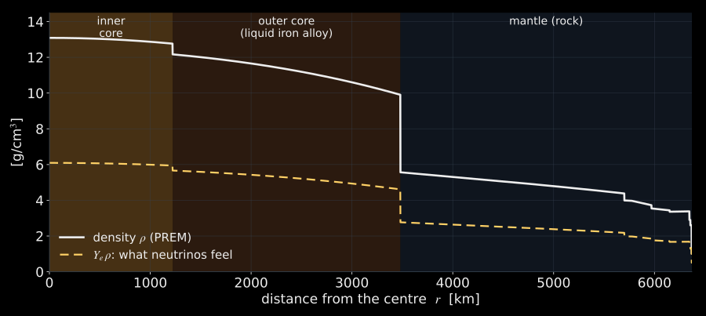
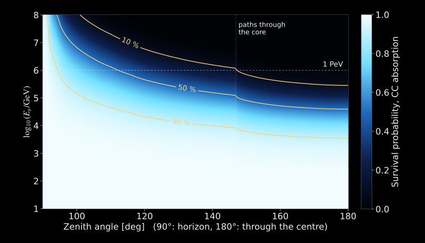
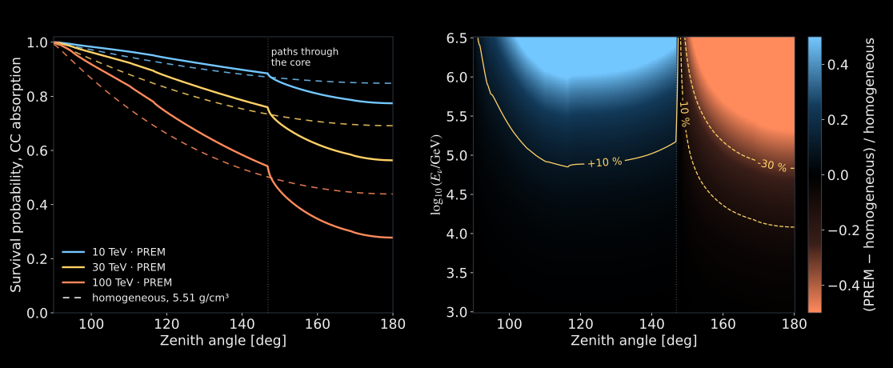
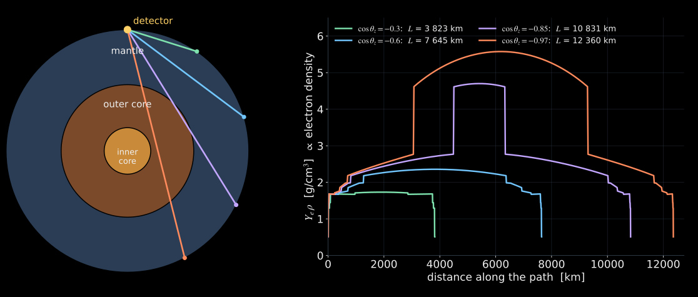
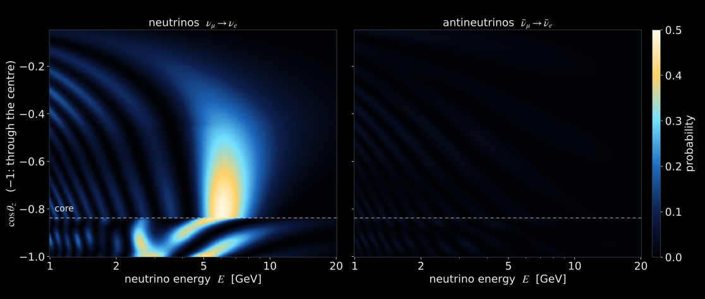
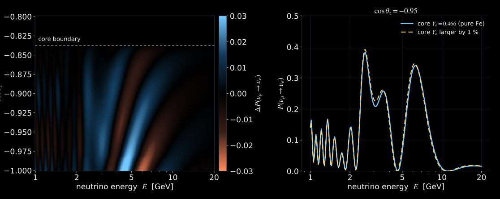
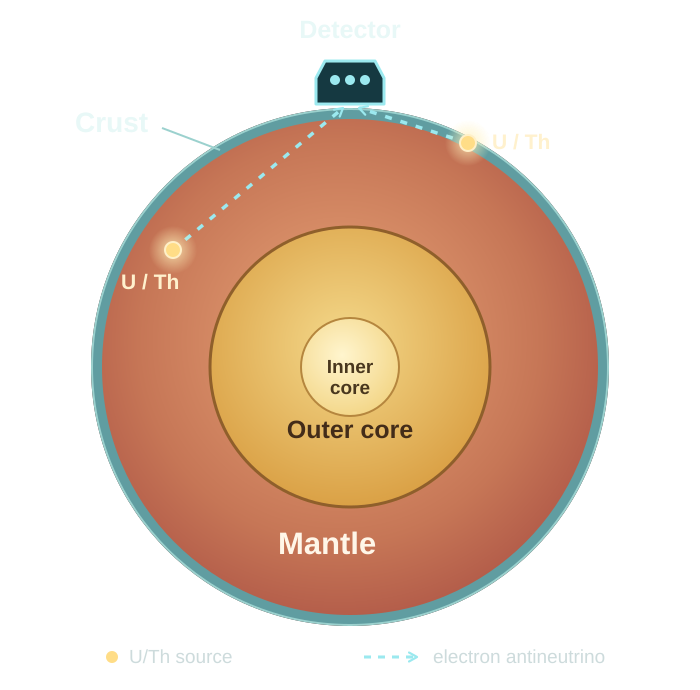
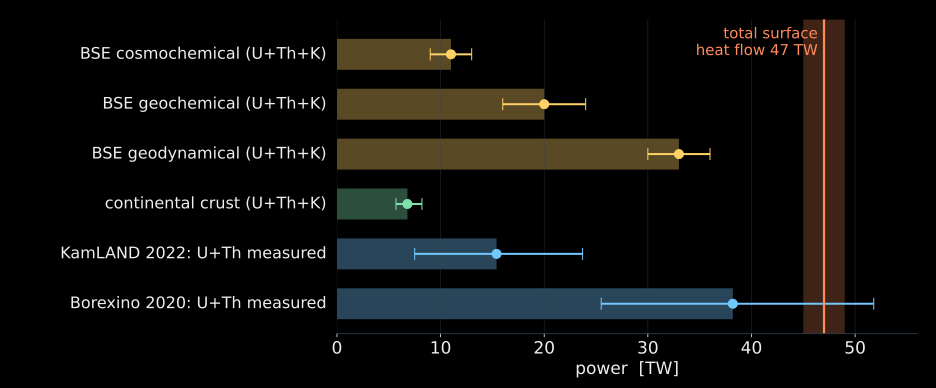

## What we know now {#recap-3}

::: {.columns}

::: {.column width="55%"}

- **Vacuum:** two mass waves beat; the clock ticks with $\Delta m^2L/E$.
- **Matter:** $\nu_e$ feels the electrons, $V=\sqrt2G_Fn_e$; it matters when $2EV\sim\Delta m^2$.
- **Sun:** slow density change converts $\nu_e$ into $\nu_2$; the Earth regenerates a little at night.

:::

::: {.column width="45%"}

::: {.card}
[Today: the Earth]{.card-title}

1. What geophysics knows, and what it does not.
2. Probe 1 — absorption: the Earth's mass.
3. Probe 2 — oscillations: the core's electrons.
4. Probe 3 — geoneutrinos: the Earth's heat.

:::

:::

:::

# The Earth as geophysicists see it

## What geophysics knows {#prem}

{.slide-media .nostretch style="--media-max-height: 500px;" fig-alt="PREM density against radius with the inner core, liquid outer core and mantle shaded; the electron density Y_e rho is about half of the density."}

- Seismic waves, the Earth's mass and moment of inertia give the **density** profile (PREM).
- The **composition** is inferred indirectly: the outer core is 5–10 % less dense than pure iron, so it contains light elements — but which ones, and how much?

::: {.media-caption}
PREM: Dziewonski & Anderson (1981). Density deficit: [Badro, Côté & Brodholt, PNAS 111, 7542 (2014)](https://doi.org/10.1073/pnas.1316708111). Dashed: $Y_e\rho$ with the model compositions of the previous slides.

:::

## What neutrinos add: electrons per nucleon {#ye}

::: {.columns}
::: {.column width="46%"}
$$
Y_e=\frac{\text{electrons}}{\text{nucleons}}=\sum_i w_i\,\frac{Z_i}{A_i}
$$

::: {.school-table}

| Element | $Z/A$ |
|:---|---:|
| H | 0.992 |
| O, Si, S, C | 0.50 |
| Mg | 0.494 |
| Fe | 0.466 |
| Ni | 0.477 |

:::
:::
::: {.column width="54%"}
::: {.card}
[Seismology + neutrinos]{.card-title}

- Seismology and gravity: $\rho$.
- Neutrino oscillations: $n_e\propto Y_e\,\rho$.
- Together: $Y_e$, a direct handle on **composition**.

:::

**Core models**

- pure Fe: $Y_e=0.466$
- Fe + 10 wt% O: $Y_e=0.469$ (+0.7 %)
- Fe + 1 wt% H: $Y_e=0.471$ (+1.1 %)

:::
:::

::: {.takeaway}
Hydrogen is the outlier: one electron per nucleon. A percent-level measurement of $Y_e$ in the core would test whether the core holds hydrogen.

:::

::: {.media-caption}
Derived from CIAAW standard atomic weights; mixtures by mass fraction.

:::

## Three neutrino probes of the Earth {#three-probes}

::: {.columns}
::: {.column width="33%"}
::: {.card}
[Absorption]{.card-title}

$E\gtrsim10$ TeV

The Earth becomes opaque: absorption counts **nucleons**.

→ density, mass of the core

:::
:::
::: {.column width="33%"}
::: {.card}
[Oscillations]{.card-title}

$E\approx1\text{–}20$ GeV

Matter shifts the oscillation phase: forward scattering on **electrons**.

→ electron density, composition

:::
:::
::: {.column width="34%"}
::: {.card}
[Geoneutrinos]{.card-title}

$E\approx2\text{–}3$ MeV

$\bar\nu_e$ from U and Th decays inside the Earth: counts **radioactive sources**.

→ radiogenic heat

:::
:::
:::

::: {.takeaway}
Three energy ranges, three physical quantities — all through the same weak interaction. Today: one section for each.

:::

# Probe 1: absorption

## The Earth as a shield {#earth-shield}

<video class="slide-video" style="--media-max-height: 640px;" width="1920" height="1080" muted controls preload="metadata" playsinline poster="media/video/earth_shield_poster.jpg" src="media/video/earth_shield_en.mp4"></video>

::: {.media-caption}
PREM Earth, CSMS cross sections; probability of no interaction along the path. Muon ranges from PDG tables of standard rock.

:::

## How opaque is the Earth? {#transmission}

{.slide-media .nostretch style="--media-max-height: 560px;" fig-alt="Computed survival probability of neutrinos crossing the Earth versus zenith angle from 90 to 180 degrees and energy from 10 GeV to 100 PeV, charged-current absorption only. Near the horizon the Earth is transparent at all energies; through the core it becomes opaque above about 100 TeV. Contours at 10, 50 and 90 percent."}

- At 10 TeV about three quarters of the neutrinos cross the whole diameter; above ~100 TeV the core paths are dark.
- The darkness depends on the column $X=\int\rho\,dl$: absorption measures **mass density**.

::: {.media-caption}
Computed: PREM, CSMS cross sections, detector 1 km deep · CC absorption only, average of $\nu$ and $\bar\nu$.

:::

## Absorption tomography: IceCube weighed the Earth {#absorption-tomography}

{.slide-media .nostretch style="--media-max-height: 340px;" fig-alt="Charged-current survival probability against zenith angle at 10, 30 and 100 TeV for PREM and a homogeneous Earth of the same mass, and their relative difference."}

::: {.columns}
::: {.column width="55%"}
One year of IceCube up-going muons, 0.4–20 TeV (20 145 events):

- Earth's mass $6.0^{+1.6}_{-1.3}\times10^{24}$ kg; gravity: $5.97\times10^{24}$ kg.
- Core mass $2.72^{+0.97}_{-0.89}\times10^{24}$ kg; the core is denser than the mantle.

:::
::: {.column width="45%"}
::: {.takeaway}
A weak-interaction measurement of the Earth's mass, without gravity.

:::
:::
:::

::: {.media-caption}
Figure computed: PREM vs homogeneous Earth of the same mass, CC absorption only. Measurement: 68 % credible intervals · Donini, Palomares-Ruiz & Salvado, [Nature Physics 15, 37 (2019)](https://arxiv.org/abs/1803.05901)

:::

# Probe 2: oscillations

## Paths through the Earth {#paths}

{.slide-media .nostretch style="--media-max-height: 620px;" fig-alt="Left: Earth cross-section with mantle, outer and inner core and four paths from below to a detector at the top. Right: electron density along each path; steeper paths enter the core and see a jump to more than twice the mantle value."}

- The arrival direction $\cos\theta_z$ fixes the path: $L=2R_\oplus|\cos\theta_z|$.
- Paths with $\cos\theta_z<-0.84$ cross the core; below $-0.98$ also the inner core.

## A neutrino crossing the Earth {#flavor-path}



::: {.small .muted}
Press play: the flavor changes fastest where the density jumps. Try 4 GeV through the core, then 6 GeV through the mantle only.

:::

## The oscillogram of the Earth {#oscillogram}

{.slide-media .nostretch style="--media-max-height: 500px;" fig-alt="Probability of muon to electron neutrino conversion through the PREM Earth as a function of energy from 1 to 20 GeV and of the cosine of the zenith angle. Neutrinos show a large mantle resonance near 6 GeV and structured core features below cos theta of -0.84; antineutrinos show almost nothing."}

- **Mantle resonance** near 6 GeV: $P(\nu_\mu\to\nu_e)$ grows from a few % in vacuum to almost 50 %.
- **Core-crossing paths**: mantle and core layers interfere — sharp features at 2–5 GeV.
- **Antineutrinos** (normal ordering): no resonance. The asymmetry reveals the mass ordering.

::: {.media-caption}
Computed: three flavors, NuFIT 6.1 best fit (normal ordering), PREM with $Y_e^{\rm mantle}=0.497$, $Y_e^{\rm core}=0.466$; detector at the surface. Core–mantle enhancement: [Akhmedov, Nucl. Phys. B 538, 25 (1999)](https://arxiv.org/abs/hep-ph/9805272); [Petcov, Phys. Lett. B 434, 321 (1998)](https://arxiv.org/abs/hep-ph/9805262).

:::

## Explore a path {#explorer}



::: {.small .muted}
Move the direction from the horizon to the nadir. Change the core $Y_e$: which energies and directions react? Switch to antineutrinos and to the inverted ordering.

:::

## Build your own Earth {#oscillogram-lab}



::: {.small .muted}
Left: the oscillogram of your Earth. Right: how it differs from PREM with an iron core. Remove the core; add hydrogen; make the core 5 % lighter.

:::

## How large is the composition signal? {#core-ye}

{.slide-media .nostretch style="--media-max-height: 500px;" fig-alt="Left: change of the muon to electron conversion probability when the core electron fraction rises by one percent, as a map over energy and direction below the core boundary; changes reach about plus or minus 0.03 on sharp features. Right: the probability at cos theta = -0.95 for the two core compositions."}

- $+1\,\%$ in the core $Y_e$ changes $P$ by up to $\pm0.03$, only for core-crossing paths of 2–10 GeV; resolution smears much of this fine pattern.

::: {.media-caption}
Computed with the same model; only the core $Y_e$ changed; no detector response or flux.

:::

## What it takes {#what-it-takes}

::: {.columns}
::: {.column width="55%"}
- If smearing leaves a 1 % change in the event rate, seeing it at 3σ needs $3/\sqrt N\approx0.01$, i.e. $N\approx10^5$ events in that window: **megaton-scale detectors over many years**.

::: {.card}
[Studies for real detectors]{.card-title}

After 20 years KM3NeT/ORCA and DUNE reach $Z/A$ of the outer core to 3–4 %, Hyper-Kamiokande to 2.5 %; 1 wt% of hydrogen reaches only 1σ after 50 years of combined data.

:::
:::
::: {.column width="45%"}
::: {.card}
[Why so hard]{.card-title}

- Few atmospheric neutrinos cross the core: $\cos\theta_z<-0.84$ is 16 % of the lower hemisphere.
- The detector must measure both energy and direction of GeV neutrinos.
- Flux and cross-section uncertainties also enter.

:::
:::
:::

::: {.takeaway}
A geophysical measurement with particle-physics detectors: the effect is percent-level, the exposure must be megatons × decades.

:::

::: {.media-caption}
[Rott, Taketa & Bose, Sci. Rep. 5, 15225 (2015)](https://arxiv.org/abs/1502.04930) · [Maderer et al., Front. Earth Sci. 11, 1008396 (2023)](https://arxiv.org/abs/2208.00532)

:::

# Probe 3: geoneutrinos

## Antineutrinos from inside the Earth {#geo-what}

::: {.columns}

::: {.column width="55%"}

- $\beta$ decays in the $^{238}$U and $^{232}$Th chains emit $\bar\nu_e$. Only four decays are energetic enough to be seen through $\bar\nu_e+p\to e^++n$ (threshold 1.806 MeV):

::: {.school-table}

| Chain | Visible decays | Highest $\bar\nu$ energy |
|:---|:---|---:|
| $^{238}$U | $^{234\rm m}$Pa, $^{214}$Bi | 3.27 MeV |
| $^{232}$Th | $^{228}$Ac, $^{212}$Bi | 2.25 MeV |
| $^{40}$K | — | 1.31 MeV: invisible |

:::

:::

::: {.column width="45%"}

::: {.card}
[Heat per kilogram]{.card-title}

- U: 98.5 μW/kg
- Th: 26.3 μW/kg
- K: 0.0033 μW/kg

Chondritic ratio Th/U = 3.9.

:::

::: {.card}
[Unit of signal]{.card-title}

1 TNU = 1 event per $10^{32}$ free target protons per year.

:::

:::

:::

::: {.media-caption}
[Fiorentini, Lissia & Mantovani, Phys. Rep. 453, 117 (2007)](https://arxiv.org/abs/0707.3203) · [Dye, Rev. Geophys. 50, RG3007 (2012)](https://arxiv.org/abs/1111.6099), Table 3 · Q-values: NNDC NuDat 3 · [Borexino, PRD 101, 012009 (2020)](https://arxiv.org/abs/1909.02257)

:::

## Geoneutrinos: the Earth's radioactive heat {#geoneutrino-heat}

::: {.columns}
::: {.column width="42%"}
{.slide-media .nostretch style="--media-max-height: 560px;" fig-alt="Schematic Earth with crust and mantle sources of geoneutrinos reaching a detector."}

::: {.media-caption}
Crust enlarged; paths illustrative.

:::
:::
::: {.column width="58%"}
- $^{238}$U and $^{232}$Th chains emit $\bar\nu_e$ up to 3.27 and 2.25 MeV; detected by $\bar\nu_e+p\to e^++n$ above 1.806 MeV.
- The Earth loses $47\pm2$ TW of heat. How much is radiogenic, how much primordial?
- Radiogenic U+Th heat: Borexino $38.2^{+13.6}_{-12.7}$ TW; KamLAND $15.4^{+8.3}_{-7.9}$ TW. KamLAND sees geoneutrinos at 8.5σ.
- Geoneutrinos oscillate too: averaged over many oscillation lengths, $P_{ee}\approx0.55$.

:::
:::

::: {.media-caption}
Heat flow: [Davies & Davies, Solid Earth 1, 5 (2010)](https://doi.org/10.5194/se-1-5-2010) · [Borexino, PRD 101, 012009 (2020)](https://arxiv.org/abs/1909.02257) · [KamLAND, GRL 49, e2022GL099566 (2022)](https://arxiv.org/abs/2205.14934), Th/U free · $P_{ee}=c_{13}^4(1-\tfrac12\sin^22\theta_{12})+s_{13}^4$ with NuFIT 6.1.

:::

## How much of the Earth's heat is radiogenic? {#heat-budget}

{.slide-media .nostretch style="--media-max-height: 460px;" fig-alt="Horizontal bars of power in terawatts: Bulk Silicate Earth models give 11, 20 and 33 TW of total radiogenic heat; the continental crust alone 6.8 TW; KamLAND measures 15.4 TW and Borexino 38.2 TW from uranium and thorium with large errors; the total surface heat flow is 47 TW."}

- Earth models disagree by a factor of 3: 11–33 TW of radiogenic heat out of 47 TW. The rest is primordial heat.
- The crust is sampled by rocks; geoneutrinos see the U and Th of the **mantle** directly.

::: {.media-caption}
[Šrámek et al., EPSL 361, 356 (2013)](https://arxiv.org/abs/1207.0853), Table 2 · [Huang et al., G³ 14, 2003 (2013)](https://arxiv.org/abs/1301.0365) · [Davies & Davies (2010)](https://doi.org/10.5194/se-1-5-2010) · Borexino 2020 · KamLAND 2022 (Th/U free). Models and crust: U+Th+K; measurements: U+Th only.

:::

## JUNO: geoneutrinos by the hundred {#juno-geo}

::: {.columns}

::: {.column width="52%"}

::: {.big-number}
≈ 400 per year

:::

::: {.big-number-caption}
expected geoneutrino events in JUNO

:::

:::

::: {.column width="48%"}

- More events per year than KamLAND and Borexino have collected in total.
- About 70 % of the signal comes from the crust, 44 % from the crust within a few hundred kilometres: local geology must be mapped.
- The goal: subtract the crust and **measure the mantle**.

:::

:::

::: {.media-caption}
[JUNO Yellow Book, J. Phys. G 43, 030401 (2016)](https://arxiv.org/abs/1507.05613), Sec. 8: $408\pm60$ events per year; bulk crust 28.2 of 39.7 TNU. Prediction of 2015.

:::

# Three lectures in one slide

## What neutrinos can tell about the Earth {#summary-3}

::: {.school-table}

| Probe | Energy | Physics | Measures | Status |
|:---|:---|:---|:---|:---|
| Absorption | > 10 TeV | weak interaction with nucleons | density, mass of the core | first measurement (IceCube) |
| Oscillations | 1–20 GeV | refraction on electrons | electrons per nucleon: composition | 3–4 % on $Z/A$ in ~20 years |
| Geoneutrinos | 2–3 MeV | U and Th decays | radiogenic heat | observed; mantle at 2.3σ (Borexino) |

:::

1. **Vacuum:** a neutrino is two interfering waves; the clock ticks with $\Delta m^2L/E$ — sensitive to $10^{-21}$ of the energy.
2. **Matter:** $\nu_e$ feels electrons; resonance and adiabatic following explain the Sun and reveal the mass ordering.
3. **The Earth:** the same physics becomes a tool — to weigh the planet, probe its core and measure its heat.
