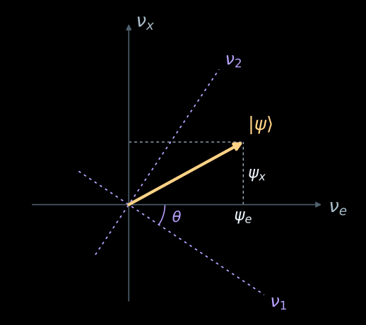
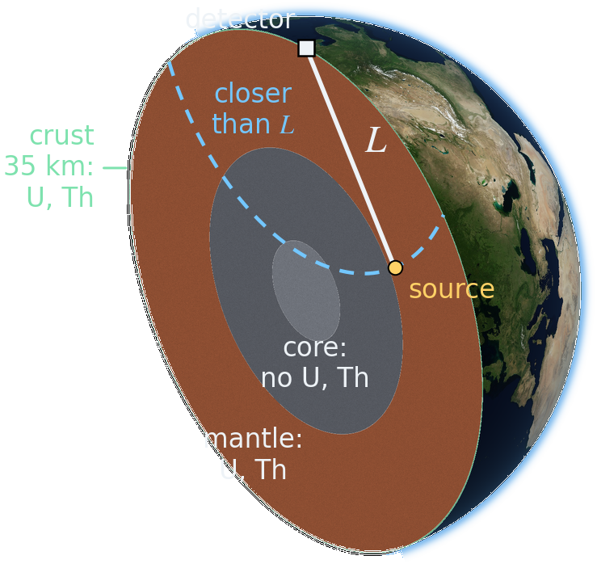
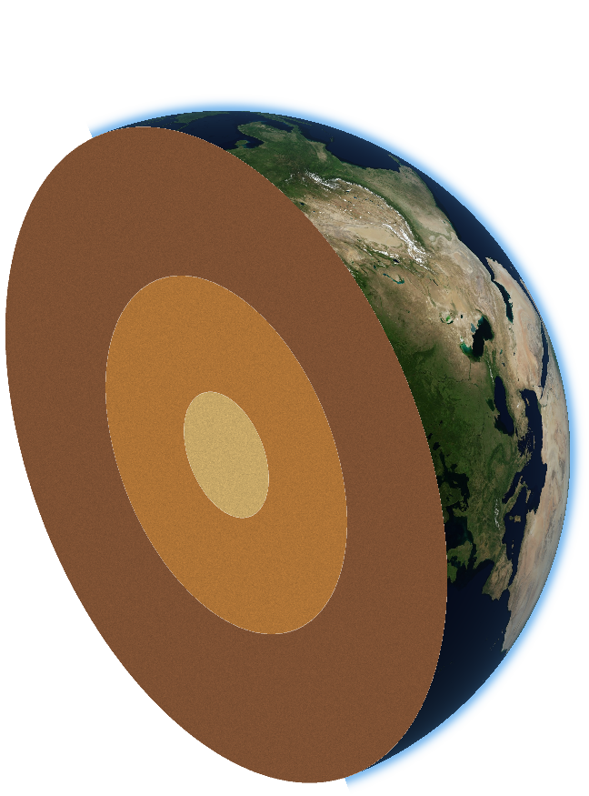
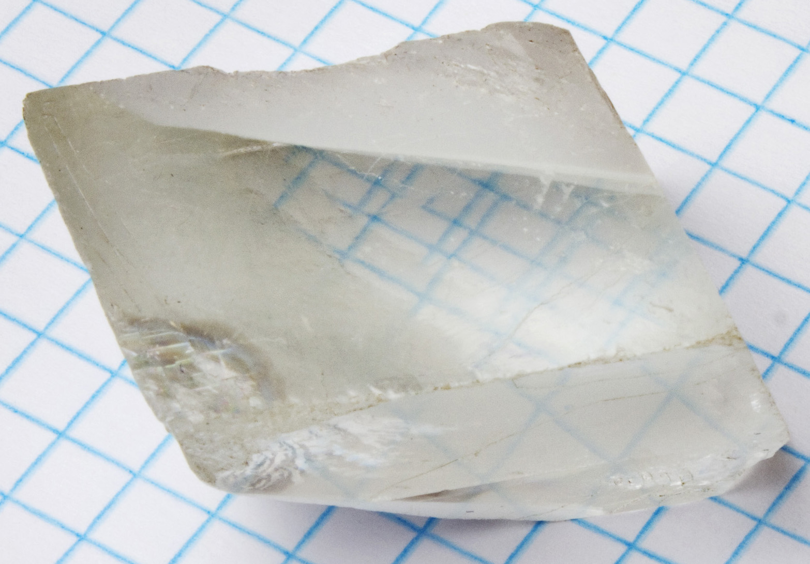
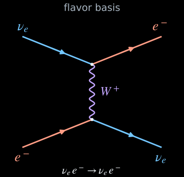
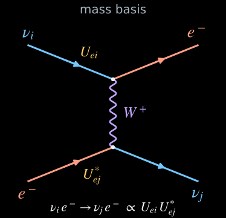
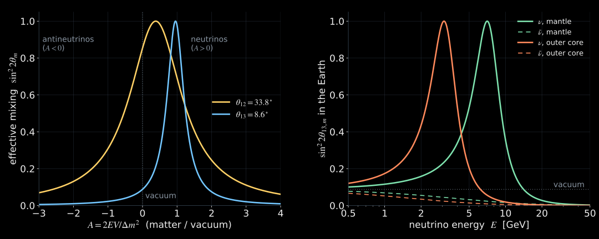
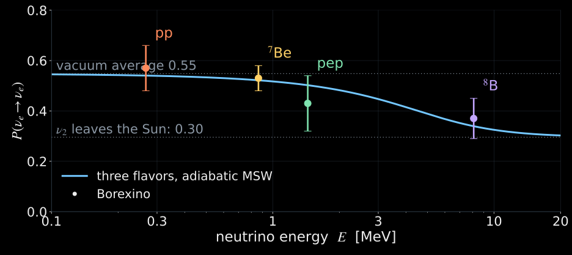
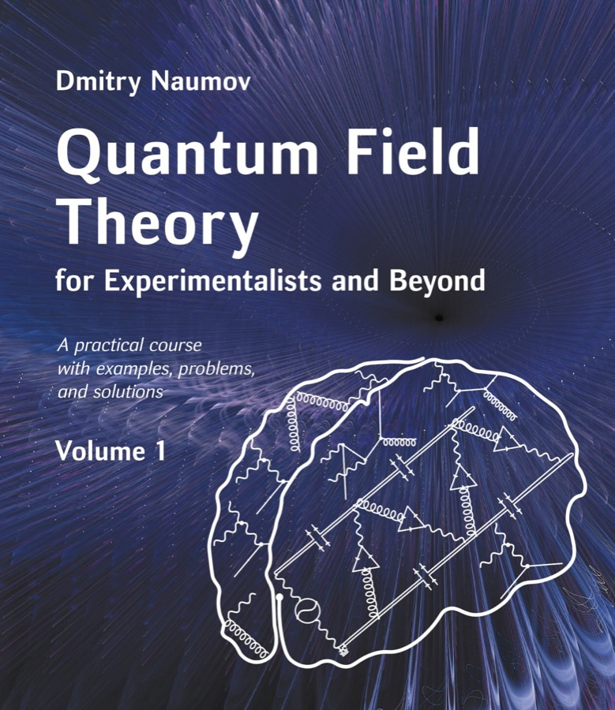

# Vacuum

## The problem {#problem}



::: {.media-caption}
Two flavors, $\sin^2\theta=\sin^2\theta_{12}=0.3088$ (NuFIT 6.1); $L_{\rm osc}=4\pi E/\Delta m^2$. Each event is drawn at random with $P(\nu_e\to\nu_\mu)$.
:::

## Neutrino = Quantum Chameleon {#quantum-chameleon}



## What is the mass of the electron neutrino? {#quiz-mass}

:::: {.quiz-slide}
::: {.quiz-options}

::: {.quiz-option}
**A.** Zero, as in the Standard Model
:::

::: {.quiz-option}
**B.** It depends on its mood: it is a chameleon
:::

::: {.quiz-option}
**C.** It has no mass of its own: it is a mix of $\nu_1$, $\nu_2$, $\nu_3$
:::

:::
::::

## What is the mass of the electron neutrino? {#quiz-mass-answer}

:::: {.quiz-slide}
::: {.quiz-options}

::: {.quiz-option .wrong}
**A.** Zero, as in the Standard Model
:::

::: {.quiz-option .wrong}
**B.** It depends on its mood: it is a chameleon
:::

::: {.quiz-option .correct}
**C.** It has no mass of its own: it is a mix of $\nu_1$, $\nu_2$, $\nu_3$
:::

:::

::: {.quiz-note}
Each of $\nu_1$, $\nu_2$, $\nu_3$ has its own mass. $\nu_e$ is their mix, so it has none of its own.
:::
::::

## Surprise: $\nu_e$, $\nu_\mu$, $\nu_\tau$ have no mass {#no-mass}

:::: {.columns}
::: {.column width="56%"}
- In QFT a fundamental particle is a quantum wave: an excitation of a quantum field with a mass,
  $E_i=\sqrt{p^2+m_i^2}$.
- There are no $\nu_e$, $\nu_\mu$, $\nu_\tau$ fields with a mass. The massive fields are $\nu_1$, $\nu_2$, $\nu_3$.
- $\nu_e$, $\nu_\mu$, $\nu_\tau$ are the combinations that the weak interaction creates and absorbs. For two of them:

$$
\boxed{
\begin{aligned}
|\nu_e\rangle&=\cos\theta\,|\nu_1\rangle+\sin\theta\,|\nu_2\rangle\\
|\nu_\mu\rangle&=-\sin\theta\,|\nu_1\rangle+\cos\theta\,|\nu_2\rangle
\end{aligned}}
$$

- One state space, two pairs of axes, turned by the mixing angle $\theta$.
  For $\nu_e$ and the slow clock below: $\theta_{12}\approx34^\circ$.
:::
::: {.column width="44%"}
{.slide-media .nostretch style="--media-max-height: 520px;" fig-alt="Flavor axes nu_e and nu_x, the projections psi_e and psi_x of a state, and the mass axes nu_1 and nu_2 turned by the angle theta."}

::: {.media-caption}
Here $\nu_x=\nu_\mu$.
:::
:::
::::

## Two waves: in phase and out of phase {#phases}



::: {.nh-text tone="muted" size="sm"}
Move the detector. $\nu_1$ and $\nu_2$ leave the source in phase: $\nu_e$. In antiphase the detector finds $\nu_\mu$; in phase again, $\nu_e$.
A real geoneutrino makes about $2\times10^{17}$ waves over $L_{\rm osc}\approx100$ km.
:::

## The formula {#formula}

:::: {.panel-tabset .nh-story-tabs}

### Result

::: {.marginnote .absolute top=380 left=1190 width=380 style="--note-font-size: 0.8em; line-height: 1.5;"}
[Natural units]{.note-title}

$\hbar=c=1$

$E,\ p,\ m$ in eV

$L,\ t$ in eV$^{-1}$

$\hbar c=1.973\times10^{-7}$ eV m

$\hbar=6.582\times10^{-16}$ eV s

[CODATA 2022]{style="font-size: 0.75em;"}
:::

$$
\boxed{
P(\nu_e\to\nu_\mu)=\sin^2 2\theta\;\sin^2\!\left(\frac{\Delta m^2L}{4E}\right)
=\sin^2 2\theta\;\sin^2\!\left(1.267\,\frac{\Delta m^2[\mathrm{eV^2}]\;L[\mathrm{km}]}{E[\mathrm{GeV}]}\right)},
\qquad
P(\nu_e\to\nu_e)=1-P(\nu_e\to\nu_\mu).
$$

- The angle sets the **depth**: $P_{\max}=\sin^22\theta$.
- $\Delta m^2L/E$ sets **where** the maxima are. The oscillation length

$$
L_{\rm osc}=\frac{4\pi E}{\Delta m^2}=2.48\ \mathrm{km}\;\frac{E[\mathrm{GeV}]}{\Delta m^2[\mathrm{eV^2}]}.
$$

The first maximum of the transition is at $L=L_{\rm osc}/2$.

### 1. Two phases

Let $\varphi_i$ be the phase that mass component $i$ accumulates between the source and the detector:

$$
|\nu_e;L\rangle=\cos\theta\,e^{-i\varphi_1}|\nu_1\rangle+\sin\theta\,e^{-i\varphi_2}|\nu_2\rangle .
$$

A single mass state would carry only an overall phase, invisible in any probability. Here there are
two waves: after the common factor is taken out, the difference $\Delta\varphi=\varphi_2-\varphi_1$ remains.

### 2. Projection

The detector looks for $|\nu_\mu\rangle=-\sin\theta\,|\nu_1\rangle+\cos\theta\,|\nu_2\rangle$. The mass states are
orthonormal, $\langle\nu_i|\nu_j\rangle=\delta_{ij}$, and two terms survive:

$$
\mathcal A_{e\to\mu}=\langle\nu_\mu|\nu_e;L\rangle
=\sin\theta\cos\theta\left(e^{-i\varphi_2}-e^{-i\varphi_1}\right).
$$

At $L=0$ the phases are equal and the two terms cancel: the source prepared a pure $\nu_e$.

### 3. Probability

$$
\left|e^{-i\varphi_2}-e^{-i\varphi_1}\right|^2=4\sin^2\frac{\Delta\varphi}{2},
\qquad
4\sin^2\theta\cos^2\theta=\sin^22\theta,
\qquad
P(\nu_e\to\nu_\mu)=\sin^22\theta\,\sin^2\frac{\Delta\varphi}{2}.
$$

### 4. Phase

For a plane wave $\varphi_i=E_it-p_iL$. With $t\simeq L$ ($\hbar=c=1$) and $E_i^2-p_i^2=m_i^2$:

$$
\varphi_i\simeq(E_i-p_i)L=\frac{m_i^2L}{E_i+p_i}\simeq\frac{m_i^2L}{2E},
\qquad
\Delta\varphi\simeq\frac{\Delta m^2L}{2E}.
$$

::::

## Geoneutrino Example {#scales}

::: {.earth-setup}
{fig-alt="The Earth cut through the detector: the thin crust and the mantle hold uranium and thorium, the core none; one source at distance L from the detector and the sphere of radius L around it."}
:::

::: {.earth-setup-text style="font-size: 24px; margin: -4px 0 10px;"}
[One source at distance $L$: $P_{ee}(L)$.]{style="color:#73c7ff"}
[All sources of the Earth closer than $L$: $\bar P_{ee}(L)=\int_0^L w(x)\,P_{ee}(x)\,dx\Big/\!\int_0^L w(x)\,dx$.]{style="color:#7ee2ae; display:block"}
:::

::::: {.panel-tabset .nh-story-tabs}

### Lab



### Calculation details

::: {.earth-setup-text style="font-size: 25px;"}
A volume $dV$ emitting $n$ antineutrinos per cm³ per s gives the flux $n\,dV/4\pi x^2$; around the detector
$dV=x^2dx\,d\Omega$, so $d\Phi=\frac{n}{4\pi}\,dx\,d\Omega$. Only the solid angle inside a shell $a<r<b$ is left;
$\beta$ is the angle from the vertical, $r^2=R^2+x^2-2Rx\cos\beta$:

$$
\frac{d\Phi}{dx}=\frac{n}{2}\,\bigl[\cos\beta(a)-\cos\beta(b)\bigr],
\qquad
\cos\beta(r)=\frac{R^2+x^2-r^2}{2Rx}\ \ \text{clipped to}\ [-1,1].
$$

- Crust: $d\Phi/dx\approx n/2$ for $x<H=35$ km, $\approx nH/2x$ beyond. A uniform ball: $\Phi=\frac{nR}{2}$.
- Each shell emits $n=\rho\,(\ell_{\rm U}c_{\rm U}+\ell_{\rm Th}c_{\rm Th})$, $\ell_{\rm U}=7.46\times10^7$, $\ell_{\rm Th}=1.62\times10^7$ ν̄ per kg per s. Crust: 2.7 g/cm³, U 1.3 ppm, Th 5.6 ppm; mantle: U 12 ppb, Th 48 ppb; core: none.

The detector does not know where a neutrino came from; it counts all of them:

$$
S(L)=\sum_{\rm shells}\int_0^L \frac{d\Phi}{dx}\,P_{ee}(x)\,dx,
\qquad
w(x)=\frac{1}{S_0}\sum_{\rm shells}\frac{d\Phi}{dx},
\qquad S_0:\ \text{the whole Earth without oscillations.}
$$
:::

::: {.earth-setup-text style="font-size: 19px; color: #a9b6c2;"}
Continental crust 35 km (Rudnick & Gao 2003); mantle: bulk silicate Earth (McDonough & Sun 1995) minus the crust; TNU after Fiorentini et al. 2007. Spectrum: U and Th chains ([S. Enomoto](https://www.awa.tohoku.ac.jp/~sanshiro/research/geoneutrino/spectrum/)) times the IBD cross section (Vogel & Beacom 1999), U : Th = 30.3 : 9.0 TNU.
Oscillations: NuFIT 6.1, normal ordering. Earth picture: radii to scale, interior colors schematic; surface: NASA Blue Marble.
:::

:::::

## Atmospheric Neutrino Example {#atm}

::: {.earth-setup}
```{=html}
<div class="earth-live"><svg id="atm-earth" role="img" aria-label="The detector, the zenith, the zenith angle and the path L of the neutrino in the cut plane of the Earth"></svg></div>
```
:::

::: {.earth-setup-text style="font-size: 24px; margin: -4px 0 10px;"}
A $\nu_\mu$ born in the atmosphere at height $h\approx15$ km; the zenith angle fixes the path:
[$L=15$ km from above, $437$ km from the horizon, $12\,757$ km from below.]{style="display:block"}
:::

::::: {.panel-tabset .nh-story-tabs}

### Lab



### Calculation details

::: {.earth-setup-text style="font-size: 28px;"}
The path from the birth point at height $h$ to a detector on the surface, $R=6371$ km:

$$
L(\theta_z)=\sqrt{(R+h)^2-R^2\sin^2\theta_z}-R\cos\theta_z ,
\qquad h\approx15\ \text{km}.
$$

Three flavors in vacuum, one energy and one direction:

$$
P(\nu_\mu\to\nu_\beta)=\Bigl|\sum_{i=1}^{3}U_{\beta i}\,U^*_{\mu i}\,e^{-i m_i^2L/2E}\Bigr|^2 .
$$

- No averaging over $L$ or $E$: atmospheric detectors reconstruct the energy and the direction of each event.
- No matter yet: the Earth's electrons change these curves at a few GeV (slide "Matter turns the axes", tab Picture).
:::

::: {.earth-setup-text style="font-size: 22px; color: #a9b6c2;"}
$h\approx15$ km: the most probable production height of vertical neutrinos from pion decay
([Gaisser & Stanev, Phys. Rev. D 57, 1977 (1998)](https://arxiv.org/abs/astro-ph/9708146)).
NuFIT 6.1 best fit (IC24 + SK-atm), normal ordering: $\sin^2\theta_{12}=0.3088$, $\sin^2\theta_{13}=0.02248$, $\sin^2\theta_{23}=0.470$, $\delta=212^\circ$,
$\Delta m^2_{21}=7.537\times10^{-5}$ eV², $\Delta m^2_{31}=2.511\times10^{-3}$ eV².
Earth picture: radii to scale (PREM), interior colors schematic; surface: NASA Blue Marble.
:::

:::::

# Vacuum = Birefringent Crystal {#birefringence}

{.slide-media .nostretch style="--media-max-height: 560px;" fig-alt="A calcite crystal on graph paper: every blue line seen through the crystal appears twice."}

::: {.media-caption}
Calcite on graph paper: every line is seen twice. Photo: APN MJM, [Wikimedia Commons](https://commons.wikimedia.org/wiki/File:Crystal_on_graph_paper.jpg), [CC BY-SA 3.0](https://creativecommons.org/licenses/by-sa/3.0/).
:::

## Light in a birefringent plate {#crystal-vacuum}

::::: {.panel-tabset .nh-story-tabs}

### Set-up



:::: {.columns style="font-size: 24px; margin-top: 10px;"}
::: {.column width="25%"}
**In.** The polarizer passes light polarized along $H$.
:::
::: {.column width="25%"}
**Crystal**, thickness $L$, axes at the angle $\theta$ to $H$: two waves, $\cos\theta$ along the fast axis, $\sin\theta$ along the slow one.
:::
::: {.column width="25%"}
**Out.** The slow wave lags by $\Delta\varphi=2\pi\,(n_o-n_e)\,L/\lambda$: the polarization is elliptical.
:::
::: {.column width="25%"}
**Filter $V$.** The detector sees $I_V/I_0=\sin^22\theta\,\sin^2(\Delta\varphi/2)$.
:::
::::

::: {style="font-size: 19px; color: #a9b6c2; margin-top: 8px;"}
Calcite at 589 nm: $n_o=1.658$, $n_e=1.486$ (G. Ghosh, [Opt. Commun. 163, 95 (1999)](https://doi.org/10.1016/S0030-4018(99)00091-7)); a full-wave plate is $\lambda/(n_o-n_e)=3.42\ \mu$m thick. The drawing is schematic: wavelength and thickness not to scale.
:::

### Lab



:::::

## The vacuum is a birefringent crystal for neutrinos {#vacuum-crystal}

In the mass basis the vacuum is diagonal: one refractive index per mass state,

$$
n=\begin{pmatrix}n_1&0&0\\0&n_2&0\\0&0&n_3\end{pmatrix},
\qquad
n_i\simeq1-\frac{m_i^2}{2E^2},
\qquad
E\,(n_i-n_j)\,L=\frac{\Delta m^2_{ji}\,L}{2E}.
$$

| Light in calcite | Neutrinos in vacuum |
|:--|:--|
| two axes, $o$ and $e$ | **three** axes, $\nu_1,\nu_2,\nu_3$ |
| angle $\theta$ of the axes to $H$ | mixing angles $\theta_{12},\theta_{13},\theta_{23}$ |
| polarizer $H$, analyzer $V$ | $\nu_e$ at the source, $\nu_\mu$ at the detector |
| $\Delta\varphi=2\pi\,(n_o-n_e)\,L/\lambda$ | $\Delta\varphi_{ji}=\Delta m^2_{ji}\,L/2E$ |

::: {.nh-box tone="accent" size="md"}
Three neutrinos, three axes: even empty space is a crystal for them.
:::

# Matter

## Everything is tiny {#tiny}

| | | $\Delta n$ | a full turn of the phase |
|:--|:--|:-:|:-:|
| light, 589 nm | calcite: $n_o-n_e$ | $0.17$ | $3.4\ \mu\mathrm{m}$ |
| $\nu$, 10 MeV | vacuum: $n_1-n_2$ | $3.8\times10^{-19}$ | $329\ \mathrm{km}$ |
| $\nu$, 10 MeV | solar center: $n_{\nu_\mu}-n_{\nu_e}$ | $7.9\times10^{-19}$ | $158\ \mathrm{km}$ |

::: {.nh-box tone="accent" size="lg"}
**$5\times10^{17}$ times weaker than calcite.** The flavor still turns: the paths are hundreds of kilometers.
:::

::: {.media-caption}
$\Delta n=\Delta m^2_{21}/2E^2$ and $V/E$ with $V=\sqrt2\,G_Fn_e$, $n_e/N_A=102.9\ \mathrm{cm^{-3}}$ at the solar center (BS05(OP)); a full turn: $E\,\Delta n\,L=2\pi$.
:::

## A $\nu_e$ crosses the Sun. Its phase velocity is… {#quiz-faster}

:::: {.quiz-slide}
::: {.quiz-options}

::: {.quiz-option}
**A.** Above $c$
:::

::: {.quiz-option}
**B.** Below $c$, as for light in glass
:::

::: {.quiz-option}
**C.** Whatever the solar weather allows today
:::

:::
::::

## A $\nu_e$ crosses the Sun. Its phase velocity is… {#quiz-faster-answer}

:::: {.quiz-slide}
::: {.quiz-options}

::: {.quiz-option .correct}
**A.** Above $c$
:::

::: {.quiz-option .wrong}
**B.** Below $c$, as for light in glass
:::

::: {.quiz-option .wrong}
**C.** Whatever the solar weather allows today
:::

:::

::: {.quiz-note}
$n_{\nu_e}-1=-V/E<0$: the phase runs faster than light. The group velocity, which carries the signal, stays below $c$. Einstein is safe.
:::
::::

## Only $\nu_e$ feels the electrons {#potential}

::::: {.panel-tabset .nh-story-tabs}

### Flavor basis

:::: {.columns}
::: {.column width="44%"}
{.slide-media .nostretch style="--media-max-height: 470px;" fig-alt="Charged-current forward scattering of an electron neutrino on an electron through W exchange, in the flavor basis."}
:::
::: {.column width="56%" style="font-size: 30px;"}
::: {style="font-size: 1.5em;"}
$$
\boxed{\,n_{\nu_e}-1=-\frac{V}{E}<0\,},
\qquad V=\sqrt2\,G_F\,n_e .
$$
:::

- Only $\nu_e$ exchanges a $W$ with the electrons; the $Z$ part is the same for all flavors.
- $V>0$ is a **repulsion**: $p=E-V$. The wavelength **grows**, the phase velocity exceeds $c$, as for X-rays on free electrons.
- The group velocity stays below $c$: $E=\sqrt{p^2+m^2}+V$ gives $v_g=dE/dp=p/\sqrt{p^2+m^2}<1$.
- $\bar\nu_e$: $V<0$, $n>1$.

::: {style="font-size: 1.5em;"}
$$
n-1=-\frac{V}{E}\begin{pmatrix}1&0\\0&0\end{pmatrix}:
\ \text{the axes } \nu_e,\nu_\mu \text{ stay.}
$$
:::
:::
::::

### Mass basis

:::: {.columns}
::: {.column width="44%"}
{.slide-media .nostretch style="--media-max-height: 470px;" fig-alt="The same diagram in the mass basis: an incoming nu_i and an outgoing nu_j, with the factors U_ei and the complex conjugate of U_ej at the vertices."}
:::
::: {.column width="56%" style="font-size: 30px;"}
The same scattering, written for $\nu_1,\nu_2$ ($U_{e1}=\cos\theta$, $U_{e2}=\sin\theta$):

::: {style="font-size: 1.5em;"}
$$
n-1=-\frac{V}{E}\begin{pmatrix}\cos^2\theta&\sin\theta\cos\theta\\\sin\theta\cos\theta&\sin^2\theta\end{pmatrix}.
$$
:::

- One scattering turns $\nu_1$ into $\nu_2$: the amplitude is $\propto U_{e1}U_{e2}^*=\sin\theta\cos\theta\neq0$.
- Add the vacuum, $\mathrm{diag}(n_1,n_2)$: the sum is **not diagonal**.

::: {.nh-box tone="accent" size="md"}
The crystal turns its axes, $\nu_{1,2}\to\nu_{1m,2m}$, and its indices change, $n_{1,2}\to n_{1m,2m}$.
:::
:::
::::

### 1. Index

::: {style="font-size: 38px;"}
A plane wave $e^{ikz}$ crosses a slab $dz$ with $N$ scatterers per volume, each scattering $f(\theta)\,e^{ikr}/r$. The first Fresnel zones add up to

::: {style="font-size: 1.25em;"}
$$
e^{ikz}\Bigl[1+\frac{2\pi i}{k}\,N f(0)\,dz\Bigr]=e^{inkz}
\quad\Rightarrow\quad
n-1=\frac{2\pi N f(0)}{k^2}.
$$
:::

Only the forward amplitude $f(0)$ enters.
:::

### 2. Amplitude

::: {style="font-size: 36px;"}
$W$ exchange at $q^2\ll M_W^2$, after the Fierz rearrangement (coefficient $+1$ for anticommuting fields):

::: {style="font-size: 1.2em;"}
$$
\mathcal L=-\frac{G_F}{\sqrt2}\,[\bar\nu_e\gamma^\mu(1-\gamma_5)\nu_e]\,[\bar e\gamma_\mu(1-\gamma_5)e].
$$
:::

Forward, left-handed $\nu_e$, unpolarized $e^-$ at rest: $\bar u_\nu\gamma^\mu(1-\gamma_5)u_\nu=4p^\mu$, $\langle\bar u_e\gamma_\mu(1-\gamma_5)u_e\rangle=2k_\mu$:

::: {style="font-size: 1.2em;"}
$$
\mathcal M_{\rm fwd}=-4\sqrt2\,G_F\,E\,m_e,
\qquad
f(0)=\frac{\mathcal M_{\rm fwd}}{8\pi m_e}=-\frac{G_F E}{\sqrt2\,\pi}<0 .
$$
:::
:::

### 3. Potential and $n$

::: {style="font-size: 36px;"}
Born: $f=-\dfrac{E}{2\pi}\displaystyle\int U\,d^3r$, so $U=\sqrt2\,G_F\,\delta^3(\mathbf r)$. A vector exchange between like charges: repulsion; $\bar\nu_e$: $V\to-V$.

::: {style="font-size: 1.2em;"}
$$
V=N_e\!\int U\,d^3r=-\frac{2\pi N_e f(0)}{E}=\sqrt2\,G_F N_e>0,
\qquad
n-1=-\frac{\sqrt2\,G_F N_e\,E}{p^2}\simeq-\frac{V}{E}<0 .
$$
:::

**The role of $\omega_0$.** Light on an oscillator: $f(0)=r_e\,\omega^2/(\omega_0^2-\omega^2)$; a free electron, $\omega_0=0$: $f(0)=-r_e$, $n<1$ (X-rays).
Here the pole is the $W$: for $\nu_e e^-$ it sits in the $u$ channel and is never reached, $n<1$ at all energies;
for $\bar\nu_e e^-$ it is in the $s$ channel, at $E=M_W^2/2m_e\approx6.3$ PeV (Glashow): below it $n>1$.
:::

::: {style="font-size: 24px; color: #a9b6c2;"}
R. D. Peccei, [hep-ph/9906509](https://arxiv.org/abs/hep-ph/9906509), Eqs. (91)–(92); E. Kh. Akhmedov, [hep-ph/0001264](https://arxiv.org/abs/hep-ph/0001264), Eqs. (84)–(88); [L. Wolfenstein, Phys. Rev. D 17, 2369 (1978)](https://doi.org/10.1103/PhysRevD.17.2369). $Z$ exchange is common to all flavors and drops out.
:::

:::::

## Matter against vacuum: one ratio {#ratio}

$$
\boxed{A=\frac{V}{\Delta m^2/2E}=\frac{2EV}{\Delta m^2}},
\qquad
V=\sqrt2\,G_Fn_e=7.63\times10^{-14}\ \mathrm{eV}\cdot\frac{Y_e\rho}{\mathrm{g\,cm^{-3}}},
\qquad \bar\nu:\ A<0 .
$$

| | $E$ | $\Delta m^2$ | $Y_e\rho$, g/cm³ | $A$ |
|:--|:-:|:-:|:-:|:-:|
| solar center, $\nu_e$ | 10 MeV | $\Delta m^2_{21}$ | 103 | $2.08$ |
| mantle, geo-$\bar\nu_e$ | 3 MeV | $\Delta m^2_{21}$ | 2.2 | $-0.013$ |
| mantle, atmospheric $\nu$ | 6 GeV | $\Delta m^2_{31}$ | 2.2 | $0.80$ |

::: {.nh-box tone="accent" size="md"}
The Sun: matter wins. Geoneutrinos: vacuum wins, 75 times. GeV neutrinos in the Earth: a draw.
:::

## Matter turns the axes of the crystal {#axes}

::::: {.panel-tabset .nh-story-tabs}

### Phases

::: {style="font-size: 30px;"}
After a length $L$ each state collects the phase $E\,(1-n)\,L$. In the basis $\nu_1,\nu_2$:

::: {style="font-size: 1.3em;"}
$$
E\,(1-n)\,L=\underbrace{\varphi_0\,\mathbf{1}}_{\text{same for all}}
+\underbrace{\frac{L}{2E}\begin{pmatrix}0&0\\0&\Delta m^2\end{pmatrix}}_{\text{vacuum}}
+\underbrace{V L\begin{pmatrix}\cos^2\theta&\sin\theta\cos\theta\\\sin\theta\cos\theta&\sin^2\theta\end{pmatrix}}_{\text{matter}}
$$
:::

$\varphi_0$ is not seen. Take out $\dfrac{\Delta m^2L}{2E}=2\pi\dfrac{L}{L_{\rm osc}}$:

::: {style="font-size: 1.3em;"}
$$
E\,(1-n)\,L=\varphi_0\,\mathbf{1}+2\pi\,\frac{L}{L_{\rm osc}}\,
\boxed{\begin{pmatrix}0&0\\0&1\end{pmatrix}+A\begin{pmatrix}\cos^2\theta&\sin\theta\cos\theta\\\sin\theta\cos\theta&\sin^2\theta\end{pmatrix}},
\qquad A=\frac{2EV}{\Delta m^2}.
$$
:::

The box is a matrix of numbers: the crystal.
:::

### Index matrix



### Propagation

::: {style="font-size: 30px;"}
In its own axes $\nu_{1m},\nu_{2m}$ the crystal is diagonal: each axis keeps its own phase, nothing mixes.

::: {style="font-size: 1.3em;"}
$$
\psi_{km}(L)=e^{-2\pi i\,\lambda_k L/L_{\rm osc}}\,\psi_{km}(0),
\qquad
\lambda_{1,2}=\tfrac12\bigl(1+A\mp R\bigr),
\qquad
R=\sqrt{(\cos2\theta-A)^2+\sin^22\theta}.
$$

$$
\nu_e=\cos\theta_m\,\nu_{1m}+\sin\theta_m\,\nu_{2m},
\qquad
\sin2\theta_m=\frac{\sin2\theta}{R},
\qquad
\cos2\theta_m=\frac{\cos2\theta-A}{R}.
$$
:::

The phase between the axes grows as $2\pi R\,L/L_{\rm osc}$. In vacuum, $A=0$: $R=1$, $\theta_m=\theta$.
:::

### Crystal



### Probability

::: {style="font-size: 30px;"}
::: {style="font-size: 1.4em;"}
$$
\boxed{P(\nu_e\to\nu_\mu)=\sin^22\theta_m\,\sin^2\!\left(\frac{\Delta m^2_m\,L}{4E}\right)}
$$
:::

::: {style="font-size: 1.2em;"}
$$
\sin^22\theta_m=\frac{\sin^22\theta}{(\cos2\theta-A)^2+\sin^22\theta},
\qquad
\Delta m^2_m=\Delta m^2\sqrt{(\cos2\theta-A)^2+\sin^22\theta}.
$$
:::

The vacuum formula with $\theta\to\theta_m$ and $\Delta m^2\to\Delta m^2_m$.

- $A=0$: the vacuum.
- **Resonance** at $A=\cos2\theta$: $\sin^22\theta_m=1$ for any vacuum angle (Mikheyev, Smirnov, Wolfenstein).
- $A\gg1$: $\theta_m\to90^\circ$, $\nu_e$ is itself an axis of the crystal, the flavor freezes.
- $A<0$ (antineutrinos for $\Delta m^2>0$): no resonance. Matter tells $\nu$ from $\bar\nu$, and the sign of $\Delta m^2$.
:::

### Picture

{.slide-media .nostretch style="--media-max-height: 520px;" fig-alt="Left: effective mixing in matter against A for the two vacuum angles; both reach unit height at the resonance, A = cos 2 theta. Right: effective theta13 mixing in the Earth against energy: neutrinos resonate near 7 GeV in the mantle and 3 GeV in the core; antineutrinos are suppressed."}

:::::

# The Sun

## What leaves the Sun when a 10 MeV $\nu_e$ is born at its center? {#quiz-sun-exit}

:::: {.quiz-slide}
::: {.quiz-options}

::: {.quiz-option}
**A.** A $\nu_e$, of course
:::

::: {.quiz-option}
**B.** Almost only $\nu_2$
:::

::: {.quiz-option}
**C.** Nothing: the Sun keeps it as a souvenir
:::

:::
::::

## What leaves the Sun when a 10 MeV $\nu_e$ is born at its center? {#quiz-sun-exit-answer}

:::: {.quiz-slide}
::: {.quiz-options}

::: {.quiz-option .wrong}
**A.** A $\nu_e$, of course
:::

::: {.quiz-option .correct}
**B.** Almost only $\nu_2$
:::

::: {.quiz-option .wrong}
**C.** Nothing: the Sun keeps it as a souvenir
:::

:::

::: {.quiz-note}
About 94 % $\nu_2$, a mass state: it no longer oscillates on the way to the Earth. Two flavors, adiabatic; see the next slide.
:::
::::

## Solar Neutrinos {#solar-data}

::::: {.panel-tabset .nh-story-tabs}

### Why $\nu_2$



### Data

{.slide-media .nostretch style="--media-max-height: 600px;" fig-alt="Solar electron-neutrino survival probability against energy from 0.1 to 20 MeV: the three-flavor adiabatic MSW curve falls from the vacuum average 0.55 at low energy to 0.30 above 10 MeV; Borexino points for pp, 7Be, pep and 8B neutrinos follow it."}

::: {style="font-size: 24px; color: #a9b6c2;"}
Curve: three flavors, adiabatic MSW, NuFIT 6.1, BS05(OP) density where $^8$B neutrinos are made. Points: Borexino with high-metallicity solar fluxes, [Nature 562, 505 (2018)](https://doi.org/10.1038/s41586-018-0624-y); values as quoted in [arXiv:2105.13858](https://arxiv.org/abs/2105.13858).
:::

:::::

# Lepton Mixing

## Unitarity {#unitarity}

::: {style="font-size: 34px;"}
Three flavors, three masses: $\nu_\alpha=\sum_{i=1}^{3}U_{\alpha i}\,\nu_i$, $\alpha=e,\mu,\tau$. Both sets are orthonormal bases of one space, so $U$ is unitary:

::: {style="font-size: 1.45em; margin: 0.4em 0;"}
$$
UU^\dagger=U^\dagger U=\mathbf 1:\qquad
\underbrace{\sum_{i}|U_{\alpha i}|^2=1}_{\text{rows}},\qquad
\underbrace{\sum_{\alpha}|U_{\alpha i}|^2=1}_{\text{columns}},\qquad
\underbrace{\sum_{\alpha}U_{\alpha i}U^*_{\alpha j}=0,\ i\ne j}_{\text{orthogonal columns}} .
$$
:::

$|U_{\alpha i}|^2$ is the share of $\nu_i$ in $\nu_\alpha$. Two measurements, to leading order:

::: {style="font-size: 1.3em; margin: 0.4em 0;"}
$$
\text{solar }{}^8\text{B}:\ P_{ee}\simeq|U_{e2}|^2\simeq\tfrac13,
\qquad
\text{atmospheric}:\ 4|U_{\mu3}|^2\bigl(1-|U_{\mu3}|^2\bigr)\simeq1,
\qquad
|U_{e3}|^2\simeq0 .
$$
:::
:::

::: {.nh-box tone="accent" size="md"}
Nine shares $|U_{\alpha i}|^2$: two measurements, $|U_{e3}|^2\simeq0$ and unitarity fix them all.
:::

## The mixing matrix from data {#pmns-from-data}



## What is measured, what is open {#status-table}

:::: {.columns}
::: {.column width="64%"}

::: {.school-table}

| | NuFIT 6.1 | JUNO, 59.1 d | JUNO, 207.2 d |
|:--|:-:|:-:|:-:|
| $\sin^2\theta_{12}$ | 0.3088 | $0.3092\pm0.0087$ | $0.3036\pm0.0064$ |
| $\Delta m^2_{21}/10^{-5}\,\mathrm{eV^2}$ | 7.537 | $7.50\pm0.12$ | $7.388\pm0.078$ |
| $\sin^2\theta_{13}$ | 0.02248 | | |
| $\sin^2\theta_{23}$ | 0.470 | | |
| $\Delta m^2_{31}/10^{-3}\,\mathrm{eV^2}$ | $+2.511$ | | $+2.509^{+0.027}_{-0.025}$ |
| $\delta_{CP}$ | $212^\circ$ | | |

:::

:::
::: {.column width="36%"}
**Open**

- The **ordering**: is $\nu_3$ the heaviest? Normal ordering is preferred at about 2–3σ; JUNO alone, with long-baseline $\Delta m^2_{31}$, at ≥ 2.1σ.
- **CP violation**: is $\delta_{CP}$ different from 0 and $180^\circ$?
- The **octant**: is $\theta_{23}$ above or below $45^\circ$?
- The **masses** themselves: oscillations see only differences.
:::
::::

::: {.media-caption}
NuFIT 6.1, best fit, normal ordering, IC24 with SK atmospheric data ([www.nu-fit.org](http://www.nu-fit.org)). JUNO: [arXiv:2511.14593](https://arxiv.org/abs/2511.14593) (59.1 days), [arXiv:2609.37895](https://arxiv.org/abs/2609.37895) (207.2 days, normal ordering).
:::

## Summary {#summary}

1. There are no $\nu_e$, $\nu_\mu$, $\nu_\tau$ fields with a mass: each is a superposition of the massive $\nu_1$, $\nu_2$, $\nu_3$.
   Two waves beat: $P=\sin^22\theta\,\sin^2(\Delta m^2L/4E)$.
2. Far from the source the beat averages out. Geoneutrinos arrive as a mixture of $\nu_1,\nu_2,\nu_3$:
   $\langle P_{ee}\rangle=0.68\cdot0.68+0.30\cdot0.30+0.02\cdot0.02=0.55$.
3. For neutrinos the vacuum is a birefringent crystal, diagonal in $\nu_1,\nu_2$. Matter acts only on $\nu_e$:
   the crystal turns and its indices change. The same formula with $\theta_m$ and $\Delta m^2_m$; resonance at $A=\cos2\theta$.
4. The Sun: at low energy the vacuum average, $P_{ee}\approx0.55$; for $^8$B the axes turn slowly and $\nu_2$ leaves the Sun, $P_{ee}\approx0.30$.
   The Earth changes geoneutrinos by less than 1 %, and GeV neutrinos strongly: tomography (S. Petcov, next lectures).

## The Textbook {#qft-book}

:::: {.columns}
::: {.column width="38%"}
{.slide-media .nostretch style="--media-max-height: 640px;" fig-alt="Front cover of Quantum Field Theory for Experimentalists and Beyond by Dmitry Naumov, volume 1."}
:::
::: {.column width="62%" style="font-size: 34px;"}
**Quantum Field Theory for Experimentalists and Beyond**

A practical course with examples, problems, and solutions: from the foundations to renormalization, anomalies and functional integrals, always tied to experiment.

- In English: three volumes, electronic edition, November 2026.
- In Russian: two volumes, IKI, 2026.

:::: {style="display: flex; align-items: center; gap: 28px; margin-top: 24px;"}
{width="260px" fig-alt="QR code to the book page on neutrinohit.github.io."}

[neutrinohit.github.io/en/materials.html#qft-book](https://neutrinohit.github.io/en/materials.html#qft-book){style="font-size: 28px;"}
::::
:::
::::

# Appendix

## Matter: eigenvalues and angle {#matter-derivation}

:::: {.panel-tabset .nh-story-tabs}

### 1. Equation

At fixed energy, in the mass basis, with $\Delta=\Delta m^2/2E$ (terms common to both states dropped):

$$
i\frac{d}{dx}\binom{\psi_1}{\psi_2}=
\left[
\begin{pmatrix}0&0\\0&\Delta\end{pmatrix}
+V\begin{pmatrix}\cos^2\theta&\sin\theta\cos\theta\\\sin\theta\cos\theta&\sin^2\theta\end{pmatrix}
\right]
\binom{\psi_1}{\psi_2}.
$$

The first matrix is the vacuum, diagonal. The second is $V$ times the projector on $\nu_e=\cos\theta\,\nu_1+\sin\theta\,\nu_2$:
$\nu_1$ and $\nu_2$ are no longer eigenstates. In units of $\Delta$ this is the matrix $\mathrm{diag}(0,1)+A\,P_e$ of the slide "Matter turns the axes".

### 2. Eigenvalues

In units of $\Delta$ the matrix is $M=\begin{pmatrix}A\cos^2\theta&A\sin\theta\cos\theta\\A\sin\theta\cos\theta&1+A\sin^2\theta\end{pmatrix}$,
with $\operatorname{tr}M=1+A$ and $\det M=A\cos^2\theta$. Then $\det(M-\lambda)=0$ gives

$$
\lambda_{1,2}=\frac{1+A\mp\sqrt{(1+A)^2-4A\cos^2\theta}}{2}=\frac{1+A\mp R}{2},
\qquad
(1+A)^2-4A\cos^2\theta=(\cos2\theta-A)^2+\sin^22\theta=R^2 .
$$

The phase difference is $(\lambda_2-\lambda_1)\Delta L=R\,\Delta m^2L/2E$: hence $\Delta m^2_m=R\,\Delta m^2$.
Its smallest value, $R=\sin2\theta$, is at $A=\cos2\theta$: the levels would cross there; mixing keeps them apart.

### 3. Angle

Rotate to the flavor basis, $\nu_e=\cos\theta\,\nu_1+\sin\theta\,\nu_2$:

$$
M_{\rm flavor}=\frac{1+A}{2}\,\mathbf 1+\frac12\begin{pmatrix}A-\cos2\theta&\sin2\theta\\\sin2\theta&\cos2\theta-A\end{pmatrix}
=\frac{1+A}{2}\,\mathbf 1+\frac R2\begin{pmatrix}-\cos2\theta_m&\sin2\theta_m\\\sin2\theta_m&\cos2\theta_m\end{pmatrix},
$$

$$
\sin2\theta_m=\frac{\sin2\theta}{R},\qquad \cos2\theta_m=\frac{\cos2\theta-A}{R}.
$$

The same form as the vacuum ($A=0$, $R=1$) with $\theta\to\theta_m$: the eigenvectors are $\nu_{1m}=\cos\theta_m\,\nu_e-\sin\theta_m\,\nu_\mu$, $\nu_{2m}=\sin\theta_m\,\nu_e+\cos\theta_m\,\nu_\mu$,
and the vacuum derivation of $P$ repeats with $\theta\to\theta_m$, $\Delta m^2\to R\,\Delta m^2$.

::::

## Follow the twist {#adiabatic-lab}



::: {.nh-text tone="muted" size="sm"}
"Adiabatic": the state follows the upper branch and leaves as the other flavor. "Fast": it jumps across the gap. "Small θ": the gap is narrow and following is harder.
:::

## Decoherence: why the phase is lost {#decoherence}

::: {style="font-size: 36px;"}
- $\nu_1$ and $\nu_2$ of one energy travel with different group velocities, $v_i\simeq1-\dfrac{m_i^2}{2E^2}$.
- A wave packet of length $\sigma_x$: the two packets separate after
  $$
  L_{\rm coh}\sim\sigma_x\,\frac{2E^2}{\Delta m^2}\qquad(\Delta v\,L=\sigma_x).
  $$
- Beyond $L_{\rm coh}$ the detector meets $\nu_1$ and $\nu_2$ apart: probabilities add, not amplitudes,
  $$
  P_{ee}=\sum_i|U_{ei}|^4 .
  $$
- The same result comes earlier from averaging: a source region or an energy spread much wider than one $L_{\rm osc}$
  washes out $\sin^2(\Delta m^2L/4E)\to\tfrac12$. Geoneutrinos: sources all over the Earth, $L_{\rm osc}\approx100$ km. The Sun: neutrinos are made over $10^4$–$10^5$ km, $L_{\rm osc}\lesssim300$ km.
:::

## The same physics with two pendulums {#pendula}



::: {.nh-text tone="muted" size="sm"}
Push one pendulum: the swing moves to the other one and back. Each normal mode keeps its own frequency; the energy transfer is their beat, $P_{1\to2}(t)=\sin^22\theta\,\sin^2[(\omega_--\omega_+)t/2]$.
:::

## Explore three-flavor probabilities {#three-flavor-probabilities}


